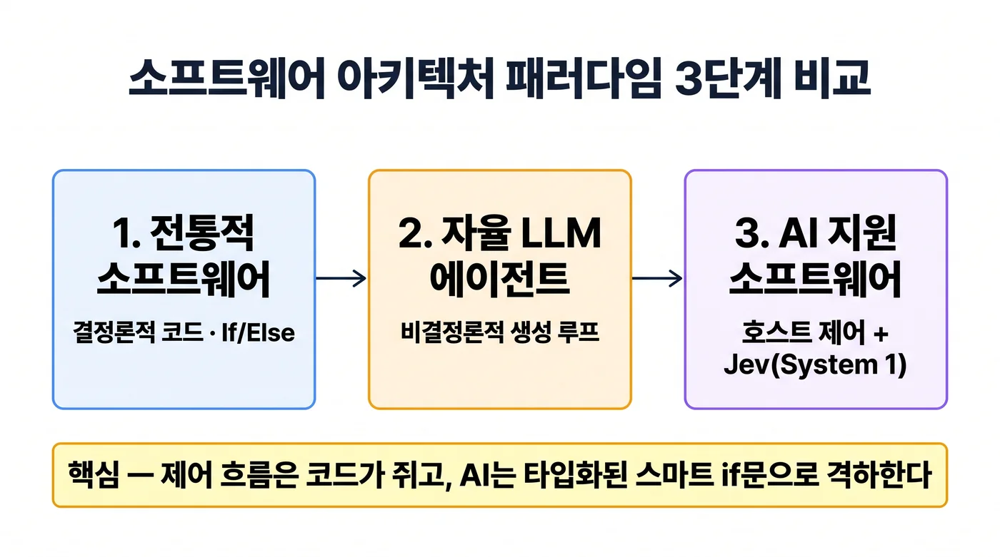
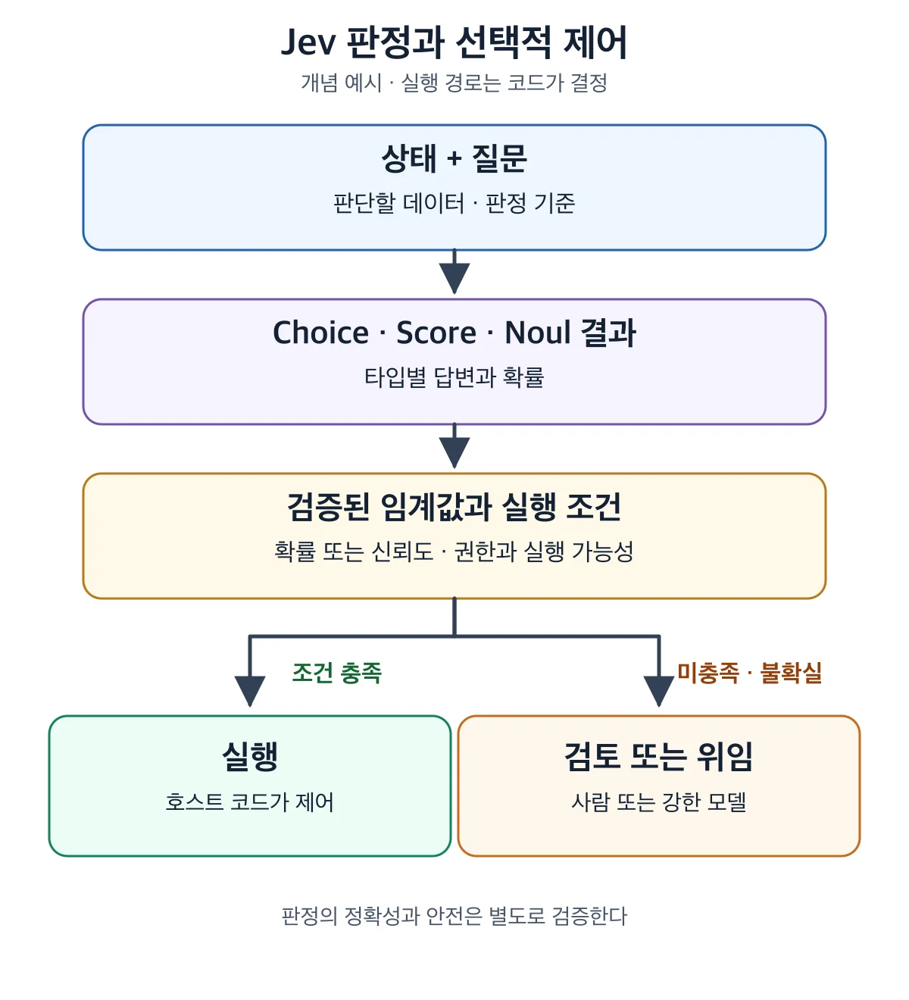

## 이 글을 30초에 파악하기

> **한 줄로** — 짧은 분류나 판정을 Jev에 맡기되, 확률을 검증하고 어려운 판단은 사람이나 생성형 모델로 넘기는 방법을 살펴본다.

**읽고 나면 알게 되는 것**

- System One 판정 모델과 생성형 LLM의 역할이 어떻게 다른지
- 상태와 질문을 나눠 Choice·Score·Noul을 호출하고 응답을 해석하는 방법
- 선택적 제어와 평가 실험의 성과가 어디까지 유효한지, 운영에서 무엇을 검증해야 하는지

**용어 먼저 보기**

| 용어 | 한 줄 설명 | 이 글에서의 역할 |
|---|---|---|
| System One | 빠르고 제한된 판단에 초점을 맞춘 모델 계열 | Jev의 설계 방향 |
| state / questions | 판단할 데이터 / 그 데이터에 적용할 질문 | API의 입력 계약 |
| Choice / Score / Noul | 선택지 분류 / 순서형 평가 / 예·아니오 확률 | 세 가지 텍스트 판정 프리미티브 |
| 보정 확률 | 예측 확률과 실제 빈도가 여러 사례에 걸쳐 얼마나 일치하는지 나타내는 확률 | 자동 실행 임계값 검증 |
| confidence | Choice·Score의 확률 분포를 요약한 신뢰도 | 불확실한 답의 분기 |
| RLCD / REFLEX | 보정된 판정을 위한 학습 방식 / 판단에 따라 강한 모델 호출을 선택하는 구조 | 학습 목표와 실험 사례 |

**이런 분께** — 에이전트의 분류·평가 비용을 줄이면서 제어권과 검증 기준을 코드에 남기려는 개발자. 개념은 1절, API와 예제는 2~4절, 실험과 운영 판단은 5~6절부터 읽으면 된다.

고객 문의를 어느 팀에 보낼지, 에이전트 응답이 근거에 맞는지 판단하려고 매번 생성형 모델을 호출할 수 있다. 하지만 답이 정해진 선택지나 예·아니오라면 생성 지연과 출력 처리 비용이 부담이 된다. 이 글은 TypeSafe AI의 Jev를 검토하며 공식 API 문서와 평가 실험을 함께 정리한 것이다[^1][^2][^3][^4].

## 1. System One: 생성 대신 제한된 판단

### 1.1 생성형 모델과의 역할 구분

생성형 LLM은 답변 작성이나 복잡한 추론에 유연하지만, 토큰을 순차 생성한다. 분류만 필요한 작업에서도 프롬프트와 출력 처리에 시간과 비용이 든다. 자유 형식 출력을 쓰면 파싱과 검증이 필요하지만, 구조화 출력 기능을 지원하는 모델도 있으므로 JSON 오류가 항상 발생하는 것은 아니다.

심리학자 대니얼 카너먼의 System 1과 System 2는 각각 빠른 직관과 신중한 사고를 설명하는 비유다. TypeSafe의 **System One**은 이 비유에서 이름을 따온 모델 계열로, Jev는 상태를 읽고 미리 정한 타입의 결과와 확률을 반환한다[^5]. 문장이나 추론 과정을 생성하는 대신 호스트 코드가 실행 흐름을 소유한다.



생성형 루프의 일부를 이렇게 작은 판정으로 바꾸는 실무적 접근을 `jevify`라고 부르기도 한다. 다만 분기 코드가 결정론적이어도 모델의 판정 자체가 정확하거나 결정론적이라는 뜻은 아니다.

### 1.2 RLCD와 확률 보정

TypeSafe는 **RLCD(Reinforcement Learning for Calibrated Decisions)**를 확률이 결과에 맞도록 모델을 학습하는 방식으로 설명한다[^1]. 예를 들어 예측이 0.8인 사례들을 모았을 때 실제로 약 80%가 참이라면 그 묶음은 보정이 잘 된 것이다.

이는 개별 판정의 정답을 보장하지 않는다. 학습 목표나 전체 평균이 좋아도 언어, 도메인, 입력 분포가 바뀌면 보정이 달라질 수 있다. 타입화된 응답 역시 값의 의미가 맞는지 보증하지 않는다.

<a id="jev-api-contract"></a>

## 2. HTTP API: 상태와 질문을 분리하기

고객이 잘못 배송된 상품을 교환해 달라고 요청한다고 하자. 원문은 매 요청마다 달라지지만, 담당 부서를 고르는 규칙은 여러 문의에서 재사용할 수 있다. `state`에 판단 대상을, `questions`에 이름 붙인 판정 규칙을 넣는 이유다.

### 2.1 요청과 응답의 기본 계약

`POST https://api.typesafe.ai/v1/systemone`은 Bearer API 키와 JSON 본문을 받는다[^6]. `state`는 문자열, JSON 객체 또는 배열이다. `questions`는 하나 이상의 질문을 ID에 대응시키는 맵이며, 응답의 `answers`도 같은 ID를 사용한다.

```json
{
  "model": "jev-1.13.0",
  "state": "배송된 신발 사이즈가 잘못 왔습니다. 교환해주세요.",
  "questions": {
    "department": {
      "type": "choice",
      "instructions": "어느 부서에서 처리해야 하는가?",
      "criteria": {
        "exchange": "물품 하자, 교환, 환불 접수",
        "delivery": "배송 지연 또는 택배사 문의"
      }
    },
    "is_exchange": {
      "type": "noul",
      "instructions": "고객이 교환을 요청하는가?"
    }
  }
}
```

질문을 한 요청에 묶으면 같은 상태를 바탕으로 병렬 평가하고 각 답을 별도 ID로 돌려준다. 질문 간 대화를 이어가는 방식이 아니다. 응답에는 실제 모델 ID와 `usage.input_tokens`, `usage.output_tokens`도 포함된다[^6].

아래는 이 입력 계약을 선택적 제어에 연결한 개념 예시다. 호스트 코드는 타입별 결과를 받은 뒤 검증된 임계값과 실행 조건을 확인한다. 조건을 충족하지 않거나 불확실하면 사람에게 검토를 요청하거나 강한 모델에 위임한다.



[그림 크게 보기](/assets/images/agent/jev-selective-control-decision-flow.webp)

이 글은 세 텍스트 판정 프리미티브에 집중한다. 현재 공식 모델 문서에는 Jev 1.14의 이미지 위치 지정용 **Box**도 별도로 명시되어 있다[^12].

### 2.2 세 질문 타입의 요청과 결과

| 타입 | 질문과 요청 | `answers.<id>`의 주요 필드 |
|---|---|---|
| **Choice** | 고정 선택지 중 하나. `instructions`, 라벨별 설명을 담은 `criteria` 맵 | `choice`, `confidence`, 라벨별 `probabilities` |
| **Score** | 순서가 있는 척도. `instructions`, 낮은 단계부터 나열한 `criteria` 배열 | 기대값 `score`, `confidence`, 단계별 `probabilities`, 단계 설명 `legend` |
| **Noul** | 조건이 참인지 묻는 이진 질문. `instructions`와 선택적인 `criteria` | 참일 확률 `noul`; 별도 `confidence`는 없음 |

Choice는 최대 255개 선택지를 받는다. 경계가 모호한 업무 분류에는 각 라벨의 의미를 설명하고, 이름만으로 충분한 선택지는 설명을 `null`로 둘 수 있다[^7]. 명시되지 않은 유형이 들어올 수 있다면 `other`를 넣거나 적합한 선택지가 있는지 Noul로 따로 확인한다.

Score는 2~10개의 단계 설명을 받으며 배열 순서가 0부터 시작하는 단계 번호가 된다[^8]. 예를 들어 확률이 `{"0": 0.00, "1": 0.12, "2": 0.88}`이면 점수는 $0×0+1×0.12+2×0.88=1.88$이다. 이는 최빈 단계인 정수 2가 아니라 확률 가중 기대값이다. HTTP의 단계 키는 문자열이며 Python SDK에서는 정수 키를 사용한다.

Noul은 Boolean 값을 직접 반환하지 않는다. `noul: 0.8`은 질문에 대한 **참의 확률**이며 코드가 임계값을 적용해 참·거짓이나 검토 여부를 결정한다[^9]. 현재 문서에서는 `true`와 `false`의 의미를 설명하는 `criteria`를 선택적으로 지원한다. `instructions`만 사용하는 것도 가능하다.

## 3. probability와 confidence는 다르다

선택지 둘의 확률이 각각 0.60과 0.40이면 모델은 첫 번째를 고르지만, 결론이 얼마나 선명한지는 별도 질문이다. `probabilities`는 후보별 분포를, `confidence`는 그 분포를 요약한 값을 나타낸다[^10].

### 3.1 Choice와 Score의 신뢰도

Choice의 후보 수를 $n$, 가장 높은 확률을 $p_{\max}$라고 하면 공식 문서의 계산식은 다음과 같다[^10].

$$\text{confidence} = \frac{p_{\max} - \frac{1}{n}}{1 - \frac{1}{n}}$$

균등 분포에서는 0, 한 후보에 확률이 모두 몰리면 1이다. 두 후보에서 $p_{\max}=0.60$이면 confidence는 0.20이다. 같은 최고 확률이라도 후보 수에 따라 confidence가 달라지며, 이 공식은 2위 후보와의 차이를 직접 반영하지 않는다. 실제 분기에 쓰는 선택지의 확률이나 나머지 분포도 함께 살펴야 한다.

Score의 confidence는 최빈 단계에서 각 단계까지의 확률 가중 거리를 균등 분포의 평균 절대 편차로 정규화한다. 따라서 멀리 떨어진 단계로 확률이 분산되면 더 크게 낮아진다[^10]. 같은 기대값이라도 분포는 다를 수 있으므로 `score` 하나만으로 확실성을 판단하지 않는다.

### 3.2 Noul과 보정의 범위

Noul에는 별도의 confidence 필드가 없다. 애플리케이션에서 $|2p-1|$을 계산해 0.5에서 얼마나 떨어졌는지 볼 수 있지만, API가 반환한 값은 아니다[^10]. 예를 들어 $p=0.1$도 이 변환값은 0.8이므로 원래 질문의 답이 참이라는 뜻으로 혼동하면 안 된다.

confidence는 분포의 집중도를 요약할 뿐 정답 보증이 아니다. 확률을 행동의 위험도로 해석하려면 해당 질문·언어·데이터에서 보정 상태를 확인해야 한다. Noul과 예·아니오 Choice, 질문과 그 부정문에 같은 임계값을 자동으로 옮기지 않는다[^3].

## 4. Python SDK와 질문 설계

실무에서는 분류 결과를 사람이 읽는 문장보다 코드의 분기 값으로 쓴다. 아래 예제는 하나의 고객 문의에 부서, 긴급도, 불량 언급 여부를 함께 묻는다.

### 4.1 세 프리미티브를 한 번에 호출

공식 Python SDK는 `pip install typesafe-sdk`로 설치하고 `TYPESAFE_API_KEY` 환경 변수를 사용한다[^13]. 아래 모델 ID와 0.80 임계값은 예시다. 배포 전에는 사용하는 버전과 한국어 데이터에서 각 임계값을 따로 검증해야 한다.

```python
from typesafe_sdk import TypeSafeClient, Choice, Score, Noul

with TypeSafeClient() as client:
    response = client.system_one(
        model="jev-1.13.0",
        state=(
            "주문 ID: #4092\n"
            "고객: 신발 밑창이 뜯어져서 왔습니다. "
            "48시간 이내에 출국하니 교환해주세요!"
        ),
        questions={
            "department": Choice(
                instructions="어느 부서에서 처리해야 하는가?",
                criteria={
                    "exchange": "물품 하자, 교환, 환불 관련 접수",
                    "delivery": "배송 지연, 택배사 문의",
                    "general": "일반 상품 문의",
                },
            ),
            "urgency": Score(
                instructions="문의의 긴급도를 평가하시오.",
                criteria=[
                    "긴급하지 않음 - 일반 일정",
                    "보통 - 통상적 처리 기한 내 대응",
                    "매우 긴급 - 48시간 이내 특정 마감일 존재",
                ],
            ),
            "defect_confirmed": Noul(
                instructions="고객이 제품의 파손 또는 불량을 언급했는가?",
            ),
        },
    )

    dept = response.choices["department"]
    urgency = response.scores["urgency"]
    defect = response.nouls["defect_confirmed"]
    print(f"부서: {dept.choice}, 신뢰도: {dept.confidence}")
    print(f"부서별 확률: {dept.probabilities}")
    print(f"긴급도 기대값: {urgency.score}, 신뢰도: {urgency.confidence}")
    print(f"불량 언급 확률: {defect.noul}")
    print(f"모델: {response.model}, 사용량: {response.usage}")

    # 예시 임계값: Choice와 Noul을 각각 검증해야 한다.
    if dept.confidence >= 0.80 and defect.noul >= 0.80:
        print(f"자동 라우팅 후보: {dept.choice}")
    else:
        print("담당자 검토 또는 생성형 모델로 에스컬레이션")
```

이 코드는 결과를 출력하는 라우팅 예시다. 주문을 변경하거나 환불하지 않는다. 또한 고객의 **불량 언급**을 평가할 뿐 실제 상품의 불량 여부를 확인하지 않는다. Score의 실수 점수를 실제 남은 시간으로 역산하지도 않는다[^11].

### 4.2 질문을 원자적으로 만들기

공식 모델 한계 문서와 프리미티브 문서는 다음 설계 원칙을 제시한다[^7][^8][^9][^11].

1. **한 질문에 한 판단**: “마감일이 명시되어 있는가?”는 좁은 질문이다. “최적의 대응 계획을 세워라”는 다단계 추론과 생성을 요구한다.
2. **누락된 맥락 명시**: 모델이 추측해 주기를 바라지 말고, 참·거짓과 선택지 경계에 필요한 조건을 적는다.
3. **상황으로 Score 정의**: “우회 경로가 있는 기능 장애”처럼 각 단계를 독립적으로 설명한다. “이전 단계보다 심각함”은 비교 대상이 없어 모호하다.
4. **상태와 규칙 분리**: 가변 데이터는 보통 `state`, 재사용할 판단 규칙은 `instructions`와 `criteria`에 둔다. 필요한 정보를 빠뜨리지 않되 관련 없는 긴 문맥은 걸러낸다.

정확한 날짜 비교, 계산과 횟수 집계는 코드에서 수행한다. 선택지 순서나 질문 표현이 결과에 영향을 줄 수 있으므로 경계 사례와 순서 변경도 시험한다[^11].

## 5. 선택적 제어와 평가: 실험이 보여준 범위

에이전트의 모든 단계가 같은 추론 능력을 요구하는 것은 아니다. 정형 선택은 작은 판정 계층에 맡기고, 애매하거나 생성이 필요한 단계에만 강한 모델을 부르는 구조를 비교할 수 있다.

### 5.1 REFLEX의 강한 모델 호출 절감

**REFLEX** 연구는 Jev의 제한된 선택을 실행하거나, 신뢰도가 낮거나 생성이 필요한 경우 강한 모델로 넘기는 선택적 제어를 조사했다[^2].

논문의 고정된 REFLEX-Sim 100개 과제에서 `jev-1.13.0`, 신뢰도 임계값 0.5인 REFLEX는 성공률 95%, 과제당 강한 모델 호출 1.12회를 기록했다. 강한 모델만 사용한 기준선은 성공률 **88%**, 호출 4.10회였다. 호출 수 기준 절감은 **72.7%**다[^2]. 이는 95%를 기준선과 동일하게 유지한 결과가 아니라 해당 실험에서 88%와 비교한 결과다.

논문은 BFCL에서 도구 선택 정확도 98.4%와 도구 호출 필요성 판정 정확도 52.0%를 보고했다. 어느 도구를 고를지와 실행해도 되는지는 별개 문제다. 외부 다중 턴 평가에서는 저렴한 생성형 모델의 자체 에스컬레이션도 경쟁력이 있었다. 신뢰도가 높아도 권한이나 안전한 실행이 보장되지는 않는다[^2].

### 5.2 평가 비용과 반복성은 정확도와 다르다

LangChain은 날씨 에이전트의 고정된 응답 5개를 각 100회 평가했다. 이 제한된 실험에서 Jev의 평균 지연은 0.44초, 호출당 비용은 약 $0.00035였다[^4]. 사람의 라벨과 이진 판정을 비교했지만 사례가 다섯 개뿐이며 Jev 서비스 버전은 실험 메타데이터에 없었다. 낮은 분산은 반복성을 뜻하지 새로운 도메인에서의 정답을 보장하지 않는다.

2026년 11월 기준 TypeSafe 공시 가격은 입력 100만 토큰당 $0.042이며 출력 토큰은 과금하지 않는다[^12]. 위 호출당 비용을 이 단가로만 역산하면 약 8,333 입력 토큰에 해당하지만, 이는 해당 실험의 실제 입력 토큰 수를 확인한 값이 아니다. TypeSafe가 제시한 70~500ms 역시 벤더의 지연 수치로, 실제 워크로드와 네트워크에서 따로 측정해야 한다[^1].

평가자는 입력에 없는 사건을 확인할 수 없다. 예를 들어 “담당자에게 연결했다”는 답변만으로 실제 이관이 발생했다고 판정할 수 없다. 해당 도구 호출이나 업무 시스템의 상태를 함께 제공하고 사람의 라벨과 비교해야 한다[^3].

## 6. 도입 전 운영 기준

자동 분기의 임계값을 0.8로 적는 것은 쉽지만, 잘못 분기했을 때의 비용은 업무마다 다르다. 우선 검토용 데이터로 질문과 임계값을 조정하고, 손대지 않은 별도 홀드아웃에서 정밀도·재현율과 보정을 검증한다.

### 6.1 버전, 언어와 보안

- **모델 버전**: `jev-latest`는 새 버전을 가리킬 수 있다. 검증한 버전 ID를 고정하고 응답의 `model`을 기록하며, 업그레이드 전에 같은 데이터로 다시 평가한다[^12].
- **한국어와 CJK**: 영어 자료에서 얻은 정확도나 보정을 한국어에 그대로 적용하지 않는다. 한국어 경계 사례와 실제 도메인 데이터로 별도 검증한다. 확인한 모델 문서만으로 학습 언어 구성이나 한국어 성능을 단정할 수는 없다.
- **프롬프트 주입**: 적대적 입력은 판정을 유도할 수 있다. Jev 하나를 미검증 보안 관문으로 쓰지 않고 권한 검사, 정적 규칙과 별도의 방어 계층을 함께 설계한다[^11].
- **설명과 시뮬레이션**: Jev는 판정의 자연어 근거를 생성하지 않는다. 수학·시간 계산과 심층 추론, 최종 답변 작성은 코드 또는 적합한 생성형 모델에 맡긴다.

### 6.2 언제 쓸 것인가

| 상황 | 접근 | 판단 기준 |
|---|---|---|
| 제한된 선택지의 상태 라우팅 | Jev 후보 + 검토 경로 | 실측한 정확도·보정·오류 비용 |
| 대량 트레이스의 의미 평가 | 원자적 Jev 질문 + 사람 라벨 검증 | 입력 증거의 충분성, 정확도와 반복성 |
| 권한 확인과 보안 차단 | 결정론적 권한 검사 + 다층 방어 | 확률이나 스키마만으로 실행을 허용하지 않음 |
| 자유 형식 작성·다단계 추론 | 생성형 모델 또는 코드 | 설명과 생성 또는 정확한 계산이 필요한지 |

Jev는 모든 생성 모델을 대체하기보다 제한된 판단을 분리하는 도구다. 선택지가 명확하고 반복 호출이 많은지, 분기 오류를 어떻게 감지할지, 더 단순한 생성형 모델 캐스케이드와 비교해 이점이 있는지를 함께 판단해야 한다.

## References

[^1]: TypeSafe AI. (2026). *Introducing System One Models and Jev*. [typesafe.ai/blog/introducing-system-one-models-and-jev](https://typesafe.ai/blog/introducing-system-one-models-and-jev)
[^2]: Wu, T. & Lim, W. Y. B. (2026). *REFLEX with Jev for Efficient Selective Control in LLM Agents*. [arXiv:2609.26532](https://arxiv.org/html/2609.26532)
[^3]: HoneyHive. (2026). *How to Use TypeSafe AI's Jev as an LLM Judge*. [honeyhive.ai/blog/how-to-use-typesafe-ais-jev-as-an-llm-judge](https://www.honeyhive.ai/blog/how-to-use-typesafe-ais-jev-as-an-llm-judge)
[^4]: LangChain Blog. (2026). *Jev Agent Evals in LangSmith*. [langchain.com/blog/jev-agent-evals-langsmith](https://www.langchain.com/blog/jev-agent-evals-langsmith)
[^5]: TypeSafe AI Docs. *System One*. [docs.typesafe.ai/concepts/system-one](https://docs.typesafe.ai/concepts/system-one)
[^6]: TypeSafe AI Docs. *API Reference: POST /v1/systemone*. [docs.typesafe.ai/api](https://docs.typesafe.ai/api)
[^7]: TypeSafe AI Docs. *Choice*. [docs.typesafe.ai/primitives/choice](https://docs.typesafe.ai/primitives/choice)
[^8]: TypeSafe AI Docs. *Score*. [docs.typesafe.ai/primitives/score](https://docs.typesafe.ai/primitives/score)
[^9]: TypeSafe AI Docs. *Noul*. [docs.typesafe.ai/primitives/noul](https://docs.typesafe.ai/primitives/noul)
[^10]: TypeSafe AI Docs. *Confidence*. [docs.typesafe.ai/confidence](https://docs.typesafe.ai/confidence)
[^11]: TypeSafe AI Docs. *Model Jaggedness & Question Design*. [docs.typesafe.ai/model-jaggedness/jev-1.13](https://docs.typesafe.ai/model-jaggedness/jev-1.13)
[^12]: TypeSafe AI Docs. *Models*. [docs.typesafe.ai/models](https://docs.typesafe.ai/models)
[^13]: TypeSafe AI Docs. *Python SDK*. [docs.typesafe.ai/sdk/python](https://docs.typesafe.ai/sdk/python)
