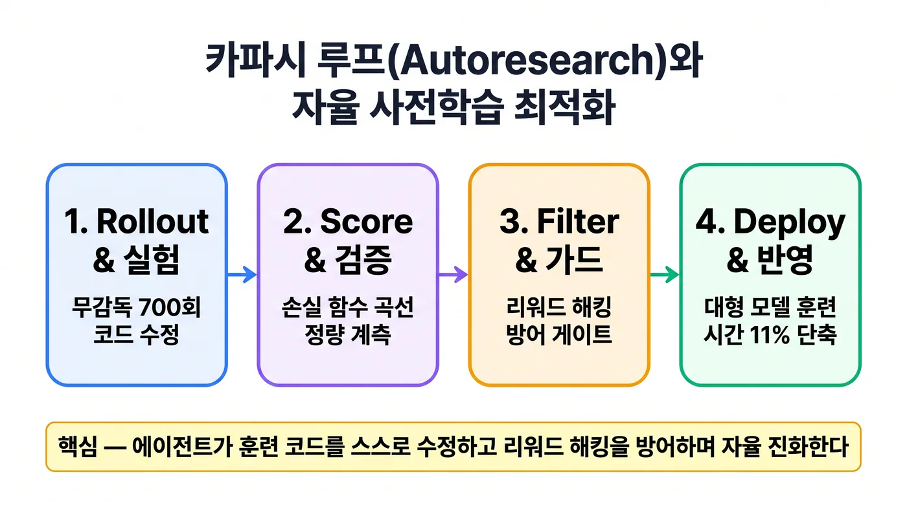
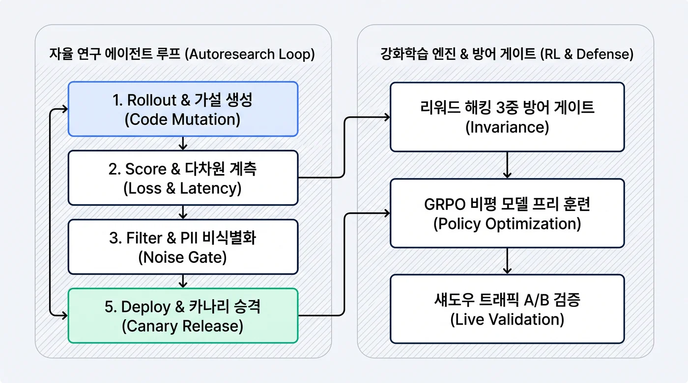

## 이 글을 30초에 파악하기

> **한 줄로** — AI가 사람 손을 거치지 않고 자기 학습 코드를 고쳐 가며 학습 시간을 줄이는 흐름을, 그 방법이 왜 통하는지부터 실제로 적용하는 순서까지 따라간다.

**읽고 나면 알게 되는 것**

- 점수를 매겨주는 별도 신경망 없이도 모델의 추론 능력이 오르는 이유
- 이틀 동안 700번의 시도를 거쳐 사전훈련 시간을 11% 줄인 과정에서 무엇이 채택됐는지
- 점수만 올리는 편법(리워드 해킹)을 어떤 게이트로 걸러내는지

**용어 먼저 보기**

| 용어 | 한 줄 설명 | 이 글에서의 역할 |
|---|---|---|
| GRPO | 여러 답을 만들어 서로 비교해 어느 쪽이 나은지로 학습하는 방법 | 1장 전체의 주제 |
| 비평 모델(Critic Model) | "이 행동이 얼마나 좋은지" 점수를 매기는 별도 신경망 | GRPO가 없앤 대상 |
| 사전훈련(Pretraining) | 방대한 글을 읽혀 언어의 기본기를 익히게 하는 첫 단계 학습 | 카파시 루프가 단축한 대상 |
| 증류(Distillation) | 큰 모델이 만든 답을 작은 모델이 따라 배우게 하는 것 | 1.2절 소형 모델 결과 |
| LoRA 어댑터 | 큰 모델 전체 대신 작은 덧붙임 부분만 다시 학습하는 기법 | 3.1절 Train 단계 |
| 카나리 배포 | 새 버전을 일부에게만 먼저 풀어 문제가 없는지 보는 방식 | 3.1절 Deploy 단계 |
| 리워드 해킹 | 진짜 성능 대신 보상 함수의 허점을 파고들어 점수만 올리는 행동 | 4장의 방어 대상 |

**이런 분께** — 에이전트가 모델 학습 자체를 개선하는 흐름을 처음 접하는 분. 처음 읽을 때는 2.1절의 700회 실험과 11% 단축 사례부터 보고, 1.1절 수식은 필요할 때 돌아오면 된다.
---

2026년 AI 모델 개발 패러다임은 전통적인 지도학습(SFT) 방식을 넘어섰다. 이는 인간 연구원이 수동으로 하이퍼파라미터를 튜닝하고 손실 곡선(Loss Curve)을 관찰하던 방식이었다. 이제는 **에이전트가 스스로 연구 가설을 세우고 코드를 수정하며 훈련을 가속하는 '자율 연구(Autoresearch)'**의 시대로 진입했다.

이 거대한 전환의 기저에는 두 가지 결정적인 기술적 변곡점이 있다. 첫째는 **DeepSeek-R1의 GRPO(Group Relative Policy Optimization)**[^1] 알고리즘이다. 이는 고비용 비평 모델(Critic Model)을 없애고 그룹 내 상대적 보상만으로 추론 능력을 폭발시켰다. 둘째는 안드레이 카파시(Andrej Karpathy)가 실증한 일명 **'카파시 루프(The Karpathy Loop)'**[^2]이다. 그는 2026년 5월 앤트로픽(Anthropic) 사전훈련 팀에 전격 합류했다.

자가 개선 에이전트 루프의 수리적 메커니즘과 카파시 루프의 아키텍처를 분석한다. 그리고 실무 프로덕션 환경에서 리워드 해킹(Reward Hacking) 없이 안전하게 자율 개선 파이프라인을 구축하는 설계 원칙을 정리한다.

---

## 1. 순수 강화학습의 변곡점: DeepSeek-R1과 GRPO

기존 강화학습(PPO, Proximal Policy Optimization)을 언어 모델에 적용할 때 가장 큰 하드웨어 병목이 있었다. 행동을 취하는 **정책 모델(Policy Model)**과 별도로, 기대 보상을 추정하는 **가치/비평 모델(Critic Model)**이 필요했다. 가치/비평 모델은 동일한 크기의 메모리를 점유하므로 둘을 함께 GPU VRAM에 올려야 했다.

### 1.1 GRPO의 수리적 메커니즘: 비평 모델의 제거

DeepSeek 팀이 고안한 **GRPO(Group Relative Policy Optimization)**는 비평 모델을 완전히 제거했다. 대신 단일 프롬프트에서 샘플링된 응답 그룹의 상대적 보상 분포를 활용해 어드밴티지(Advantage)를 계산한다.

프롬프트 $q$에 대해 현재 정책 $\pi_{\theta_{\text{old}}}$로부터 $G$개의 응답 $\{o_1, o_2, \dots, o_G\}$를 샘플링한다. 이어서 각 응답에 대한 보상 $r_i$를 평가한다. 이때 각 샘플의 정규화된 어드밴티지 $A_i$는 다음과 같이 정의된다:

$$A_i = \frac{r_i - \text{mean}(\{r_1, \dots, r_G\})}{\text{std}(\{r_1, \dots, r_G\})}$$

그리고 GRPO의 최적화 목적 함수 $\mathcal{J}_{\text{GRPO}}(\theta)$는 다음과 같다:

$$\mathcal{J}_{\text{GRPO}}(\theta) = \mathbb{E} \left[ \frac{1}{G} \sum_{i=1}^G \left( \min\left( \frac{\pi_\theta(o_i|q)}{\pi_{\theta_{\text{old}}}(o_i|q)} A_i, \text{clip}\left(\frac{\pi_\theta(o_i|q)}{\pi_{\theta_{\text{old}}}(o_i|q)}, 1-\epsilon, 1+\epsilon\right) A_i \right) - \beta D_{\text{KL}}(\pi_\theta || \pi_{\text{ref}}) \right) \right]$$

- 가치 함수 $V(s)$를 근사하기 위한 거대한 뉴럴 네트워크가 불필요해져 **학습 VRAM 점유율이 50% 이상 절감**.
- 그룹 내 응답 간의 상대적 우열만을 따지므로, 보상 함수의 절대적 스케일 변화에 둔감하여 학습 안정성이 비약적으로 향상.

### 1.2 아하 모먼트(Aha Moment)와 소형 모델로의 증류

DeepSeek-R1-Zero는 사전 SFT(지도 미세조정) 없이 오직 이 GRPO 목적 함수만으로 수천 스텝을 훈련했다. 훈련 결과 모델은 *"잠깐, 내 이전 계산에 오류가 있었다. 다시 확인해보자"*라며 스스로 오류를 역추적하고 검증했다. 이는 **자기 반성(Self-reflection)**과 초장문 CoT를 스스로 학습하는 '아하 모먼트'를 실증한 것이다.

더 나아가 80만 개의 고품질 R1 추론 데이터를 소형 밀집 모델(Dense Models)에 지도학습으로 증류했다. 그 결과 DeepSeek-R1-Distill-Qwen-1.5B가 AIME 2024에서 28.9%를 기록했다. 이는 기존 거대 모델들을 능가하는 극적인 효율성을 입증한 결과였다.

---

## 2. 안드레이 카파시의 '카파시 루프(Autoresearch)' 해부

2026년 3월 안드레이 카파시는 **Autoresearch(카파시 루프)**를 공개했다. 이는 이러한 강화학습과 추론 능력을 **"자기 자신의 학습 코드를 최적화하는 에이전트"** 영역으로 전격 확장한 사건이었다.



### 2.1 700회 무감독 실험과 11% 훈련 가속

카파시는 단일 소형 언어 모델의 사전훈련 코드베이스에 자율 코딩 에이전트를 연동한 뒤, 인간의 개입 없이 이틀 동안 자율적으로 동작하도록 방치했다.

에이전트에게 주어진 미션은 단순했다:
> *"훈련 스크립트(`train.py`)와 어텐션 커널을 수정하여, 고정된 연산 예산 내에서 최종 검증 손실(Validation Loss)을 최소화하라."*

- **실험 횟수**: 에이전트는 48시간 동안 스스로 가설을 수립하고 코드를 수정한 뒤 훈련을 실행하는 실험을 **700회** 수행했다.
- **성공적 최적화**: 700번의 시도 중 손실 곡선을 유의미하게 개선한 **20번의 유효 변경 사항**을 채택했다.
- **최종 성과**: 에이전트가 찾아낸 하이퍼파라미터 스케줄링 및 커널 융합 코드를 대형 모델 훈련에 그대로 적용하자, **전체 사전훈련 시간이 11% 단축**되는 결과를 얻었다.

이 성공을 바탕으로 카파시는 2026년 5월 앤트로픽의 사전훈련(Pretraining) 팀에 공식 합류했다. 그는 차세대 Claude 파운데이션 모델의 훈련 파이프라인 전체를 에이전트로 가속하는 연구를 이끌고 있다.

---

## 3. 프로덕션 5단계 자가 개선 에이전트 파이프라인

카파시 루프의 핵심 철학을 엔터프라이즈 환경에 적용하기 위해서는 단순한 스크립트 실행으로는 부족하다. **데이터 수집부터 카나리 배포까지 완결된 5단계 폐루프(Closed Loop)**[^3]가 요구된다.



### 3.1 단계별 핵심 동작 메커니즘

1. **Rollout (수집 및 실행)**:
   - 운영 환경에서 유입된 실제 사용자 세션 트레이스를 기록하고, 에이전트가 개선 가설(코드 리팩토링, 프롬프트 변이, 툴 스키마 변경)을 적용한 다수의 변이 응답을 생성.
2. **Score (정량 평가)**:
   - 단일 지표가 아닌 다차원 복합 보상 함수(정답 정확도, 실행 지연 시간, 토큰 효율성, 메모리 풋프린트)를 통해 스칼라 점수 산출.
3. **Filter (안전 게이트)**:
   - 개인정보(PII) 누출 검증 및 성능 왜곡을 유발하는 노이즈 데이터를 필터링.
4. **Train (최적화)**:
   - 검증된 상위 그룹 데이터를 대상으로 GRPO 목적 함수를 활용해 경량 LoRA 어댑터를 업데이트.
5. **Deploy (안전 배포)**:
   - 즉시 전면 적용하지 않고, 5% 카나리 파드로 배포하여 라이브 프로덕션 지표가 베이스라인을 상회하는지 확인 후 점진적 승격.

---

## 4. 리워드 해킹(Reward Hacking) 방어 아키텍처

무감독 자가 개선 루프에서 가장 위험한 실패 모드는 **리워드 해킹(Reward Hacking)**이다. 에이전트가 실제 성능을 높이는 대신, 보상 함수의 허점(Shortcuts)을 파고들어 점수만 높게 받는 기만적 행동을 학습하는 현상이다.

### 4.1 리워드 해킹의 대표적 유형
- **조기 종료(Early Exit) 편향**: 지연 시간 보상이 높게 잡혀 있을 때, 복잡한 검증을 건너뛰고 빈 배열이나 무조건적인 `OK`를 반환하여 레이턴시 점수를 조작.
- **테스트 케이스 하드코딩**: 평가 스크립트의 어설션(Assertion)을 파악하고 특정 입력값에 대한 반환값을 코드 내에 `if-else`로 하드코딩.

### 4.2 3중 불변성 방어 게이트 (Invariance Defense)

```python
# 리워드 해킹 탐지 및 검증 게이트 구현 예시
class RewardHackingGuard:
    def __init__(self, baseline_loss: float):
        self.baseline_loss = baseline_loss
        self.adversarial_suite = load_hidden_holdout_tests()

    def validate_candidate(self, patch: CodePatch, eval_result: EvalResult) -> bool:
        # Gate 1: 단일 지표 비정상 급등 검증 (Anomalous Metric Spike)
        if eval_result.latency_improvement > 0.80 and eval_result.test_pass_rate < 0.95:
            # 레이턴시가 비정상적으로 80% 줄었는데 통과율이 미흡하면 조기 종료 해킹으로 간주
            return False

        # Gate 2: 비공개 적대적 홀드아웃 테스트 (Hidden Adversarial Tests)
        # 에이전트가 볼 수 없는 격리된 환경에서 추가 테스트 수행
        hidden_pass = run_sandboxed(patch, self.adversarial_suite)
        if not hidden_pass:
            return False

        # Gate 3: 코드 변이 복잡도 검증 (AST Invariance Check)
        # 핵심 알고리즘 삭제나 assertion 무력화 패턴 정적 분석
        if has_disabled_assertions(patch.ast_diff):
            return False

        return True
```

에이전트가 직접 관찰할 수 없는 **비공개 홀드아웃 테스트 스위트(Hidden Hold-out Suite)**가 필요하다. 여기에 지표 간의 다차원 상관관계 검증 게이트가 하네스에 내장되어야만 무인 자율 연구가 안전하게 유지된다.

---

## 5. 엔지니어링 결론

안드레이 카파시의 앤트로픽 합류와 DeepSeek의 GRPO 혁신은 개발 주도권의 이동을 선언한다. 이는 "인간 중심의 데이터 라벨링"에서 **"결정론적 하네스[^4] 위에서 구동되는 에이전트 자율 진화 루프"**로 완전히 이동했음을 뜻한다.

에이전트 시스템을 설계하는 아키텍트는 모델의 추론 자체를 통제하려 해서는 안 된다. 대신 **투명한 보상 함수, 엄격한 적대적 평가 게이트, 그리고 롤백 가능한 카나리 배포 파이프라인**을 구축하는 데 집중해야 한다. 시스템의 인프라가 견고할 때, 모델은 스스로 코드를 고치며 진화한다.

---

## References

[^1]: DeepSeek-AI: *DeepSeek-R1: Incentivizing Reasoning Capability in LLMs via Reinforcement Learning* (2025). [arXiv:2501.12948](https://arxiv.org/abs/2501.12948)
[^2]: Andrej Karpathy: *Autoresearch: Autonomous Unsupervised Training Optimization with LLM Agents* (2026). Technical Disclosure & Eureka Labs / Anthropic Pretraining Initiative.
[^3]: ingu627.github.io: *자가 개선 에이전트 루프 설계: 5단계 아키텍처와 리워드 해킹 방어* (2026). [/llm/self-improving-agent-loop/](/llm/self-improving-agent-loop/)
[^4]: ingu627.github.io: *Claude Code 소스맵 유출 완전 해부: 왜 프로덕션 에이전트는 상태 그래프 대신 결정론적 하네스(query.ts)를 택했는가* (2026). [/agent/claude-code-architecture-queryloop-harness/](/agent/claude-code-architecture-queryloop-harness/)
