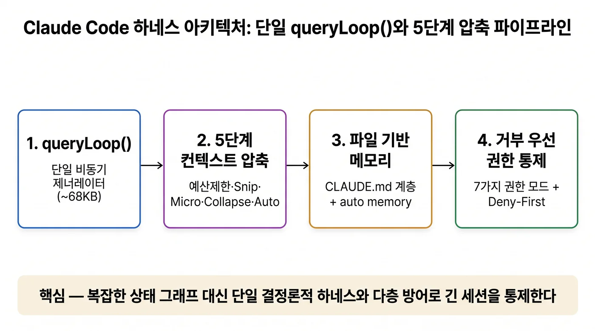
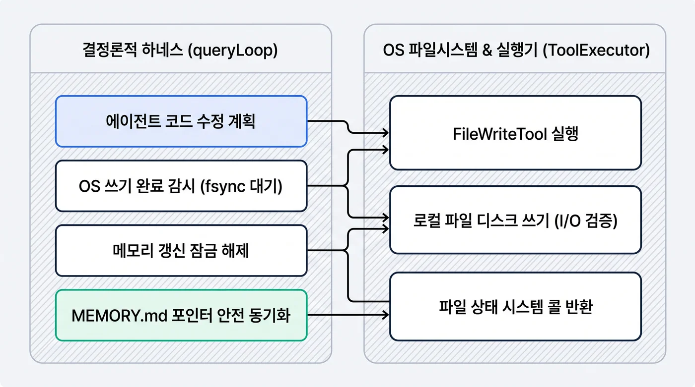

## 이 글을 30초에 파악하기

> **한 줄로** — AI 코딩 에이전트가 긴 작업을 수행할 때 길을 잃지 않고 터미널에서 안정적으로 일하게 만드는 제어 루프와 메모리 통제 구조를 배운다.

**읽고 나면 알게 되는 것**

- 복잡한 상태 그래프 프레임워크 없이 단일 루프(`queryLoop`)로 에이전트를 안정적으로 구동하는 이유
- 긴 대화와 도구 실행 결과가 쌓여도 모델이 길을 잃지 않게 제어하는 5단계 점진적 컨텍스트 압축 파이프라인
- 벡터 데이터베이스 대신 로컬 파일(`CLAUDE.md`, `MEMORY.md`)과 실제 파일 확인으로 환각을 줄이는 메모리 설계법
**용어 먼저 보기**

| 용어 | 한 줄 설명 | 이 글에서의 역할 |
|---|---|---|
| 하네스(Harness) | AI 모델 주변에서 도구 실행, 권한 검사, 메모리 관리를 통제하는 외곽 제어 프로그램 | 복잡한 프레임워크 대신 에이전트의 안정성을 책임지는 핵심 틀 |
| queryLoop() | 사용자 입력을 받아 모델을 호출하고 도구를 실행하는 과정을 반복하는 핵심 실행 루프 | Claude Code의 모든 작업 표면이 공통으로 사용하는 단일 심장부 |
| 컨텍스트 엔트로피 | 터미널 명령어 결과와 대화 기록이 쌓이면서 중요한 맥락이 흩어지는 현상 | 장기 실행 에이전트가 집중력을 잃고 실패하는 주된 원인 |
| 컨텍스트 압축 | 도구 출력 축소부터 요약까지 단계별로 토큰을 줄여 대화 길이를 관리하는 기법 | 긴 세션 중에도 토큰 한도를 방어하고 모델 추론 능력을 유지하는 5단계 파이프라인 |
| 회의적 메모리 | 메모리에 적힌 내용을 무조건 믿지 않고 실제 파일을 직접 읽어 확인하는 기억 원칙 | 벡터 데이터베이스 없이도 거짓 기억(환각)을 방지하는 메모리 규율 |
| 거부 우선(Deny-First) | 허용 설정이 있더라도 거부 규칙이 하나라도 있으면 실행을 막는 보안 원칙 | 7가지 권한 모드와 규칙 평가에서 위험한 명령어 실행을 차단하는 기본 기준 |
| 킬 스위치(Kill Switch) | 문제가 생겼을 때 서버에서 원격으로 특정 도구나 기능을 즉시 멈추는 비상 차단 장치 | 클라이언트 배포판에서 위험 동작을 실시간으로 차단하는 tengu 플래그 체계 |

**이런 분께** — AI 에이전트를 만들고 있지만 실행이 길어질수록 멈추거나 엉뚱한 출력을 내어 고민인 개발자. 처음 읽을 때는 1절과 3절을 먼저 살펴보고, 운영체제 제어와 보안 세부 사항은 4절에서 확인하면 된다.

---

2026년 AI 에이전트 엔지니어링 생태계에서 큰 기술적 관심을 모은 사건이 있었다. 앤트로픽(Anthropic)의 터미널 네이티브 코딩 에이전트인 **Claude Code** npm 패키지에 소스맵(Source Map)이 포함되어 내부 소스 구조가 노출된 일이었다. 이후 학술 연구진이 이를 체계적으로 분석한 연구 논문[^1]을 발표하며 프로덕션 에이전트의 실질적 설계 공간이 드러났다.

약 2,000개 TypeScript 파일로 구성된 Claude Code 코드베이스를 다룬 분석 리포트가 공유되면서, 현업 개발팀이 던져온 핵심 질문에 대한 실마리도 함께 제시되었다. 바로 **"프로덕션 코딩 에이전트는 어떻게 컨텍스트 붕괴를 제어하며 터미널 환경에서 코드를 리팩토링하는가?"**라는 질문이다.

분석 결과 확인된 핵심 설계는 명확하다. 복잡한 자율 상태 플래너나 무거운 상태 그래프(State Graphs)에 의존하지 않는다. 기저의 거대 언어 모델(LLM)을 무상태 추론 엔진(Stateless Reasoning Engine)으로 두고, 그 외곽을 견고한 **결정론적 하네스(Deterministic Agent Harness)**로 통제하는 방식을 택했다.
엔터프라이즈 에이전트 시스템을 설계하며 Claude Code의 핵심 루프와 메모리 통제 메커니즘을 분석하고, 실무에 적용할 수 있는 아키텍처 패턴을 정리해보았다.

---

## 1. 모놀리식 하네스(query.ts)와 단일 실행 루프

### 1.1 핵심 실행 루프 queryLoop() 엔진

Claude Code의 중심에는 에이전트 루프를 관장하는 `src/query.ts`가 자리 잡고 있다. 여러 진입 표면이 공유하는 이 단일 파일이 에이전트 전체의 실행 하네스 역할을 수행한다[^1].



대화형 CLI(`claude`), 백그라운드 CI 파이프라인(`claude -p`), Agent SDK, 데스크톱 환경 등 모든 진입 표면(Surface)은 동일한 코어를 거친다. 비대화형 진입점은 `QueryEngine`이라는 래퍼 클래스를 둘 뿐, 실제 턴 단위 실행은 공통으로 `query.ts` 안의 단일 `queryLoop()` 비동기 제너레이터 함수를 통한다.
```typescript
// Claude Code의 핵심 실행 루프 단순화 의사코드 (query.ts 기반)
export async function queryLoop(
  initialPrompt: string,
  context: AgentContext
): Promise<ExecutionSummary> {
  let messages = await initializeContext(initialPrompt, context);

  while (true) {
    // 1. 사전 실행 검증 및 컨텍스트 압축 임계값 감시
    if (estimateTokens(messages) > CONTEXT_COLLAPSE_THRESHOLD) {
      messages = await autoCompact(messages);
    }

    // 2. 무상태 LLM 호출 (시스템 프롬프트 + 직렬화된 히스토리)
    const stream = await callInferenceEngine({
      messages,
      systemPrompt: buildSystemPrompt(context),
      tools: getAvailableTools(context)
    });

    const response = await processStream(stream);

    // 3. 종료 조건 검사
    if (response.isDone || !response.toolCalls.length) {
      return buildSummary(messages);
    }

    // 4. 결정론적 도구 실행 (권한 계층 통제)
    const toolResults = await executeToolsWithStreaming(
      response.toolCalls,
      context.permissions
    );

    // 5. 히스토리 동기화 및 쓰기 후 메모리 검증
    messages.push(createAssistantMessage(response));
    messages.push(createToolResultMessage(toolResults));
    await syncSkepticalMemory(toolResults);
  }
}
```

표면 계층은 단순히 터미널 UI 렌더링 방식만 변경할 뿐이다. 도구 호출, 에러 재시도, 권한 평가, 메모리 기록의 모든 상태 전이는 단 하나의 결정론적 `while(true)` 루프가 통제한다.

### 1.2 상태 머신(State Graph) 프레임워크를 배제한 이유

많은 오픈소스 에이전트 프레임워크들이 노드(Node)와 엣지(Edge)로 이루어진 복합 상태 그래프를 통해 에이전트의 경로를 인위적으로 강제한다. 하지만 Claude Code의 아키텍처는 이를 정면으로 부정한다.

- **프레임워크 제약의 역효과**: 모델의 지능과 추론 능력이 높아질수록, 개발자가 사전에 설계한 정적 상태 머신은 복잡한 실제 터미널 환경(예: 컴파일 에러 후 로그 분석 중 의존성 누락 발견)에서 에이전트의 적응력을 가로막는 장애물이 된다.
- **하네스 집중 원칙**: 모델의 사고 자유도는 단일 루프 안에서 열어두되, **도구 실행 권한, 다층 컨텍스트 압축, 메모리 무결성, OS 쓰기 검증**이라는 외곽 인프라를 체계적으로 구축하는 데 집중했다.
---

## 2. 점진적 컨텍스트 압축: 5단계 컴팩션 파이프라인

장기 실행 에이전트가 실패하는 주된 원인은 토큰 총량 제한만이 아니다. 도구의 원시 출력(Raw Output)이 누적되면 **컨텍스트 엔트로피(Context Entropy)**와 어텐션 희석(Attention Dilution)이 발생해 모델이 이전 지시를 망각하거나 엉뚱한 결정을 내리기 쉽다.

Claude Code는 단일 압축 방식(단순 FIFO 삭제나 즉각적인 전체 요약)에 의존하지 않는다. 비용이 낮고 손실이 적은 가공부터 점진적으로 적용하는 **5단계 컴팩션 파이프라인(Compaction Pipeline)**을 매 턴 모델 호출 전에 순차 가동한다[^1].

### 2.1 5단계 점진적 압축 파이프라인

| 압축 단계 | 적용 메커니즘 | 처리 내용 및 특징 | 엔지니어링 목적 |
|---|---|---|---|
| **Stage 1: 결과 예산 제한 (Budget Reduction)** | `applyToolResultBudget()` | 도구 출력 크기 상한을 초과한 대용량 stdout/텍스트를 참조 포인터로 치환 | 개별 도구의 비정상적 토큰 폭발 방지 |
| **Stage 2: 가벼운 잘라내기 (Snip)** | `snipCompactIfNeeded()` (HISTORY_SNIP 플래그) | 오래된 대화 구간의 세부 내역을 가볍게 트리밍하고 경계 마커 기록 | 시간적 깊이에 따른 토큰 회수 |
| **Stage 3: 마이크로컴팩트 (Microcompact)** | 캐시 인식형 압축 (CACHED_MICROCOMPACT) | 도구 ID 기준으로 프롬프트 캐시 경계를 보존하며 세밀하게 출력 축소 | 프롬프트 캐시 적중률 유지 및 토큰 절감 |
| **Stage 4: 컨텍스트 축약 투영 (Context Collapse)** | `applyCollapsesIfNeeded()` (CONTEXT_COLLAPSE) | 원본 히스토리를 파괴하지 않고 REPL 히스토리 위에 축약된 읽기 전용 뷰 투영 | 전체 이력 복원력을 유지하며 모델 입력 절감 |
| **Stage 5: 시맨틱 요약 (Auto-compact)** | `compactConversation()` (compact.ts) | 앞선 4단계 이후에도 임계치를 초과할 때 모델을 호출해 대화를 압축 요약 | 긴 세션의 컨텍스트 한도 방어 |

공식 문서[^5]와 논문 분석[^1]에 따르면, 이러한 점진적 파이프라인 덕분에 긴 리팩토링 세션에서도 세션 전체를 끊지 않고 작업 맥락을 이어갈 수 있다. 다만 모델 요약을 거치는 5단계(Auto-compact)는 추가 토큰 호출 비용이 발생하므로, 상위 1~4단계에서 불필요한 토큰 낭비를 먼저 걷어내는 계층화가 필수적이다.
---

## 3. 회의적 메모리(Skeptical Memory) 아키텍처: 벡터 RAG의 종말

에이전트에게 영구 메모리를 부여할 때 흔히 사용되는 방식은 RAG 파이프라인이다. "모든 대화와 코드 조각을 벡터 데이터베이스(Vector DB)에 임베딩하고 유사도 검색(k-NN)으로 불러오는" 방식을 쓴다. 하지만 Claude Code는 이 방식을 완전히 배제했다.

### 3.1 파일 기반 계층 메모리(CLAUDE.md)와 자동 메모리(MEMORY.md)

Claude Code는 고가의 벡터 데이터베이스 대신, 개발자가 쉽게 검수하고 버전 관리할 수 있는 마크다운 파일 기반 메모리 체계를 채택했다[^1][^6].

1. **CLAUDE.md 4단계 계층**: 관리자 정책, 사용자 전역 설정(`~/.claude/`), 프로젝트 공유 규칙(`./`), 로컬 개인 설정(`./CLAUDE.local.md`) 순으로 적재된다.
2. **자동 메모리(Auto Memory)**: 세션 중 학습한 선호도와 특이사항을 프로젝트별 `MEMORY.md`에 기록하며, 세션 시작 시 첫 200줄 또는 25KB 한도 내에서 적재된다[^6].

```markdown
<!-- Claude Code 로컬 자동 메모리(MEMORY.md) 구조 예시 -->
# Persistent Memory
- auth_flow: Auth tokens use RS256 in src/auth/jwt.ts; never use HS256 (verified 2026-10-18)
- build_command: Use `pnpm run build:prod` instead of npm; requires Node >= 22.0
- db_pool: Postgres max connections capped at 20 in src/config/database.ts
```

- **간결한 포인터 권장**: 공식 문서와 실무 지침에서는 불필요한 컨텍스트 낭비를 줄이기 위해 파일당 200줄 이내의 간결한 포인터 형태 유지를 권장한다.
- **회의적 원칙 (Skeptical Principle)**: 시스템 프롬프트는 에이전트에게 로컬 메모리나 지침이 과거 기록일 수 있으므로 맹신하지 말고, 코드를 수정하기 전 반드시 실제 파일을 직접 읽어서 검증하도록 지시한다[^1].
### 3.2 엄격한 OS 파일 쓰기 검증 규율 (Strict Write Discipline)

에이전트가 환각(Hallucination)에 빠지는 가장 흔한 시나리오가 있다. "내가 파일을 이렇게 수정했다"고 메모리에 기록했으나 실제 디스크 I/O가 실패했거나 다른 프로세스에 의해 롤백되었을 때가 대표적이다.

Claude Code 하네스는 이를 방지하기 위해 엄격한 쓰기 규율을 강제한다:



에이전트는 계획이나 의도를 메모리에 기록할 수 없다. 오직 **로컬 운영체제가 파일 디스크 쓰기 성공을 시스템 콜 수준에서 반환한 직후**에만 메모리 갱신 도구를 호출할 수 있다.

---

## 4. 다층 보안 거버넌스와 거부 우선(Deny-First) 권한 체계

실제 로컬 파일시스템과 셸에서 임의의 명령을 실행하는 에이전트는 단 한 번의 오작동으로도 소스코드나 시스템에 치명적인 영향을 줄 수 있다. 연구 리포트[^1]와 공식 문서[^7]에 따르면, Claude Code는 단일 게이트가 아닌 다층 방어(Defense in Depth) 구조를 갖추고 있다.

### 4.1 빌드 타임 제거: 부재를 통한 보안 (Security Through Non-Existence)

외부 배포용 npm 패키지를 빌드할 때, 앤트로픽은 Bun 번들러의 데드코드 제거(Dead-Code Elimination)를 극한으로 활용한다.

```typescript
// 빌드 타임 조건 분기
if (feature("WEB_BROWSER_TOOL") && process.env.USER_TYPE === "ant") {
  // 앤트로픽 내부 연구원 전용 브라우저 자동화 및 REPL 도구
  registerInternalTool(WebBrowserTool);
  registerInternalTool(REPLTool);
}
```

빌드 플래그가 `false`이면 내부 전용 위험 도구의 코드 블록 자체가 컴파일된 JS 바이너리에서 문자 그대로 삭제된다. 따라서 공격자가 런타임 환경변수를 조작하거나 프로토타입 오염을 시도하더라도, 실행할 코드 자체가 바이너리에 존재하지 않으므로 원천 방어가 가능하다.

### 4.2 서버 사이드 실시간 킬 스위치 (`tengu_`)

보안 사고나 이상 동작이 감지되었을 때, 클라이언트 업데이트를 기다리지 않고 즉시 기능을 차단할 수 있도록 GrowthBook 기반의 피처 플래그 시스템이 상시 가동된다.

- `tengu_amber_quartz_disabled`: 특정 하위 도구의 긴급 비활성화
- `tengu_bypass_permissions_disabled`: 권한 우회 옵션 전역 무효화
- `tengu_auto_mode_config.enabled`: 자율 실행 오토 모드의 서킷 브레이커 작동
- `tengu_sessions_elevated_auth_enforcement`: 민감 디바이스 세션 토큰 재인증 강제

### 4.3 7가지 권한 모드와 거부 우선(Deny-First) 평가

Claude Code 코드베이스의 권한 타입 정의에는 총 7가지 권한 모드가 존재한다[^1]:

- **외부 공개 5개 모드**: `plan`, `default/manual`, `acceptEdits`, `dontAsk`, `bypassPermissions`
- **조건부 및 내부 모드**: 백그라운드 ML 분류기 기반의 `auto` 모드, 서브에이전트 권한 위임용 내부 전용 `bubble` 모드

권한 판정은 8단계 우선순위 소스를 거쳐 평가된다:
`userSettings` > `projectSettings` > `localSettings` > `flagSettings` > `policySettings` > `cliArg` > `command` > `session`

- **거부 우선 원칙 (Deny-First)**: 하위 계층이나 규칙에서 `allow`를 주었더라도, 상위나 동일 범위의 `deny` 규칙이 하나라도 일치하면 즉시 차단된다. 예컨대 `Bash(git push *)`가 거부되어 있다면 `Bash(*)` 허용 규칙이 있더라도 실행되지 않는다.
- **미인식 작업의 인간 에스컬레이션**: 안전성이 검증되지 않았거나 인식되지 않은 위험 명령은 묵인되지 않고, 터미널 사용자에게 명시적 승인(`ask`)을 요청하도록 설계되어 있다.
---

## 5. 엔터프라이즈 에이전트 구축 시사점 및 트레이드오프

Claude Code의 소스맵 해독이 우리에게 주는 엔지니어링 시사점은 명확하다.

### 5.1 에이전트 시스템 엔지니어링 4대 원칙
1. **상태 그래프 프레임워크에 매몰되지 말라**: 복잡한 그래프를 그리는 대신, 단일 무한 루프(`while(true)`) 주위에 견고한 입출력 가드와 복구 인프라를 구축하라.
2. **벡터 RAG를 만병통치약으로 쓰지 말라**: 에이전트의 장기 기억은 사용자 검수와 버전 관리가 가능한 마크다운 파일(`CLAUDE.md`, `MEMORY.md`)로 유지하고, 실행 직전 파일시스템을 직접 읽어 사실을 확인(Grounding)하게 하라.
3. **점진적 컨텍스트 압축 파이프라인을 구축하라**: 대용량 도구 출력 제어(Budget)부터 마이크로컴팩트, 시맨틱 요약(Auto-compact)에 이르는 단계별 압축 체계 없이는 긴 세션이 반드시 불안정해진다.
4. **보안은 빌드 타임부터 런타임까지 다층으로 격리하라**: 번들러의 데드코드 제거를 통한 미배포 도구 원천 격리, 원격 킬 스위치, 그리고 거부 우선 권한 정책을 결합하라.

이 원칙들은 코드-퍼스트 에이전트 설계론[^2], 무인 자가 개선 루프의 검증 게이트 설계[^3], 그리고 역공학용 결정론적 파이프라인[^4]에 이르기까지 이어진다. 모델의 능력과 무관하게 호스트 코드가 제어 흐름과 무결성 검증을 쥐어야 한다는 동일한 엔지니어링 명제로 수렴한다.

### 5.2 솔직한 트레이드오프 (Honest Tradeoffs)
- **단일 루프 하네스의 유지보수 복잡도**: `query.ts`와 주변 서비스 모듈에 도구 스트리밍, 에러 복구, 권한 검사가 얽혀 있어 포괄적인 회귀 테스트(Regression Test) 스위트 없이는 확장이 까다롭다.
- **시맨틱 압축(Auto-compact)의 추가 토큰 비용**: 규칙 기반 압축 단계를 넘어서 전체 대화 요약 단계에 도달하면 별도의 모델 요약 호출이 발생하므로 보조 토큰 비용이 든다.
---

*이 글은 소스맵 분석을 바탕으로 한 코어 루프와 메모리 구조에 집중한다. 2026년 하네스의 도구·권한 계층은 [Claude Code 하네스 런타임 2026](/agent/claude-code-harness-runtime-2026/)에서 이어진다.*

## References

[^1]: Jiacheng Liu, Xiaohan Zhao, Xinyi Shang, and Zhiqiang Shen: *Dive into Claude Code: The Design Space of Today’s and Future AI Agent Systems* (2026). [arXiv:2604.14228](https://arxiv.org/abs/2604.14228)
[^2]: TypeSafe AI Official Blog: *Stop Paying for Tokens When You Need Decisions: Kahneman's System 1 for Code-First Agents* (2026). [https://typesafe.ai/blog](https://typesafe.ai/blog)
[^3]: ingu627.github.io: *자가 개선 에이전트 루프 설계: 5단계 아키텍처와 리워드 해킹 방어* (2026). [/llm/self-improving-agent-loop/](/llm/self-improving-agent-loop/)
[^4]: ingu627.github.io: *바이너리에서 런타임까지: REA와 TypeSafe Jev를 활용한 결정론적 역공학 파이프라인* (2026). [/agent/rea-reverse-engineering-with-typesafe-jev/](/agent/rea-reverse-engineering-with-typesafe-jev/)
[^5]: Anthropic: *How Claude Code works: The agentic loop, built-in tools, and context* (2026). [https://code.claude.com/docs/en/how-claude-code-works](https://code.claude.com/docs/en/how-claude-code-works)
[^6]: Anthropic: *How Claude remembers your project: CLAUDE.md files and auto memory* (2026). [https://code.claude.com/docs/en/memory](https://code.claude.com/docs/en/memory)
[^7]: Anthropic: *Configure permissions: Permission rules, modes, and managed policies* (2026). [https://code.claude.com/docs/en/permissions](https://code.claude.com/docs/en/permissions)
