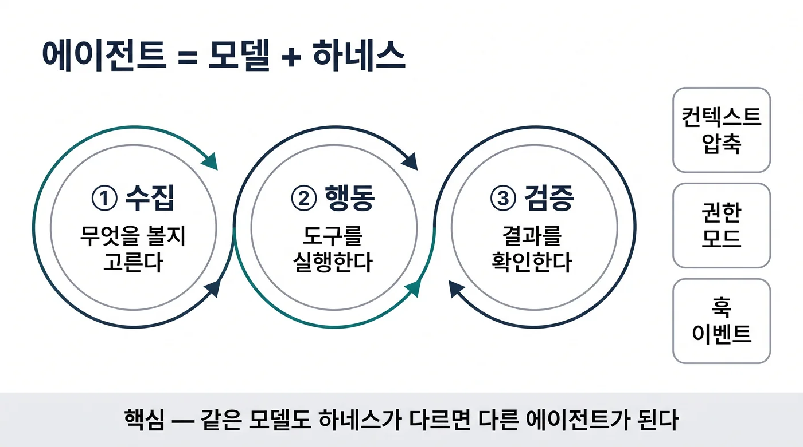

## 이 글을 30초에 파악하기

> **한 줄로** — 코딩 에이전트는 모델이 내린 판단을 하네스가 도구 실행, 컨텍스트 관리, 권한 검사로 연결하는 반복 시스템이다.

**읽고 나면 알게 되는 것**

- 공식 문서의 수집 → 행동 → 검증 루프와 소스 분석 논문의 `queryLoop()`가 어떻게 연결되는지
- 캐싱, 점진적 컨텍스트 축소, 파일 기반 메모리가 각각 무엇을 보존하고 무엇을 놓칠 수 있는지
- 거부 우선 규칙, 훅, 자동 승인 분류기와 선택적 OS 샌드박스의 적용 범위와 한계

**용어 먼저 보기**

| 용어 | 한 줄 설명 | 이 글에서의 역할 |
|---|---|---|
| 하네스(Harness) | 모델 주변에서 도구 실행과 컨텍스트를 관리하는 런타임 | 모델의 판단과 실제 시스템 사이를 연결한다 |
| `queryLoop()` | 논문이 분석한 모델 호출과 도구 실행의 반복 루프 | 에이전트의 제어 흐름을 보여준다 |
| 프롬프트 캐싱 | 요청의 일치하는 접두사를 재사용하는 방식 | 반복 입력의 비용과 지연을 줄인다 |
| 컴팩션 | 긴 대화 기록을 요약하거나 축소하는 방식 | 컨텍스트 압박에 대응하되 세부 내용은 잃을 수 있다 |
| 회의적 메모리 | 저장된 기록을 힌트로 삼고 현재 상태를 다시 확인하는 실무 원칙 | 오래된 메모리를 사실로 오인할 위험을 줄인다 |
| 훅과 샌드박스 | 이벤트에 반응하는 설정과 셸 프로세스의 OS 격리 | 서로 다른 경계에서 실행을 제어한다 |

**이런 분께** — 장시간 실행되는 코딩 에이전트의 루프와 운영 경계를 설계하려는 엔지니어. 전체 흐름은 1절, 컨텍스트와 메모리는 2절, 권한과 격리는 4절에서 살펴본다.

이 글은 2026년 10월 10일 공개된 논문 v3의 **Claude Code v2.1.88 소스 스냅샷**과 2026년 11월 28일 확인한 공식 문서를 구분해 읽는다[^18]. 논문의 내부 구현이 이후 버전에도 그대로 존재하거나 모든 배포판에서 활성화된다는 뜻은 아니다. 릴리스별 수치는 해당 버전을 따로 밝힌다.

---

## 1. 모델의 판단을 실행으로 연결하는 루프

실패한 테스트를 고치라는 요청을 받았을 때 모델은 파일을 읽고 테스트를 실행하자고 제안할 수 있다. 하지만 파일을 열고 프로세스를 띄우며 결과를 다시 전달하는 일은 모델 바깥의 런타임이 맡는다.



공식 문서는 모델 주변의 도구와 컨텍스트 관리 계층을 **하네스(harness)**라고 부른다[^1]. 모델은 다음 행동을 결정하고, 하네스는 권한과 실행 환경에 따라 해당 요청을 처리한다.

### 1.1 gather-context → act → verify와 queryLoop

공식 설명의 세 단계는 **컨텍스트 수집 → 행동 → 결과 검증**이다[^2]. 실제 작업에서는 이 단계들이 섞인다. 예를 들어 테스트 실패를 확인한 뒤 파일을 읽고 수정하며, 다시 테스트 결과를 보고 경로를 바꾼다.

독립 연구 논문은 v2.1.88의 `query.ts`에서 비동기 제너레이터인 `queryLoop()`를 분석했다[^18]. 논문에 따르면 대화형 CLI, `claude -p`, SDK 등 여러 진입점이 공통 루프로 연결된다. 비대화형 `QueryEngine`은 그 주위의 래퍼다. 모델 호출과 도구 결과의 반복은 단순하지만 권한, 복구, 컨텍스트 처리 코드는 그 주위에 놓인다.

논문의 컨텍스트 축소 방식과 권한 모드는 분석 당시 구현에 관한 관찰이다. 공개 권한 모드와 내부 모드의 차이는 4절에서 구분한다.

### 1.2 핵심 루프 의사코드

다음은 논문에서 관찰한 흐름을 설명하기 위해 단순화한 의사코드다[^18]. 실제 API 시그니처나 제품 소스의 복사본이 아니며 스트리밍, 병렬 처리, 중단과 오류 복구는 생략했다.

```typescript
async function queryLoop(initialPrompt: string, context: AgentContext) {
  let messages = await initializeContext(initialPrompt, context);

  while (true) {
    messages = await shapeContext(messages);
    const stream = await callInferenceEngine({
      messages,
      systemPrompt: buildSystemPrompt(context),
      tools: getAvailableTools(context)
    });
    const response = await processStream(stream);
    messages.push(createAssistantMessage(response));

    if (!response.toolCalls.length) {
      return buildSummary(messages);
    }

    const toolResults = await executeToolsWithStreaming(
      response.toolCalls,
      context.permissions
    );
    messages.push(createToolResultMessage(toolResults));
  }
}
```

권한 검사는 도구 요청을 실행하기 전에 이뤄진다. 루프가 단순하다는 것은 도구 실행이나 모델의 판단이 모두 결정론적이라는 뜻이 아니다. 논문이 관찰한 구조에서는 모델이 작업 경로를 선택하고 호스트 코드가 실행 절차와 제약을 관리한다.

명시적인 상태 그래프는 승인 절차나 정해진 단계가 중요한 작업에 유용할 수 있다. 반대로 자유로운 탐색이 필요한 코딩 작업에는 단일 루프가 유연할 수 있다. 어느 쪽이 항상 우월하다는 비교 실험은 이 논문의 범위가 아니다.

### 1.3 SDK의 턴과 메시지

Agent SDK는 세션 시작의 `SystemMessage`와 모델의 `AssistantMessage`, 도구 결과를 담는 `UserMessage`를 전달한다. 도구 호출이 없으면 최종 응답과 사용량을 담은 `ResultMessage`로 마친다. 컴팩션 경계는 별도 시스템 이벤트로 전달된다[^3].

SDK 문서는 읽기 전용 도구는 병렬로 실행할 수 있고 `Edit`, `Write`, `Bash` 같은 상태 변경 도구는 순차 처리한다고 설명한다. `max_turns`와 `max_budget_usd`로 실행을 제한할 수 있으며 둘 다 기본값은 무제한이다. 예산은 응답 후 사용량으로 확인하므로 마지막 호출 비용만큼 한도를 넘을 수 있다[^3].

---

## 2. 컨텍스트 관리: 캐싱, 점진적 축소와 파일 기반 메모리

긴 리팩토링에서 대용량 테스트 로그를 반복해 읽으면 앞서 정한 제약이 요약에서 빠질 수 있다. 큰 창을 제공하는 것과 필요한 사실이 살아남는 것은 별개의 문제다.

### 2.1 캐싱의 세 계층과 무효화

공식 문서는 요청을 자주 변하지 않는 내용부터 세 계층으로 설명한다[^4].

| 계층 | 주요 내용 | 흔한 변경 시점 |
|---|---|---|
| 시스템 프롬프트 | 기본 지침과 도구 정의 | 도구 정의가 변경될 때 |
| 프로젝트 맥락 | 루트 `CLAUDE.md`, 자동 메모리, 범위 없는 규칙 | 시작, `/clear`, `/compact` 후 |
| 대화 기록 | 사용자 메시지, 응답과 도구 결과 | 매 턴 |

캐시는 요청의 **일치하는 접두사(prefix)**를 재사용한다. 앞부분이 바뀌면 바뀐 지점 이후를 다시 처리한다. 모델을 전환해도 새 모델의 캐시가 필요하다. 루트 `CLAUDE.md`를 세션 중 수정한 내용은 `/clear`, `/compact` 또는 재시작으로 다시 읽는다[^4].

2026년 11월 확인한 문서에서 구독 포함 사용량의 주 대화 캐시는 기본 1시간, API 키와 클라우드 제공자는 기본 5분이다. 보조 요청과 사용 크레딧은 별도 조건이 적용되며 TTL을 설정으로 바꿀 수 있다[^4].

### 2.2 논문이 관찰한 다섯 가지 컨텍스트 축소

논문은 v2.1.88에서 모델 호출 전에 다음 다섯 처리를 순서대로 검토한다고 설명한다[^18]. 캐싱의 세 계층은 **요청을 어떻게 재사용하는지**에 관한 것이고, 아래 다섯 단계는 **모델에 보낼 기록을 어떻게 줄이는지**에 관한 것이다.

| 논문 속 처리 | 동작 | 적용 조건과 한계 |
|---|---|---|
| 결과 예산 제한 | `applyToolResultBudget()`이 큰 도구 결과를 내용 참조로 대체한다 | 런타임 플래그와 도구별 제한에 좌우된다 |
| Snip | `snipCompactIfNeeded()`가 오래된 기록 일부를 잘라낸다 | `HISTORY_SNIP` 플래그가 필요하다 |
| Microcompact | 오래된 도구 결과를 세밀하게 줄인다 | 시간 기반 경로가 있고 캐시 인식 경로는 `CACHED_MICROCOMPACT` 조건부다 |
| Context collapse | 전체 REPL 기록 대신 축약된 읽기 시점 뷰를 모델에 제공한다 | `CONTEXT_COLLAPSE` 조건부이며 원본 배열을 직접 바꾸는 방식과 다르다 |
| Auto-compact | 여전히 임계값을 넘으면 모델이 대화 요약을 만든다 | 별도 모델 호출과 요약 손실이 발생한다 |

논문 자체가 빌드·런타임 플래그와 설정에 따른 차이를 명시한다. 따라서 다섯 항목을 **모든 세션에서 실제 축소가 발생하는 필수 5단계**나 최신 제품의 공개 계약으로 읽으면 안 된다. 공식 문서는 자동 요약과 복원 범위를 설명하지만 위 내부 파이프라인의 고정을 보장하지 않는다[^5][^18].

### 2.3 자동 요약 이후에 남는 것

2026년 11월 공식 모델 설정 문서는 네이티브 1M 창의 기본 자동 컴팩션을 약 967K 토큰으로 설명한다. 모델, 제공자, 설정에 따라 다르며 `autoCompactWindow`나 `/autocompact`로 조정할 수 있다[^6]. 모든 모델이 1M 창을 기본 제공하는 것은 아니다.

컴팩션 후 시스템 프롬프트, 루트 지침과 자동 메모리는 다시 적용된다. 호출한 스킬 본문은 스킬당 5,000토큰, 합계 25,000토큰 한도에서 재주입된다. 최근 읽거나 수정한 파일은 최대 5개까지 다시 읽되 5,000토큰이 넘으면 경로만 참조할 수 있다. 경로별 규칙과 하위 디렉터리 지침은 필요할 때 다시 로드된다[^5].

백그라운드 명령과 하위 에이전트는 계속 실행될 수 있지만, 이전 대화의 상세 지시와 훅 출력은 요약에 묻혀 사라질 수 있다. `/compact`에 보존할 관점을 지정하고 `/context`로 사용량을 확인한다. 유휴 컴팩션 역시 조건부 동작이며 캐시 만료를 막는 보장은 아니다[^4][^5].

### 2.4 파일 기반 메모리와 회의적 검증

논문은 사람이 읽고 수정할 수 있는 파일 기반 구성을 강조한다[^18]. 공식 문서에서 `CLAUDE.md`는 관리자, 사용자, 프로젝트, 로컬 범위의 지침이고 `MEMORY.md`는 자동 메모리가 켜져 있을 때 세션을 넘어 유지되는 학습 기록이다. 시작 시 `MEMORY.md`의 첫 200줄 또는 25KB 중 먼저 도달하는 범위를 읽는다[^7].

다음은 실제 저장소의 설정이나 측정이 아닌 가상의 메모리 형식이다.

```markdown
# Persistent Memory
- auth_flow: 인증 구현은 `src/auth/jwt.ts`를 확인한다.
- build_command: 배포 빌드 명령은 프로젝트 설정에서 확인한다.
- db_pool: 연결 제한은 `src/config/database.ts`에서 확인한다.
```

파일은 검토와 버전 관리가 쉽지만 오래될 수 있다. 따라서 **회의적 메모리**란 기록을 사실의 최종 근거가 아니라 탐색 포인터로 보고, 변경 전 현재 파일과 실행 결과를 다시 확인하는 운영 원칙이다. 파일 메모리의 장점이 벡터 검색이 불필요하거나 환각이 사라진다는 뜻은 아니다.

파일 쓰기가 성공해도 이후 롤백이나 다른 프로세스의 변경을 막지는 못한다. 중요한 결과는 현재 파일과 테스트 결과로 다시 확인해야 한다.

`CLAUDE.md`와 메모리는 모델에 제공되는 지침이지 강제 정책이 아니다. 실제 차단은 권한 규칙이나 적절히 구성한 훅 등 별도의 실행 경계에서 담당한다[^7][^19].

---

## 3. 도구와 훅: 확장 지점과 실행 결과

에이전트가 셸 명령을 제안하면 그 요청을 표시하고, 실행 전 차단하며, 실행 결과를 기록할 지점이 필요하다. 도구와 훅은 이 지점들을 제공하지만 설정하지 않은 검사를 대신해 주지는 않는다.

### 3.1 도구 실행과 출력 제한

`Read`, `Edit`, `Write`는 파일 작업을, `Bash`는 명령 실행을, `Agent`는 별도 컨텍스트의 하위 작업을 담당한다. MCP 서버는 외부 도구를 추가한다[^8][^10]. 이전 글의 45개 활성 도구와 33개 훅은 문서 행을 세던 시점의 수치로, 모든 세션에서 사용할 수 있는 고정 개수가 아니다. 현재 레퍼런스에는 제거된 `TaskOutput`과 조건부 도구도 함께 표시된다[^8].

`Edit`은 정확한 문자열 일치와 유일성 등을 확인한다. 읽기 전 편집 제한은 모델과 조건에 따라 달라 모든 모델에 동일하게 적용되는 것은 아니다[^8].

공식 문서의 기본 포그라운드 `Bash` 타임아웃은 120초, 기본 최대치는 600초다. 무인 세션의 백그라운드 명령은 기본 30분, 최대 2시간이며 대화형 로컬 세션은 해당 제한이 없다. 출력이 5GB를 넘으면 프로세스가 종료된다. 정상 출력의 인라인 기본 크기는 약 30,000자이고 더 크면 경로와 미리보기를 전달한다. 실패 출력은 별도 절삭 규칙을 따른다[^8].

MCP 도구 스키마는 지원 모델과 설정에 따라 필요할 때 로드할 수 있다. 임계값 모드 `auto`에서는 정의 크기가 컨텍스트의 10% 이상이면 도구 검색을 켠다. 도구를 미루는 방식과 기본값은 제공자에 따라 다르다[^10]. 관련 패턴은 [MCP 에이전트 아키텍처 패턴 분석](/llm/mcp-agent-architecture-patterns/)에서 다룬다.

### 3.2 훅으로 검증 게이트 만들기

`PreToolUse` 훅은 도구 실행 전에 차단하거나 입력을 검사할 수 있고, `PostToolUse`는 실행 후 결과를 다룬다. `Stop`과 `SubagentStop`은 응답이나 하위 에이전트의 종료 시점에 개입한다[^9].

명령형 훅이 `Stop`에서 종료 코드 2를 반환하면 종료를 막고 피드백을 전달해 작업을 계속하게 할 수 있다. 다만 훅이 등록되어 실행되고 검사 결과를 올바르게 해석해야 한다. 훅의 실패와 타임아웃 처리는 이벤트별로 다르므로 이를 테스트 통과의 무조건적 보장으로 볼 수 없다[^9].

명령·HTTP·MCP 훅의 기본 타임아웃은 대부분 600초다. `UserPromptSubmit`과 `PreModelSwitch`는 기본 30초이며 `SessionEnd`는 기본 1.5초다. 종류와 설정에 따라 달라지므로 운영 시 해당 이벤트의 계약을 확인한다[^9].

---

## 4. 거부 우선 권한과 선택적 샌드박스

승인 창이 너무 자주 나타나면 사용자는 내용을 살피지 않고 승인하기 쉽다. 그렇다고 자동 승인을 켠 것만으로 시스템 전체가 격리되는 것은 아니다.

### 4.1 일곱 가지와 여섯 가지 권한 모드는 무엇이 다른가

논문의 v2.1.88 분석에서는 외부 모드 다섯 가지, 조건부 `auto`, 하위 에이전트의 내부 상향용 `bubble`을 합쳐 타입 정의상 최대 일곱 가지를 셌다[^18]. 2026년 11월 확인한 공식 사용자 문서는 `default`, `acceptEdits`, `plan`, `auto`, `dontAsk`, `bypassPermissions` **여섯 가지 공개 모드**를 설명한다[^11]. 내부 `bubble`은 일곱 번째 사용자 선택지라는 뜻이 아니다.

규칙은 **거부(deny) → 질의(ask) → 허용(allow)** 순서로 평가하며, 같은 호출에 일치하는 거부가 있으면 더 구체적인 허용으로 예외를 만들 수 없다[^19]. 예를 들어 `Bash(git push *)` 거부는 같은 형식의 호출에 `Bash(git *)` 허용이 있어도 우선한다.

다만 셸 규칙은 명령 문자열을 매칭한다. `git -C . push`처럼 다른 형태로 실행한 같은 프로그램까지 그 규칙 하나로 차단하지는 못한다. 공식 문서도 이를 프로그램 자체의 보안 경계로 간주하지 말라고 경고한다[^19]. `default`의 확인, `dontAsk`의 거부, `auto`의 분류기 심사는 서로 다른 동작이다.

### 4.2 자동 승인 분류기와 남는 위험

공식 문서에 따르면 v2.1.283부터 대화형 터미널과 VS Code 세션은 조건을 충족할 때 `auto`로 시작할 수 있다. 설정, 조직 정책, 제공자와 인터페이스에 따라 달라지며 `claude -p`와 Agent SDK는 기본적으로 `default`로 시작한다[^11].

Anthropic의 2026년 연구 설명에서 입력 측 탐지기는 의심스러운 도구 출력에 경고를 붙인다. 출력 측에서는 일부 안전 도구와 프로젝트 내부 파일 편집을 먼저 허용하고 나머지 호출을 별도 분류기가 심사한다. 분류기는 사용자 메시지와 도구 호출을 보되 도구 결과와 어시스턴트의 설명은 제외한다[^12]. 이 설명은 연구 시점의 설계이며 모든 버전·호출이 동일한 분류기를 통과한다는 보장은 아니다.

분류기의 빠른 1단계는 위험 가능성을 걸러내고, 표시된 호출만 2단계 추론으로 재검토한다. Anthropic의 내부 트래픽 10,000건에서 오탐률은 8.5%에서 0.4%로 줄었다. 그러나 실제 과잉 행동 52건에서는 전체 파이프라인의 미탐률이 17%였다. 합성 유출 시도 1,000건에서는 미탐률이 5.7%였다[^12]. 이는 벤더의 제한된 평가 결과이지 독립 실측이나 모든 작업의 안전률이 아니다.

같은 연구는 분류기가 연속 3회 또는 총 20회 거부하면 사람에게 제어권을 넘기고, 비대화형 실행에서는 프로세스를 종료한다고 설명한다[^12]. 고위험 배포나 외부 공유에는 정확한 대상과 범위를 사람이 검토하는 절차가 여전히 필요하다.

### 4.3 OS 샌드박스의 실제 경계

셸 샌드박스는 기본적으로 꺼져 있으며 활성화하면 macOS의 Seatbelt, Linux와 WSL2의 bubblewrap 및 socat을 사용한다. 선택적 seccomp 필터는 유닉스 소켓 제한을 더한다. 샌드박스 내부 프로세스의 파일 및 네트워크 접근은 설정된 OS 경계와 프록시를 따른다[^13].

이 경계는 **셸 명령과 그 자식 프로세스**에 적용된다. `Read`, `Edit`, `Write`, `WebFetch`, 로컬 MCP 서버와 훅은 밖에서 실행된다. 기본 읽기 범위에는 자격 증명 파일이 포함될 수 있고, 제외 명령이나 승인된 비샌드박스 재시도도 별도로 고려해야 한다. 의존성이 없어 샌드박스를 시작하지 못할 때도 기본 설정에서는 비격리 실행으로 넘어갈 수 있다[^13].

필수 격리가 필요하다면 `sandbox.enabled`, `sandbox.failIfUnavailable`, `sandbox.allowUnsandboxedCommands`와 제외 목록을 함께 검토한다. 전체 프로세스와 MCP까지 한 경계에 넣으려면 컨테이너나 VM 같은 바깥 격리도 고려한다. v2.1.314의 `permissions.blockWritesOutsideWorkingDirectories`는 `Write`, `Edit`, `NotebookEdit`에 적용되지만 셸·MCP·훅의 모든 쓰기를 막지는 않는다[^11][^13].

### 4.4 빌드 플래그와 원격 제어를 해석하는 법

논문은 v2.1.88의 일부 기능이 빌드 플래그에 따라 제거될 수 있다고 설명한다. 예를 들어 `TRANSCRIPT_CLASSIFIER`가 꺼진 빌드에서는 관련 모듈이 빠질 수 있다[^18]. 다음은 그 원리를 보여주는 개념 코드이지 제품의 실제 등록 함수가 아니다.

```typescript
if (feature("TRANSCRIPT_CLASSIFIER")) {
  registerClassifier();
}
```

코드를 배포하지 않는 것은 해당 코드 경로의 공격 표면을 줄이는 설계다. 그러나 모든 빌드에서 특정 도구가 제거됐거나 다른 경로로 우회할 수 없다고 증명하지는 않는다. 릴리스 노트에도 기능 플래그 설정이 등장하지만, 이전 글에서 열거한 특정 `tengu_` 플래그가 실제 보안 킬 스위치라는 주장은 확인하지 못했다[^15].

---

## 5. 하네스의 효과를 측정할 때

모델을 바꾸지 않고 도구 출력을 줄이면 결과가 좋아질까? Anthropic은 여러 평가에서 하네스 구성의 영향을 보고했지만, 워크로드와 모델이 서로 다르므로 수치를 같은 실험의 비교 결과로 묶으면 안 된다.

### 5.1 벤더가 보고한 벤치마크

다음은 Anthropic의 2026년 4월 하네스 설계 글에 실린 결과다[^14]. Claude Code 전체의 생산성을 직접 측정한 결과가 아니라 각 평가 환경에 대한 벤더 보고다.

| 평가 환경과 기법 | 적용 전 | 적용 후 | 조건 |
|---|---|---|---|
| BrowseComp의 도구 출력 자체 필터링 | 45.3% | 61.6% | Opus 4.6이 코드 실행으로 필요한 출력만 전달 |
| BrowseComp-Plus의 메모리 폴더 | 60.4% | 67.2% | Sonnet 4.5의 파일 기반 메모리 사용 |
| BrowseComp의 하위 에이전트 | 최고 단일 에이전트 대비 | 2.8% 향상 | Opus 4.6이 하위 에이전트를 생성 |

같은 글은 BrowseComp 컴팩션 실험에서 Sonnet 4.5의 43%, Opus 4.5의 68%, Opus 4.6의 84%를 보고한다[^14]. 이는 모델이 다른 비교이므로 도구 출력 제어만의 효과나 컴팩션에서 보존된 정보의 비율로 해석할 수 없다.

### 5.2 릴리스와 운영 비용

2026년 11월 6일 릴리스인 v2.1.319의 변경 기록에는 기능 개선 16건과 버그 수정 90건이 명시돼 있다[^15]. 같은 버전의 npm 메타데이터는 패키지의 압축 해제 크기를 202,387바이트로 기록하며 플랫폼별 선택적 의존성 8개를 나열한다[^16]. 이 크기는 전체 네이티브 바이너리의 크기가 아니다. 버전 번호 319만으로 업데이트가 정확히 319회였다고 셀 수도 없다.

Anthropic의 비용 가이드는 기업 배포에서 활성 개발자당 평균 하루 약 13달러, 월 150~250달러, 사용자 90%의 활성일 비용이 30달러 미만이라고 제시한다[^17]. 모델, 사용량과 과금 방식에 따라 달라지는 벤더 집계이므로 자체 파일럿의 토큰 사용량과 청구액으로 예산을 세워야 한다.

---

## 한계와 트레이드오프

단일 루프는 진입점을 단순하게 유지하지만 스트리밍, 오류 복구, 권한 검사와 상태 관리가 주변 모듈에 얽힌다. 기능이 늘수록 회귀 테스트와 관찰성이 중요하다[^18].

요약은 추가 모델 호출 비용을 만들고 중요한 세부 사항을 잃을 수 있다. 큰 도구 출력이 요약 직후 다시 창을 채우면 자동 컴팩션이 여러 번 실패한 뒤 중단될 수도 있다[^2]. 긴 세션에서는 도구 출력을 필요한 범위로 줄이고, 중요한 결정을 디스크에 남긴 뒤 현재 상태를 재확인한다.

분류기와 훅은 지연을 추가할 수 있고, 샌드박스는 필요한 네트워크나 빌드 경로를 차단할 수 있다. 반대로 편의를 위해 허용 범위나 비격리 재시도를 넓히면 보호 범위가 줄어든다. 명령 패턴, 경로, 플러그인과 외부 시스템을 포함해 실제 경계를 검토해야 한다.

## 정리

공식 문서의 수집 → 행동 → 검증 루프와 논문의 `queryLoop()`는 모델 판단과 호스트 실행을 나눠 보여준다. 캐시 재사용, 조건부 컨텍스트 축소와 파일 기반 메모리는 긴 작업을 돕지만, 기록의 완전한 보존을 보장하지 않는다.

거부 우선 규칙, 훅, 분류기와 선택적 샌드박스는 서로 다른 범위를 다룬다. 어떤 경계가 켜져 있고 무엇이 그 밖에서 실행되는지 확인하는 것이 개수만 세는 것보다 중요하다. 관련 설계는 [자가 개선 에이전트의 검증 게이트](/llm/self-improving-agent-loop/)와 [결정론적 역공학 파이프라인](/agent/rea-reverse-engineering-with-typesafe-jev/)에서도 살펴볼 수 있다[^20][^21][^22].

---


## References

[^1]: Anthropic Claude Code Glossary: *Harness and Agent Architecture Definitions* (2026). https://code.claude.com/docs/en/glossary
[^2]: Anthropic Claude Code Documentation: *How Claude Code Works* (2026). https://code.claude.com/docs/en/how-claude-code-works
[^3]: Anthropic Agent SDK Documentation: *Agent Loop and Message Lifecycle* (2026). https://code.claude.com/docs/en/agent-sdk/agent-loop
[^4]: Anthropic Claude Code Documentation: *Prompt Caching Architecture* (2026). https://code.claude.com/docs/en/prompt-caching
[^5]: Anthropic Claude Code Documentation: *Context Window and Compaction Mechanics* (2026). https://code.claude.com/docs/en/context-window
[^6]: Anthropic Claude Code Documentation: *Model Configuration and Auto-compact Boundaries* (2026). https://code.claude.com/docs/en/model-config
[^7]: Anthropic Claude Code Documentation: *Memory Management Guidance* (2026). https://code.claude.com/docs/en/memory
[^8]: Anthropic Claude Code Documentation: *Tools Reference* (2026). https://code.claude.com/docs/en/tools-reference
[^9]: Anthropic Claude Code Documentation: *Hooks Reference* (2026). https://code.claude.com/docs/en/hooks
[^10]: Anthropic Claude Code Documentation: *Model Context Protocol (MCP) Integration* (2026). https://code.claude.com/docs/en/mcp
[^11]: Anthropic Claude Code Documentation: *Permission Modes* (2026). https://code.claude.com/docs/en/permission-modes
[^12]: Anthropic Research: *Claude Code Auto Mode Deep Dive* (2026). https://www.anthropic.com/research/claude-code-auto-mode
[^13]: Anthropic Claude Code Documentation: *Sandboxing Architecture* (2026). https://code.claude.com/docs/en/sandboxing
[^14]: Anthropic Engineering Articles: *Harnessing Claude's Intelligence* (2026). https://claude.com/resources/articles/harnessing-claudes-intelligence
[^15]: Anthropic Claude Code Changelog: *Release Notes v2.1.319* (2026). https://code.claude.com/docs/en/changelog
[^16]: npm Registry: *@anthropic-ai/claude-code 2.1.319 Package Metadata*. https://registry.npmjs.org/@anthropic-ai/claude-code/2.1.319
[^17]: Anthropic Claude Documentation: *Cost Management and Usage Recommendations* (2026). https://code.claude.com/docs/en/costs
[^18]: Jiacheng Liu, Xiaohan Zhao, Xinyi Shang, Zhiqiang Shen: *Dive into Claude Code: The Design Space of Today’s and Future AI Agent Systems*, arXiv v3 (2026-10-10), v2.1.88 스냅샷 분석. https://arxiv.org/abs/2604.14228v3
[^19]: Anthropic Claude Code Documentation: *Configure permissions* (2026-11-28 확인). https://code.claude.com/docs/en/permissions
[^20]: TypeSafe AI Official Blog: *Stop Paying for Tokens When You Need Decisions: Kahneman's System 1 for Code-First Agents* (2026). https://typesafe.ai/blog
[^21]: ingu627.github.io: *자가 개선 에이전트 루프 설계: 5단계 아키텍처와 리워드 해킹 방어* (2026). [/llm/self-improving-agent-loop/](/llm/self-improving-agent-loop/)
[^22]: ingu627.github.io: *바이너리에서 런타임까지: REA와 TypeSafe Jev를 활용한 결정론적 역공학 파이프라인* (2026). [/agent/rea-reverse-engineering-with-typesafe-jev/](/agent/rea-reverse-engineering-with-typesafe-jev/)
 
공식 문서는 2026년 11월 28일 확인했으며 이후 변경될 수 있다. 논문의 v2.1.88 관찰, 특정 릴리스 기록과 현재 문서의 사용자 동작은 각각 기준 시점이 다르다.