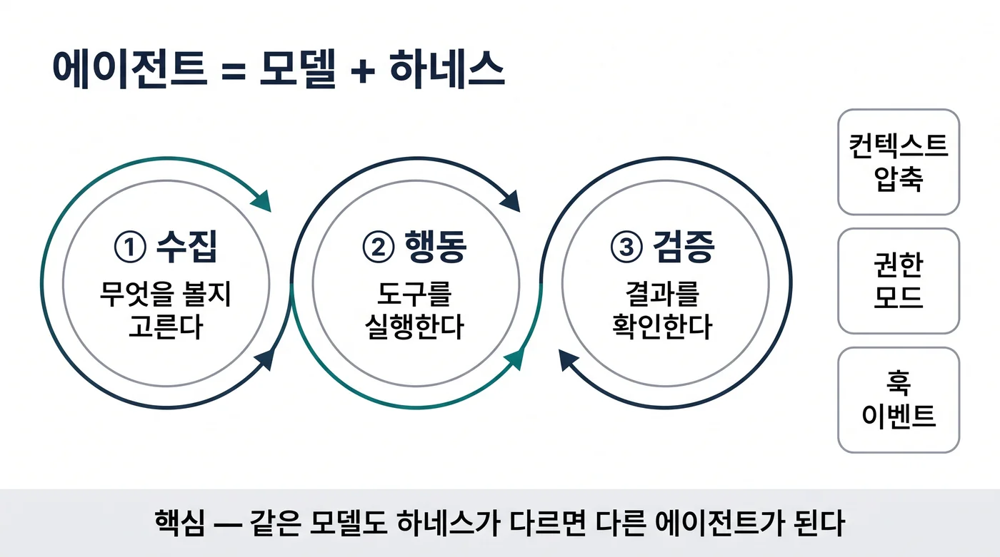

## 이 글을 30초에 파악하기

> **한 줄로** — 인공지능 모델 자체보다 모델을 감싸고 도구 실행, 메모리 압축, 보안을 통제하는 하네스 런타임이 에이전트의 완성도를 결정한다.

**읽고 나면 알게 되는 것**

- Claude Code가 정보 수집부터 검증까지 이어지는 3단계 루프를 무상태 API 환경에서 턴 단위로 어떻게 유지하는지
- 1M 토큰 창을 효율적으로 관리하기 위한 프롬프트 캐싱 계층과 컴팩션 이후에도 생존하는 데이터의 범위
- 45개 내장 도구, 33개 훅 이벤트, 6가지 권한 모드와 OS 수준 샌드박스가 안전한 자율 실행을 보장하는 구조

**용어 먼저 보기**

| 용어 | 한 줄 설명 | 이 글에서의 역할 |
|---|---|---|
| 하네스(Harness) | 언어 모델을 실제 작업 가능한 에이전트로 구동하는 도구·컨텍스트·실행 환경 런타임 | 글 전체의 분석 대상이자 핵심 주제 |
| 에이전트 루프(Agent Loop) | 정보 수집, 행동 실행, 결과 검증을 반복하며 작업을 완수하는 제어 흐름 | 1장에서 다루는 핵심 동작 메커니즘 |
| 프롬프트 캐싱(Prompt Caching) | 변하지 않는 시스템 지침과 프로젝트 맥락을 재사용해 비용과 지연을 줄이는 기법 | 2장에서 다루는 컨텍스트 비용 제어 기법 |
| 컴팩션(Compaction) | 컨텍스트 창 상한에 도달했을 때 핵심 맥락만 요약하고 나머지를 정리하는 압축 메커니즘 | 2장에서 장기 세션을 유지하는 핵심 기술 |
| 훅(Hook) | 에이전트 수명주기의 특정 이벤트 발생 시 결정론적 규칙을 실행하는 제어점 | 3장에서 확장을 통제하는 결정론적 게이트 |
| 오토 모드(Auto Mode) | 별도의 분류기 모델이 도구 호출의 위험도를 판정해 자동 승인 여부를 결정하는 권한 모드 | 4장에서 안전과 편의를 절충하는 제어 계층 |
| 샌드박스(Sandbox) | 셸 명령어와 파일 접근이 호스트 시스템을 침범하지 못하도록 격리하는 OS 수준 보호막 | 4장에서 다루는 최종 인프라 방어선 |

**이런 분께** — 터미널 기반 AI 코딩 도구의 내부 동작 구조를 이해하고 자체 에이전트 런타임을 설계하려는 엔지니어. 처음 읽을 때는 1장과 2장의 컨텍스트 제어 흐름을 먼저 확인하고, 4장의 권한 및 샌드박스 파이프라인을 살펴보면 된다.

---

## 1. 에이전트의 본질: '모델 + 하네스' 루프와 턴 수명주기

터미널에서 명령어 한 줄을 입력했을 때 에이전트가 코드를 스스로 탐색하고 수정하며 테스트까지 실행한다. 그 과정을 지켜보면 인공지능 모델 혼자 모든 복잡한 작업을 처리하는 것처럼 보인다.

공식 문서가 정의하는 에이전트의 공식은 명확하다. 바로 **에이전트 = 모델 + 하네스(agent = model + harness)**다[^1]. 여기서 하네스는 언어 모델을 유능한 코딩 에이전트로 전환하는 도구, 컨텍스트 관리, 실행 환경을 통칭한다. 즉, Claude Code 자체가 하네스이며, 내부에 탑재된 Claude는 추론을 담당하는 모델이다.

### 1.1 gather-context → act → verify 3단계 루프

Claude Code의 핵심 구동 엔진은 **컨텍스트 수집(gather context) → 행동 실행(take action) → 결과 검증(verify results)**의 3단계 루프다[^2]. 에이전트는 이 루프를 계속 반복하며 작업을 완수한다. 사용자가 목표를 제시하면 에이전트는 먼저 관련 파일이나 디렉터리 구조를 읽어 필요한 맥락을 모은다. 이후 코드 편집이나 명령어 실행 같은 구체적인 행동을 취하고, 컴파일이나 테스트 실행을 통해 작업 결과를 확인한다. 검증 결과 오류가 발견되면 다시 정보를 수집하고 행동을 보정하는 루프가 반복된다.

이 루프에서 추론과 실행의 주체는 철저히 분리된다. 모델은 다음 단계에 어떤 도구를 호출할지 판단하는 두뇌 역할을 수행한다. 하네스는 해당 도구를 로컬 머신이나 클라우드 샌드박스에서 실제로 실행한 뒤 그 결과를 모델에게 다시 전달한다.

### 1.2 무상태 API 환경에서의 턴(turn) 수명주기

API 계층에서 대형 언어 모델과의 통신은 기본적으로 무상태(stateless)로 이루어진다. 따라서 하네스는 매 턴마다 전체 컨텍스트를 재구성하여 전송해야 한다[^3]. SDK 수준에서 이 루프의 수명주기는 다음과 같은 5단계 메시지 규약으로 구체화된다.

1. **SystemMessage{init}**: 세션 메타데이터와 초기 런타임 환경 설정이 담긴 메시지를 생성한다.
2. **AssistantMessage**: 모델이 추론한 텍스트 블록 또는 호출할 도구 목록을 반환한다.
3. **도구 실행 및 피드백**: 하네스가 요청된 도구를 실행하고, 각 실행 결과를 `UserMessage`로 포장하여 피드백한다.
4. **루프 반복**: 모델이 도구 호출 없이 순수 텍스트(text-only) 응답을 반환할 때까지 2단계와 3단계를 순환한다.
5. **ResultMessage**: 최종 텍스트, 토큰 사용량, 소모 비용, 세션 ID를 담아 작업을 마친다. 컴팩션이 일어났을 때는 중간에 `SystemMessage{compact_boundary}`가 기록된다.

루프의 1회 왕복을 단일 턴(turn)으로 정의하며, 복잡한 개발 작업은 수십 번의 도구 호출을 연쇄적으로 연결하여 수행된다. 이때 읽기 전용 도구(Read, Glob 등)는 병렬 실행이 허용되지만, 상태를 변경하는 도구(Edit, Write, Bash)는 충돌 방지를 위해 반드시 순차적으로 실행된다. `max_turns`나 `max_budget_usd` 설정으로 루프의 최대 회차나 지출 예산을 제한할 수 있으며 기본값은 무제한이다[^3].

---

## 2. 계층형 컨텍스트와 컴팩션: 1M 토큰 창을 지탱하는 엔지니어링

규모가 큰 코드베이스에서 작업을 오래 이어가다 보면 컨텍스트 창이 가득 차서 에이전트가 이전 대화 내용이나 방금 수정한 파일의 맥락을 잊어버리는 상황을 마주하게 된다.

Claude Code는 1M 토큰 창(Fable 5.1, Opus 5.5, Sonnet 5.5, Haiku 5.5)을 기본으로 제공한다. 하지만 매 턴마다 수십만 토큰을 단순 재전송한다면 비용과 지연 시간이 기하급수적으로 증가한다[^4]. 하네스는 이를 정교한 프롬프트 캐싱 계층과 자동 컴팩션 정책으로 통제한다.

### 2.1 3계층 프롬프트 캐싱 구조와 무효화 규칙

API에 전달되는 요청은 캐시 효율성을 극대화하기 위해 3개 계층으로 엄격하게 정렬된다[^4].

| 캐시 계층 | 포함 내용 | 변경 시점 |
|---|---|---|
| 시스템 프롬프트(System Prompt) | 핵심 시스템 지침 및 로드된 도구 정의 | 도구 정의가 추가·변경될 때 |
| 프로젝트 맥락(Project Context) | CLAUDE.md, 자동 메모리, 전역 규칙 | 세션 시작, `/clear`, `/compact` 호출 시 |
| 대화 기록(Conversation) | 사용자 메시지, 어시스턴트 응답, 도구 실행 결과 | 매 턴(turn)마다 갱신 |

프롬프트 캐싱은 **접두사 일치(Prefix Matching)** 방식으로 동작하므로 앞선 계층이 단 1바이트라도 변경되면 그 뒤에 위치한 모든 캐시가 무효화된다. 이 구조로 인해 세션 도중 `CLAUDE.md` 파일을 수정하더라도 세션을 재시작하거나 `/compact`를 실행하기 전까지는 즉시 반영되지 않는다. 또한 모델을 변경하면 캐시는 처음부터 다시 생성된다.

캐시의 유효 시간(TTL)은 구독 플랜을 사용하는 일반 대화의 경우 1시간이며, API 키나 클라우드 제공자를 통한 호출은 5분이다. 최소 캐시 가능 프롬프트 크기는 최신 모델 기준 512토큰이며, 도구 사용 시스템 프롬프트는 286토큰, Bash 도구 정의는 +325토큰을 차지한다[^4].

### 2.2 자동 컴팩션과 데이터 생존 정책

컨텍스트 창이 한계에 도달하면 하네스는 자동으로 대화 기록을 요약하는 자동 컴팩션(auto-compaction)을 수행한다[^5]. 네이티브 1M 모델의 경우 기본적으로 약 967K 토큰에 도달했을 때 컴팩션이 시작된다. 이 임계값은 `autoCompactWindow` 설정을 통해 100K에서 1M 사이로 조정할 수 있다[^6].

컴팩션이 실행되면 대화의 상당 부분이 요약문으로 대체되지만, 핵심적인 맥락은 다음과 같이 복원된다[^5].

- **시스템 프롬프트 및 출력 스타일**: 손실 없이 그대로 유지된다.
- **프로젝트 루트 지침 및 메모리**: `CLAUDE.md`, 전역 규칙, `MEMORY.md`(세션 시작 시 최초 200줄 또는 25KB 로드)[^7]는 디스크에서 원본 상태로 다시 주입된다.
- **스킬(Skills) 정의**: 스킬 설명 목록이 다시 생성되며, 호출된 스킬 본문은 스킬당 최대 5,000토큰, 전체 합계 최대 25,000토큰 한도 내에서 주입된다.
- **최근 작업 파일**: 최근 수정된 순서대로 최대 5개 파일을 다시 읽어 들인다. 단, 5,000토큰을 초과하는 대형 파일은 내용 대신 경로 참조만 남긴다.
- **실행 상태**: 백그라운드에서 실행 중인 하위 에이전트와 명령어는 종료되지 않고 활성 상태가 유지된다.

또한 장시간 자리를 비웠을 때 캐시가 만료되는 것을 방지하기 위해 컨텍스트가 200,000토큰 이상이고 약 1시간 동안 입력이 없을 때 미리 요약을 진행하는 유휴 컴팩션(idle compaction) 기능도 갖추고 있다[^5].

---

## 3. 도구와 확장 레이어: 45개 도구와 33개 훅 이벤트

에이전트에게 셸 명령어나 파일 수정 권한을 열어줄 때 의도치 않은 명령어가 실행되어 빌드 파이프라인이 꼬이거나 프로젝트 파일이 망가지지 않을지 고민이 깊어진다.

하네스는 안전성과 확장성을 양립하기 위해 정밀하게 제한된 내장 도구 세트와 함께, 실행 라이프사이클 전반에 개입할 수 있는 결정론적 훅(Hook) 시스템을 제공한다[^8][^9].

### 3.1 45개 활성 도구의 상태 격리와 실행 제약

Claude Code의 공식 도구 레퍼런스는 총 46개 행으로 구성되어 있으며, `TaskOutput`이 v2.1.277에서 제거되면서 현재 45개의 활성 도구가 문서화되어 있다[^8]. 도구는 파일 제어(`Read`, `Edit`, `Write`), 셸 실행(`Bash`), 오케스트레이션(`Agent`, `Workflow`), 세션 관리(`EnterPlanMode`, `EnterWorktree`), 외부 연동(`ToolSearch`) 등으로 분류된다.

도구 실행에는 엄격한 제약이 적용된다. `Edit` 도구는 파일 전체를 무작정 덮어쓰지 않고 대상 문자열(`old_string`)과의 정확한 일치를 요구하며, 사전에 `Read`로 파일을 확인하지 않은 상태에서의 임의 편집을 제한한다. `Bash` 도구의 경우 포그라운드 실행 기본 타임아웃은 120초(최대 600초)이며, 백그라운드 실행은 기본 30분(최대 2시간)으로 제한된다.

명령어 출력이 5GB에 도달하면 즉시 프로세스가 강제 종료되며, 인라인 응답 창은 약 30,000자 내외로 절삭되어 모델의 컨텍스트 낭비를 막는다[^8].

외부 도구 확장 규격인 MCP 연동 구조와 패턴은 [MCP 에이전트 아키텍처 패턴 분석](/agent/mcp-agent-architecture-patterns/)에서 살펴본 바와 같이, 도구 검색 지연 평가(Tool Search Deferral)를 지원한다. 전체 도구 정의 크기가 컨텍스트의 10%를 초과할 경우 스키마 로딩을 뒤로 미룸으로써 불필요한 프롬프트 토큰 소모를 방지한다[^10].

### 3.2 33개 수명주기 훅을 통한 결정론적 게이트

에이전트의 확률론적 행동을 제어하기 위해 하네스는 총 33개의 수명주기 훅(Hook) 이벤트를 제공한다[^9]. 개발자는 셸 스크립트, HTTP 엔드포인트, 또는 MCP 호출 형태로 훅을 정의하여 에이전트의 실행 단계마다 결정론적인 검증 규칙을 강제할 수 있다.

| 훅 이벤트 계층 | 대표 이벤트 | 기본 타임아웃 | 차단 및 제어 메커니즘 |
|---|---|---|---|
| 프롬프트 및 모델 | UserPromptSubmit, PreModelSwitch | 30초 | 사용자 입력 정제 및 모델 변경 감지 |
| 도구 실행 전후 | PreToolUse, PostToolUse | 600초 | 위험한 명령어 사전 차단, 실행 결과 감사 |
| 세션 및 에이전트 종료 | Stop, SubagentStop, SessionEnd | 600초 (SessionEnd 1.5초) | 종료 코드 2 반환 시 작업을 중단하지 않고 재실행 |

특히 `Stop` 또는 `SubagentStop` 이벤트에서 훅 스크립트가 종료 코드 2(exit code 2)를 반환하면, 하네스는 작업 종료를 승인하지 않고 에이전트에게 추가 작업을 지시하며 루프로 되돌려 보낸다[^9]. 이를 통해 테스트가 통과하지 않았거나 필수 린트 검사를 마치지 않은 상태에서 에이전트가 임의로 세션을 마치는 현상을 원천 차단한다.

---

## 4. 6가지 권한 모드와 OS 샌드박스: 자율 실행과 안전의 균형

수십 번 반복되는 파일 수정 작업마다 엔터 키를 눌러 수동으로 승인하다 보면 피로감이 쌓여 나중에는 위험한 셸 명령어까지 무심코 승인하는 실수가 발생한다.

실제 시스템에서 도구를 실행하는 코딩 에이전트는 사용자의 승인 피로를 줄이면서도 인프라를 보호할 수 있는 안전장치가 필수적이다. Claude Code는 6가지 권한 모드와 전용 분류기 기반의 오토 모드(Auto Mode), 그리고 OS 수준의 샌드박스를 결합한 다계층 방어선을 구축했다[^11][^12][^13].

### 4.1 3단계 파이프라인 기반의 오토 모드(Auto Mode)

권한 모드는 `default`(수동 확인), `acceptEdits`, `plan`, `auto`, `dontAsk`, `bypassPermissions`의 6가지로 나뉜다[^11]. 규칙 평가는 **거부(deny) → 질의(ask) → 허용(allow)** 순서로 첫 번째 일치 규칙이 적용된다.

v2.1.283부터 대화형 터미널의 기본 시작 모드로 자리 잡은 오토 모드는 별도의 소형 분류기 모델(Claude Sonnet 5)을 활용해 도구 호출의 안전성을 실시간으로 판정한다[^11][^12]. 과거 내부 통계에 따르면 사용자가 수동 승인 프롬프트의 93%를 별다른 의심 없이 승인한다는 점에서 출발한 설계다[^12].

오토 모드의 판정 파이프라인은 3단계로 구동된다.

1. **입력 검사 계층**: 도구 출력에 포함된 프롬프트 주입(Prompt Injection) 시도를 감지하여 경고를 주입한다.
2. **1·2티어 결정론적 승인**: 내장 안전 도구 허용 목록과 프로젝트 내부 파일 수정(`Write`, `Edit`)을 분류기 호출 없이 즉시 승인한다. 임의 코드를 실행할 수 있는 광범위한 셸 허용 규칙은 오토 모드 진입 시 자동으로 해제된다.
3. **3티어 추론 격리 분류기**: 도구의 세부 본문과 사고 과정을 제거하고 사용자의 지시와 도구 호출 형태만 남긴 상태에서 2단계 심사를 진행한다. 1단계에서 단일 토큰 판정으로 위험 가능성을 보수적으로 걸러내고(FPR 8.5%), 플래그가 지정된 호출에 대해서만 2단계 사고 연쇄(CoT) 추론을 수행해 최종 오탐률을 0.4%까지 낮춘다[^12].

만약 분류기가 도구 실행을 거부하면 에이전트에게 안전한 대안 경로를 찾으라는 피드백을 전달하며, 연속 3회 또는 총 20회 거부될 경우 세션을 정지하고 사람에게 제어권을 넘긴다.

### 4.2 운영체제 수준의 샌드박스와 네트워크 프록시

소프트웨어 수준의 권한 분류 외에도 호스트 환경을 물리적으로 격리하는 OS 샌드박스가 작동한다[^13].

macOS 환경에서는 **시트벨트(Seatbelt)**를 사용하며, Linux 및 WSL2 환경에서는 **버블랩(bubblewrap)과 socat**을 조합하여 프로세스를 격리한다. 필요에 따라 유닉스 도메인 소켓 접근을 차단하는 seccomp 필터가 추가된다. 외부 통신 또한 격리된 네임스페이스 내부에서 호스트 측 프록시를 거치도록 라우팅되며, 프록시가 대상 도메인과 호스트명을 엄격히 검증한다.

또한 v2.1.314에 추가된 `permissions.blockWritesOutsideWorkingDirectories` 설정을 활성화하면, 권한 모드와 상관없이 프로젝트 루트 디렉터리 바깥 경로에 대한 모든 파일 쓰기 작업이 거부된다[^11].

---

## 5. 모델이 바뀌어도 하네스가 성능을 좌우한다: 실측 데이터와 시사점

더 뛰어난 새로운 파운데이션 모델이 공개될 때마다 모델만 교체하면 에이전트의 개발 역량이 저절로 완성될 것이라는 기대를 품게 된다.

하지만 Anthropic이 공개한 실측 연구 결과는 다른 사실을 보여준다. 동일한 모델을 사용하더라도 런타임 하네스가 도구의 출력을 어떻게 가공하고 메모리를 어떻게 구성하느냐에 따라 벤치마크 결과가 크게 달라진다[^14].

### 5.1 도구 출력 필터링과 메모리가 증명한 성능 격차

Anthropic의 하네스 설계 연구 논문에 기록된 실측 데이터는 하네스의 가치를 구체적인 수치로 입증한다[^14].

| 평가 환경 / 기법 | 적용 전 | 적용 후 | 변화 요인 및 엔지니어링 의의 |
|---|---|---|---|
| BrowseComp (도구 출력 자체 필터링) | 45.3% | 61.6% | 도구 결과의 무조건 주입 대신 모델이 스스로 요약·필터링하여 어텐션 희석 방지 |
| BrowseComp-Plus (메모리 폴더 도입) | 60.4% | 67.2% | 구조화된 지속 메모리 폴더 주입을 통한 장기 맥락 유지 |
| BrowseComp (하위 에이전트 분기) | 단일 에이전트 기준 | +2.8% 향상 | 독립된 컨텍스트 창을 가진 하위 에이전트로 작업을 격리 분할 |

컨텍스트 컴팩션 상황에서의 모델별 성능 유지율에서도 하네스 구조의 영향이 드러난다. 동일한 컴팩션 예산 환경에서 Sonnet 4.5는 43%에 머물렀으나, 도구 출력 제어가 강화된 Opus 4.6은 84%의 작업 성공률을 유지했다[^14]. 단순한 모델 파라미터 크기보다 컨텍스트 윈도우 내부의 불필요한 노이즈를 제거하는 하네스의 엔트로피 제어 능력이 에이전트의 장기 생존율을 좌우한 셈이다.

### 5.2 303일간 319회 업데이트가 남긴 엔지니어링 시사점

Claude Code는 2026년 1월 7일 v2.1.0을 시작으로 2026년 11월 6일 v2.1.319에 도달하기까지 303일 동안 319회의 업데이트를 단행했다[^15]. 최신 릴리스인 v2.1.319 한 판에서만 90건의 버그 수정과 16건의 기능 개선이 포함되었으며, npm 배포판은 202,387바이트 규모의 경량 설치 래퍼와 8개 플랫폼 전용 네이티브 바이너리로 패키징된다[^15][^16].

이러한 급격한 릴리스 주기는 코딩 에이전트의 실패가 모델의 지능 부족보다는 터미널 환경의 특수성(경로 불일치, 프로세스 행(hang), 인코딩 예외, 비정상적인 도구 출력 포맷)에서 비롯된다는 점을 시사한다. 하네스는 이러한 현실 세계의 불완전성을 메우는 방어 계층이다.

기업 환경에서의 실제 운영 비용 역시 제어권 내에 들어와 있다. 공식 비용 가이드에 따르면 활성 개발자 1인당 하루 평균 비용은 약 13달러, 월평균 150~250달러 수준이며, 상위 90% 백분위수에서도 일일 30달러 미만으로 유지된다[^17]. 1M 토큰 창과 프롬프트 캐싱, 그리고 정교한 컴팩션 하네스가 결합하면서 엔터프라이즈 환경에서의 경제적 실용성을 확보한 것이다.

---

## 한계와 트레이드오프

하네스 중심의 설계는 컨텍스트 관리와 안전성을 체계화하지만, 런타임 제어 계층이 늘어날수록 호출 지연과 토큰 오버헤드가 동반된다. 시스템 프롬프트(286토큰)와 도구 정의(+325토큰)가 매 턴 누적되고, 오토 모드의 분류기 판단과 샌드박스 프록시 검증이 반복되면서 단일 질의응답 대비 체감 응답 속도가 느려질 수 있다. 또한 단일 도구 출력이 1M 창의 대부분을 차지하는 극단적인 대용량 파일 덤프 상황에서는 컴팩션 쓰래싱(thrashing)이 발생해 런타임이 동작을 중단하는 한계가 존재한다.

결국 복잡한 런타임 하네스는 다단계 추론과 도구 조작이 필수적인 장기 작업에 유효하며, 단순 일회성 질의나 초저지연을 요구하는 단답형 작업에는 비용 대비 효과가 떨어진다.

---

## 정리

Claude Code의 구조는 '에이전트는 모델이 아니라 런타임'이라는 명제를 구체적인 시스템으로 증명한다. gather-context → act → verify 루프, 3단계 프롬프트 캐싱, 45개 도구와 33개 훅 이벤트, 6가지 권한 모드와 OS 샌드박스는 모델의 추론 능력을 실제 소프트웨어 개발 역량으로 변환하는 필수 인프라다. 모델 자체의 지능이 상향 평준화되는 환경일수록 상태 격리, 컨텍스트 보존, 결정론적 안전 제어를 담당하는 하네스의 정교함이 에이전트의 생산성을 결정짓는 핵심 차별점이 된다.

---

## References

[^1]: Anthropic Claude Code Glossary: *Harness and Agent Architecture Definitions* (2026). https://code.claude.com/docs/en/glossary
[^2]: Anthropic Claude Code Documentation: *How Claude Code Works* (2026). https://code.claude.com/docs/en/how-claude-code-works
[^3]: Anthropic Agent SDK Documentation: *Agent Loop and Message Lifecycle* (2026). https://code.claude.com/docs/en/agent-sdk/agent-loop
[^4]: Anthropic Claude Code Documentation: *Prompt Caching Architecture* (2026). https://code.claude.com/docs/en/prompt-caching
[^5]: Anthropic Claude Code Documentation: *Context Window and Compaction Mechanics* (2026). https://code.claude.com/docs/en/context-window
[^6]: Anthropic Claude Code Documentation: *Model Configuration and Auto-compact Boundaries* (2026). https://code.claude.com/docs/en/model-config
[^7]: Anthropic Claude Code Documentation: *Memory Management Guidance* (2026). https://code.claude.com/docs/en/memory
[^8]: Anthropic Claude Code Documentation: *Tools Reference* (2026). https://code.claude.com/docs/en/tools-reference
[^9]: Anthropic Claude Code Documentation: *Hooks Reference* (2026). https://code.claude.com/docs/en/hooks
[^10]: Anthropic Claude Code Documentation: *Model Context Protocol (MCP) Integration* (2026). https://code.claude.com/docs/en/mcp
[^11]: Anthropic Claude Code Documentation: *Permission Modes* (2026). https://code.claude.com/docs/en/permission-modes
[^12]: Anthropic Research: *Claude Code Auto Mode Deep Dive* (2026). https://www.anthropic.com/research/claude-code-auto-mode
[^13]: Anthropic Claude Code Documentation: *Sandboxing Architecture* (2026). https://code.claude.com/docs/en/sandboxing
[^14]: Anthropic Engineering Articles: *Harnessing Claude's Intelligence* (2026). https://claude.com/resources/articles/harnessing-claudes-intelligence
[^15]: Anthropic Claude Code Changelog: *Release Notes v2.1.319* (2026). https://code.claude.com/docs/en/changelog
[^16]: npm Registry: *@anthropic-ai/claude-code Package Metadata* (2026). https://registry.npmjs.org/@anthropic-ai/claude-code/latest
[^17]: Anthropic Claude Documentation: *Cost Management and Usage Recommendations* (2026). https://code.claude.com/docs/en/costs