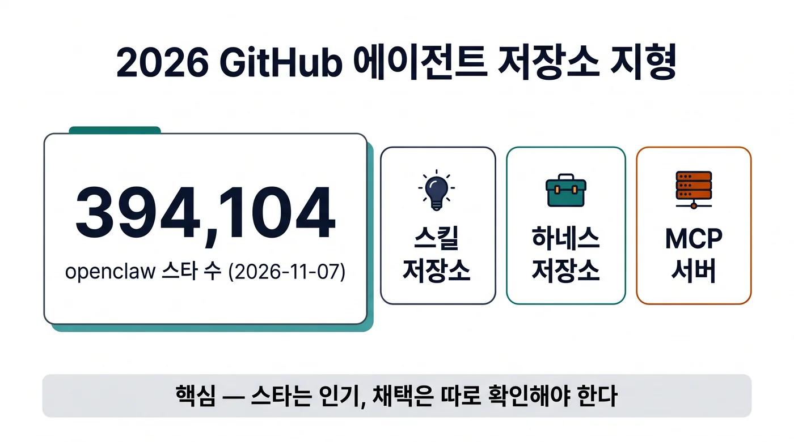

## 이 글을 30초에 파악하기

> **한 줄로** — 2026년 11월 GitHub에서 가장 인기 있는 AI 에이전트 프로젝트는 똑똑한 모델이 아니라, 모델에게 일을 시키는 절차 문서(스킬)와 실행 틀(하네스)이며, 그 인기 숫자를 읽는 방법을 정리한다.

**읽고 나면 알게 되는 것**

- 2026년 11월 7일 스냅샷에서 에이전트 저장소 상위권이 어떤 유형으로 채워졌고, 2023년식 프레임워크는 어디로 밀렸는지
- 누적 스타와 하루 증가분이 서로 다른 질문에 답한다는 점, 그리고 그 숫자를 계산하는 방법
- 스타 39만 개인 저장소의 실제 다운로드가 수천 건에 그칠 수 있는 이유와, 도입 검토 때 대신 볼 지표

**용어 먼저 보기**

| 용어 | 한 줄 설명 | 이 글에서의 역할 |
|---|---|---|
| 스타(Star) | 저장소에 관심을 표시하는 GitHub의 북마크 기능 | 1장 순위표와 4장 속도 계산의 기준 숫자 |
| 포크(Fork) | 저장소를 내 계정으로 복제해 독립적으로 고치는 것 | 1장에서 스타 대비 활동량을 가늠하는 보조 지표 |
| 스킬(Skill) | 모델에게 특정 작업 절차를 알려주는 문서·스크립트 묶음 | 2장에서 2026년 순위표를 채운 저장소 유형 |
| 하네스(Harness) | 모델을 감싸 도구 실행·권한·컨텍스트를 통제하는 실행 틀 | 3장에서 스킬 문서를 실제 작업으로 바꾸는 계층 |
| 트렌딩(Trending) | GitHub가 하루·일주일 단위 관심 증가분을 보여주는 목록 | 4장에서 누적 스타와 구분해 읽는 지표 |
| 클론 이벤트(Clone Event) | 저장소를 복제한 횟수로, 실제 사용 시도를 보여주는 신호 | 5장에서 스타와 채택을 갈라 보는 근거 |
| 플러그인 카탈로그 | 하네스가 불러 쓸 수 있는 확장 목록 | 3장에서 하네스 생태계의 성장 폭을 보여주는 숫자 |

**이런 분께** — 사내에 AI 에이전트 도구를 도입할 후보를 추리고, "스타 몇만 개"라는 근거를 검증해야 하는 백엔드·플랫폼 개발자. 처음 읽을 때는 1장 순위표와 5장의 반증 숫자만 먼저 보고, 관심 있는 저장소가 있으면 3장의 하네스 비교표로 돌아오면 된다.

---

2026년 11월의 도구 도입 회의에서 이런 문장이 근거로 올라온다. "이 저장소 스타가 39만 개인데, 우리가 안 쓸 이유가 있나요."

숫자 자체는 틀리지 않았다. 다만 그 숫자가 무엇을 재는지, 저장소가 언제 만들어졌는지, 실제로 몇 명이 내려받았는지는 문장에서 빠져 있다. 이 글은 2026년 11월 7일 12시 31분부터 12시 39분(UTC) 사이에 GitHub의 1차 엔드포인트에서 직접 읽은 값만으로 그 지형을 다시 그린다.

저장소·검색 API가 스타와 포크·생성일을 주고, 트렌딩 페이지가 일간·주간 증가분을 주고, 릴리스 객체가 버전과 함께 프로젝트가 스스로 보고한 측정값을 준다. 여기서 확인할 수 없는 값은 추정으로 메우지 않고 비워 둔다.

## 1. 2026년 11월 순위표를 펼치면 보이는 공통점

먼저 순위표를 그대로 놓고 본다. 상위권은 한 가지로 묶인다. 모델을 직접 만드는 저장소가 아니라, 모델에게 일을 시키는 절차와 실행 틀을 담은 저장소다.

`ai-agents` 태그가 붙은 저장소는 이 시점에 134,748개다[^1]. `ai-agent` 태그가 44,258개, `multi-agent`가 22,328개, `autonomous-agents`가 6,507개, `agent-framework`가 3,535개다. 가장 큰 우산(`ai-agents`)이 가장 좁은 태그(`agent-framework`)의 약 38배라는 사실은, 사람들이 특정 프레임워크 이름보다 "에이전트"라는 큰 범주로 저장소를 찾고 있다는 뜻으로 읽힌다.

### 1.1 스타 상위 6개 저장소

| 저장소 | 스타 | 포크 | 만든 날 | 주 언어 |
|---|---|---|---|---|
| openclaw/openclaw | 394,104 | 82,819 | 2025-11-24 | TypeScript |
| mattpocock/skills | 317,180 | 26,545 | 2026-02-03 | Shell |
| obra/superpowers | 313,853 | 27,920 | 2025-10-09 | Shell |
| affaan-m/ECC | 298,866 | 44,158 | 2026-01-18 | JavaScript |
| deepseek-ai/deepseek-harness | 275,420 | 33,672 | 2026-08-13 | TypeScript |
| NousResearch/hermes-agent | 261,359 | 57,899 | 2025-07-22 | Python |

2위와 3위가 셸(Shell) 스크립트 저장소라는 점이 이 표의 핵심이다. 컴파일러도, 서빙 서버도, 추론 엔진도 아닌 마크다운과 스크립트 묶음이 파이썬·타입스크립트로 작성된 대형 프레임워크보다 많은 스타를 받았다. openclaw는 348일 만에 394,104 스타를 모았고, 이는 하루 평균 약 1,133개에 해당한다[^2].

### 1.2 "가장 많은 스타"라는 표현의 실제 의미

openclaw는 GitHub 전체 누적 순위에서 4위다. 앞에는 build-your-own-x(560,613), sindresorhus/awesome(532,844), freeCodeCamp(458,695)가 있고, 그 뒤로 torvalds/linux(254,726)가 따라온다. 즉 "역대 최다 스타 소프트웨어"라는 문구는 절대 순위가 아니라 **성장 속도**를 가리킬 때만 성립한다. 2025년 11월에 만들어진 저장소가 2022년에 만들어진 리눅스 커널보다 위에 있다는 사실 자체가 그 증거다.

반대로 2023년에 이름을 올린 프레임워크들은 아래쪽에 있다. langchain 149,151, MetaGPT 71,207, AutoGen 61,738, CrewAI 60,602, LangGraph 44,612다. anthropics/claude-code(154,863)와 openai/codex(133,547)처럼 벤더가 직접 만든 하네스는 중간권에 걸쳐 있다.

### 1.3 저장소 이름에 드러난 2026년의 어휘

이름만 훑어도 흐름이 보인다. `skills`(mattpocock, anthropics, google), `superpowers`, `harness`(deepseek-harness), `spec-kit`(github)처럼 절차·규격·실행 틀을 가리키는 단어가 상위권에 몰려 있다. 2년 전 상위권을 채웠던 `agent`+`framework` 조합은 태그 통계에서도 3,535개로 가장 작은 분류가 됐다.

## 2. 스킬 저장소: 프롬프트가 아니라 배포물이 되다

순위표 두 번째 줄을 다시 본다. 셸 스크립트 저장소가 31만 스타를 받았다. 이 저장소들이 파는 것은 모델의 능력이 아니라, 모델에게 붙여 주는 작업 절차다.

### 2.1 스킬 한 묶음의 실제 부피

affaan-m/ECC의 v2.2.3 릴리스는 `pi/core` 프로필에 스킬 123개와 프롬프트 명령 24개를 담았고, 스킬 설명 텍스트만 35,006자다[^3]. 이를 스킬 123개로 나누면 하나당 평균 약 285자의 설명이 붙는 셈인데, 이는 "무엇을 언제 어떤 순서로 하라"는 지시를 문서 형태로 쌓아 둔 구조다. 배포 단위도 npm 패키지(`ecc-pi-core`)로 정리돼 있다.

스킬이 별도 저장소로 분리되는 이유는 재사용 경계가 모델이 아니라 작업에 있기 때문이다. 같은 스킬 묶음을 openclaw에서도, Claude Code에서도, Codex에서도 쓸 수 있다. 모델이 바뀌어도 절차는 남는다.

### 2.2 스킬 저장소가 스타를 모으는 구조

스킬 저장소는 설치 비용이 낮다. 클론해서 디렉터리에 넣거나 npm으로 한 줄 설치하면 끝난다. 별도 서버도, API 키도, 데이터베이스도 필요 없다. 스타를 누르는 문턱이 낮다는 뜻이고, 그만큼 스타 수와 실제 사용 사이의 간격도 벌어진다. 이 간격은 5장에서 따로 다룬다.

저장소가 커지는 방식도 다르다. hermes-agent는 v0.23.0에서 내장 스킬을 58개에서 44개로 줄이는 대신 플러그인 카탈로그를 약 600개에서 1,050개 이상으로 늘렸다[^4]. 핵심 스킬은 직접 관리하고, 나머지는 외부 카탈로그로 밀어낸 운영 방식이다.

### 2.3 스킬 문서는 혼자 실행되지 않는다

스킬은 "이렇게 하라"는 문서일 뿐이고, 그 문서를 읽고 도구를 호출하고 결과를 다시 프롬프트에 넣는 프로그램이 따로 필요하다. 그 계층이 하네스다. 하네스가 도구 실행 권한을 어떻게 검사하고, 긴 대화를 어떻게 압축하며, 실패한 호출을 어떻게 재시도하는지는 앞서 쓴 [Claude Code 하네스 구조 분석](/agent/claude-code-architecture-queryloop-harness/)에서 코드 수준으로 다뤘다. 여기서는 저장소 생태계 쪽에서 같은 계층을 본다.

## 3. 하네스 저장소: 모델을 감싸는 실행 틀

스킬 문서를 실제 작업으로 바꾸는 프로그램이 하네스(harness)다. 2026년 11월 기준 상위 하네스 세 개는 실행 환경과 배포 방식이 서로 다르다.

### 3.1 하네스가 맡는 세 가지 일

첫째는 도구 호출의 실행이다. 모델이 "파일을 읽어라"라고 출력하면 실제 파일 읽기를 수행하고 결과를 잘라서 다시 넣는다. 둘째는 컨텍스트 관리다. 대화가 길어지면 오래된 도구 출력을 요약하거나 버린다. 셋째는 권한과 격리다. hermes-agent는 로컬·Docker·SSH·Modal·Daytona·Vercel 샌드박스를 실행 기반으로 지원하고, 설정을 OpenClaw·Claude Code·Codex·Cursor에서 가져올 수 있다[^4]. 같은 하네스가 여러 실행 기반 위에서 돌아간다는 뜻이다.

### 3.2 상위 하네스 세 개의 차이

| 저장소 | 스타 | 실행 기반 | 라이선스·특징 |
|---|---|---|---|
| openclaw/openclaw | 394,104 | macOS 15 이상 데스크톱 앱, Linux AppImage·deb, Windows 컴패니언 | MIT, 501(c)(3) 재단 운영, 유료판 없음 |
| deepseek-ai/deepseek-harness | 275,420 | Node 24.9.0 이상, npm `@deepseek-ai/dsh@0.2.2-rc.1` | MIT, 개발자 프리뷰, GitHub 이슈 비활성 |
| NousResearch/hermes-agent | 261,359 | 로컬·Docker·SSH·Modal·Daytona·Vercel 샌드박스 | MIT, 타 하네스 설정 가져오기 지원 |

openclaw는 MIT 라이선스에 미국 501(c)(3) 재단이 운영하고, 기업용 판과 유료판을 두지 않는다고 밝힌다. 29개 채널을 지원하고, v2026.11.1 릴리스에는 78개의 PR이 포함됐다[^5][^6]. deepseek-harness는 GitHub 릴리스 대신 npm으로만 배포하며, 문서에 호환성 파괴 변경이 있을 것이라고 명시한 개발자 프리뷰다. 이슈를 꺼 두고 논의(Discussions)로 피드백을 받는 운영도 눈에 띈다[^7].

### 3.3 하네스가 여러 개면 공급망이 된다

여러 하네스를 한 화면에서 굴리는 도구가 등장하면서 버전 고정(pin) 문제가 생긴다. paperclip의 v2026.1106.0 릴리스는 515개 커밋과 27명의 기여자를 담았고, Codex 0.160.0, Claude Agent SDK 0.3.286(Claude Code 2.1.286), OpenCode 1.18.34, Copilot CLI 1.0.88을 명시적으로 고정한다[^8]. OpenClaw·Claude Code·Codex·Cursor·Gemini CLI·OpenCode·Pi·Hermes·Grok Build·Kimi Code까지 10종의 하네스를 어댑터로 감싸는 구조에서, 각 하네스의 마이너 업데이트가 전체 동작을 바꾸지 않게 막는 장치다.

같은 릴리스에는 도커 부팅 시 코드 적재 시간을 24초에서 4초 미만으로 줄였다는 변경과, 단순 작업에서 Claude 러너가 약 20% 빨라졌다는 변경이 함께 기록돼 있다. 하네스를 여러 개 묶는 계층에서는 성능 개선도 결국 오케스트레이션 비용에서 나온다.

## 4. 스타 속도: 누적 총량과 증가분은 다른 질문에 답한다

총 스타는 오래 쌓인 결과다. 그래서 "요즘 뜨는가"를 물으려면 총량이 아니라 나이로 나눈 속도를 봐야 한다.

### 4.1 하루 평균 스타 계산

| 저장소 | 스타 | 경과일 | 하루 평균 |
|---|---|---|---|
| deepseek-harness | 275,420 | 86 | 약 3,202 |
| ponytail | 186,118 | 148 | 약 1,258 |
| mattpocock/skills | 317,180 | 277 | 약 1,145 |
| openclaw | 394,104 | 348 | 약 1,133 |
| ECC | 298,866 | 293 | 약 1,020 |
| superpowers | 313,853 | 394 | 약 797 |
| hermes-agent | 261,359 | 473 | 약 552 |

이 표는 API가 주는 `created_at`과 스타 수를 나눈 계산값이다. GitHub는 공식 스타 속도 지표를 제공하지 않으므로 산술적으로 도출한 값이고, 그래서 순위의 절대 기준이 아니라 저장소 간 비교용으로만 쓴다. 표에서 가장 빠른 것은 2026년 8월 13일에 만들어진 deepseek-harness로, 86일 동안 하루 약 3,202개를 모았다. 가장 오래된 hermes-agent와 비교하면 약 5.8배 차이다.

### 4.2 트렌딩 페이지의 하루·일주일 증가분

2026년 11월 7일 일간 트렌딩 14개 항목 중 에이전트·스킬·도구 저장소는 6개다. cloudflare/security-audit-skill이 하루 2,088개로 가장 많이 늘었고, milind-soni/OpenMausBot이 1,986개, mattpocock/skills가 1,111개, google/skills가 449개, anthropics/skills가 386개, vercel-labs/agent-browser가 180개다[^9]. 같은 날 셜록(sherlock, 1,761개)이나 zed(1,119개)처럼 에이전트와 무관한 저장소도 상위에 있으므로, 트렌딩은 에이전트 전용 지표가 아니다.

주간 목록에서는 성격이 더 분명해진다. pingdotgg/t3code가 16,782개로 1위이고, mattpocock/skills 9,589개, thedotmack/claude-mem 8,726개, D4Vinci/Scrapling 8,372개, pbakaus/impeccable 8,172개, Nutlope/hallmark 6,900개 순이다[^10]. 주 단위로 보면 스킬과 메모리, 수집 도구가 상위를 나눠 갖는다.

### 4.3 이 숫자를 과신하면 안 되는 이유

GitHub는 트렌딩 순위 산식과 "오늘 얻은 스타"의 정확한 정의를 공개하지 않는다. 화면에 보이는 증가분은 페이지 표시값일 뿐이고, 저장소가 어떤 가중치로 정렬됐는지는 확인할 수 없다. 그래서 트렌딩 등장 횟수로 시장 규모를 추정하거나, 하루 증가분을 성장률로 환산하는 해석은 근거가 약하다. 이 글도 그런 환산은 하지 않는다.

## 5. 스타 39만 개가 채택 39만 명은 아닌 이유

여기까지 읽으면 openclaw가 앞서는 것처럼 보인다. 그런데 스타는 "나중에 써볼게요"에 가깝고, 실제 채택은 다른 숫자로 나타난다.

### 5.1 클론 이벤트로 본 실제 사용 시도

ECC는 2026년 8월 29일부터 9월 11일까지 약 2주 동안 673,617회 클론과 90,216명의 고유 클론 사용자를 기록했다고 밝힌다. 이는 저장소 소유자가 GitHub 트래픽 화면에서 확인한 값이다[^3]. 스타 298,866개와 비교하면 고유 클론 사용자는 약 30% 수준이지만, 두 수치의 측정 구간이 다르므로 이 비율을 정밀한 채택률로 쓰기는 어렵다. 분명한 것은 클론이 스타 수보다 작은 규모로 발생한다는 점이다.

### 5.2 다운로드 수라는 더 좁은 관문

openclaw v2026.11.1 릴리스의 데스크톱 자산은 게시 하루 뒤 macOS 유니버설 DMG가 2,820회, zip이 3,084회 내려받혔다[^5]. 스타 394,104개와 비교하면 자릿수가 다르다. 물론 데스크톱 앱을 쓰지 않고 npm으로 설치하는 경로가 따로 있으므로 이 수치가 전체 사용자를 뜻하지는 않는다. 그래도 스타 수가 설치 수의 상한도 아니라는 점은 분명히 보여준다.

### 5.3 이슈 수는 유지보수 부담과 신뢰도를 함께 흔든다

hermes-agent는 열린 이슈가 53,507개로 포크 수(57,899)에 맞먹는다[^4]. 이 숫자가 실제 백로그인지, 라벨 운영이나 스팸으로 부풀려진 것인지는 이번 조사에서 감사하지 않았으므로 해석을 붙이지 않는다. 대조적으로 deepseek-harness는 이슈를 아예 꺼 두어 0으로 표시되고, ECC는 240개, openclaw는 7,646개, anthropics/claude-code는 16,777개, openai/codex는 26,823개다.

이슈 0이 건강의 증거는 아니다. 이슈를 끄면 사용자 신고가 저장소 밖으로 나가고, 남은 숫자는 관리된 것처럼 보인다. 도입 판단에서는 이슈 수의 절대값보다 "이슈를 받는 방식이 우리 조직의 문의 경로와 맞는가"를 봐야 한다.

### 5.4 아카이브된 저장소의 스타는 동결된 역사다

이 스냅샷에서 daytona(71,359)와 Flowise(55,562)는 API에 `archived: true`로 표시된다. 두 저장소의 스타 수는 더 이상 증가하지 않는 과거 기록이다. 순위표를 스타로만 정렬하면 이런 저장소가 여전히 상위에 남으므로, 표를 읽을 때 생성일과 함께 아카이브 여부를 확인해야 한다.

## 6. 스타가 0원이어도 실행은 0원이 아니다

하네스와 스킬은 대부분 MIT로 공개되고 무료다. 그러나 에이전트를 실제로 돌리는 순간 과금은 다른 층에서 발생한다.

### 6.1 브라우저 에이전트의 시간 과금

browser-use는 브라우저를 시간 단위로 과금한다. 브라우저는 시간당 `$0.02`이고 분 단위로 청구하며 최소 1분부터다. 트래픽은 주거용 IP 프록시가 GB당 `$5`, 직접 연결이나 자체 프록시가 GB당 `$0.20`이고 CAPTCHA 해결은 포함이다.

에이전트 실행은 중앙값 `$0.006` 수준이고, 하네스 자체는 MIT로 $0이다[^11]. 동시 실행 수는 누적 결제액으로 열린다. $0이면 10, `$100`이면 50, `$1,000`이면 250, `$5,000`이면 500, `$25,000`이면 1,000이다.

무료 저장소를 도입해도 부하가 늘면 결제액이 동시성을 결정한다.

### 6.2 모델 호출 비용

hermes-agent를 구동하는 Nous Portal은 무료, Plus 월 `$20`, Super 월 `$100`, Ultra 월 `$200`의 네 단계다. Plus는 4GB 메모리·25GB 디스크의 클라우드 에이전트 1개, Ultra는 8GB·100GB까지 포함한다[^12]. DeepSeek API는 deepseek-flash 기준 100만 토큰당 입력 캐시 적중이 `$0.003`~`$0.006`, 캐시 미스가 `$0.15`~`$0.30`, 출력이 `$0.60`~`$1.20`이고, 컨텍스트 100만 토큰에 최대 출력 384K를 제공한다.

피크 시간은 평일 01:00~04:00과 06:00~10:00(UTC)이며 그 외는 절반 가격이다[^13].

### 6.3 수집과 스크래핑 비용

Firecrawl은 무료 1,000 크레딧에서 시작해 Hobby 월 `$19`(5,000 크레딧), Standard 월 `$99`(100,000), Growth 월 `$399`(500,000), Scale 월 `$749`(1,000,000)로 올라간다. 크레딧은 페이지 스크레이프 1개당 1, JSON 형식 추가 4, 프롬프트 인젝션 검사 추가 4처럼 작업 단위로 차감된다[^14]. 에이전트가 웹을 읽는 기능을 붙이는 순간, 고정비가 아니라 사용량 비용이 생긴다.

### 6.4 라이선스가 가격표를 가르는 지점

ECC는 오픈소스 툴킷이 `$0`이고, GitHub App·Pro가 활성 좌석당 월 `$19`다[^3]. openclaw는 유료판과 호스팅 티어를 두지 않는다고 밝히고, paperclip의 클라우드는 대기 명단만 받는다. 같은 "무료 에이전트 저장소"라도 좌석 과금, 사용량 과금, 완전 무료가 섞여 있으므로 도입 견적은 저장소가 아니라 실행 경로를 기준으로 계산해야 한다.

## 한계와 트레이드오프

이 글의 수치는 2026년 11월 7일 12시 31분부터 12시 39분(UTC)까지의 단일 스냅샷이다. 같은 저장소를 HTML에서 317,179개, API에서 317,180개로 읽은 사례가 있었을 만큼 값은 계속 움직이므로, 하루만 지나도 표의 숫자는 어긋난다. 트렌딩 순위 산식과 증가분 정의는 GitHub가 공개하지 않아서, 트렌딩 항목으로 시장 규모를 추정하는 해석은 이 글에서 제외했다.

조사 대상 50여 개 중 30개 이상의 라이선스는 확인되지 않았고, SWE-bench 같은 벤치마크 점수는 1차 리더보드에서 읽지 않았으므로 이 글은 어떤 저장소의 성능 우열도 판정하지 않는다. 클론·다운로드·이슈 수는 각각 다른 기간과 다른 집계 방식으로 측정돼 서로 나눠 비율을 만드는 용도로는 부적합하다.

## 정리

2026년 11월 GitHub 에이전트 지형의 중심은 모델이 아니라 스킬과 하네스다. 셸 스크립트 저장소가 파이썬 프레임워크보다 많은 스타를 받았고, `agent-framework` 태그는 3,535개로 가장 작은 분류가 됐다. 누적 스타는 성장 속도를 뜻하지 않으므로 생성일로 나눈 하루 평균을 함께 봐야 하고, 그 속도조차 트렌딩 산식이 비공개라 해석에 한계가 있다.

채택을 확인하려면 클론 이벤트, 릴리스 자산 다운로드, 이슈 운영 방식이라는 세 숫자를 봐야 한다. 도입 검토에서는 스타 수 대신 이 세 가지와 라이선스·과금 경로를 표에 적어 두는 편이 실제 비용을 덜 놀라게 한다.

## References

[^1]: GitHub Search API, `topic:ai-agents` 정렬 스냅샷(2026-11-07) — ai-agents 134,748 / ai-agent 44,258 / multi-agent 22,328 / autonomous-agents 6,507 / agent-framework 3,535. https://api.github.com/search/repositories?q=topic:ai-agents&sort=stars&order=desc

[^2]: openclaw/openclaw 저장소 메타데이터 — 스타 394,104, 포크 82,819, 생성 2025-11-24, MIT, 348일 경과. https://github.com/openclaw/openclaw

[^3]: affaan-m/ECC v2.2.3 릴리스 및 ecc.tools — `pi/core` 123 스킬 + 24 프롬프트 명령, 스킬 설명 35,006자; 2026-08-29~09-11 클론 673,617회·고유 90,216명; 툴킷 `$0`, 좌석당 월 `$19`. https://github.com/affaan-m/ECC/releases/tag/v2.2.3 · https://ecc.tools

[^4]: NousResearch/hermes-agent v0.23.0 릴리스(2026-11-05) — 내장 스킬 58→44, 플러그인 카탈로그 약 600→1,050+, 실행 기반 local/Docker/SSH/Modal/Daytona/Vercel, 열린 이슈 53,507. https://github.com/NousResearch/hermes-agent/releases/tag/v0.23.0

[^5]: openclaw v2026.11.1 릴리스 — 78개 PR, 데스크톱 자산 다운로드 DMG 2,820·zip 3,084(게시 약 1일 후). https://github.com/openclaw/openclaw/releases/tag/v2026.11.1

[^6]: openclaw.ai 프로젝트 페이지 — 501(c)(3) 재단 운영, 유료판·호스팅 티어 없음, 29개 채널. https://openclaw.ai

[^7]: deepseek-ai/deepseek-harness — npm `@deepseek-ai/dsh@0.2.2-rc.1`, Node 24.9.0 이상, 개발자 프리뷰(호환성 파괴 변경 예고), GitHub 이슈 비활성. https://github.com/deepseek-ai/deepseek-harness

[^8]: paperclipai/paperclip v2026.1106.0 릴리스(2026-11-06) — 515 커밋·27 기여자, Codex 0.160.0·Claude Agent SDK 0.3.286·OpenCode 1.18.34·Copilot CLI 1.0.88 고정, 도커 부팅 24초→4초 미만, 단순 작업 약 20% 개선; 어댑터 10종(OpenClaw·Claude Code·Codex·Cursor·Gemini CLI·OpenCode·Pi·Hermes·Grok Build·Kimi Code). https://github.com/paperclipai/paperclip/releases/tag/v2026.1106.0 · https://github.com/paperclipai/paperclip

[^9]: github.com/trending 일간(2026-11-07) — 14개 항목 중 에이전트 관련 6개, security-audit-skill +2,088, OpenMausBot +1,986, mattpocock/skills +1,111, google/skills +449, anthropics/skills +386, agent-browser +180. https://github.com/trending?since=daily

[^10]: github.com/trending 주간(2026-11-07) — t3code +16,782, mattpocock/skills +9,589, claude-mem +8,726, Scrapling +8,372, impeccable +8,172, hallmark +6,900. https://github.com/trending?since=weekly

[^11]: Browser Use 가격 페이지 — 브라우저 시간당 `$0.02`(분 단위·최소 1분), 트래픽 `$5/GB`(주거용) / `$0.20/GB`, 에이전트 중앙값 `$0.006`, 하네스 `$0`, 동시성 임계 `$0/10`·`$100/50`·`$1,000/250`·`$5,000/500`·`$25,000/1`,000. https://browser-use.com/pricing

[^12]: Nous Portal 가격 — 무료 / Plus 월 `$20` / Super 월 `$100` / Ultra 월 `$200`, Plus 4GB·25GB, Ultra 8GB·100GB. https://portal.nousresearch.com

[^13]: DeepSeek API 가격 — deepseek-flash 입력 캐시 적중 `$0.003`~`$0.006`, 미스 `$0.15`~`$0.30`, 출력 `$0.60`~`$1.20`(100만 토큰당), 컨텍스트 100만·최대 출력 384K, 피크 평일 01:00~04:00·06:00~10:00 UTC. https://api-docs.deepseek.com/quick_start/pricing

[^14]: Firecrawl 가격 — 무료 1,000 크레딧, Hobby 월 `$19/5`,000, Standard 월 `$99/100`,000, Growth 월 `$399/500`,000, Scale 월 `$749/1`,000,000, 스크레이프 1페이지=1크레딧, JSON +4, 인젝션 검사 +4. https://www.firecrawl.dev/pricing