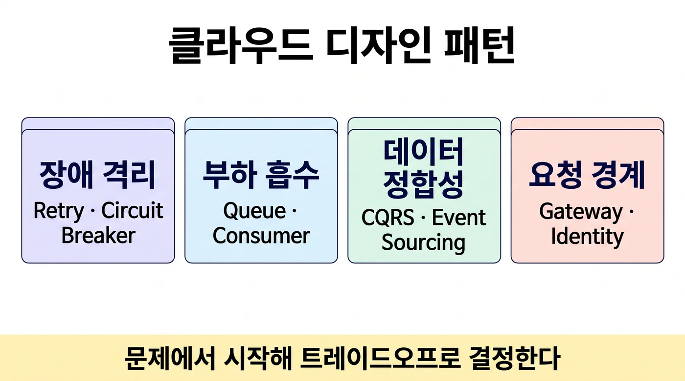

## 이 글을 30초에 파악하기

> **한 줄로** — 클라우드 디자인 패턴은 장애와 부하, 데이터 불일치를 어디에서 어떻게 다룰지 정하는 설계 선택이다.

**읽고 나면 알게 되는 것**

- 패턴 이름보다 먼저 확인해야 할 장애 증상과 업무 제약
- 재시도, 큐, 데이터 모델 분리가 해결하는 서로 다른 문제
- 44개 패턴을 정리한 일곱 편 중 지금 필요한 글을 고르는 방법

| 용어 | 뜻 |
| --- | --- |
| 디자인 패턴 | 반복되는 문제에 적용할 수 있는 설계 방식과 그 조건 |
| 멱등성 | 같은 작업을 여러 번 수행해도 업무 효과가 한 번과 같은 성질 |
| 결과적 일관성 | 변경이 다른 복사본에 즉시 보이지 않을 수 있지만, 조건이 충족되면 수렴하는 모델 |

**이런 분께** — 서비스가 느려지거나 일부가 실패할 때 어떤 설계부터 살펴볼지 고민하는 개발자와 아키텍트. 전체 지도를 본 뒤 아래 일곱 편에서 필요한 주제를 골라 읽으면 된다.

*시리즈의 주요 문제를 기준으로 직접 구성한 개요다.*

## 결제 버튼을 두 번 누른 뒤에 생기는 일

결제 요청을 보냈는데 응답이 돌아오지 않는다. 사용자는 버튼을 다시 누르고 애플리케이션도 같은 요청을 재시도한다. 첫 결제가 이미 승인됐다면 느린 응답과 별개로 중복 결제 가능성이 생긴다.

여기서 질문은 하나가 아니다. 얼마나 기다릴지, 다시 시도할지, 같은 주문을 어떻게 구별할지, 결제 서비스가 계속 실패하면 언제 호출을 멈출지를 각각 정해야 한다. 재시도와 멱등 처리, 회로 차단기는 이 서로 다른 질문에 답한다.

이 시리즈는 [Microsoft 클라우드 디자인 패턴 카탈로그](https://learn.microsoft.com/ko-kr/azure/architecture/patterns/)의 44개 패턴을 문제별로 나눠 정리한다.[^1] 카탈로그 범위는 2026년 11월에 확인한 목록을 기준으로 한다. 분류는 독자가 찾기 쉽도록 이 글에서 정한 것이며 Microsoft의 공식 분류 체계는 아니다.

## 패턴은 제품이 아니라 설계의 경계다

주문이 몰릴 때 애플리케이션 앞에 큐를 둔다고 가정하자. 작업을 받은 시점과 끝낸 시점을 분리하면 순간적인 유입을 완충할 수 있다. 하지만 작업자의 처리 속도가 계속 유입 속도보다 낮으면 대기열은 계속 늘어난다. 큐는 부족한 처리량을 만들어 내지 않는다.

같은 식으로 캐시는 자주 읽는 데이터를 빠르게 꺼낼 수 있지만 원본과 다른 값을 잠시 보여줄 수 있다. 회로 차단기는 실패한 의존성으로 가는 호출을 줄이지만 실패한 업무 자체를 성공으로 바꾸지는 않는다. **무엇을 얻는지와 무엇을 책임져야 하는지를 함께 정하는 것**이 패턴 선택이다.

## 일곱 편 중 어디서 시작할까

서비스가 `503`을 내는 상황이라면 장애 격리 편부터 읽는다. 사용자는 접수됐다고 보는데 작업이 끝나지 않는다면 큐 편이 더 가깝다. 각 글은 독립적으로 읽을 수 있으며, 필요한 경우 다음 주제로 이어진다.

| 주제 | 먼저 살펴볼 상황 | 다루는 패턴 수 |
| --- | --- | --- |
| [장애 격리와 회복](/cloud/cloud-patterns-resilience/) | 재시도가 몰리거나 한 의존성의 실패가 퍼진다 | 7 |
| [메시지 큐와 소비자](/cloud/cloud-patterns-queues/) | 접수와 완료가 다르고 중복·순서가 중요하다 | 7 |
| [이벤트와 분산 작업](/cloud/cloud-patterns-event-workflows/) | 여러 서비스가 한 업무를 나눠 처리한다 | 7 |
| [데이터 읽기·쓰기와 확장](/cloud/cloud-patterns-data/) | 조회 부하가 크거나 갱신 결과가 늦게 보인다 | 6 |
| [게이트웨이와 서비스 경계](/cloud/cloud-patterns-gateways/) | 클라이언트별 요청과 공통 네트워크 기능을 나눠야 한다 | 7 |
| [신뢰 경계와 권한](/cloud/cloud-patterns-security/) | 사용자·토큰·외부 자산을 어디까지 신뢰할지 정해야 한다 | 4 |
| [배포·지역·전환](/cloud/cloud-patterns-deployment/) | 복제 단위를 늘리거나 기존 시스템을 단계적으로 바꿔야 한다 | 6 |

각 편은 해당 패턴의 공식 문서와 원문 그림을 연결한다. 본문 그림은 사용 조건이 불명확한 Microsoft 원본을 복제하지 않고 별도로 제작했다. 각 편의 숫자는 별도 실측이라고 밝히지 않은 한 설명을 위한 가상 사례다.

## 패턴을 고르기 전에 정할 것

요청이 1초 안에 끝나야 하는 업무와 몇 분 뒤 결과를 받아도 되는 업무는 같은 큐 정책을 쓸 필요가 없다. 먼저 지연·실패·중복·데이터 불일치 중 무엇을 얼마나 허용할지 정한다. 그다음 그 제약을 완화하는 패턴을 조합한다.

| 질문 | 설계에서 확인할 항목 |
| --- | --- |
| 느린 호출을 얼마나 기다릴 수 있는가? | 연결·응답 타임아웃과 전체 마감 시간 |
| 같은 작업이 다시 실행돼도 되는가? | 작업 식별자와 중복 부작용 방지 |
| 요청을 나중에 완료해도 되는가? | 접수 상태, 완료 조회와 큐 보관 기간 |
| 읽은 값이 잠시 오래돼도 되는가? | 원본과 읽기 모델의 차이, 최신성 요구 |
| 한 경계가 실패하면 어디까지 영향이 가는가? | 자원 분리, 복구 경로와 관측 범위 |

실패는 패턴 하나로 사라지지 않는다. 예를 들어 재시도는 일시적 실패를 다루고, 회로 차단기는 반복 호출을 멈추며, 멱등성은 같은 작업의 중복 효과를 다룬다. 세 규칙은 적용 범위가 다르므로 함께 사용할 때도 각각 검증해야 한다.

## 도입한 뒤 무엇을 확인할까

큐를 넣은 뒤 접수 오류가 줄었다고 가정하자. 그사이 작업 완료까지 걸리는 시간이 늘었다면 사용자가 겪는 문제는 남아 있다. 접수 성공률과 최종 완료 시간을 따로 측정해야 하는 이유다.

재시도 횟수, 회로 차단 상태, 가장 오래된 큐 메시지의 나이, 읽기 모델의 반영 지연을 함께 본다. 같은 부하와 장애 조건에서 변경 전후를 비교하고, 수치가 달라진 이유를 확인한다. 구체적인 목표와 임계값은 각 서비스의 요구사항과 실험 결과에 맞게 정한다.

이처럼 복잡한 결정을 입력·판단·제어 흐름으로 나눠 살펴보면 어떤 규칙이 결과를 바꿨는지 추적하기 쉽다.[^2] 다만 표나 그림만으로 설계의 정확성이 보장되지는 않는다. 실제 구현에서 장애를 주입하고, 관측한 결과를 근거로 설정을 조정해야 한다.

## References

[^1]: [Cloud Design Patterns — Microsoft Azure Architecture Center](https://learn.microsoft.com/en-us/azure/architecture/patterns/).
[^2]: [Don’t Call It a Decision Model — TypeSafe AI](https://typesafe.ai/blog/dont-call-it-a-decision-model).
