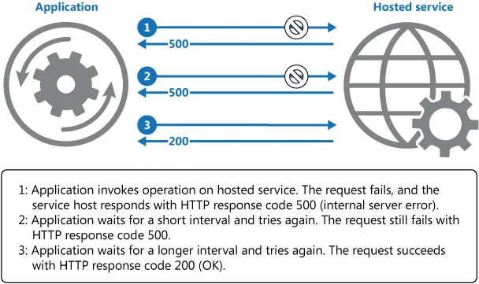
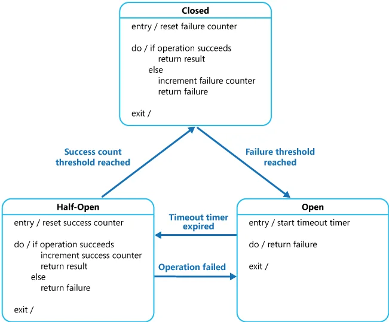

## 이 글을 30초에 파악하기

> **한 줄로** — 장애를 회복하려면 다시 시도하기 전에 대기 시간, 자원 경계와 실패 신호부터 정해야 한다.

**읽고 나면 알게 되는 것**

- 느린 결제 의존성이 다른 기능까지 멈추는 이유와 격리 방법
- 재시도와 회로 차단기의 차이, 다중 재시도에서 발생하는 호출 증폭
- 상태 점검, 리더 선출, 호출 속도 제한을 운영하는 경계

**용어 먼저 보기**

| 용어 | 뜻 |
| --- | --- |
| 의존성 | 한 서비스가 요청을 처리하기 위해 호출하는 다른 시스템 |
| 타임아웃 | 특정 연결이나 응답을 기다리는 시간의 상한 |
| 마감 시간 | 재시도와 대기를 포함한 전체 작업의 시간 한도 |
| 임대(lease) | 제한된 시간 동안 자원이나 리더 권한을 보유하는 계약 |

**이런 분께** — 외부 API나 공유 서비스를 호출하는 백엔드를 운영하는 개발자를 위한 글이다. 장애 확산이 급한 독자는 격리와 재시도 절부터 읽으면 된다.

## 느린 결제 서비스가 주문 조회까지 막는 이유

온라인 상점에서 결제 응답이 느려졌다고 가정하자. 주문 API는 응답을 기다리는 동안 연결과 실행 자원을 보유한다. 새 요청도 계속 들어오면 결제와 무관한 주문 조회까지 자원을 얻지 못할 수 있다.

이 글은 이런 연쇄 장애를 줄이는 일곱 패턴을 공식 문서와 함께 정리한다. 수치가 등장하는 사례는 모두 설명을 위한 가정이며 실측 결과가 아니다. 각 패턴의 임계값은 실제 업무 목표와 부하를 기준으로 정해야 한다.

### Bulkhead: 한 구획의 침수를 다른 구획으로 옮기지 않는다

**벌크헤드(Bulkhead)** 는 배의 방수 격벽처럼 자원을 독립된 구획으로 나눈다.[^1] 결제 호출과 주문 조회 호출에 별도 연결 풀과 동시 실행 한도를 두는 방식이다. 결제 풀이 가득 차도 주문 조회의 풀이 남아 있다면 조회는 계속 진행할 수 있다.

적용 순서는 먼저 중요한 기능과 의존성을 구분하는 것부터다. 다음으로 각 구획에 연결·스레드·동시 요청 예산을 배정한다. 풀이 찼을 때는 무한히 기다리지 않고 정해진 시간 안에 거절하거나 실패를 반환한다. 테넌트별 인스턴스를 분리해 소비자 간 영향을 줄일 수도 있다.

이 패턴은 느린 외부 서비스나 중요한 고객을 다른 작업과 분리할 때 적합하다. 호출량이 적고 격리할 필요가 없다면 별도 풀은 유휴 용량과 운영 복잡도만 늘릴 수 있다. 풀을 나눠도 같은 데이터베이스나 네트워크가 병목이면 장애는 여전히 공유된다. 자원 격리는 권한 분리 자체를 보장하지 않으므로 테넌트 인증과 접근 제어도 필요하다.

### 격리와 시간 제한은 서로 대신하지 못한다

풀이 분리돼도 한 구획의 호출이 끝없이 대기하면 해당 기능은 복구되지 않는다. 연결과 응답에 타임아웃을 두고, 전체 요청의 마감 시간도 따로 정한다. 반대로 타임아웃만 짧게 설정해도 순간적으로 많은 요청이 공유 자원을 모두 차지할 수 있다. 제한할 자원과 기다릴 시간을 함께 설계해야 한다.

## 일시적 실패를 재시도하고 지속적 실패를 차단한다

결제 승인 응답만 늦게 도착한 상황을 생각해 보자. 지금 다시 호출할지와 한동안 호출을 멈출지는 다른 결정이다.

### Retry: 다시 해도 안전한 실패만 제한적으로 반복한다

**재시도(Retry)** 는 짧은 네트워크 단절처럼 회복될 가능성이 있는 실패를 다시 시도한다.[^2] 오류를 분류한 뒤 재시도 가능한 경우에만 실행하고, 정해진 횟수나 마감 시간에 도달하면 실패를 반환한다. 인증 실패나 잘못된 입력처럼 반복해도 해결되지 않는 오류에는 적용하지 않는다.

다음 그림은 애플리케이션이 서비스로부터 HTTP 500 응답을 두 번 받은 뒤, 대기 시간을 늘려 세 번째 시도에서 HTTP 200을 받는 예다. 모든 500 오류가 재시도에 적합하거나 부작용이 있는 작업을 안전하게 반복할 수 있다는 뜻은 아니다.

[그림 크게 보기](/assets/images/cloud/official-retry.webp)

*출처: Microsoft 및 기여자, [Retry 패턴](https://learn.microsoft.com/en-us/azure/architecture/patterns/retry) · [CC 허가본](https://github.com/reddev9339/architecture-center/blob/fa6c83c844280f548222c94857377596cbedae6f/docs/patterns/_images/retry-pattern.png) · [CC BY 4.0](https://creativecommons.org/licenses/by/4.0/). 원본을 WebP로 변환했다.*

대기가 필요한 오류는 시도 간 간격을 늘리고 무작위 지연을 섞는다. 여러 인스턴스가 동시에 다시 호출하는 현상을 줄이기 위해서다. 제공자가 `Retry-After`를 보낸다면 그 안내와 남은 마감 시간을 함께 고려한다. 무조건 기다리면 사용자의 응답 시간 목표를 넘길 수 있다.

응답 타임아웃은 서버가 작업을 수행하지 않았다는 증거가 아니다. 결제는 성공했지만 응답만 유실됐을 수 있다. 따라서 부작용이 있는 요청은 같은 작업을 구별하는 식별자와 서버 측 중복 방지 계약을 확인해야 한다. 재시도 로그에는 민감한 결제 정보나 인증 토큰을 남기지 않는다.

재시도는 정상 회복의 가능성을 높이지만 추가 호출과 로그 비용을 만든다. 오래 지속되는 장애나 상시 용량 부족을 재시도로 해결하려 하면 지연과 부하가 커진다. 짧은 응답이 중요한 화면에서는 실패를 빠르게 보여주는 편이 적합할 수 있다.

### 재시도 횟수는 계층마다 곱해질 수 있다

가상의 호출자와 중간 서비스가 각각 최초 요청을 포함해 최대 세 번 시도한다고 가정하자. 모든 시도가 하위 서비스에 전달되고 끝까지 실패하는 최악의 경우다. 사용자 요청 하나가 하위 서비스에 최대 `3 × 3 = 9`번 도달한다. 각 계층의 설정이 **재시도 세 번**이라면 최초 호출을 포함해 네 번이므로 최대 `4 × 4 = 16`번이다.

SDK의 기본 재시도도 이 계산에 포함해야 한다. 재시도를 담당할 계층을 정하고 다른 계층의 정책과 합계를 확인한다. 전체 마감 시간 안에 각 시도 타임아웃과 대기 간격이 들어가는지도 계산한다. 차단기가 열린 오류는 즉시 다시 시도하지 않는다.

### Circuit Breaker: 고장 난 회로를 잠시 열어 둔다

**서킷 브레이커(Circuit Breaker)** 는 실패할 가능성이 높은 의존성 호출을 잠시 막는다.[^3] 재시도가 다음 시도의 성공을 기대한다면, 차단기는 계속 호출하지 않을 시점을 정한다. 전기 차단기처럼 고장을 직접 고치는 장치는 아니다.

그림에서 닫힘(Closed) 상태의 실패가 기준에 도달하면 열림(Open)으로 전환된다. 대기 시간이 지나면 반열림(Half-Open)에서 시험하고, 성공 횟수가 기준에 도달하면 닫히며 실패하면 다시 열린다.

[그림 크게 보기](/assets/images/cloud/official-circuit-breaker.webp)

*출처: Microsoft 및 기여자, [Circuit Breaker 패턴](https://learn.microsoft.com/en-us/azure/architecture/patterns/circuit-breaker) · [CC 허가본](https://github.com/reddev9339/architecture-center/blob/fa6c83c844280f548222c94857377596cbedae6f/docs/patterns/_images/circuit-breaker-diagram.png) · [CC BY 4.0](https://creativecommons.org/licenses/by/4.0/). 원본을 WebP로 변환했다.*

1. **닫힘(Closed)**: 호출을 전달하고 최근 실패를 관찰한다. 정해진 기준을 넘으면 회로를 연다.
2. **열림(Open)**: 의존성을 호출하지 않고 빠르게 실패한다. 정해진 대기 시간이 지나면 시험 단계로 넘어간다.
3. **반열림(Half-Open)**: 제한된 시험 요청을 보낸다. 성공 기준을 충족하면 닫고, 실패하면 다시 연다.

열린 상태에서는 사용자에게 오류를 알리거나 업무상 허용된 대체 결과를 반환한다. 오래된 가격이나 권한 정보를 대체 응답으로 무조건 제공해서는 안 된다. 실패 기준이 너무 민감하면 정상 서비스도 차단하고, 너무 둔감하면 자원이 오래 묶인다. 독립된 의존성이나 샤드를 하나의 차단기로 묶으면 멀쩡한 대상까지 차단할 수 있다.

반복적으로 느려지는 원격 의존성에는 유용하지만 로컬 메모리 접근에까지 차단기를 두면 복잡도만 늘 수 있다. 첫 호출이 타임아웃될 때까지는 자원이 묶인다는 점도 남는다. 복구 시험과 관측, 정책 관리에는 운영 비용이 들지만 장애 중 불필요한 호출은 줄일 수 있다.

## 상태를 확인하고 조정자를 교체한다

### Health Endpoint Monitoring: 살아 있음과 일할 준비는 다르다

프로세스가 응답한다고 주문을 처리할 수 있는 것은 아니다. **상태 엔드포인트 모니터링(Health Endpoint Monitoring)** 은 외부 관측자가 주기적으로 상태를 확인하는 방식이다.[^4] 응답 코드뿐 아니라 응답 시간과 필요한 경우 응답 내용도 판단한다.

생존 점검은 프로세스가 반응하는지 가볍게 확인한다. 준비 상태 점검은 초기화와 업무에 꼭 필요한 의존성을 확인해 요청을 받을 수 있는지 판단한다. 선택 기능의 장애까지 준비 실패로 삼으면 불필요하게 인스턴스가 모두 트래픽에서 빠질 수 있다. 공통 데이터베이스 장애를 애플리케이션 재시작만으로 해결할 수도 없다.

깊은 점검은 의존성마다 타임아웃을 두고 읽기 전용으로 만든다. 점검 요청이 너무 잦으면 데이터베이스 연결과 CPU를 사용해 오히려 장애를 악화시킨다. 결과를 캐시하면 점검 비용은 줄지만 장애 감지가 늦어진다. 단순한 프로세스 확인이면 플랫폼의 기본 점검만으로도 충분할 수 있다.

상세 진단 응답은 내부 주소나 장애 정보를 노출할 수 있다. 필요한 최소 정보만 반환하고, 상세 정보에는 인증과 네트워크 접근 제한을 적용한다. 상태 점검은 로그와 추적을 대체하지 않으며, 트래픽을 옮길 여유 용량도 별도로 필요하다.

### Leader Election: 조정자를 바꿔도 이전 조정자는 멈춰야 한다

여러 인스턴스가 같은 정산 작업을 동시에 예약하면 중복 처리가 생길 수 있다. **리더 선출(Leader Election)** 은 한 인스턴스를 조정자로 선택해 이런 충돌을 줄인다.[^5] 리더는 모든 작업을 직접 수행하지 않고 작업의 배정과 진행을 조정할 수도 있다.

일반적인 흐름은 공유 조정 서비스에서 만료 가능한 임대를 획득하는 것이다. 리더는 임대를 갱신하며 작업하고, 다른 후보는 권한을 얻을 기회를 기다린다. 리더의 갱신이 중단되면 임대 만료와 선출 과정을 거쳐 다른 후보가 이어받는다. 장애 감지, 만료, 선출 및 새 리더의 시작에는 시간이 걸리므로 즉시 전환을 가정하지 않는다.

네트워크가 분리되면 예전 리더가 자신이 아직 리더라고 믿고 실행을 계속할 수 있다. 임대 만료 자체는 그 프로세스를 중단하지 않는다. 권한을 확인할 수 없으면 리더 작업을 중단하고, 보호 대상도 오래된 리더의 쓰기를 거부해야 한다. 예를 들어 세대 번호를 쓰기 요청에 포함하고 저장소가 이전 세대를 거부하도록 설계할 수 있다. 중복 실행 가능성이 남는 업무는 별도로 멱등 처리한다.

조정 상태와 체크포인트는 새 리더가 접근할 수 있는 곳에 저장한다. 조정 서비스가 불가능하면 선출과 갱신도 멈출 수 있으므로 그 가용성과 비용을 포함해 판단한다. 후보에는 선출에 필요한 최소 권한만 부여한다. 단순한 공유 데이터 갱신이라면 무거운 선출보다 저장소의 동시성 제어가 적합할 수 있다.

## 보내는 속도와 받는 쪽의 보호를 나눈다

외부 API 허용량에 먼저 닿는 경우와 한 고객이 우리 서버를 독점하는 경우는 다르다. 제한을 거는 위치도 달라진다.

### Rate Limiting: 호출자가 사용 속도를 맞춘다

**요청 속도 제한(Rate Limiting)** 은 이 공식 패턴에서 호출자가 하위 서비스에 보내는 속도를 제어하는 방법이다.[^6] 공급자의 제한에 맞춰 요청을 고르게 보내고 거절과 불필요한 재전송을 줄인다. 단위는 초당 요청 수뿐 아니라 전송량이나 작업별 자원 비용일 수 있다.

가상의 하위 서비스가 초당 100건을 허용한다고 하자. 두 작업자가 각각 초당 100건을 보낼 수 있게 독립 설정하면 합계는 초당 200건이다. 공유 한도에 맞추려면 작업자별 몫을 나누거나 공유된 제한기로 합계를 조정해야 한다. 예약된 몫이 만료되면 해당 작업자는 그만큼 속도를 줄인다.

처리가 나중에 끝나도 되는 배치에는 속도 제어가 적합하다. 대기 중인 작업이 프로세스 장애로 유실되면 안 된다면 내구성 있는 저장도 검토한다. 즉시 응답이 필수인 요청은 대기 시간이 허용되지 않을 수 있다. 속도가 아니라 장시간 진행 중인 호출 수가 병목이라면 별도의 동시성 한도가 필요하다.

공유 제한기는 추가 저장소와 조정 호출을 요구할 수 있다. 로컬 한도는 단순하지만 다른 인스턴스나 애플리케이션의 사용량을 모른다. 제한기의 조정 권한을 최소화하고 실패 시 대기할지 거절할지도 정한다. 호출자가 제한해도 다른 사용자나 공급자 상태에 따라 제한 응답은 발생할 수 있다.

### Throttling: 제공자가 자원을 보호한다

**스로틀링(Throttling)** 은 제공자 관점에서 테넌트나 서비스가 소비하는 자원을 제한한다.[^7] 예를 들어 한 고객의 요청이 몰릴 때 해당 고객의 초과 요청을 거절해 다른 고객이 사용할 용량을 남긴다. 호출자 측 제한과 방향이 다르지만 둘은 함께 적용할 수 있다.

제공자는 요청 주체와 비용을 식별하고, 병목에 맞춰 속도나 동시 실행 수를 제한한다. 한도 초과에는 `429`를, 일시적인 서비스 과부하에는 상황에 따라 `503`을 반환할 수 있다. 재시도 시점을 안내할 수 있다면 `Retry-After`도 제공한다. 호출자는 안내를 따르되 전체 마감 시간과 재시도 예산을 넘기지 않는다.

스로틀링은 정당한 사용자의 급증과 과도한 자원 소비를 제어하는 데 유용하다. 반면 너무 낮은 한도는 정상 요청을 거절하고, 공통 한도만 두면 한 고객의 행동이 모두에게 영향을 줄 수 있다. 인증된 주체를 기준으로 정책을 적용하고 위조 가능한 식별자만 믿지 않는다. 애플리케이션 제한은 대규모 네트워크 공격을 막는 경계 방어를 대체하지 않는다.

요청 수만 제한하면 비싼 작업이나 오래 실행되는 요청이 자원을 고갈시킬 수 있다. 분산 카운터를 사용하면 전역 사용량을 더 잘 반영하지만 저장소 비용과 지연이 생긴다. 인스턴스별 카운터는 빠르지만 합산 한도를 정확히 지키기 어렵다. 지속적인 수요가 용량을 넘으면 제한만으로 모든 요청을 처리할 수 없으므로 용량과 업무 우선순위를 다시 정한다.

## 장애 실험과 운영 지표

아래 항목은 성능 결과가 아니라 검증 계획이다. 실제 목표와 임계값은 업무별로 정하고 같은 부하 조건에서 비교한다.

| 확인할 질문 | 관측할 신호와 실험 |
| --- | --- |
| 격리된 자원이 다른 기능을 보호하는가? | 의존성별 풀 사용량·대기·거절과 다른 기능의 오류율을 비교한다. |
| 재시도가 부하를 증폭하는가? | 원 요청당 하위 호출 수, 시도 번호, 최종 실패율과 남은 마감 시간을 기록한다. |
| 차단기가 회복을 제대로 감지하는가? | 상태 전이, 열린 시간, 반열림 성공·실패와 빠른 실패 비율을 본다. |
| 점검 자체가 장애를 유발하는가? | 점검 지연·오류, 인스턴스 제외 수, 의존성 연결 사용량을 본다. |
| 리더가 안전하게 교체되는가? | 임대 갱신 실패, 리더 부재 시간, 중복 작업과 처리 진행을 추적한다. |
| 제한이 공정하고 충분한가? | 주체별 거절률, 대기 시간, 동시 요청 수, 처리율과 비용을 함께 본다. |

실험할 때는 의존성 지연, 오류 응답, 조정 서비스 연결 단절을 각각 주입한다. 사용자 요청이 어디서 실패하고 복구 시 어떤 순서로 돌아오는지 확인한다. 특히 네트워크가 끊긴 이전 리더의 쓰기가 거부되는지 확인해야 한다. 지표에는 요청 식별자와 대상 구획을 남기되 개인정보와 자격 증명은 제외한다.

핵심은 패턴을 많이 추가하는 것이 아니라 실패가 전파되는 경로를 끊는 것이다. 먼저 업무가 허용하는 지연과 실패 범위를 정한다. 그다음 자원 격리, 호출 제어, 상태 판단을 연결하고 실제 운영 조건에서 조정한다.

전체 구성은 [클라우드 아키텍처 디자인 패턴 시리즈 안내](/cloud/cloud-architecture-design-patterns/)에서 볼 수 있다. 다음 편은 [큐와 비동기 처리 패턴](/cloud/cloud-patterns-queues/)이다.

## References

[^1]: [Bulkhead Pattern — Microsoft Azure Architecture Center](https://learn.microsoft.com/en-us/azure/architecture/patterns/bulkhead)
[^2]: [Retry Pattern — Microsoft Azure Architecture Center](https://learn.microsoft.com/en-us/azure/architecture/patterns/retry)
[^3]: [Circuit Breaker Pattern — Microsoft Azure Architecture Center](https://learn.microsoft.com/en-us/azure/architecture/patterns/circuit-breaker)
[^4]: [Health Endpoint Monitoring Pattern — Microsoft Azure Architecture Center](https://learn.microsoft.com/en-us/azure/architecture/patterns/health-endpoint-monitoring)
[^5]: [Leader Election Pattern — Microsoft Azure Architecture Center](https://learn.microsoft.com/en-us/azure/architecture/patterns/leader-election)
[^6]: [Rate Limiting Pattern — Microsoft Azure Architecture Center](https://learn.microsoft.com/en-us/azure/architecture/patterns/rate-limiting-pattern)
[^7]: [Throttling Pattern — Microsoft Azure Architecture Center](https://learn.microsoft.com/en-us/azure/architecture/patterns/throttling)
