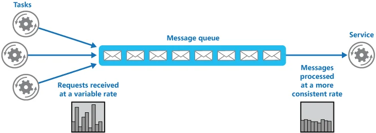
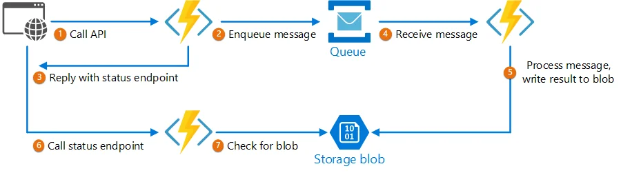

## 이 글을 30초에 파악하기

> **한 줄로** — 큐는 작업을 기다리게 할 수 있지만 완료, 중복 방지, 순서는 별도로 설계해야 한다.

**읽고 나면 알게 되는 것**

- 접수 응답과 실제 완료를 구분하고 적체량을 계산하는 법
- 여러 소비자의 병렬 처리와 중복 방지를 함께 설계하는 법
- 큰 메시지, 우선순위, 그룹별 순서에 맞는 선택 기준

**용어 먼저 보기**

| 용어 | 뜻 | 이 글에서의 역할 |
| --- | --- | --- |
| 생산자와 소비자 | 메시지를 보내는 쪽과 처리하는 쪽 | 접수와 처리의 책임을 구분한다 |
| 브로커 | 메시지를 저장하고 전달하는 시스템 | 큐의 보관과 전달을 담당한다 |
| 최소 한 번 전달 | 조건에 따라 같은 메시지가 다시 전달될 수 있는 전달 방식 | 중복 효과를 방지할 필요가 있다 |
| 확인 응답(ack) | 소비자가 처리를 마쳤음을 브로커에 알리는 신호 | 성공 전에 보내면 작업이 유실될 수 있다 |

**이런 분께** — 오래 걸리는 주문 처리나 파일 변환을 비동기로 바꾸려는 개발자에게 적합하다. 용량 판단이 급하다면 다음 적체 계산부터 살펴보자.

주문 접수 화면에는 성공이 떴지만 배송 예약은 아직 시작되지 않았다고 가정하자. 접수 서버가 재고와 배송 서비스를 동시에 기다리지 않도록 큐에 작업을 넣었다면 가능한 장면이다. 공부하면서 정리한 일곱 패턴으로 이 간격에서 생기는 책임을 살펴본다. 수치는 모두 이해를 위한 가상 사례다.

## 접수 속도가 처리 속도를 앞서면

가게 입구에 번호표를 놓으면 손님이 계산대 앞에서 한꺼번에 밀치는 일은 줄어든다. 그러나 계산대가 계속 부족하다면 대기 줄은 끝없이 길어진다. 큐도 같은 원리로 유입과 처리 사이의 시간을 벌어 줄 뿐이다.

### Queue-Based Load Leveling: 순간 부하를 완충한다

**큐 기반 부하 평탄화(Queue-Based Load Leveling)** 는 생산자와 처리 서비스 사이에 큐를 둔다.[^1] 생산자는 작업을 기록하고, 소비자는 하위 서비스가 감당할 속도로 가져간다. 소비자가 늘어도 하위 데이터베이스나 외부 API에 보내는 전체 동시 호출을 제한해야 한다. 제한하지 않으면 큐 뒤쪽으로 과부하가 이동한다.

[그림 크게 보기](/assets/images/cloud/official-queue-leveling.webp)

*출처: Microsoft 및 기여자, [Queue-Based Load Leveling](https://learn.microsoft.com/en-us/azure/architecture/patterns/queue-based-load-leveling) · [CC 허가본](https://github.com/reddev9339/architecture-center/blob/fa6c83c844280f548222c94857377596cbedae6f/docs/patterns/_images/queue-based-load-leveling-pattern.png) · [CC BY 4.0](https://creativecommons.org/licenses/by/4.0/) · 형식 변환*

왼쪽 막대는 변동하는 요청 유입을, 오른쪽 막대는 상대적으로 일정한 처리 속도를 개념적으로 나타낸다. 다음 계산의 수치는 그림과 별도로 정한 가상 조건이다.

가상으로 유입이 초당 150건이고 실제 완료가 초당 100건이라고 가정한다. 두 속도가 일정하고 만료나 유실이 없다면 적체 증가량은 초당 `150 - 100 = 50`건이다. 5분은 300초이므로 추가 적체는 `50 × 300 = 15,000`건이다.

이후 유입이 초당 50건으로 낮아지고 완료가 초당 100건으로 유지된다고 가정하자. 새 요청을 처리하고 남는 여력은 초당 50건이다. 기존 적체 15,000건을 비우는 데는 추가로 `15,000 ÷ 50 = 300`초가 걸린다. 이는 일정한 속도를 가정한 계산이지 실제 지연 시간의 예측값이 아니다.

이 방식은 짧은 급증과 지연을 허용하는 작업에 적합하다. 장기 평균 유입이 처리량보다 높거나 호출자가 즉시 결과를 요구하면 해결책이 아니다. 큐의 용량·보관 기한·내구성과 가득 찼을 때의 접수 거부 정책을 정해야 한다. 브로커 보관 및 작업 지연 비용도 처리 자원 절감과 함께 비교한다.

### Asynchronous Request-Reply: 접수와 완료를 나눈다

파일 변환 요청처럼 결과가 늦게 나오는 작업에서는 연결을 계속 붙잡지 않아도 된다. **비동기 요청-응답(Asynchronous Request-Reply)** 은 먼저 접수 상태를 알리고 나중에 결과를 조회하게 한다.[^2]

[그림 크게 보기](/assets/images/cloud/official-async-request-reply.webp)

*출처: Microsoft 및 기여자, [Asynchronous Request-Reply](https://learn.microsoft.com/en-us/azure/architecture/patterns/asynchronous-request-reply) · [CC 허가본](https://github.com/reddev9339/architecture-center/blob/fa6c83c844280f548222c94857377596cbedae6f/docs/patterns/_images/async-request-fn.png) · [CC BY 4.0](https://creativecommons.org/licenses/by/4.0/) · 형식 변환*

이 예시에서는 Azure Functions가 요청을 큐에 넣고 상태 조회 주소를 반환한다. 다른 함수가 메시지를 처리해 결과를 Blob에 저장하면 상태 조회 함수가 Blob을 확인한다. Azure Functions, 큐와 Blob은 이 패턴의 필수 구성은 아니다.

1. API가 입력과 권한을 검증하고 작업 식별자를 만든다.
2. 접수한 작업이 유실되지 않도록 기록과 큐 발행의 실패 경계를 설계한다.
3. API가 `202 Accepted`와 상태 조회용 `Location`을 돌려준다.
4. 소비자가 작업을 처리하고 상태를 진행 중·성공·실패 등으로 갱신한다.
5. 클라이언트는 상태를 조회하고 성공 시 결과를 가져온다.

`202`는 **처리 접수 응답이지 작업 완료나 영속 저장의 보증이 아니다**. 작업 기록과 큐 발행 사이에 장애가 나면 접수만 남거나 작업만 남을 수 있다. 같은 저장소에서 원자적으로 기록한 뒤 발행하는 설계 또는 누락을 탐지해 복구하는 절차가 필요하다. 클라이언트 재시도에는 안정적인 요청 식별자를 사용해 중복 작업을 피한다.

조회 간격을 안내하면 불필요한 폴링을 줄일 수 있다. 상태 URL은 식별자를 안다고 누구나 볼 수 없도록 소유자 권한을 검사한다. 결과와 오류의 보관 기간도 정한다. 상태 저장과 반복 조회는 추가 비용이다. 즉시 끝나는 작업이나 실시간 스트리밍이 필요한 요청에는 단순 동기 응답이나 다른 전달 방식이 더 적합할 수 있다.

## 여러 소비자가 한 큐를 읽으면

택배 분류대에 작업자 여럿을 배치하면 서로 다른 상자를 동시에 다룰 수 있다. 하지만 한 사람이 분류를 마친 직후 확인 신호를 보내지 못하면 같은 상자가 다시 배정될 수 있다. 작업을 나누는 문제와 결과가 중복되지 않게 하는 문제는 다르다.

### Competing Consumers: 독립 작업을 나눠 처리한다

**경쟁 소비자(Competing Consumers)** 는 여러 인스턴스가 같은 큐에서 메시지를 가져가 처리한다.[^3] 각 전달 시도는 한 소비자가 맡도록 조정하지만, 실패나 확인 응답 유실 뒤에는 다른 소비자가 같은 작업을 다시 받을 수 있다.

독립적인 이미지 변환이나 알림 생성처럼 작업을 병렬로 나눌 수 있을 때 적합하다. 한 인스턴스가 멈춰도 다른 인스턴스가 재전달된 메시지를 처리할 수 있다. 단, 정확한 동작은 브로커의 잠금·확인·재전달 설정과 내구성에 달려 있다.

소비자가 늘면 계산 자원과 브로커 호출 비용도 늘어난다. 하위 서비스의 한도를 넘지 않도록 소비자 수와 동시성을 함께 제한한다. 작업 간 엄격한 순서가 필요하거나 즉시 결과를 기다려야 한다면 단순 경쟁 소비만으로는 적합하지 않다. 반복 실패 메시지는 별도 격리 큐로 옮기고 원인과 재처리 절차를 남긴다.

### Idempotent Consumer: 중복 전달과 중복 효과를 구분한다

**멱등 소비자(Idempotent Consumer)** 는 같은 논리 작업이 반복돼도 한 번 처리한 것과 같은 업무 효과를 내도록 한다.[^4] 최소 한 번 전달은 전달 보장에 관한 계약이다. 멱등성은 중복 전달로 결제가 두 번 승인되거나 주문이 두 번 생성되는 효과를 막는 처리 계약이다.

작동 순서를 주문 생성으로 살펴보자.

1. 생산자가 재전달과 재시도에도 바뀌지 않는 작업 식별자를 부여한다.
2. 소비자가 해당 식별자를 읽고 업무 변경과 처리 기록을 같은 데이터베이스 트랜잭션에 넣는다.
3. 식별자의 유일성 제약으로 동시에 도착한 중복 처리 중 하나만 성공하게 한다.
4. 커밋 후 확인 응답을 보낸다. 응답 전에 장애가 나 재전달돼도 기존 처리 기록을 확인한다.

단순히 먼저 조회하고 나중에 기록하면 두 소비자가 동시에 조회를 통과할 수 있다. 처리 기록을 업무 변경과 별도로 저장해도 그 사이의 장애가 중복을 만든다. 서로 다른 내용에 같은 키가 재사용된 경우에는 정상 중복으로 버리지 말고 충돌로 조사한다.

외부 결제 호출은 로컬 데이터베이스 트랜잭션에 묶을 수 없다. 결제 제공자의 멱등 키를 사용하고, 응답 유실로 결과가 불명확하면 상태를 조회해 대사해야 한다. 지원이 없다면 중복을 자동으로 완전히 막는다고 단정할 수 없다. 중복 기록은 브로커 재전달과 격리 큐 재투입 기간을 고려해 보관한다.

항상 같은 절대 상태를 설정하는 등 작업 자체가 멱등인 경우 별도 기록이 불필요할 수 있다. 반면 중복 제거 기록의 저장·조회와 정리는 비용을 만든다. 처리 키와 로그에 개인정보를 직접 넣지 않고 접근 권한을 제한한다.

## 큰 메시지와 급한 메시지는 어떻게 다룰까

대형 첨부 파일과 짧은 주문 알림을 같은 상자에 넣어 옮긴다고 생각해 보자. 상자 크기 제한에 걸릴 수도 있고, 긴급한 알림이 파일 뒤에서 기다릴 수도 있다. 크기와 중요도는 서로 다른 기준으로 처리한다.

### Claim Check: 내용 대신 찾을 표를 보낸다

**클레임 체크(Claim Check)** 는 큰 본문을 별도 저장소에 두고 큐에는 그 본문을 찾을 참조를 보낸다.[^5] 맡긴 짐 대신 보관표를 전달하는 방식이다. 생산자는 저장이 성공한 뒤 참조를 발행하고, 소비자는 참조로 본문을 읽어 처리한다.

큰 파일이 브로커의 메시지 크기 제한을 넘거나 브로커 자원을 과도하게 사용하는 경우 적합하다. 작은 메시지는 직접 전송하는 편이 간단하며 추가 저장·조회 왕복도 피한다. 저장소가 장애를 겪으면 큐가 살아 있어도 본문을 읽을 수 없고, 저장 후 발행 전 장애는 주인 없는 파일을 남긴다. 고아 파일 정리와 재시도 절차가 필요하다.

참조가 가리키는 본문은 메시지의 재시도와 재처리 기간보다 먼저 삭제하지 않는다. 소비자는 별도로 인증·인가하고 참조에 장기 자격 증명을 넣지 않는다. 필요하다면 해시로 무결성을 확인한다. 브로커 부담이 줄더라도 저장소 용량, 조회와 전송 비용이 추가된다.

### Priority Queue: 급한 일을 먼저 선택한다

**우선순위 큐(Priority Queue)** 는 도착 순서가 아니라 업무 중요도에 따라 처리 순서를 조정한다.[^6] 브로커가 우선순위를 지원하면 하나의 큐를 쓸 수 있고, 그렇지 않으면 등급별 큐와 소비자 정책을 둘 수 있다.

예를 들어 긴급 주문과 일반 보고서를 별도 큐에 넣을 수 있다. 공유 소비자가 긴급 큐부터 계속 읽으면 일반 보고서는 오래 밀릴 수 있다. 오래 기다린 작업의 우선순위를 높이거나 일반 큐에 최소 처리 용량을 배정해 기아를 완화한다. 별도 소비자 풀은 격리에 도움이 되지만 유휴 용량과 큐 운영 비용이 늘 수 있다.

업무별 완료 목표가 다를 때 적합하지만 모든 작업의 중요도가 같다면 복잡성만 늘어난다. 순서 의존 작업을 우선순위로 재배열하면 잘못된 상태가 생길 수 있다. 우선순위 값은 신뢰할 수 있는 서버 정책으로 정하고, 클라이언트가 임의로 긴급 등급을 얻지 못하게 권한을 확인한다.

## 같은 주문의 순서는 지키고 싶다면

주문 생성보다 취소가 먼저 처리되면 소비자가 취소할 대상을 찾지 못할 수 있다. 그렇다고 모든 주문을 한 줄로 세우면 서로 무관한 주문까지 기다린다. 주문별로 별도의 계산대를 두되 각 계산대 안에서는 한 명씩 처리하는 방식이 필요하다.

### Sequential Convoy: 그룹 안은 순차, 그룹 사이는 병렬

**순차 호송(Sequential Convoy)** 은 관련 메시지에 그룹 키를 붙이고 그룹별로 순차 처리한다.[^7] 주문 A의 생성과 취소는 A 그룹에서 순서대로 처리한다. 주문 B는 별도 그룹에서 동시에 처리할 수 있다.

생산자는 각 메시지에 같은 주문 식별자를 그룹 키로 넣는다. 순서 보장을 지원하는 브로커에서 소비자는 해당 그룹을 잠그고 메시지를 하나씩 처리한다. 다른 소비자는 다른 그룹을 맡는다. 예를 들어 Azure Service Bus의 메시지 세션은 이런 그룹화와 잠금을 지원한다.[^7]

브로커가 지키는 것은 보통 **큐에 들어온 순서**다. 생산자나 네트워크 때문에 생성 순서와 큐 도착 순서가 다르면 이를 자동으로 바로잡지 못한다. 업무상 생성 순서가 중요하면 생산 단계에서 순서를 보장하거나 버전·순번을 검사하고 누락 시 대기·복구한다. 그룹 키 오류도 다른 주문의 상태를 오염시킬 수 있으므로 검증한다.

한 그룹의 느린 작업이나 반복 실패는 뒤의 작업을 막는다. 실패 메시지를 격리한 뒤 다음 메시지를 진행하면 업무상 순서가 깨질 수 있으므로, 해당 그룹을 멈출지 복구 후 재생할지 정해야 한다. 잠금 만료에 따른 재전달에도 멱등 처리가 필요하다. 그룹 키가 너무 거칠면 병렬성이 떨어지고, 활성 그룹과 잠금 관리가 늘면 운영·계산 비용도 증가한다. 순서가 필요 없는 독립 작업이라면 경쟁 소비자가 더 단순하다.

## 운영에서 무엇을 확인할까

접수 성공률이 높아도 사용자는 결과를 오래 기다릴 수 있다. 대기실 입장 인원만 세지 말고 대기 시간과 실제 완료 인원을 함께 살펴봐야 한다.

| 질문 | 관측할 신호와 대응 |
| --- | --- |
| 작업이 계속 밀리는가 | 유입률·완료율, 큐 깊이, 가장 오래된 메시지 나이와 만료 건수를 함께 본다 |
| 요청이 실제로 끝나는가 | 접수부터 완료까지의 지연 분포, 진행 중 상태의 체류 시간과 실패율을 본다 |
| 처리가 반복되는가 | 재전달·중복 감지·잠금 만료·격리 큐 건수를 추적한다 |
| 특정 등급이나 그룹만 밀리는가 | 우선순위별 대기 시간과 그룹별 적체·처리 시간을 구분한다 |
| 외부 의존성이 막히는가 | 하위 서비스 오류·동시 호출과 본문 저장소 조회 실패를 확인한다 |

알림 기준은 실제 허용 지연, 보관 기한, 하위 서비스 용량에 맞춰 정한다. 오류가 난 메시지의 내용과 로그에는 민감 정보가 담길 수 있다. 격리 큐의 조회·재처리 권한과 보관 기간도 일반 큐만큼 엄격히 관리한다.

결국 큐의 핵심은 속도가 아니라 **기다림과 실패의 책임을 어디에 둘지**다. 완충, 병렬 처리, 멱등성, 순서를 각각 검토하면 필요한 조합만 선택할 수 있다.

## References

[^1]: [Queue-Based Load Leveling pattern — Microsoft Azure Architecture Center](https://learn.microsoft.com/en-us/azure/architecture/patterns/queue-based-load-leveling)
[^2]: [Asynchronous Request-Reply pattern — Microsoft Azure Architecture Center](https://learn.microsoft.com/en-us/azure/architecture/patterns/asynchronous-request-reply)
[^3]: [Competing Consumers pattern — Microsoft Azure Architecture Center](https://learn.microsoft.com/en-us/azure/architecture/patterns/competing-consumers)
[^4]: [Idempotent Consumer pattern — Microsoft Azure Architecture Center](https://learn.microsoft.com/en-us/azure/architecture/patterns/idempotent-consumer)
[^5]: [Claim Check pattern — Microsoft Azure Architecture Center](https://learn.microsoft.com/en-us/azure/architecture/patterns/claim-check)
[^6]: [Priority Queue pattern — Microsoft Azure Architecture Center](https://learn.microsoft.com/en-us/azure/architecture/patterns/priority-queue)
[^7]: [Sequential Convoy pattern — Microsoft Azure Architecture Center](https://learn.microsoft.com/en-us/azure/architecture/patterns/sequential-convoy)

시리즈 전체 구성은 [클라우드 아키텍처 디자인 패턴](/cloud/cloud-architecture-design-patterns/)에서 볼 수 있다. 다음 글에서는 [이벤트와 워크플로 패턴](/cloud/cloud-patterns-event-workflows/)을 살펴본다.
