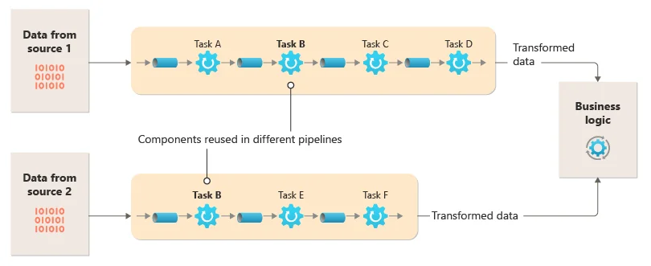

## 이 글을 30초에 파악하기

**한 줄로:** 이벤트 전달, 단계 실행, 업무 복구는 서로 다른 책임이며 함께 설계해야 한다.

**읽고 나면 알게 되는 것**

- 발행-구독과 코레오그래피가 각각 무엇을 분리하는지 이해한다.
- 파이프라인, 메시징 브리지, 중앙 감독자의 적용 경계를 구분한다.
- 사가의 중간 상태와 보상 실패를 운영 가능한 상태로 다룬다.

**용어 먼저 보기**

| 용어 | 뜻 |
| --- | --- |
| 이벤트 | 주문 생성처럼 이미 일어난 일을 알리는 메시지 |
| 브로커 | 발행자와 구독자 사이에서 메시지를 전달하는 중개 시스템 |
| 멱등성 | 같은 요청을 반복해도 업무상 효과가 한 번 처리한 것과 같은 성질 |
| 보상 | 이미 완료된 업무의 효과를 업무 규칙에 따라 상쇄하는 새 작업 |

주문과 결제 같은 비동기 업무를 설계하거나 장애를 추적하는 개발자를 위한 글이다. 메시징과 업무 조정이 자주 혼동되어, 공식 패턴을 운영 관점에서 정리했다.

## 주문은 접수됐는데 배송이 시작되지 않았다

주문 서비스가 주문을 저장한 직후 프로세스가 종료됐다고 가정하자. 고객 화면에는 주문이 보이지만 재고 서비스에는 주문 이벤트가 전달되지 않을 수 있다. 반대로 이벤트가 전달된 뒤 확인 응답만 유실되면 같은 이벤트가 다시 전송될 수 있다.

이 문제는 식당의 주문표와 닮았다. 주문표를 주방에 전달하는 것과 요리를 끝내는 것은 다른 일이다. 조리 중 실패했을 때 누가 주문 상태를 바꾸고 결제를 취소할지도 따로 정해야 한다.

이 글의 모든 수치와 주문 흐름은 이해를 위한 가정이다. 특정 서비스의 처리량이나 요금을 측정한 결과가 아니다.

## 이벤트 전달과 업무 흐름은 어떻게 다른가

주문 하나가 생겼을 때 재고, 알림, 분석이 같은 소식을 받아야 한다고 가정하자. 소식을 전달하는 일과 다음 업무를 결정하는 일은 다르다.

### Publisher-Subscriber: 한 사건을 여러 구독자에게 알린다

**발행-구독(Publisher-Subscriber)** 에서 주문 서비스는 `주문 생성` 이벤트를 브로커에 발행한다. 브로커는 관심 있는 재고, 알림, 분석 구독자에게 각자의 경로로 이벤트를 전달한다.[^1] 발행자는 각 구독자의 주소와 배포 시점을 몰라도 된다.

구독자는 독립적으로 처리하지만, 모든 구독자가 동시에 완료된다는 뜻은 아니다. 브로커의 보관 기간과 전달 보장, 필터, 재전달 정책을 제품별로 확인해야 한다. 최소 한 번 전달이면 소비자는 이벤트 식별자를 이용해 중복 효과를 막아야 한다. 순서가 중요하다면 주문별 순서 보장 범위와 처리 방식을 별도로 정한다.

가상의 주문 이벤트가 1,000건이고 관심 구독자가 세 개라고 하자. 필터 없이 모두 전달한다면 최대 3,000건의 구독자별 처리 기회가 생긴다. 이는 재시도를 제외한 계산이며 실제 과금 단위를 뜻하지 않는다. 구독자가 늘면 전달량과 저장·처리 비용도 늘 수 있다.

독립적인 여러 소비자에게 알릴 때 적합하다. 즉시 응답이나 모든 소비자의 원자적 완료가 필수라면 다른 계약이 필요하다. 토픽별 발행·구독 권한을 분리하고 전송을 암호화한다. 브로커 장애, 구독자 적체, 만료와 격리된 메시지를 관찰해야 한다.

### Choreography: 다음 행동을 각 서비스가 결정한다

**코레오그래피(Choreography)** 는 중앙 조정자가 전체 단계를 지시하지 않는다. 각 서비스가 이벤트를 보고 자신의 업무를 수행한 뒤 결과를 발행한다.[^2]

예를 들어 재고 서비스가 `주문 생성`을 받아 재고를 예약한다. 이어 `재고 예약 완료`를 발행하면 결제 서비스가 결제를 시도한다. 서비스들은 사전에 합의한 이벤트 계약으로 협력한다. 발행-구독이 **전달 방식**이라면 코레오그래피는 **업무 결정의 분산 방식**이다.

독립된 작업과 자주 바뀌는 참여자가 있을 때 유용하다. 반면 재고와 신용 확인이 모두 끝나야 다음 단계를 시작하는 복잡한 흐름은 상태를 모으기 어렵다. 중앙 조정자가 필요한 경우가 있다. 브로커를 쓴다고 자동으로 코레오그래피가 되는 것도 아니다.

서비스별 이벤트 발행 권한과 스키마를 제한하고 순환 이벤트를 방지한다. 장애 시에는 상관관계 ID로 서비스 간 경로를 추적한다. 이벤트 형식 변경과 분산 추적에 운영 비용이 든다. 상태 저장과 이벤트 발행이 따로 실패할 수 있으므로 원자적으로 기록하는 방법도 필요하다.

## 서로 다른 경계에서 메시지를 연결하고 처리한다

### Messaging Bridge: 서로 다른 메시징 인프라를 잇는다

기존 주문 시스템과 새 배송 시스템이 서로 다른 브로커를 사용한다고 가정하자. **메시징 브리지(Messaging Bridge)** 는 양쪽 인프라에 연결해 한쪽 큐의 메시지를 다른 쪽으로 전달한다.[^3] 공식 패턴의 기본 설명은 페이로드를 바꾸지 않는 전달이다. 메시지 형식 자체를 바꿔야 한다면 그 변환 계약은 별도로 설계해야 한다.

브리지는 송신 측 메시지를 읽고 수신 측에 보낸 뒤 원본 처리 완료를 확정한다. 수신 측 전송은 성공했는데 원본 확인 전에 브리지가 죽으면 중복 전달이 생길 수 있다. 안정적인 메시지 ID와 중복 처리, 각 구간의 확인 정책이 필요하다. 두 브로커의 순서·크기 제한과 기능도 모두 만족해야 한다.

레거시를 한 번에 바꾸기 어렵거나 단계적으로 이관할 때 적합하다. 양쪽 중 한쪽에만 있는 필수 기능이나 즉각적인 동기 응답이 필요하면 부적합할 수 있다. 이관 후에도 기존 큐와 오류 큐의 미처리 메시지가 남았는지 확인해야 한다.

브리지는 양쪽 시스템에 접근하므로 최소 권한과 네트워크 경계를 적용한다. 장애 시 양쪽 적체와 전달 지연을 함께 본다. 추가 네트워크 홉, 브리지 가용성, 데이터 전송과 운영 비용이 생긴다.

### Pipes and Filters: 처리 단계를 계약으로 연결한다

**파이프와 필터(Pipes and Filters)** 는 복잡한 작업을 독립된 처리 단계인 필터로 나눈다. 파이프는 한 필터의 출력을 다음 필터로 전달한다.[^4] 예를 들어 상품 이미지의 검증, 크기 조정, 게시를 구분할 수 있다.

[그림 크게 보기](/assets/images/cloud/official-pipes-and-filters.webp)

*출처: Microsoft 및 기여자, [Pipes and Filters](https://learn.microsoft.com/en-us/azure/architecture/patterns/pipes-and-filters) · [CC 허가본](https://github.com/reddev9339/architecture-center/blob/fa6c83c844280f548222c94857377596cbedae6f/docs/patterns/_images/pipes-and-filters-solution.png) · [CC BY 4.0](https://creativecommons.org/licenses/by/4.0/). 원본을 WebP로 변환했다.*

그림에서 서로 다른 데이터 원본은 각각 독립된 파이프라인을 거친다. 두 파이프라인은 Task B 필터를 재사용하고, 변환된 데이터를 업무 로직(Business logic)에 전달한다.

검증 필터는 입력 파일과 검증 결과를 정의하고, 크기 조정 필터는 유효한 파일을 받아 결과를 만든다. 필터는 같은 프로세스에 둘 수도 있고 독립 배포할 수도 있다. 단계의 데이터 의존성과 업무 규칙을 지키는 경우에만 순서를 바꿀 수 있다. 검증 전에 게시하도록 순서를 바꾸면 안 된다.

가정상 검증이 분당 100건, 크기 조정이 분당 60건, 게시가 분당 100건을 처리한다고 하자. 다른 병목이 없고 입력이 충분하면 전체 완료 속도는 느린 단계의 분당 60건을 넘기 어렵다. 크기 조정 앞의 대기열이 커진다면 해당 단계와 공유 자원의 용량을 먼저 확인한다.

독립 확장이나 재사용이 필요할 때 적합하다. 단순한 동기 처리에 단계를 나누면 전송과 배포 비용이 이점보다 클 수 있다. 단계별 재시도로 출력이 중복될 수 있으므로 멱등성을 설계한다. 각 필터에 필요한 입력·출력 권한만 부여하고 실패 메시지와 단계별 대기 시간을 관찰한다.

## 누가 단계의 완료와 재시도를 감독하는가

### Scheduler Agent Supervisor: 상태를 남기고 복구를 지시한다

외부 결제나 배송 예약을 여러 단계로 호출할 때 중앙에서 진행 상황을 확인해야 한다고 가정하자. **Scheduler Agent Supervisor** 는 역할을 세 가지로 분리한다.[^5]

1. **Scheduler** 는 단계와 순서를 정하고 진행 상태와 완료 기한을 영속 저장한다.
2. **Agent** 는 원격 서비스 호출과 허용된 범위의 재시도를 담당한다.
3. **Supervisor** 는 저장된 상태를 살펴 기한이 지난 작업의 재시도나 복구를 요청한다.

이들은 논리적 역할이며 반드시 세 개의 별도 서비스일 필요는 없다. Supervisor가 프로세스를 직접 재시작하는 것은 아니다. 프로세스 재시작은 호스팅 환경의 책임이고, 업무 복구는 저장된 상태와 워크플로 로직에 달려 있다.

시간 초과는 원격 작업이 실행되지 않았다는 증거가 아니다. 기존 시도가 늦게 완료되는 동안 새 시도가 시작될 수 있다. 따라서 안정적인 작업 식별자, 멱등 처리와 상태 소유권 검사가 필요하다. 여러 감독자가 같은 작업을 동시에 복구하지 않도록 조건부 소유권도 확보한다.

원격 호출이 있는 장시간 업무와 명시적인 진행 상태가 필요할 때 적합하다. 단일 프로세스의 짧은 작업이라면 상태 저장과 감독의 복잡도가 불필요할 수 있다. 상태 저장소와 복구 기록은 민감 데이터를 포함할 수 있으므로 권한과 보존 기간을 제한한다. 감독 주기가 짧으면 장애 감지는 빨라지지만 조회 부하와 비용이 늘 수 있다.

## 사가는 실패한 업무를 어떻게 수습하는가

배송 예약이 실패한 뒤 이미 승인한 결제를 취소해야 하는 주문을 생각해 보자. 앞 단계가 성공했다고 전체 업무가 끝난 것은 아니다.

### Saga: 로컬 트랜잭션을 업무 흐름으로 묶는다

**사가(Saga)** 는 여러 서비스의 로컬 트랜잭션을 순서에 맞춰 조정한다.[^6] 각 서비스는 자기 저장소에서 작업을 커밋하고 다음 단계에 필요한 이벤트나 메시지를 보낸다. 분산된 전체 작업이 하나의 ACID 트랜잭션이 되는 것은 아니다.

가상의 주문 흐름을 보자. 재고를 예약하고, 결제를 승인하고, 배송을 예약한다. 배송 예약이 실패하면 결제 승인 취소와 재고 예약 해제 같은 보상 작업을 시작할 수 있다. 각 단계의 성공과 실패, 보상 가능 여부는 업무별로 다르다.

사가는 이벤트를 주고받는 코레오그래피나 중앙 조정자를 쓰는 오케스트레이션으로 구현할 수 있다. 전자는 참여자가 적고 규칙이 단순할 때 이해하기 쉽다. 후자는 전체 상태와 복잡한 분기를 한곳에서 관리하기 쉽지만 조정자의 가용성과 운영 책임이 생긴다. 앞서 살펴본 Scheduler Agent Supervisor는 조정과 복구를 구현하는 한 가지 역할 분리 방식이다.

사가에는 서비스 간 자동 격리가 없다. 다른 주문이 예약 중인 재고를 동시에 읽거나 변경할 수 있다. 예약 상태, 버전 검사 또는 업무상 잠금으로 충돌을 다루고, 중간 상태가 사용자에게 보일지 정한다. 즉시 강한 일관성이 필수인 작업이나 유효한 보상 방법이 없는 업무에는 사가가 적합하지 않을 수 있다.

### Compensating Transaction: 되감기가 아니라 새 업무다

**보상 트랜잭션(Compensating Transaction)** 은 앞서 완료된 업무의 효과를 상쇄하는 새 작업이다.[^7] 결제 승인 취소는 이전 결제 데이터베이스의 커밋을 지우는 것이 아니다. 이미 발송된 알림이나 환불 수수료처럼 원래 상태로 정확히 되돌릴 수 없는 효과도 있다.

보상은 **ACID 롤백이 아니며 자동으로 성공하지 않는다.** 보상 호출이 실패하거나 응답이 유실되면 진행 상태를 남기고 안전하게 재시도해야 한다. 외부 결제사가 취소를 수행했는지 불명확할 때는 상대 시스템의 조회와 멱등성 계약을 확인한다. 해결되지 않으면 담당자가 확인할 수 있도록 알리고 업무를 보류한다.

보상 순서는 반드시 원래 단계의 역순일 필요가 없다. 업무상 더 민감한 자원을 먼저 해제하거나 독립된 보상을 병렬로 수행할 수 있다. 단, 그 순서는 다른 동시 작업과 보상 간 의존성을 반영해야 한다. 단순히 이전 값을 덮어쓰면 다른 사용자의 변경을 잃을 수 있다.

일시적 실패라면 먼저 제한된 재시도가 가능한지 판단한다. 대체 배송 수단을 제안하는 편이 취소보다 나을 수도 있다. 반대로 발송 완료처럼 되돌릴 수 없는 지점은 사전에 정의하고 중요한 검증을 그 전에 마친다. 보상 기록에는 결제나 고객 정보가 들어갈 수 있으므로 접근과 보존을 제한한다. 추가 호출, 장기 보관과 수동 복구 비용도 예산에 포함한다.

## 운영에서 무엇을 관찰해야 하는가

패턴을 도입했다는 사실보다 **어느 주문이 어디에서 멈췄는지** 알 수 있는지가 중요하다. 다음은 가상의 주문 시스템을 위한 측정 계획이다. 목표치와 알림 기준은 실제 업무의 지연 허용 범위와 장애 실험에 맞춰 정한다.

| 질문 | 확인할 신호 |
| --- | --- |
| 구독자가 뒤처지는가? | 구독별 적체량, 가장 오래된 메시지 나이, 만료·격리 건수 |
| 브리지에 문제가 있는가? | 양쪽 큐 적체, 전달 실패, 중복 감지, 구간별 지연 |
| 어느 처리 단계가 느린가? | 필터별 처리율과 지연, 실패율, 대기열 증가 속도 |
| 감독자가 업무를 복구하는가? | 기한 초과 단계 수, 탐지 지연, 재시도 횟수, 상태 저장소 오류 |
| 사가가 끝났는가? | 진행 중인 업무의 나이, 단계별 성공·실패, 보상 진행·완료·실패 건수 |

주문 ID와 이벤트 ID, 시도 번호, 단계 상태를 각 로그에 연결한다. 다만 로그에 결제 정보나 개인정보를 그대로 담지 않는다. 상태 저장과 이벤트 발행 사이의 실패, 중복 메시지, 브리지 중단과 보상 실패를 각각 실험해야 한다. 접수 성공률만으로 업무 완료를 판단하지 않는다.

[클라우드 아키텍처 디자인 패턴 시리즈 안내](/cloud/cloud-architecture-design-patterns/)에서 전체 지도를 볼 수 있다. 다음 글은 [데이터를 다루는 클라우드 패턴](/cloud/cloud-patterns-data/)이다.

## References

[^1]: [Publisher-Subscriber Pattern — Microsoft Learn](https://learn.microsoft.com/en-us/azure/architecture/patterns/publisher-subscriber)
[^2]: [Choreography Pattern — Microsoft Learn](https://learn.microsoft.com/en-us/azure/architecture/patterns/choreography)
[^3]: [Messaging Bridge Pattern — Microsoft Learn](https://learn.microsoft.com/en-us/azure/architecture/patterns/messaging-bridge)
[^4]: [Pipes and Filters Pattern — Microsoft Learn](https://learn.microsoft.com/en-us/azure/architecture/patterns/pipes-and-filters)
[^5]: [Scheduler Agent Supervisor Pattern — Microsoft Learn](https://learn.microsoft.com/en-us/azure/architecture/patterns/scheduler-agent-supervisor)
[^6]: [Saga Design Pattern — Microsoft Learn](https://learn.microsoft.com/en-us/azure/architecture/patterns/saga)
[^7]: [Compensating Transaction Pattern — Microsoft Learn](https://learn.microsoft.com/en-us/azure/architecture/patterns/compensating-transaction)
