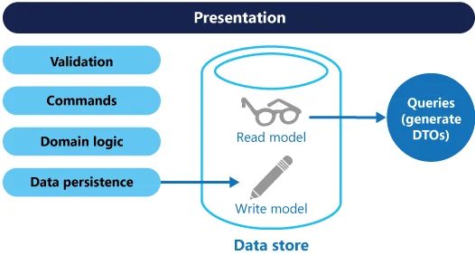

## 이 글을 30초에 파악하기

> **한 줄로** — 데이터 패턴은 읽기와 쓰기의 병목을 옮기는 대신 최신성, 복구, 운영 비용을 설계하게 만든다.

**읽고 나면 알게 되는 것**

- 반복 조회를 캐시하고 다른 조회 기준의 인덱스나 집계 뷰를 만드는 방법
- CQRS의 모델 분리와 이벤트 소싱의 원본 기록 방식이 서로 다른 이유
- 샤드 키와 갱신 지연이 장애 범위, 보안, 비용에 미치는 영향

**용어 먼저 보기**

| 용어 | 뜻 | 이 글에서의 역할 |
| --- | --- | --- |
| 원본 데이터 | 업무상 정답으로 삼는 데이터 | 파생 데이터가 틀렸을 때 복구 기준이 된다 |
| 읽기 모델 | 조회에 맞게 구성한 데이터 표현 | 원본과 다르게 구성하거나 별도로 보관할 수 있다 |
| 투영 | 원본에서 필요한 형태를 만들어 내는 처리 | 이벤트나 원본 변경을 읽기 모델에 반영한다 |
| 샤드 | 전체 행 중 일부를 보관하는 수평 분할 | 데이터와 부하를 여러 저장 단위로 나눈다 |

**이런 분께** — 조회가 느려진 서비스에서 캐시, 데이터 모델 분리, 수평 확장 중 무엇부터 검토할지 고민하는 개발자를 위한 글이다.

주문이 몰리는 날을 가정하자. 상품 상세는 느려지고, 주문 목록은 방금 저장한 주문을 보여주지 못한다. 동시에 운영 대시보드는 이전 시간대의 매출을 보여준다. 세 화면이 모두 데이터를 읽지만 필요한 최신성과 조회 방식은 다르다.

이 글은 Microsoft의 공식 패턴을 바탕으로 그 차이를 정리한 학습 기록이다. 아래 예시는 이해를 돕기 위한 가정이며 성능 실측이 아니다.

## 반복 조회는 캐시로 줄이되 최신성을 계약한다

### Cache-Aside: 필요한 항목만 옆에 둔다

도서관에서 자주 찾는 책을 안내 데스크 옆에 두는 모습을 생각해 보자. 책이 없으면 서고에서 가져와 놓고, 다음 방문자는 가까운 곳에서 찾는다. **Cache-Aside**도 애플리케이션이 캐시와 원본을 직접 조정한다.[^1]

1. 애플리케이션이 키로 캐시를 조회한다. 값이 있으면 반환한다.
2. 값이 없으면 원본 저장소에서 읽어 캐시에 채운 뒤 반환한다.
3. 수정할 때는 원본을 먼저 갱신하고 해당 캐시 항목을 무효화한다.
4. 다음 조회에서 새 값을 다시 읽어 채운다.

원본 갱신 전에 캐시를 지우면 다른 요청이 옛 원본을 다시 캐시에 채울 수 있다. 원본을 먼저 갱신해도 두 작업이 원자적이지 않으면 짧은 불일치가 가능하다. 진행 중인 오래된 읽기가 무효화 후 값을 다시 넣는 경쟁도 따로 다뤄야 한다. 버전 확인이나 갱신 조정 등은 저장소와 업무의 일관성 요구에 맞게 설계한다.

예를 들어 전체 조회가 1,000건이고 그중 800건이 캐시에서 처리된다고 가정하자. 다른 원본 읽기가 없다면 나머지 200건이 원본으로 간다. 이는 이해를 위한 계산이지 실제 적중률이나 지연 개선을 보장하는 수치가 아니다.

자주 읽고 자주 바뀌지 않는 상품 설명에는 적합하다. 반대로 매 요청에서 최신 권한을 확인해야 하는 데이터는 오래된 캐시가 보안 사고로 이어질 수 있다. 공유 캐시는 테넌트별 키와 접근 제어를 분리하고 민감한 값의 저장 필요성부터 검토한다.

캐시 장애나 대량 만료가 발생하면 요청이 원본으로 몰릴 수 있다. 캐시 미스 비율, 원본 부하, 만료와 무효화 실패를 함께 관측한다. 캐시 용량과 운영비, 원본 호출 절감 효과를 비교해야 한다. 대부분 미스라면 캐시 조회 비용만 추가될 수 있다.

## 명령과 조회를 나누고 사건의 기록 방식도 구분한다

### CQRS: 같은 주문을 두 관점으로 본다

주문 접수는 재고와 결제 상태를 검증해야 한다. 주문 목록은 그 모든 규칙보다 화면에 보여줄 상태와 시간을 빠르게 읽는 데 관심이 있다. **CQRS**는 상태를 변경하는 명령 모델과 데이터를 반환하는 조회 모델의 책임을 나눈다.[^2]

예를 들어 명령 측은 주문을 승인하기 전에 업무 규칙을 검사한다. 조회 측은 주문 목록에 필요한 항목만 반환하는 모델을 제공한다. 두 모델은 하나의 데이터베이스를 공유할 수도 있고 서로 다른 저장소를 쓸 수도 있다. **별도 데이터베이스와 이벤트 소싱은 CQRS의 필수 조건이 아니다.**

[그림 크게 보기](/assets/images/cloud/official-cqrs.webp)

*출처: Microsoft 및 기여자, [CQRS 패턴](https://learn.microsoft.com/en-us/azure/architecture/patterns/cqrs) · [CC 허가본](https://github.com/reddev9339/architecture-center/blob/fa6c83c844280f548222c94857377596cbedae6f/docs/patterns/_images/command-and-query-responsibility-segregation-cqrs-basic.png) · [CC BY 4.0](https://creativecommons.org/licenses/by/4.0/) · 형식 변환*

그림은 하나의 데이터 저장소 안에 읽기 모델과 쓰기 모델을 둔 예다. 명령과 도메인 로직은 쓰기 모델을 거치고, 조회는 읽기 모델에서 데이터 전송 객체(DTO)를 만든다.

읽기 모델을 비동기 갱신하는 구성이라면 쓰기 성공 후 조회 반영까지 지연이 생길 수 있다. CQRS 자체가 지연을 강제하는 것은 아니다. 같은 저장소를 동기적으로 조회하는 구성에서는 해당 비동기 갱신 지연이 없다. 실제 최신성은 트랜잭션과 저장소의 읽기 일관성에도 달려 있다.

목록이 뒤처질 수 있다면 주문 직후에는 명령 결과를 화면에 표시할 수 있다. 반드시 최신 값을 확인해야 하는 동작은 권한과 부하를 고려해 원본을 조회하거나 쓰기 측에서 다시 검증한다. 읽기 측 결과만으로 재고 차감을 확정하지 않는다.

복잡한 업무 규칙과 조회 형태가 다른 서비스에는 유용하다. 단순한 입력·조회 화면이라면 두 모델을 유지하는 비용이 이점보다 클 수 있다. 비동기 동기화가 실패하면 누락·중복·역순을 처리하고 원본과 대조해야 한다. 명령 권한과 조회 권한을 나누되 조회 저장소에도 테넌트별 접근 통제를 적용한다.

### Event Sourcing: 현재 값이 아니라 변화의 장부를 원본으로 둔다

통장 잔액만 기록하면 잔액이 왜 바뀌었는지 알기 어렵다. **이벤트 소싱(Event Sourcing)** 은 업무에서 일어난 변화를 순서 있는 사건으로 저장하고 그 기록을 원본으로 삼는다.[^3]

가상의 주문에서 `주문 생성`, `상품 추가`, `주문 취소`를 순서대로 기록한다고 하자. 현재 상태가 필요하면 해당 주문의 사건을 순서대로 적용해 재구성한다. 취소는 과거 사건을 지우는 대신 새 사건으로 남길 수 있다. 이력 재현이 중요한 업무에 도움이 되지만 단순한 감사 로그를 추가하는 것과는 다르다. 이벤트 스트림 자체가 현재 상태를 재구성하는 기준이기 때문이다.

두 요청이 같은 주문의 이전 상태를 동시에 읽었다면 둘 다 그대로 기록해서는 안 된다. 스트림 버전을 조건으로 새 사건을 추가하고 충돌 시 최신 상태를 다시 읽어 규칙을 재검사할 수 있다. 메시지 브로커는 전달 수단이며 엔터티별 조회와 동시성 제어를 갖춘 이벤트 저장소와 자동으로 같아지지 않는다.

사건이 쌓이면 재생 시간이 늘어난다. 특정 시점의 스냅샷을 저장하고 그 뒤의 사건만 재생하면 작업을 줄일 수 있다. 스냅샷은 최적화이며 원본 사건을 대신하지 않는다. 이벤트 스키마 버전과 구버전 해석, 소비자의 중복 처리, 잘못 기록된 사건의 정정 절차도 필요하다.

이력 재구성과 업무 의도가 중요한 영역에 선택적으로 적용한다. 현재 값만 필요한 단순 설정이나 수명이 짧은 서비스에는 저장·재생·운영 비용이 과할 수 있다. 사건은 오래 남기 쉬우므로 개인정보를 직접 포함할지 신중히 결정한다. 별도 저장과 접근 통제, 보존·삭제 요구를 함께 설계한다.

CQRS와 조합하면 사건을 읽어 조회 모델을 만들 수 있다. 이때 원본 사건 저장과 조회 모델 반영은 별개의 단계다. 사건 발행이 누락되거나 투영 처리가 멈추면 쓰기 성공과 조회 결과가 어긋난다. 처리 위치, 지연, 실패 건수와 재생 가능 여부를 관측한다.

## 다른 검색 기준과 집계 결과를 미리 만든다

### Index Table: 책의 위치를 찾는 색인

고객 데이터가 고객 ID로 저장되어 있는데 도시별 고객을 자주 찾아야 한다고 가정하자. 저장소가 필요한 보조 인덱스를 제공하지 않으면 전체 고객을 훑어야 할 수 있다. **인덱스 테이블(Index Table)** 은 도시처럼 다른 조회 키에서 원본 위치로 가는 별도 목록을 둔다.[^4]

도시별 인덱스에 고객 ID만 두면 먼저 인덱스에서 ID를 찾고 원본에서 상세를 읽는다. 필요한 필드 일부도 인덱스에 복사하면 일부 조회는 원본 접근 없이 끝낼 수 있다. 대신 사본이 늘어 저장과 갱신 비용이 든다. 기본 저장소의 보조 인덱스가 요구를 충족한다면 별도 테이블을 직접 운영할 필요가 없다.

인덱스와 원본을 한 트랜잭션으로 갱신할 수 없다면 변경 사실을 유실 없이 남기는 경로가 필요하다. 예를 들어 원본 변경과 같은 트랜잭션에 변경 기록을 남기고, 별도 소비자가 인덱스를 갱신한다. 소비자는 중복과 역순을 고려해 원본 버전을 비교한다. 삭제 후 늦게 도착한 이전 갱신이 항목을 되살리지 않도록 삭제 버전도 보존해야 한다.

반영 전에는 검색에서 새 항목이 빠지거나 삭제된 항목이 나타날 수 있다. 특히 권한이나 개인정보가 담긴 필드를 복제한다면 인덱스에도 동일한 접근·삭제 정책을 적용한다. 조회 지연뿐 아니라 갱신 지연, 재처리 건수, 원본과 불일치한 항목을 측정한다. 값의 편중이 심하거나 데이터 변경이 잦으면 인덱스 유지 비용이 이득보다 클 수 있다.

### Materialized View: 주문이 들어올 때마다 보고서를 다시 만들지 않는다

관리 화면이 상품별 주문 합계를 반복해서 계산한다고 가정하자. 매번 모든 주문을 읽어 합산하는 대신, **구체화된 뷰(Materialized View)** 는 필요한 결과를 미리 계산해 보관한다.[^5] 인덱스 테이블이 주로 원본을 찾는 경로라면, 이 뷰는 집계나 결합을 포함한 조회 결과 자체를 보관할 수 있다.

가상의 주문 금액이 2만 원, 3만 원, 1만 원이라면 해당 집계 결과는 6만 원이다. 새로운 주문이 들어오면 변경분을 반영하거나 정해진 시점에 전체를 다시 계산한다. 조회자는 뷰를 직접 업무 원본으로 수정하지 않고, 원본과 갱신 과정에서 뷰를 만든다. 이 패턴은 데이터베이스 내장 기능뿐 아니라 애플리케이션이 유지하는 별도 투영도 포함한다.

갱신 작업이 중간에 실패하면 불완전한 결과를 내보낼 위험이 있다. 새 버전을 별도로 만들고 검증한 뒤 전환하면 이전의 완성된 뷰를 계속 제공할 수 있다. 원본이 여러 곳이면 각 입력의 시점과 갱신 누락도 확인해야 한다. 원본과의 차이, 마지막 성공 시각, 처리 지연과 재구축 시간을 지표로 둔다.

반복 집계가 비싸고 일정한 오래됨을 허용하는 보고서에 적합하다. 데이터가 빠르게 변하거나 매 요청이 최신이어야 한다면 갱신 비용과 오답 위험이 커진다. 뷰마다 저장 공간과 계산 비용이 늘며, 복제된 민감 정보에는 원본과 같거나 더 엄격한 권한을 둔다. 원본 삭제와 보존 정책도 뷰에 전파해야 한다.

## 데이터가 한 저장소에 들어가지 않을 때 샤딩한다

고객과 주문이 늘어 한 데이터베이스의 저장 용량이나 쓰기 한계에 가까워졌다고 가정하자. 데이터를 어디에 둘지부터 다시 결정해야 한다.

### Sharding: 분류 기준이 곧 요청 경로다

**샤딩(Sharding)** 은 데이터의 행을 여러 저장 단위로 수평 분할한다.[^6] 창고를 여러 개로 나누되 고객 ID 같은 샤드 키로 물건이 있는 창고를 찾는 방식이다. 애플리케이션이나 데이터 플랫폼은 키를 바탕으로 요청을 해당 샤드로 보낸다.

가령 고객 ID의 해시로 고객을 여러 샤드에 나누면 ID를 아는 조회는 해당 샤드로 보낼 수 있다. 다만 해시는 범위 조회의 순서를 보존하지 않는다. 한 고객에게 트래픽이 집중되면 해시를 써도 그 고객이 속한 샤드가 과열될 수 있다. 날짜 범위로 나누면 기간 조회는 편하지만 최신 날짜로 쓰기가 몰릴 수 있다.

샤드 키는 자주 쓰는 조회, 안정성, 데이터와 요청의 분포를 함께 보고 고른다. 키가 없는 조회는 여러 샤드에 요청하고 결과를 합쳐야 할 수 있다. 이때 느린 샤드와 부분 실패를 어떻게 처리할지 정한다. 샤드 간 조인과 트랜잭션은 단일 저장소보다 복잡하며, 분할만으로 전역 일관성이 보장되지는 않는다.

샤드 하나가 실패해도 다른 샤드는 동작할 수 있지만, 라우팅 정보나 공유 인프라의 장애는 여러 샤드에 영향을 줄 수 있다. 샤드별 처리량과 지연, 오류율, 데이터 크기와 편중을 관측한다. 백업·복구 시점과 스키마 변경을 여러 샤드에 걸쳐 관리하고, 재배치 중 중복 쓰기나 유실을 막는 절차를 마련한다.

단일 저장소의 쓰기 처리량이나 저장 용량이 한계에 도달할 때 고려한다. 읽기만 병목이라면 캐시나 읽기 복제본이 더 단순할 수 있다. 샤드 수가 늘면 저장소 운영, 모니터링, 백업과 데이터 이동 비용도 늘어난다. 테넌트를 나눠 저장해도 권한 검증과 암호화가 자동으로 생기지는 않는다.

## 선택과 운영을 위한 점검표

패턴을 여러 개 조합할 때는 각 사본의 원본과 갱신 책임자를 먼저 적는다. 상품 캐시의 오래됨과 매출 뷰의 오래됨은 허용 시간이 다를 수 있다. 재고 차감처럼 잘못된 판단의 비용이 큰 작업은 조회용 사본만 믿지 않는다.

| 운영 질문 | 함께 볼 지표와 대응 |
| --- | --- |
| 캐시가 원본을 보호하는가 | 적중·미스 비율, 원본 부하, 무효화 실패와 대량 만료 |
| 조회 모델이 뒤처지는가 | 변경 발생부터 반영까지의 지연, 누락·중복, 소비 실패 |
| 사건을 안전하게 복원하는가 | 스트림 충돌, 재생 시간, 스냅샷 시점과 복구 결과 |
| 인덱스와 뷰가 정확한가 | 갱신 성공 시각, 원본 대조 차이, 재구축 시간 |
| 샤드가 균형을 이루는가 | 샤드별 요청량·저장량·지연, 실패 및 재배치 상태 |

목표치는 업무가 허용하는 지연과 데이터 손실 범위에 맞춰 정한다. 비교할 때는 같은 요청 종류와 부하 조건에서 원본 호출, 저장 비용, 오류와 사용자 대기 시간을 함께 본다. 어느 패턴도 자동으로 정합성이나 비용 절감을 보장하지 않는다.

전체 시리즈의 출발점은 [클라우드 아키텍처 디자인 패턴 개요](/cloud/cloud-architecture-design-patterns/)다. 다음 글에서는 [게이트웨이와 요청 경계](/cloud/cloud-patterns-gateways/)를 살펴본다.

## References

[^1]: [Cache-Aside pattern — Microsoft Azure Architecture Center](https://learn.microsoft.com/en-us/azure/architecture/patterns/cache-aside)
[^2]: [CQRS pattern — Microsoft Azure Architecture Center](https://learn.microsoft.com/en-us/azure/architecture/patterns/cqrs)
[^3]: [Event Sourcing pattern — Microsoft Azure Architecture Center](https://learn.microsoft.com/en-us/azure/architecture/patterns/event-sourcing)
[^4]: [Index Table pattern — Microsoft Azure Architecture Center](https://learn.microsoft.com/en-us/azure/architecture/patterns/index-table)
[^5]: [Materialized View pattern — Microsoft Azure Architecture Center](https://learn.microsoft.com/en-us/azure/architecture/patterns/materialized-view)
[^6]: [Sharding pattern — Microsoft Azure Architecture Center](https://learn.microsoft.com/en-us/azure/architecture/patterns/sharding)
