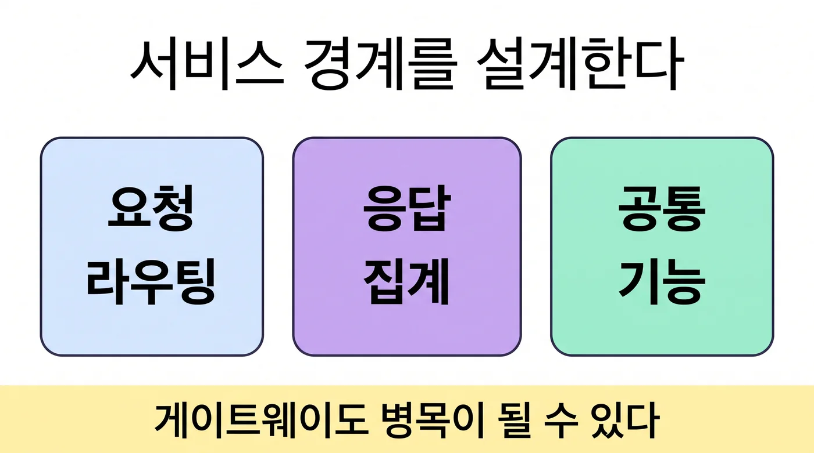

## 이 글을 30초에 파악하기

**한 줄로:** 게이트웨이는 요청의 통로이고, BFF와 변환 계층, 사이드카는 서로 다른 책임을 갖는 경계다.

**읽고 나면 알게 되는 것**

- 라우팅·집계·공통 기능 위임이 각각 무엇을 바꾸는지 구분한다.
- 화면별 백엔드와 도메인 변환 계층을 어디에 두고 누가 관리할지 판단한다.
- 부분 실패, 타임아웃, 보안 및 병목을 운영 계약과 지표로 연결한다.

**용어 먼저 보기**

| 용어 | 뜻 |
| --- | --- |
| 게이트웨이 | 클라이언트와 백엔드 사이에서 요청을 받아 전달하거나 가공하는 진입점 |
| 프록시 | 다른 구성 요소를 대신해 네트워크 요청을 중개하는 구성 요소 |
| 타임아웃 | 응답을 무한히 기다리지 않도록 설정하는 대기 시간 제한 |
| 도메인 모델 | 업무에서 쓰는 개념과 규칙을 표현한 모델 |

서비스를 운영하거나 경계 설계를 검토하는 개발자를 위한 글이다. 일곱 패턴을 Microsoft 공식 문서와 함께 공부하며, 이름보다 책임의 위치에 초점을 맞췄다.

## 주문 화면의 느린 추천이 전체 장애가 될 때

모바일 주문 화면이 주문, 배송, 추천 서비스를 각각 호출한다고 가정하자. 추천 서비스가 느려지면 주문과 배송은 정상이어도 화면 전체가 오래 기다릴 수 있다. 모바일 앱은 세 주소와 응답 형식, 각 실패 상황을 알아야 한다.

건물로 비유하면 게이트웨이는 안내 데스크다. 방문자를 어느 부서로 보낼지는 정할 수 있다. 여러 부서의 자료를 모아 줄 수도 있다. 그러나 각 부서의 업무 판단까지 안내 데스크가 대신할 필요는 없다.

*요청 라우팅, 응답 집계와 공통 기능을 구분한 개요다.*

다음은 가능한 한 가지 흐름이다. 모든 시스템에 일곱 패턴을 함께 넣으라는 뜻은 아니다.

1. 클라이언트가 하나의 진입점에 요청한다. 게이트웨이는 경로에 맞는 서비스나 BFF로 전달한다.
2. 필요한 경우 집계 구성 요소가 주문·배송·추천을 병렬 조회해 화면에 맞는 결과를 만든다.
3. 새 주문 서비스는 도메인 변환 계층을 통해 레거시 시스템과 통신한다.
4. 서비스 옆의 프록시나 보조 프로세스가 네트워크 연결 또는 관측 기능을 담당할 수 있다.

각 단계는 별도의 장애 지점이다. 경계가 하나 더 생길 때마다 누가 배포하고 무엇을 측정할지 함께 정해야 한다.

## 진입점에서 전달하고 공통 기능을 맡긴다

주문과 배송 요청이 각각 다른 서비스로 가야 한다면 경로를 누가 정할까? 공통 연결 기능을 각 서비스가 직접 관리할지도 별도 결정이다.

### Gateway Routing: 어느 서비스로 보낼 것인가

**게이트웨이 라우팅(Gateway Routing)** 은 하나의 엔드포인트 뒤에서 요청을 적절한 서비스나 인스턴스로 전달한다.[^1] 예를 들어 `/orders`는 주문 서비스로, `/shipping`은 배송 서비스로 보낸다. 경로나 호스트 같은 애플리케이션 계층 정보를 기준으로 규칙을 정할 수 있다.

같은 서비스의 여러 인스턴스나 버전으로 요청을 나눌 수도 있다. 다만 진입점이 같다고 백엔드의 API 계약 변경이 자동으로 숨겨지는 것은 아니다. 기존 경로와 응답 계약을 유지할 때만 클라이언트 변경을 피할 수 있다.

서비스가 많고 주소나 배포 버전이 자주 바뀌면 유용하다. 반대로 서비스가 한두 개이고 주소 변경도 드물다면 직접 호출이 더 단순할 수 있다. 게이트웨이 장애나 잘못된 라우팅 규칙은 여러 서비스에 영향을 준다. 인스턴스 이중화와 상태 확인, 설정 검토 및 되돌리기 절차가 필요하다.

### Gateway Offloading: 어떤 공통 기능을 맡길 것인가

**게이트웨이 오프로딩(Gateway Offloading)** 은 여러 서비스가 반복하는 기능을 게이트웨이로 옮긴다.[^2] 예를 들어 클라이언트 측 TLS 연결을 종료하고 인증서와 공통 인증 정책을 관리할 수 있다. 서비스 팀은 공통 기능의 중복 구현을 줄이는 대신 게이트웨이 운영 팀의 변경 절차에 의존한다.

TLS가 게이트웨이에서 종료되면 그 지점에서 데이터가 복호화된다. 백엔드까지 별도 TLS 연결을 수립하고 백엔드 인증서를 검증하는 구성을 고려한다. 백엔드가 게이트웨이를 우회해 직접 노출되면 공통 검사를 피할 수 있다. 네트워크 접근과 게이트웨이 자신의 인증도 함께 제한한다.

게이트웨이의 토큰 검증은 업무 권한 검사의 대체물이 아니다. 백엔드는 신뢰할 수 없는 전달 헤더를 사용자 신원으로 받아들이지 않고, 필요한 호출자 권한과 자원 소유권을 확인해야 한다. 게이트웨이는 중요한 공격 대상이므로 관리 권한과 인증서 교체도 별도 책임이다.

공통 기능이 많고 전문 운영 팀이 있을 때 적합하다. 반면 기능이 가볍고 지연에 민감하거나 중앙 팀이 배포 병목이 된다면 직접 구현이나 플랫폼 기능이 더 나을 수 있다. 중앙화는 서비스별 설정 비용을 줄일 수 있지만 게이트웨이 용량, 고가용성, 보안 운영 비용을 추가한다.

## 여러 응답을 모을 때와 화면별로 나눌 때

모바일 화면이 주문·배송·추천을 함께 보여줄 때 어디서 응답을 모아야 할까? 한 서비스만 느려지는 경우도 고려해야 한다.

### Gateway Aggregation: 한 요청에 여러 결과를 합친다

**게이트웨이 집계(Gateway Aggregation)** 는 클라이언트의 한 요청을 여러 백엔드 호출로 나누고 응답을 합친다.[^3] 모바일은 주문 요약 API 한 번을 호출한다. 집계 계층은 주문과 배송, 추천을 조회한 뒤 약속된 형태로 결과를 돌려준다.

집계는 클라이언트와 진입점 사이의 요청 수를 줄인다. 백엔드 호출 자체가 사라지는 것은 아니다. 주문·배송·추천을 동시에 조회하면 가장 늦게 끝나는 필수 호출이 응답 시간을 좌우한다.

가상 계산으로 주문이 80ms, 배송이 120ms, 추천이 400ms 걸린다고 하자. 세 호출이 동시에 시작되고 모두 기다린다면 백엔드 대기 시간은 약 400ms다. 전송과 집계 비용은 제외한 계산이다. 추천을 선택 항목으로 두고 150ms에 중단한다면, 다른 지연이 없을 때 약 150ms에 나머지를 반환할 수 있다. 이는 조건을 단순화한 예시이지 성능 측정 결과가 아니다.

부분 응답은 화면과 API의 계약이어야 한다. 추천이 빠졌다면 빈 추천인지 실패로 인한 누락인지 구분할 수 있게 한다. 결제 금액처럼 불완전한 결과가 위험한 필수 정보는 전체 요청을 실패시키는 편이 안전할 수 있다. 캐시를 대체 결과로 쓴다면 데이터의 시점과 허용 가능한 오래됨도 명시한다.

호출별 제한 시간과 전체 마감 시간을 따로 정하고, 남은 시간을 하위 호출에 반영한다. 타임아웃 뒤 실제 백엔드 작업이 취소됐는지도 구현에 따라 다르다. 특히 쓰기 요청은 응답이 늦었다는 이유만으로 무조건 재시도하지 않는다.

여러 서비스를 원거리 네트워크에서 반복 호출할 때 적합하다. 단일 서비스에 여러 작업을 묶는 문제라면 해당 서비스의 일괄 API가 더 단순할 수 있다. 복잡한 업무 조합이나 장시간 처리는 별도 집계 서비스로 분리해 진입점의 자원과 독립적으로 운영할 수 있다.

### Backends for Frontends: 화면마다 계약을 분리한다

**프런트엔드별 백엔드(Backends for Frontends, BFF)** 는 모바일과 웹처럼 서로 다른 인터페이스에 전용 백엔드를 둔다.[^4] 모바일 BFF는 작은 화면에 필요한 필드만 묶고, 웹 BFF는 상세 정보와 다른 페이지 구성을 제공할 수 있다.

BFF가 집계를 수행할 수는 있지만 두 개념은 다르다. 집계는 여러 결과를 합치는 동작이다. BFF는 특정 프런트엔드의 요구와 배포 책임을 분리하는 구조다. 공통 진입점이 요청을 각 BFF로 라우팅하고, 각 BFF가 필요할 때 집계할 수 있다.

모바일과 웹의 요구 및 릴리스 속도가 크게 다르면 각 프런트엔드 팀이 자신의 BFF를 관리하는 편이 유용하다. 반대로 요청이 거의 같거나 인터페이스가 하나뿐이면 서비스와 배포 대상만 늘어날 수 있다. GraphQL 등 기존 인터페이스가 필요한 데이터 선택을 이미 해결하는 경우에도 별도 BFF의 이점을 따져야 한다.

BFF마다 용량, 장애 대응, 보안 패치와 접근 제어가 필요하다. 한 BFF 장애를 해당 채널에 가둘 수 있지만, 공통 게이트웨이나 공유 백엔드 장애까지 격리되는 것은 아니다. 화면별 변환은 BFF에 두고 핵심 업무 규칙은 해당 도메인 서비스에 남겨 중복과 불일치를 줄인다.

## 도메인과 네트워크의 서로 다른 경계

### Anti-Corruption Layer: 서로 다른 업무 언어를 번역한다

새 주문 시스템의 `confirmed`와 레거시 시스템의 상태 코드가 정확히 일치하지 않는다고 가정하자. 단순히 필드 이름만 바꾸면 잘못된 업무 상태가 전달될 수 있다. **오염 방지 계층(Anti-Corruption Layer)** 은 서로 다른 모델과 의미 사이의 변환을 격리한다.[^5]

새 서비스는 자신의 주문 모델로 변환 계층을 호출한다. 변환 계층은 레거시 시스템이 이해하는 요청과 상태 코드로 바꾸고, 응답도 새 모델로 번역한다. 알 수 없는 코드나 누락 값은 임의의 정상 상태로 바꾸지 않고 오류 또는 명시적인 미분류 상태로 처리해야 한다.

이 계층은 애플리케이션 내부 구성 요소일 수도, 독립 서비스일 수도 있다. 독립 서비스라면 배포와 확장, 타임아웃과 장애 대응을 따로 관리한다. 내부 구성 요소라면 별도 네트워크 홉은 없을 수 있지만 변환 코드의 버전과 테스트 책임은 남는다.

단계적 마이그레이션이나 외부 시스템과 의미가 다른 경우 적합하다. 두 모델이 이미 비슷하다면 별도 계층은 불필요한 비용일 수 있다. 변환 계층이 레거시 업무 규칙 전체를 복제하는 거대한 서비스가 되지 않도록 범위와 폐기 시점을 정한다. 입력 검증과 민감 정보 보호, 변환 오류 추적도 경계의 책임이다.

### Ambassador: 호출자 곁에서 외부 연결을 대신한다

**앰배서더(Ambassador)** 는 호출자와 같은 호스트 환경에 놓인 별도 프록시다.[^6] 애플리케이션이 원격 서비스를 직접 호출하는 대신 로컬 프록시에 요청하면, 프록시가 연결·라우팅·TLS·관측 등의 기능을 처리할 수 있다.

여러 언어의 서비스가 같은 연결 정책을 써야 하거나 수정하기 어려운 레거시 앱을 연결할 때 유용하다. 네트워크 전문 팀이 프록시를 관리하고 앱 팀은 호출 계약을 관리하도록 나눌 수도 있다. 반면 한 언어만 쓰고 간단한 기능만 필요하다면 라이브러리가 더 적합할 수 있다.

앰배서더도 호출 경로의 장애 지점이며 프로세스 간 통신과 추가 홉의 비용이 있다. 프록시가 모든 요청을 자동 재시도하도록 설정하면 중복 결제처럼 위험한 부작용이 생길 수 있다. 작업의 멱등성과 남은 마감 시간에 따라 재시도 가능 여부를 정한다. 원격 서비스의 권한 검사와 인증서 관리도 없어지지 않는다.

### Sidecar: 보조 기능을 같은 수명 주기로 배포한다

**사이드카(Sidecar)** 는 주 애플리케이션과 별도 프로세스나 컨테이너로 보조 기능을 배치하고, 애플리케이션과 함께 생성·종료하는 방식이다.[^7] 오토바이 옆 좌석처럼 붙어 있지만 운전자의 주행 업무를 대신하지는 않는다. 예를 들어 로그 수집이나 설정 전달을 별도 구성 요소가 맡을 수 있다.

앰배서더는 **호출자 대신 네트워크 요청을 처리하는 역할**이고, 사이드카는 **주 애플리케이션 옆에 배포하는 방식**이다. 따라서 앰배서더를 사이드카로 배포할 수 있지만 모든 사이드카가 네트워크 프록시인 것은 아니다. 앰배서더는 같은 호스트의 여러 프로세스가 공유하는 방식으로도 배치할 수 있다.

사이드카는 언어가 다른 애플리케이션에 공통 기능을 붙일 때 적합하다. 다만 인스턴스마다 CPU와 메모리를 소비한다. 주 애플리케이션과 별도 비율로 확장해야 하는 기능이라면 독립 서비스가 나을 수 있다. 플랫폼이 이미 같은 기능을 제공한다면 중복 배포도 피한다.

보조 프로세스가 죽었을 때 앱이 계속 요청을 받아도 되는지 정해야 한다. 예를 들어 필수 네트워크 프록시가 없으면 준비 상태에서 제외하는 정책을 고려할 수 있다. 시작 순서, 종료 시 남은 요청 처리, 자원 제한과 패치 책임을 플랫폼과 운영 팀의 계약으로 명시한다. 공유 볼륨과 자격 증명은 필요한 범위만 허용한다.

## 장애가 났을 때 누가 무엇을 보는가

한 게이트웨이에서 라우팅, 인증, 집계까지 모두 처리할 수는 있다. 그러나 기능이 늘수록 CPU와 연결 풀을 공유하고, 잘못된 설정 하나의 영향 범위도 커진다. 인스턴스를 늘리는 것만으로 공통 설정 오류나 하위 서비스 장애가 해결되지는 않는다.

아래 표는 적용 전후에 같은 부하와 장애 조건으로 비교할 측정 계획이다. 목표값은 서비스의 사용자 경험과 실제 부하에 맞게 정한다.

| 경계 | 관측할 신호 | 운영 책임과 대응 |
| --- | --- | --- |
| 라우팅·오프로딩 | 경로별 지연·오류율, 연결 수, CPU, 인증 실패 | 플랫폼 팀이 용량과 인증서, 라우팅 변경 및 롤백을 관리한다. |
| 집계·BFF | 백엔드별 지연과 타임아웃, 부분 응답 비율, 응답 크기 | 화면 담당 팀과 서비스 팀이 필수·선택 데이터 계약을 정한다. |
| 도메인 변환 | 변환 실패와 미분류 코드, 양쪽 응답 시간, 불일치 건수 | 연동 담당 팀이 양쪽 모델의 변경과 복구 절차를 관리한다. |
| 앰배서더·사이드카 | 프로세스 상태, 재시도 횟수, 자원 사용량, 연결 실패 | 플랫폼과 앱 팀이 시작·종료 순서와 장애 시 동작을 정한다. |

요청 식별자를 각 경계와 하위 호출에 전달하면 어느 서비스가 지연됐는지 연결해 볼 수 있다. 로그에는 필요한 진단 정보만 남기고 토큰과 개인정보가 들어가지 않도록 한다. 게이트웨이 접근 로그만으로 백엔드 내부의 권한 판단이나 처리 완료까지 증명할 수는 없다.

장애 실험에서는 추천 서비스만 느리게 만드는 경우와 게이트웨이 인스턴스가 종료되는 경우를 따로 본다. 전자는 부분 응답 계약을 확인하고, 후자는 연결 종료와 대체 인스턴스의 수용 능력을 확인한다. 비용은 프록시 인스턴스와 네트워크 처리량뿐 아니라 배포, 보안 검토, 야간 장애 대응까지 포함해 비교한다.

## References

[^1]: [Gateway Routing Pattern — Microsoft Azure Architecture Center](https://learn.microsoft.com/en-us/azure/architecture/patterns/gateway-routing).
[^2]: [Gateway Offloading Pattern — Microsoft Azure Architecture Center](https://learn.microsoft.com/en-us/azure/architecture/patterns/gateway-offloading).
[^3]: [Gateway Aggregation Pattern — Microsoft Azure Architecture Center](https://learn.microsoft.com/en-us/azure/architecture/patterns/gateway-aggregation).
[^4]: [Backends for Frontends Pattern — Microsoft Azure Architecture Center](https://learn.microsoft.com/en-us/azure/architecture/patterns/backends-for-frontends).
[^5]: [Anti-Corruption Layer Pattern — Microsoft Azure Architecture Center](https://learn.microsoft.com/en-us/azure/architecture/patterns/anti-corruption-layer).
[^6]: [Ambassador Pattern — Microsoft Azure Architecture Center](https://learn.microsoft.com/en-us/azure/architecture/patterns/ambassador).
[^7]: [Sidecar Pattern — Microsoft Azure Architecture Center](https://learn.microsoft.com/en-us/azure/architecture/patterns/sidecar).

시리즈 전체 흐름은 [클라우드 아키텍처 디자인 패턴 안내](/cloud/cloud-architecture-design-patterns/)에서 확인한다. 다음 글에서는 [클라우드 보안 경계 패턴](/cloud/cloud-patterns-security/)을 살펴본다.
