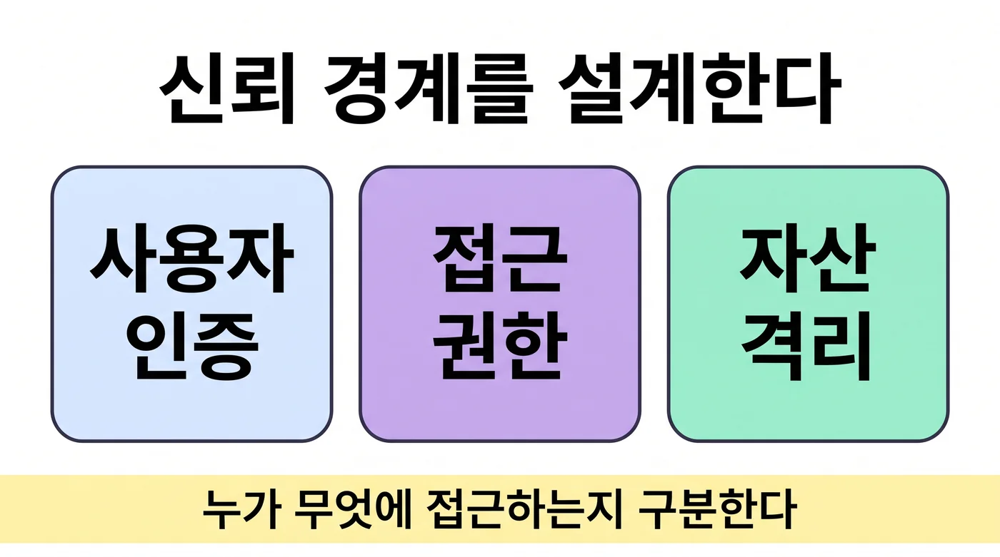

## 이 글을 30초에 파악하기

**한 줄로:** 신원 확인, 요청 검증, 외부 소프트웨어 검증, 자원 접근 권한은 서로 다른 신뢰 경계다.

**읽고 나면 알게 되는 것**

- Federated Identity는 신원 확인을 위임하지만 애플리케이션의 권한 판단을 대신하지 않는다.
- Gatekeeper는 요청을 검증하고, Quarantine은 외부 소프트웨어를 사용하기 전에 검사한다.
- Valet Key는 특정 자원에 대한 제한된 직접 접근을 허용하지만 유출과 오용을 관리해야 한다.

**용어 먼저 보기**

| 용어 | 뜻 |
| --- | --- |
| 인증(Authentication) | 요청자가 누구인지 또는 어떤 주체인지 확인하는 과정 |
| 인가(Authorization) | 확인된 주체가 특정 행동을 할 수 있는지 판단하는 과정 |
| 신원 공급자(IdP) | 사용자나 워크로드를 인증하고 신원 정보를 제공하는 시스템 |
| 클레임(Claim) | 토큰에 담긴 주체, 발급자, 역할 등 주장을 나타내는 정보 |
| 아티팩트(Artifact) | 배포나 개발에 사용하는 패키지, 이미지 등 소프트웨어 산출물 |

외부 파트너와 파일을 주고받는 서비스를 운영하는 개발자와 보안 담당자를 위한 글이다. 네 가지 패턴을 공부하며 무엇을 어디서 신뢰하는지 정리했다.

*사용자 인증, 접근 권한과 외부 자산 격리를 구분한 개요다.*

## 같은 서비스에도 여러 신뢰 경계가 있다

파트너가 포털에 로그인한 뒤 대용량 파일을 올린다고 가정하자. 서비스는 파트너의 회사 계정을 신뢰해야 한다. 업로드 요청을 검증하고, 저장소에 직접 접근할 권한도 제한해야 한다. 한편 포털이 사용하는 외부 컨테이너 이미지도 배포 전에 확인해야 한다.

네 문제는 비슷해 보여도 대상이 다르다. 신원 공급자가 인증한 사용자가 보낸 요청이라고 해서 파일의 내용이 안전한 것은 아니다. 검증된 이미지도 모든 사용자에게 저장소를 읽을 권한을 주지는 않는다.

건물에 비유하면 신분증 확인, 안내 데스크의 방문 목적 확인, 외부 장비 검사, 특정 방에만 열리는 임시 출입증이 각각 다른 통제다. 하나를 추가했다고 나머지가 자동으로 생기지는 않는다.

## Federated Identity: 신원 확인과 권한 판단을 분리한다

### 회사 계정을 받아들이는 흐름

파트너마다 포털용 비밀번호를 따로 만들면 계정 발급과 퇴사자 회수가 복잡해진다. **연합 신원(Federated Identity)** 은 애플리케이션이 신뢰하는 외부 IdP에 인증을 맡긴다.[^1]

1. 서비스 운영자는 신뢰할 IdP와 토큰 검증 정책을 미리 정한다.
2. 사용자가 로그인하면 애플리케이션은 IdP로 인증을 요청한다.
3. 인증에 성공하면 클라이언트는 프로토콜에 맞는 토큰을 받아 서비스에 제시한다.
4. 서비스는 토큰을 검증하고 클레임과 자체 정책으로 요청별 권한을 판단한다.

예를 들어 회사 계정으로 인증됐다는 사실은 그 사용자가 모든 고객사의 파일을 읽을 권한을 뜻하지 않는다. 서비스는 테넌트와 파일 소유 관계, 역할 또는 허용 범위를 함께 확인해야 한다. 신분증이 방문자의 정체를 알려줘도 어느 방에 들어갈지는 별도로 결정하는 것과 같다.

### 토큰을 신뢰하기 전에 검증할 것

서비스는 사용하는 토큰과 프로토콜에 맞게 서명, 신뢰할 발급자, 의도한 수신 대상, 만료 시각을 검증한다. 허용한 테넌트와 필요한 역할·범위도 확인한다. 토큰 문자열이 있다는 사실이나 이메일 주소만으로 권한을 부여하지 않는다. ID 토큰과 API 접근 토큰도 용도가 다르므로 서로 바꿔 쓰지 않는다.

토큰이 탈취되면 만료 전까지 악용될 수 있다. TLS로 전송하고 토큰이 로그나 URL에 노출되지 않도록 한다. 만료 시간을 줄이면 노출 창은 작아지지만 재발급 의존성과 인증 요청은 늘어난다. 계정 비활성화가 이미 발급된 모든 토큰을 즉시 무효화하는지도 공급자와 검증 방식에 따라 다르다.

여러 조직의 계정이나 SaaS 테넌트를 받아야 한다면 유용하다. 반면 단일 조직의 기존 인증으로 충분하거나 오래된 시스템이 표준 연동을 지원하지 않으면 전환 비용이 이점보다 클 수 있다. IdP 장애는 신규 로그인이나 토큰 갱신에 영향을 줄 수 있으므로 장애 시 허용할 동작과 복구 절차도 정한다. 공급자 비용과 연동·정책 운영 비용을 함께 비교한다.

## Gatekeeper: 공개 요청과 내부 처리를 분리한다

### 검문소는 업무 담당자와 다르다

인터넷에 공개된 API가 요청을 받자마자 내부 데이터베이스 자격 증명을 사용한다고 가정하자. 공개 코드가 침해되면 공격자가 그 자격 증명에도 접근할 위험이 있다. **게이트키퍼(Gatekeeper)** 는 외부 요청을 받는 전용 구성 요소와 내부 업무 처리를 분리한다.[^2]

1. 외부 요청은 공개 게이트키퍼에 도착한다.
2. 게이트키퍼는 인증 정보, 요청 형식, 허용된 크기와 정책을 확인하고 부적절한 요청을 거부한다.
3. 통과한 요청만 보호된 내부 경로로 전달한다.
4. 내부 서비스는 업무 권한과 데이터 관계를 다시 확인하고 작업을 수행한다.

게이트키퍼는 최소 권한으로 실행하고, 내부 저장소의 광범위한 자격 증명을 갖지 않게 한다. 내부 서비스는 외부에서 직접 접근할 수 없도록 네트워크와 접근 정책을 구성한다. 내부 통신도 가능한 한 암호화하고 호출 주체를 확인한다.

검문소가 통과시킨 요청이라도 업무적으로 정당하지 않을 수 있다. 예컨대 형식이 올바른 파일 삭제 요청이 다른 테넌트의 파일을 가리킬 수 있다. 따라서 백엔드의 자원별 인가와 입력 검증을 없애면 안 된다. 게이트키퍼가 침해되거나 규칙이 잘못 설정될 가능성도 남는다.

### 언제 별도 계층이 필요한가

민감한 데이터나 외부에 노출하기 어려운 업무를 보호할 때 분리된 경계가 유용하다. 반대로 플랫폼의 기존 통제만으로 요구사항을 충족하거나 추가 지연을 감당할 수 없다면 별도 계층이 과할 수 있다.

추가 홉과 검사에는 지연과 컴퓨팅 비용이 든다. 게이트키퍼 장애나 용량 부족은 정상 요청도 막으므로 이중화와 용량 계획이 필요하다. 보안 규칙의 오탐은 사용자 장애가 되고, 정책 누락은 공격 경로가 된다. 차단 사유와 백엔드 오류를 분리해 관찰해야 한다.

## Quarantine: 외부 소프트웨어는 통과 전까지 사용하지 않는다

### 검사한 이미지와 배포한 이미지가 같은가

공개 저장소의 컨테이너 이미지가 편리해 보여도 출처나 취약점을 모른 채 운영 환경에서 실행하면 공급망 위험이 생긴다. **격리(Quarantine)** 는 외부 아티팩트를 독립된 절차로 검사하고, 기준을 통과하기 전까지 사용을 막는다.[^3]

1. 요청자와 소스의 허용 여부를 확인하고 외부 이미지를 격리 저장소로 가져온다.
2. 아티팩트 종류에 맞춰 출처, 서명 정책, 취약점, 악성코드 또는 구성요소 목록을 검사한다.
3. 기준을 통과한 결과와 검사 시점, 검사 도구·정책, 아티팩트의 식별자를 기록한다.
4. 승인된 산출물만 신뢰 저장소로 승격하고 배포 시스템이 그 저장소만 사용하도록 제한한다.
5. 실패하거나 결과가 불확실하면 사용을 차단하고 담당자가 조사한다.

이 흐름은 입고 검사와 같다. 승인 기록은 상자에 붙인 이름이 아니라 실제 내용물과 연결돼야 한다. 이미지 태그는 다른 내용으로 이동할 수 있으므로 검사와 배포에서 같은 불변 다이제스트를 지정한다. 격리 저장소와 승인 저장소의 접근 권한을 나누고, 검사 우회 경로도 막는다.

### 통과는 영구적인 안전 보증이 아니다

검사기는 알려지지 않은 취약점이나 악성 동작을 놓칠 수 있다. 서명이 유효하더라도 서명자가 항상 안전하다는 뜻은 아니다. 구성요소 목록이 불완전할 수도 있고 취약점 데이터베이스는 나중에 갱신될 수 있다. 따라서 통과는 **해당 시점에 정한 검사를 통과했다는 뜻**이지 무해함의 증명이 아니다.

승인 보고서의 유효 기간을 정하고, 새 취약점 발견 시 재검사와 배포 전 검증을 수행한다. 이미 배포한 이미지가 영향을 받으면 사용 중인 위치를 찾고 교체하거나 롤백할 계획이 필요하다. 예외 승인은 사유, 책임자, 만료 시각을 기록하고 범위를 제한한다.

외부 패키지와 이미지를 자주 받아들이고 위험을 줄일 가치가 있다면 적합하다. 팀이 산출물 종류별 검사 기준을 정하지 못하면 결과가 일관되지 않는다. 신뢰된 내부 산출물에 별도 격리가 중복되거나 위험 대비 구축 비용이 높다면 다른 통제가 더 나을 수 있다. 검사 시간, 저장 공간, 도구 비용과 오탐 조사 비용도 고려한다.

## Valet Key: 필요한 자원에만 짧게 접근시킨다

### 파일 전송을 앱이 중계하지 않는 방법

파트너가 큰 파일을 올릴 때 애플리케이션이 모든 바이트를 받아 다시 저장소로 전달하면 서버의 네트워크와 컴퓨팅 자원을 사용한다. **발레 키(Valet Key)** 는 제한된 토큰을 발급해 클라이언트가 지정된 자원에 직접 접근하게 한다.[^4]

1. 클라이언트가 발급 서비스에 인증하고 파일 업로드를 요청한다.
2. 서비스는 해당 테넌트와 작업에 대한 인가를 확인한다.
3. 서비스는 특정 저장 위치, 허용 작업과 만료 시각으로 제한한 토큰을 발급한다.
4. 클라이언트는 HTTPS로 저장소에 직접 업로드한다.
5. 애플리케이션은 저장소의 완료 신호나 조회 결과를 확인하고, 파일을 사용하기 전에 검사한다.

발레파킹 직원에게 차를 맡길 때 필요한 기능만 제한적으로 허용하는 열쇠와 같다. 다만 실제 제한 수준은 저장소가 제공하는 권한과 정책에 달려 있다. 토큰이 특정 파일 하나에만 적용되는지, 덮어쓰기를 막을 수 있는지 발급 전에 확인해야 한다.

### 범위와 만료를 줄여도 탈취 위험은 남는다

가상 사례로 특정 파일 하나에 대한 생성 권한만 허용하고 유효 기간을 10분으로 정했다고 가정하자. 토큰이 발급 직후 유출된다면 공격자는 다른 차단 장치가 없을 때 최대 남은 10분 동안 허용된 작업을 시도할 수 있다. 10분은 권장 설정이나 실측이 아니다. 업로드 시간, 재발급 방식과 위험 허용 수준에 따라 정해야 한다.

토큰을 가진 사람이 사용할 수 있는 방식이라면 도난 토큰과 정상 사용자를 저장소가 구분하지 못할 수 있다. 토큰이 포함된 URL을 로그, 분석 도구, 화면 공유에 남기지 않는다. 발급과 저장소 접근은 TLS를 사용한다. 유출 시에는 해당 토큰을 개별 폐기할 수 있는지, 정책 또는 서명 키 변경이 필요한지 미리 확인한다. 폐기 기능과 다른 사용자에게 미칠 영향은 구현에 따라 다르다.

직접 전송은 앱의 중계 부담을 줄이지만 저장소 요청과 네트워크 비용은 남는다. 토큰 자체가 업로드 크기나 사용 횟수를 제한하지 못하는 서비스도 있다. 반복 전송과 과금 이상을 관찰하고, 지원하는 한도와 별도 검사를 조합한다. 업로드된 파일은 신뢰된 것이 아니므로 검사 전에는 소비하지 않는다. 이 파일 검사는 앞의 외부 **소프트웨어** 격리와 대상이 다르다.

서버가 저장 전에 모든 바이트를 검사해야 하거나 매 전송을 즉시 통제해야 한다면 직접 접근이 부적합할 수 있다. 이미 클라이언트별 저장소 인증과 세밀한 인가가 가능하다면 별도 토큰 발급 계층이 불필요할 수도 있다. 발급 서비스 자체는 민감한 권한을 가지므로 접근 통제와 감사가 필요하다.

## 네 경계를 함께 운영하기

로그인 요청이 실패했다면 신원 공급자와 게이트키퍼 중 어느 경계에서 막혔는지 알아야 한다. 각 경계의 실패 신호를 따로 남긴다.

### 실패를 구분하는 관측 지표

다음은 실측 결과가 아니라 운영팀이 목표를 정할 때 사용할 측정 계획이다. 요청과 아티팩트에 상관관계 식별자를 부여하되 토큰 원문이나 민감한 파일 내용은 기록하지 않는다.

| 경계 | 확인할 신호 | 살펴볼 문제 |
| --- | --- | --- |
| Federated Identity | IdP별 로그인·토큰 검증 실패율, 발급 지연 | 공급자 장애, 만료, 발급자·대상 설정 오류 |
| Gatekeeper | 차단 사유별 건수, 지연, 가용성, 백엔드 인가 거부 | 규칙 오탐, 용량 부족, 경계 간 정책 불일치 |
| Quarantine | 검사 대기 시간, 통과·실패·예외 건수, 재검사 지연 | 배포 지연, 우회 경로, 오래된 승인 |
| Valet Key | 발급·사용 실패, 저장소 요청량과 전송량, 만료 후 실패 | 토큰 오용, 반복 전송, 유효 기간 부적합 |

발급 요청과 저장소 작업은 가능한 범위에서 상관관계를 연결한다. 단, 토큰 발급 로그만으로 업로드가 성공했다고 판단하지 않는다. 저장소 감사 기록의 제공 여부와 지연은 사용하는 서비스의 계약을 확인해야 한다.

### 도입 순서와 복구 기준

먼저 보호할 자산과 주체를 정한다. 파트너 신원은 IdP에서 확인하고, 파일별 인가는 서비스가 담당한다. 공개 요청은 게이트키퍼를 통과시키되 백엔드도 업무 권한을 확인한다. 외부 이미지는 격리 후 승인된 식별자로 배포한다. 마지막으로 직접 업로드가 필요한 대상에만 제한된 키를 발급한다.

각 경계에는 실패 시 책임자가 필요하다. IdP가 응답하지 않을 때 로그인 실패를 어떻게 알릴지, 게이트키퍼 오탐을 어떻게 되돌릴지 정한다. 검사 결과가 불확실한 아티팩트는 차단하고, 토큰 유출 시 폐기 범위와 교체 절차를 실행한다. 네 패턴은 보안을 보장하는 제품 목록이 아니라 서로 다른 신뢰 결정을 분리하는 도구다.

전체 흐름은 [클라우드 아키텍처 디자인 패턴 시리즈 안내](/cloud/cloud-architecture-design-patterns/)에서 볼 수 있다. 다음 글은 [배포와 운영 패턴](/cloud/cloud-patterns-deployment/)으로 이어진다.

## References

[^1]: [Federated Identity pattern — Microsoft Azure Architecture Center](https://learn.microsoft.com/en-us/azure/architecture/patterns/federated-identity).
[^2]: [Gatekeeper pattern — Microsoft Azure Architecture Center](https://learn.microsoft.com/en-us/azure/architecture/patterns/gatekeeper).
[^3]: [Quarantine pattern — Microsoft Azure Architecture Center](https://learn.microsoft.com/en-us/azure/architecture/patterns/quarantine).
[^4]: [Valet Key pattern — Microsoft Azure Architecture Center](https://learn.microsoft.com/en-us/azure/architecture/patterns/valet-key).
