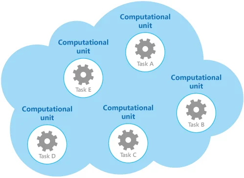

## 이 글을 30초에 파악하기

**한 줄로:** 배포 설계는 복사본의 위치뿐 아니라 장애와 데이터의 경계를 정하는 일이다.

**읽고 나면 알게 되는 것**

- 작은 작업을 합칠 때 절약하는 자원과 함께 커지는 장애 범위
- 고객별 스탬프와 지역별 Geode가 요청과 데이터를 다루는 차이
- 설정, 정적 파일, 레거시 기능을 안전하게 전환할 때 남는 운영 책임

| 필요한 용어 | 뜻 |
| --- | --- |
| 테넌트 | 공통 서비스를 사용하는 고객 또는 조직의 논리적 단위 |
| 복제 지연 | 한 복사본의 변경이 다른 복사본에 반영되기까지 걸리는 시간 |
| 장애 범위 | 한 구성 요소의 장애가 영향을 미치는 사용자와 자원의 범위 |
| 전환 | 요청 또는 데이터의 기준 위치를 기존 시스템에서 새 시스템으로 바꾸는 작업 |

여러 고객에게 서비스를 제공하면서 지역 확장과 기존 시스템 교체를 준비하는 팀을 위한 글이다. 먼저 스탬프와 Geode의 차이를 읽고, 이후 설정과 이행 절을 살펴보면 된다.

## 배포 단위가 커질 때 생기는 일

한 SaaS 서비스가 고객 증가에 맞춰 서버를 늘린다고 가정하자. 작은 배치 작업은 대부분 쉬고 있지만 고객마다 별도 서버가 돌아간다. 한편 다른 지역의 고객은 멀리 있는 데이터베이스에 접근하고, 기존 주문 시스템은 매번 전체 배포가 필요하다.

서버를 무조건 늘리거나 합치는 것만으로는 세 문제가 모두 해결되지 않는다. 계산 단위의 이용률, 고객이 배정되는 위치, 데이터 복제 방식은 각각 다른 결정이기 때문이다. 이 글은 Microsoft의 패턴을 공부하며 그 결정의 경계를 묶어 정리한 기록이다.

### 여섯 가지 결정은 서로 대체재가 아니다

자원 통합은 한 단위 안의 이용률을 높인다. 스탬프는 고객 집합별 배포 단위를 만들고, Geode는 지역마다 같은 요청을 처리하도록 설계한다. 외부 설정과 정적 파일 분리는 배포 대상의 책임을 나누며, 단계적 전환은 기존 기능을 옮기는 순서를 정한다.

같은 서비스에 여러 선택을 함께 적용할 수 있다. 다만 자원을 공유한 만큼 격리가 자동으로 생기거나, 복사본을 여러 개 둔 만큼 데이터가 자동으로 일치하는 것은 아니다.

## 작은 작업을 합칠 것인가, 배포 단위를 나눌 것인가

### Compute Resource Consolidation: 빈 공간을 공유한다

**계산 자원 통합(Compute Resource Consolidation)** 은 여러 작업을 하나의 계산 단위에 배치한다.[^1] 비유하면 각자 사무실을 임대하던 소규모 팀이 공간을 함께 쓰는 것이다. 따로 남겨 두던 여유 용량을 공유하므로, 실제 청구 자원을 줄일 수 있다면 비용도 낮아질 수 있다.

아래 그림은 통합하기 전의 구성이다. Task A부터 E까지 각 작업이 별도의 계산 단위(Computational unit)에서 실행된다.

[그림 크게 보기](/assets/images/cloud/official-compute-consolidation.webp)

*출처: Microsoft 및 기여자, [Compute Resource Consolidation pattern](https://learn.microsoft.com/en-us/azure/architecture/patterns/compute-resource-consolidation) · [CC 허가본](https://github.com/reddev9339/architecture-center/blob/fa6c83c844280f548222c94857377596cbedae6f/docs/patterns/_images/compute-resource-consolidation-diagram.png) · [CC BY 4.0](https://creativecommons.org/licenses/by/4.0/) · 형식 변환*

가정상 두 작업이 각각 별도 인스턴스를 쓰고 대부분 한가하다고 하자. 피크 시간대와 메모리 요구가 겹치지 않고 함께 실행할 충분한 여유가 있다면 한 단위로 묶는 후보가 된다. 먼저 시간대별 CPU·메모리 사용과 배치 주기를 측정하고, 합친 뒤에도 지연과 여유 용량을 비교한다. 이 예시는 실측이나 절감액 예측이 아니다.

통합은 작업의 확장 요구와 배포 주기가 비슷할 때 유리하다. 반면 하나는 급격히 확장해야 하고 다른 하나는 드물게 실행된다면, 함께 확장되는 자원이 낭비될 수 있다. 한 작업의 메모리 고갈이나 시작 실패가 이웃 작업에도 영향을 줄 수 있다. 장시간 작업은 호스트 재시작 시 중단 지점에서 복구할 수 있어야 한다.

공유 단위에서는 권한과 공격 표면도 검토한다. 민감한 데이터의 접근 권한이나 강한 장애 격리가 필요한 작업은 분리하는 편이 나을 수 있다. 묶기 전후의 호스팅 비용뿐 아니라 자원 경합과 장애 대응 비용까지 비교한다.

### Deployment Stamps: 고객별로 같은 설비를 복제한다

**배포 스탬프(Deployment Stamps)** 는 애플리케이션과 필요한 저장소 등으로 구성한 배포 단위를 여러 개 만든다.[^2] 각각은 일반적으로 일부 테넌트를 담당하며, 같은 지역에 여러 스탬프를 둘 수도 있다. 고객 수가 한 단위의 용량에 가까워지면 새 단위를 배포하고 신규 고객을 배정할 수 있다.

동일한 설계의 매장을 여러 곳에 여는 것과 비슷하다. 매장마다 독립적으로 운영할 수 있지만, 고객이 어느 매장에 배정됐는지 찾아야 한다. 서비스에서도 요청의 테넌트 식별자를 검증하고, 배정 정보를 조회한 뒤 해당 스탬프로 전달한다. 배정 정보와 라우터가 공유 의존성이라면 이들의 장애는 여러 스탬프에 영향을 줄 수 있다.

스탬프별 독립 배포는 점진적 업데이트와 고객 격리에 유리하다. 그러나 **스탬프가 여러 개라는 사실만으로 지역 장애 복구가 보장되지는 않는다.** 한 지역에만 데이터가 있는 고객은 그 지역이 멈추면 별도 복구나 이전 절차가 필요하다. 고객 이전 시 데이터 복사, 쓰기 전환, 배정 정보 변경과 검증을 계획해야 한다.

인프라를 반복 배포하고 스탬프별 정책 차이를 추적할 자동화가 필요하다. 복사본마다 최소 용량과 운영 비용도 생긴다. 단순한 단일 서비스나 일부 구성 요소만 확장하면 되는 경우에는 전체 스탬프를 복제하는 비용이 더 클 수 있다. 고객 간 권한 분리와 배정 정보의 무단 변경 방지도 필수다.

## 여러 지역에서 같은 요청을 처리할 수 있는가

### Geode: 계산을 지역 데이터 가까이 둔다

**Geode** 는 여러 지리적 노드에 백엔드 서비스를 배치하고 각 노드가 어느 지역 고객의 요청이든 처리할 수 있게 한다.[^3] 전역 라우터는 상태와 정책에 따라 사용 가능한 노드로 요청을 보낸다. 각 노드는 다른 노드의 애플리케이션 계층에 의존하지 않고, 지역 복제 데이터에 접근하도록 설계한다.

가정상 서울과 유럽에 각각 노드가 있다고 하자. 사용자가 서울에서 프로필을 수정한 직후 유럽 노드로 이동하면, 변경이 아직 복제 중일 수 있다. 두 노드가 같은 항목을 동시에 수정하면 충돌도 가능하다. 가까운 노드로 보낸다는 규칙은 최신 값을 읽는다는 보장과 다르다.

따라서 먼저 업무가 허용하는 불일치와 복제 지연을 정한다. 저장소의 일관성 모델을 선택하고, 동시 쓰기 충돌을 어떻게 감지하고 해결할지 결정한다. 사용자가 자신의 변경을 다시 읽어야 한다면 선택한 저장소가 제공하는 세션 일관성 등의 조건을 확인한다. 복제 지연이 허용 범위를 넘거나 충돌을 안전하게 해결할 수 없다면 이 구조는 부적합할 수 있다.

Geode는 다지역 사용자와 지역 장애 대응 요구가 있을 때 후보가 된다. 다만 살아남은 지역이 전환된 트래픽까지 처리할 여유를 가져야 한다. 전역 라우팅이나 데이터 복제 계층 같은 공유 의존성도 장애 범위에 포함한다. 지역별 컴퓨팅, 복제, 네트워크 전송 및 유휴 용량의 비용은 별도로 비교한다.

지역마다 진입점과 저장소 접근을 보호하고 비밀 정보 배포와 교체를 조정한다. 데이터 거주 요건이 특정 고객의 데이터를 특정 지역에 묶는다면 모든 노드에서 모든 고객을 처리하는 설계가 맞지 않을 수 있다. 스탬프는 고객별 배정에 초점을 두고, Geode는 노드 간 요청 처리의 동등성에 초점을 둔다. 두 구조를 결합해도 어떤 데이터가 어디에 있어야 하는지는 따로 설계해야 한다.

## 설정과 정적 파일을 배포 패키지에서 분리한다

설정 저장소가 끊긴 순간 새 인스턴스가 시작된다면 어떤 설정으로 동작해야 할까? 정적 파일도 배포 경로가 달라지면 다른 장애를 만난다.

### External Configuration Store: 설정을 중앙에서 관리한다

**외부 설정 저장소(External Configuration Store)** 는 애플리케이션 패키지 밖에서 설정을 관리한다.[^4] 여러 인스턴스가 공통 엔드포인트나 기능 설정을 읽을 수 있고, 코드와 설정을 서로 다른 주기로 변경할 수 있다. 환경과 버전별 범위를 나누면 스탬프마다 필요한 차이도 표현할 수 있다.

동작은 단순한 중앙 주소록과 비슷하다. 애플리케이션은 시작할 때 필요한 값을 읽고, 실행 중에는 정한 주기나 변경 신호에 따라 갱신한다. 여러 값을 동시에 바꿔야 한다면 호환되는 버전의 묶음으로 배포하고 단계적으로 적용한다. 잘못된 설정이 모든 스탬프에 전파될 수 있으므로 변경 이력과 복구 경로가 필요하다.

저장소 장애 시 실행 중인 인스턴스는 마지막으로 정상 확인한 값을 쓸 수 있다. 하지만 새 인스턴스에는 메모리 캐시가 없을 수 있다. 시작 시 안전한 마지막 스냅샷을 제공할지, 필수 설정이 없으면 시작을 거부할지 업무별로 결정한다. 오래된 보안 설정을 계속 사용하는 것이 위험하다면 실패를 허용하는 편이 나을 수 있다.

읽기와 쓰기 권한을 분리하고 변경을 감사한다. 비밀번호나 키는 일반 설정과 분리해 전용 비밀 관리 체계에 둔다. 설정 복제와 저장소 자체의 가용성, 캐시 최신성 및 장애 시 정책도 운영 비용이다. 설정이 단순하고 한 애플리케이션의 배포 때만 바뀐다면 외부 저장소가 오히려 불필요한 의존성이 된다.

### Static Content Hosting: 바뀌지 않는 파일은 별도로 제공한다

**정적 콘텐츠 호스팅(Static Content Hosting)** 은 요청마다 가공할 필요가 없는 파일을 스토리지에서 직접 전달한다.[^5] HTML, 이미지, 스타일시트와 클라이언트 스크립트를 예로 들 수 있다. 필요하면 콘텐츠 전송 네트워크(CDN)를 앞에 두어 사용자 가까이 캐시한다.

배포 순서가 중요하다. 먼저 버전이 포함된 새 파일을 올리고, 그 파일을 참조하는 페이지를 배포한다. 이전 페이지나 롤백이 여전히 참조하는 옛 파일은 필요한 기간 동안 유지한다. 캐시 삭제를 요청해도 전파 시간이 필요하며 브라우저 캐시까지 자동으로 지워지는 것은 아니다.

공개 파일만 익명으로 제공하고 업로드·교체 권한은 배포 주체에 제한한다. 비공개 파일은 인증 가능한 별도 경로에 둔다. CDN이 보호된 파일을 공유 캐시에서 반환한다면 매 요청의 권한을 검증하는지 확인해야 한다. 전송 중 보호를 위해 HTTPS를 사용하고 출처 서버를 우회할 수 있는 경로도 살핀다.

스토리지나 CDN 장애는 파일 전달을 멈출 수 있고, 캐시에 모든 파일이 있다는 보장도 없다. 요청별 개인화가 필요한 콘텐츠에는 이 방식만으로 충분하지 않다. 비용 절감도 자동이 아니다. 줄일 수 있는 실제 컴퓨팅 청구액과 스토리지·요청·전송 비용을 비교해야 한다.

## 레거시 시스템을 기능별로 전환한다

주문 조회만 새 서비스로 옮기는 동안 결제 기능은 기존 시스템에 남겨야 한다고 가정하자. 두 경로가 함께 운영되는 기간을 설계해야 한다.

### Strangler Fig: 새 기능이 기존 기능을 점진적으로 대체한다

**스트랭글러 피그(Strangler Fig)** 는 기존 시스템을 유지하면서 기능을 하나씩 새 시스템으로 옮긴다.[^6] 기존 나무 주변에서 자라는 무화과나무에 빗댄 이름이다. 전체를 한 번에 바꾸는 대신 요청을 가로채는 파사드가 이전 기능과 새 기능 사이의 경로를 정한다.

가정상 주문 조회부터 옮기는 절차는 다음과 같다.

1. 파사드를 도입하되 처음에는 요청을 기존 시스템으로 보낸다.
2. 새 조회 기능을 구현하고 일부 요청을 새 경로로 전환한다.
3. 결과와 오류를 비교하고, 문제가 있으면 사전에 정의한 조건에 따라 경로를 되돌린다.
4. 관련 쓰기와 데이터 소유권까지 이전할 준비가 되면 일관성을 검증한 뒤 기준 저장소를 전환한다.
5. 남은 기능과 의존성을 모두 제거한 뒤에만 기존 시스템의 종료를 결정한다.

요청 경로를 되돌리는 것과 데이터를 되돌리는 것은 다르다. 새 저장소가 쓰기를 받은 뒤 이전 저장소로 단순히 라우팅하면 그 사이의 변경이 빠질 수 있다. 이행 중에는 도메인별 쓰기 소유자, 동기화 방향, 지연 한도와 복구 절차를 명시한다. 동시 쓰기가 필요하다면 충돌과 부분 실패를 어떻게 해결할지 별도로 설계한다.

### 이중 운영은 전환 위험을 줄이는 대신 비용을 남긴다

기존 시스템과 새 시스템은 전환 기간에 함께 운영된다. 두 환경의 호스팅, 데이터 복사, 보안 패치, 모니터링과 장애 대응 비용이 동시에 든다. 파사드도 병목이나 단일 장애점이 되지 않도록 용량과 가용성을 고려한다. 새 경로에도 기존과 같은 인증·권한 검사를 적용해야 한다.

큰 시스템을 기능별로 나눌 수 있고 기존 환경을 일정 기간 유지할 수 있다면 이 방식이 유용하다. 반면 요청을 가로챌 수 없고 변경 가능한 통합 지점도 없다면 적용하기 어렵다. 작은 시스템을 한 번에 안전하게 교체할 수 있거나 기존 환경을 즉시 종료해야 하는 경우에도 이중 운영이 불리할 수 있다.

전환 완료는 트래픽이 새 경로로 간다는 사실만으로 판단하지 않는다. 기존 시스템을 호출하는 배치와 내부 의존성, 데이터 보존 요구, 복구 가능성을 함께 확인한다. 레거시 데이터를 삭제하기 전에는 롤백을 위해 어떤 변경을 다시 재생해야 하는지 검토한다.

## 운영에서 무엇을 측정하고 결정할까

아래 지표는 **측정 계획**이며 성능 실측이 아니다. 기준값과 경보 임계치는 각 서비스의 부하와 허용 가능한 장애 조건에 맞춰 정한다.

| 질문 | 관측할 신호 |
| --- | --- |
| 통합한 작업이 서로 방해하는가? | 작업별 CPU·메모리, 지연, 재시작과 자원 제한 발생 횟수 |
| 스탬프가 용량이나 격리 한계에 가까운가? | 스탬프별 부하·오류·여유 용량, 테넌트 배정 오류, 설정 차이 |
| 지역 전환 뒤 데이터가 안전한가? | 지역별 지연·오류, 복제 지연, 충돌 건수, 전환 후 잔여 용량 |
| 설정 장애를 견딜 수 있는가? | 설정 읽기 실패, 적용 버전과 마지막 갱신 시각, 대체값 사용 횟수 |
| 정적 파일 배포가 정상인가? | 파일별 오류율, 원본과 CDN 지연, 캐시 적중률, 버전별 요청 |
| 레거시를 안전하게 줄이고 있는가? | 경로별 요청 비율·오류, 데이터 불일치, 동기화 지연과 이중 운영 비용 |

장애 훈련에서는 지역 전환뿐 아니라 설정 저장소와 공유 라우터의 장애도 따로 시험한다. 정상 복귀 후 트래픽을 되돌리는 절차와 데이터 검증을 포함해야 한다. 패턴의 이름보다 중요한 것은 어떤 사용자를 어느 상태로 복구할지 미리 합의하는 일이다.

## References

[^1]: [Compute Resource Consolidation pattern — Microsoft Azure Architecture Center](https://learn.microsoft.com/en-us/azure/architecture/patterns/compute-resource-consolidation).
[^2]: [Deployment Stamps pattern — Microsoft Azure Architecture Center](https://learn.microsoft.com/en-us/azure/architecture/patterns/deployment-stamp).
[^3]: [Geode pattern — Microsoft Azure Architecture Center](https://learn.microsoft.com/en-us/azure/architecture/patterns/geodes).
[^4]: [External Configuration Store pattern — Microsoft Azure Architecture Center](https://learn.microsoft.com/en-us/azure/architecture/patterns/external-configuration-store).
[^5]: [Static Content Hosting pattern — Microsoft Azure Architecture Center](https://learn.microsoft.com/en-us/azure/architecture/patterns/static-content-hosting).
[^6]: [Strangler Fig pattern — Microsoft Azure Architecture Center](https://learn.microsoft.com/en-us/azure/architecture/patterns/strangler-fig).

시리즈 전체는 [클라우드 아키텍처 디자인 패턴 안내](/cloud/cloud-architecture-design-patterns/)에서 볼 수 있다. 다음 글은 [장애와 복구를 다루는 패턴](/cloud/cloud-patterns-resilience/)으로 이어진다.
