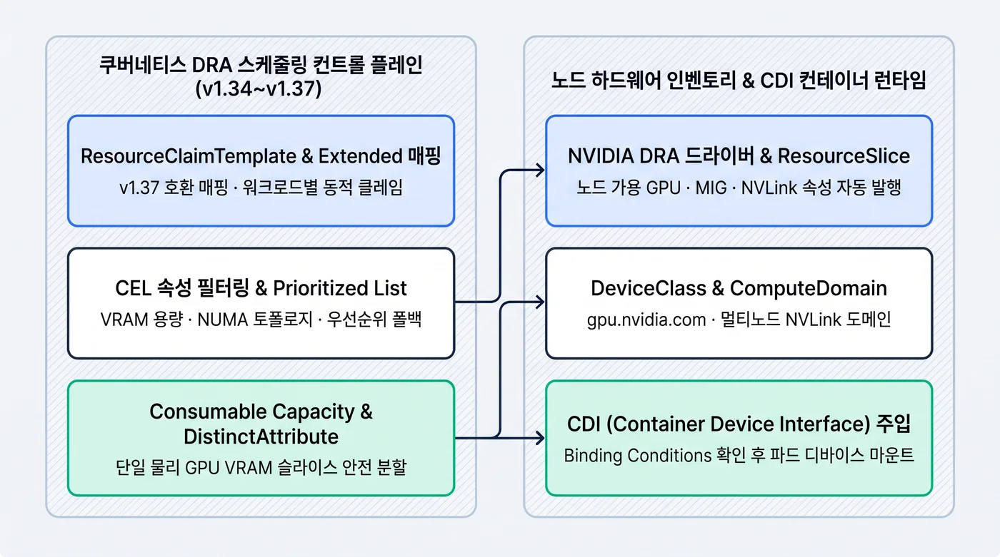
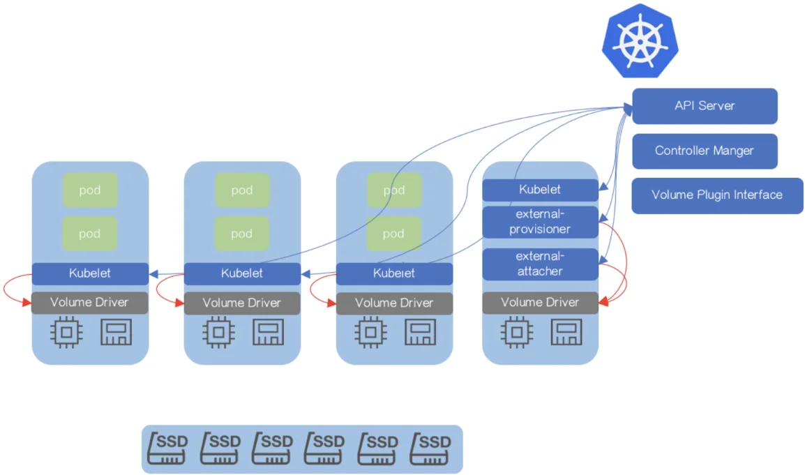

## 이 글을 30초에 파악하기

> **한 줄로** — GPU 노드에 카드가 몇 장 남았는지는 셀 수 있지만 남은 메모리가 얼마인지는 답할 수 없던 문제를, 쿠버네티스가 하드웨어 목록을 직접 읽고 배정하는 방식으로 바꾸는 과정을 다룬다.

**읽고 나면 알게 되는 것**

- `nvidia.com/gpu: 1` 방식이 멀티 테넌트 GPU 클러스터에서 VRAM을 얼마나 낭비하는지
- DRA가 `DeviceClass`·`ResourceSlice`·`ResourceClaim` 세 오브젝트로 GPU를 골라 붙이는 원리
- 기존 매니페스트를 고치지 않고 GPU Operator 환경을 무중단으로 옮기는 5단계 절차와 남는 제약

**용어 먼저 보기**

| 용어 | 한 줄 설명 | 이 글에서의 역할 |
|---|---|---|
| Device Plugin | 노드에 꽂힌 특수 하드웨어를 "몇 개"로만 알려 주는 기존 방식 | 1절에서 한계를 짚는 출발점 |
| 확장 리소스(Extended Resource) | `nvidia.com/gpu: 1`처럼 개수만 적는 자원 표기 | 소수점·용량 요청을 못 하는 원인 |
| DRA(Dynamic Resource Allocation) | 하드웨어의 속성과 남은 용량까지 보고 골라 배정하는 새 방식 | 이 글의 주제 |
| ResourceSlice | 노드가 가진 디바이스 목록과 속성·용량을 적어 둔 장부 | 스케줄러가 참조하는 실시간 재고 |
| ResourceClaim | 파드가 "이런 조건의 GPU를 달라"고 내는 신청서 | 파드와 GPU를 잇는 매개 |
| DeviceClass | 디바이스 종류와 공통 조건을 미리 정해 둔 규격표 | CEL 필터를 묶어 두는 곳 |
| CEL(Common Expression Language) | 하드웨어 속성 조건을 식으로 적는 문법 | 노드 라벨 없이 GPU를 걸러내는 수단 |
| MIG | GPU 한 장을 여러 조각으로 쪼개 쓰는 기능 | 용량 단편화 논의의 배경 |

**이런 분께** — GPU 노드를 여러 팀이 나눠 쓰는데 활용률이 낮아 고민인 플랫폼 엔지니어. 처음 읽을 때는 1절에서 문제를 확인하고 2절·3절로 원리를 잡은 뒤, 5절 절차부터 실무에 적용하면 된다.
---

GPU 노드 앞에서 플랫폼 엔지니어가 가장 자주 듣는 질문은 "지금 이 노드에 카드가 남아 있나요"다. 남은 개수는 답할 수 있어도 남은 여유 용량은 답할 방법이 없었다. 호텔 예약에 비유하면 방 크기는 보지 않고 빈 방 개수만 세는 것과 같다.

1인용 손님이 큰 방을 혼자 쓰고도 예약 장부에는 "만실"로 찍힌다. GPU 8장을 붙인 노드에 `nvidia.com/gpu: 1`을 세 번 요청하면 남는 VRAM이 얼마인지 쿠버네티스는 답하지 못한다. 개수만 세고 용량은 보지 않기 때문이다.

쿠버네티스 클러스터의 기본 제어 루프와 스케줄러 동작은 [쿠버네티스 컨트롤 플레인 아키텍처 정리](/k8s/kubernetes-architecture/)[^1]에서 다루었다. 파드 자원 요청과 오토스케일링 계층은 [쿠버네티스 워크로드와 오토스케일링 가이드](/k8s/kubernetes-workloads/)[^2]에서 분석했으며, 두 글 모두 CPU와 시스템 메모리를 중심으로 스케줄링 모델을 살펴보았다. 그러나 멀티 테넌트 인공지능(AI) 워크로드가 클러스터의 주류로 자리 잡으면서 상황이 달라졌다.

기존의 단순 정수 기반 확장 리소스(`nvidia.com/gpu: 1`) 모델은 자원 유휴와 운영 병목을 유발한다. 하드웨어 토폴로지와 파드 스케줄링이 분리된 환경의 위험은 [EKS 노드·GPU·네트워킹 장애 디버깅 실전 가이드](/k8s/eks-debugging-field-guide/)[^4]에서 정리했다. 그런 환경에서는 **비균일 메모리 접근(Non-Uniform Memory Access, NUMA)** 불일치가 자주 발생한다.

또한 **고속 인터커넥트(NVLink)** 단절로 분산 학습과 추론 성능이 급락하는 장애도 빈번하다.

쿠버네티스 커뮤니티는 이 구조적 제약을 풀기 위해 **동적 리소스 할당(Dynamic Resource Allocation, DRA)** 아키텍처를 도입했다. 스토리지 계층의 동적 볼륨 프로비저닝 모델을 하드웨어 가속기 영역으로 확장한 설계다[^6]. 쿠버네티스 v1.34에서 핵심 API(`resource.k8s.io/v1`)가 정식(GA) 단계에 진입했다.

이어 v1.35~v1.37 릴리즈를 거치며 부분 용량 공유와 기존 매니페스트 호환 매핑까지 갖춰졌다[^6][^9]. 프로덕션 전환을 위한 퍼즐이 모두 맞춰진 셈이다. 이 글은 사내 멀티 테넌트 GPU 클러스터를 쿠버네티스 v1.34 이상으로 업그레이드하며 검토한 내용을 정리한 것이다.

기존 Device Plugin 체계에서 DRA 기반으로 무중단 전환하기 위한 아키텍처 명세와 운영 절차를 담았다. 개인 학습과 설계 리뷰 목적의 기록이다.

본문은 다음과 같이 구성했다. 먼저 약 10년간 유지된 Device Plugin의 4대 구조적 한계를 정량적으로 짚어본다(§1). 이어 스토리지 CSI 모델과 대비되는 DRA 코어 오브젝트와 **컨테이너 디바이스 인터페이스(Container Device Interface, CDI)** 동작 원리를 해부한다(§2).

그다음 쿠버네티스 v1.34~v1.37의 5대 프로덕션 핵심 기능을 살펴본다(§3). 이어서 §4에서 NVIDIA GPU Operator v26.7.1 기반 매니페스트와 TypeSafe System One(`Jev`)을 결합한 어드미션 판정 구현을 다룬다. §5는 카나리 노드 풀 마이그레이션 절차다.

마지막으로 스케줄러 선점 미지원 등 현시점의 엔지니어링 한계와 트레이드오프를 정리한다(§6).

---

## 1. 왜 nvidia.com/gpu: 1은 멀티 테넌트 GPU 클러스터를 망가뜨리는가

여러 팀이 같은 GPU 노드 풀을 나눠 쓰기 시작하자 대시보드가 노란색으로 물들었다. GPU는 전부 '사용 중'으로 표시되는데 실제 연산 사용률은 한 자릿수였다.

이 절은 기존 Device Plugin 모델이 멀티 테넌트 GPU 클러스터에서 왜 한계에 부딪히는지 정리한다.

### 1.1 쿠버네티스 v1.8 Device Plugin의 4대 구조적 한계

쿠버네티스는 2017년 v1.8 릴리즈에 **디바이스 플러그인(Device Plugin)** 프레임워크를 도입했다. 이 프레임워크는 노드의 `kubelet`과 gRPC 소켓(`ListAndWatch`, `Allocate`)으로 통신한다. 그리고 서드파티 하드웨어를 **확장 리소스(Extended Resource)** 형태로 노출한다[^6]. 인터페이스 구현이 단순하다는 장점은 분명했다. 그러나 현대의 이기종 멀티 테넌트 GPU 클러스터에서는 다음 네 가지 구조적 한계를 드러낸다.

1. **단순 정수 개수(Integer Count)만 집계하는 불투명한 추상화**가 첫 번째 한계다.
   - 스케줄러(`kube-scheduler`)가 인식하는 정보는 노드당 `nvidia.com/gpu: 8`이라는 스칼라 정수값뿐이다. 파드 매니페스트 역시 `resources.limits["nvidia.com/gpu"]: 1`처럼 개수만 요청할 수 있다. 해당 장치가 80GiB HBM3를 탑재한 H100인지, 24GiB GDDR6를 탑재한 L4인지는 API 수준에서 지정할 수 없다. 어떤 PCIe 루트 컴플렉스에 연결되어 있는지도 알 수 없다[^6].
2. **네이티브 디바이스 공유 불가와 비디오 메모리(VRAM) 단편화**가 두 번째 한계다.
   - 쿠버네티스 확장 리소스는 소수점 요청(`0.5` GPU)을 허용하지 않는다. 다중 파드 간 동일 디바이스 ID 공유도 허용하지 않는다.
   - 이를 우회하려면 시분할(Time-Slicing)이나 **멀티 프로세스 서비스(Multi-Process Service, MPS)**, 혹은 벤더 전용 래퍼 스크립트를 도입해야 한다. 그런데 스케줄러는 파드별 실제 **비디오 메모리(Video RAM)** 점유량을 추적하지 못한다. 결과적으로 이웃 파드의 메모리 스파이크가 연쇄 OOM(Out of Memory)으로 이어진다[^4][^6].

앞의 두 한계는 스케줄러가 보는 정보의 해상도에서 나온다. 뒤의 두 한계는 구성 시점과 표현 방식에서 나온다.

3. **정적 노드 단위 구성으로 인한 워크로드별 동적 재구성 불가**가 세 번째 한계다.
   - NVIDIA A100/H100의 **다중 인스턴스 GPU(Multi-Instance GPU, MIG)** 기능을 쓰려면 사전 분할이 필요하다. Device Plugin 모델에서는 노드 부팅 시점이나 데몬셋 설정을 통해 `1g.10gb` 또는 `3g.40gb` 프로파일을 정적으로 쪼개 두어야 한다. 워크로드가 도착하는 시점에 요구 사양에 맞춰 온디맨드로 하드웨어 파티션을 재구성할 수 없다. 작업 종료 후 원래 상태로 되돌리는 라이프사이클 훅도 존재하지 않는다.
4. **표현식 기반 필터링 부재와 노드 라벨링 운영 고통(Toil)**이 네 번째 한계다.
   - 특정 VRAM 용량 이상을 요구하는 조건을 표현할 방법이 없다. 특정 드라이버 버전 범위나 동일 NUMA 노드 내 네트워크 카드와의 결합 조건도 마찬가지다. 결국 플랫폼 엔지니어가 수십 개의 커스텀 노드 라벨(`nvidia.com/gpu.memory: "81920"`, `topology.k8s.io/numa-zone: "0"`)을 만들어야 한다. 그리고 `nodeSelector`나 `nodeAffinity`를 수동으로 조합해야 한다[^2][^6].

| 비교 항목 | 기존 Device Plugin (v1.8+) | 동적 리소스 할당 (DRA, v1.34~v1.37 GA) |
|---|---|---|
| **스케줄러 가시성** | 노드별 단순 정수 카운트 (`nvidia.com/gpu: 8`) | 디바이스별 상세 속성·용량 (`ResourceSlice` 오브젝트) |
| **자원 요청 문법** | `resources.limits` 내 정수 선언 | `ResourceClaim` / `ResourceClaimTemplate` 및 CEL 표현식 |
| **부분 용량 공유** | API 미지원 (Time-Slicing 등 외부 우회 필요) | `Consumable Capacity`를 통한 네이티브 슬라이스 할당 |
| **다중 컨테이너/파드 공유** | 단일 컨테이너 독점 할당 원칙 | 단일 `ResourceClaim`을 복수 컨테이너·파드에서 공유 가능 |
| **토폴로지 및 멀티노드** | 단일 노드 내부로 국한 (`TopologyManager` 의존) | `ComputeDomain` 기반 멀티노드 NVLink 도메인 추상화 |
| **컨테이너 런타임 주입** | Device Plugin 전용 `Allocate` gRPC 응답 | 표준 **CDI(Container Device Interface)** 스펙 주입 |

### 1.2 VRAM 단편화와 노드 풀 카디널리티 폭발의 수리적 모델링

정수 단위 할당이 강제되는 Device Plugin 클러스터를 생각해 보자. 총 $N$개의 물리 GPU가 있고, 각 GPU의 물리 VRAM 용량은 $M_{\text{total}}$(예: $80\text{ GiB}$)이다. 파드 $i$가 실제로 필요로 하는 메모리는 $m_i \in (0, M_{\text{total}}]$로 둔다.

각 파드가 정수 단위로 1장의 GPU를 독점 점유하면 활용률 상한이 정해진다. 클러스터 전체의 **유효 VRAM 활용률(Effective VRAM Utilization)**은 다음 식처럼 제한된다.

$$\eta_{\text{DP}} = \frac{\sum_{i=1}^{K} m_i}{K \cdot M_{\text{total}}}, \quad \text{단, } K \le N$$

예를 들어 경량 임베딩·리랭커 추론 파드가 $m_i = 12\text{ GiB}$를 필요로 한다고 하자. 이런 파드 8개가 $80\text{ GiB}$ GPU 8장을 각각 1장씩 점유하는 상황을 보자. 실제 사용되는 VRAM은 $96\text{ GiB}$에 불과하다. 나머지 $544\text{ GiB}$($85.0\%$)는 스케줄러가 접근조차 할 수 없는 **내부 단편화(Internal Fragmentation)** 손실로 묶인다.

또한 $P$개의 하드웨어 속성 축이 있다고 하자. GPU 모델, MIG 프로파일, 드라이버 버전, PCIe 세대, NUMA 정렬 여부가 그 예다. 각 축은 $|A_p|$개의 이산값을 가진다. 이를 정적 노드 풀(NodePool)과 `nodeSelector` 조합으로 분리 운영하면 관리 부담이 커진다. 관리해야 할 노드 그룹의 경우의 수 $C_{\text{pool}}$은 곱집합으로 증가한다.

$$C_{\text{pool}} = \prod_{p=1}^{P} |A_p|$$

5개의 속성 축이 각각 3개의 선택지만 가져도 최대 $3^5 = 243$개의 라벨 조합이 파생된다. 이 조합은 [EKS VPC CNI 및 Karpenter 용량 계획](/k8s/vpc-cni-ip-capacity-planning/)[^5]에서 다룬 서브넷 IP 단편화와 맞물린다. 결과적으로 오토스케일러의 빈 패킹(Bin-packing) 효율이 떨어진다.

### 1.3 CNCF Kubernetes AI Conformance 프로그램 제1호 필수 요구사항

이런 운영 한계 때문에 클라우드 네이티브 컴퓨팅 재단(CNCF)이 움직였다. CNCF는 **쿠버네티스 AI 적합성 프로그램(Kubernetes AI Conformance Program)** 명세를 만들었다. 이 명세는 가속기 관리 부문의 제1호 **필수(MUST)** 요구사항으로 DRA(`resource.k8s.io/v1`) 지원을 지정했다[^7].

단순 확장 리소스 카운팅만으로는 표준화된 AI 워크로드 이식성을 보장할 수 없다는 산업계 합의가 반영된 결과다. 실제로 CNCF AI Conformance 인증을 획득한 상용 및 오픈소스 플랫폼 수는 2025년 11월 출범 당시 18개였다. 2026년 3월 기준으로는 31개로 늘었다.

엔터프라이즈 쿠버네티스 환경의 기본 스케줄링 표준으로 자리 잡은 흐름이다[^7].

**핵심 요약 — 기존 Device Plugin은 하드웨어를 단순 정수로만 취급한다. 그 결과 80% 이상의 VRAM 단편화와 정적 노드 라벨링의 조합 폭발이 발생한다. 이를 해결하기 위해 DRA가 CNCF AI Conformance의 제1호 필수 표준으로 채택되었다.**

---

## 2. DRA 코어 아키텍처 해부: DeviceClass, ResourceSlice, ResourceClaim과 CDI

새로 들여온 GPU 노드에서 어떤 카드가 어디에 꽂혀 있는지 아무도 손으로 적어 두지 않았는데도 파드가 원하는 카드를 정확히 찾아갔다. 그 뒤에는 클러스터가 스스로 하드웨어 목록을 만들어 두는 구조가 있다.

이 절은 DRA가 어떤 오브젝트로 하드웨어를 표현하고, 그것이 컨테이너에 어떻게 연결되는지 설명한다.

### 2.1 스토리지 동적 볼륨 프로비저닝(CSI)에서 영감을 얻은 설계 철학

[쿠버네티스 스토리지와 데이터 운영 가이드](/k8s/kubernetes-storage-data/)[^3]에서 살펴본 **컨테이너 스토리지 인터페이스(Container Storage Interface, CSI)**를 먼저 떠올려 보자. CSI는 과거 파드 스펙에 스토리지 볼륨 경로를 하드코딩하던 방식을 바꿨다. `StorageClass`, `PersistentVolumeClaim(PVC)`, `PersistentVolume(PV)`의 3계층 선언적 모델로 분리했다. DRA는 바로 이 스토리지 동적 프로비저닝의 설계 철학을 GPU·NIC·FPGA 등 하드웨어 디바이스 영역으로 그대로 이식한 아키텍처다[^6]. 부동산 임대에 비유하면 규격표와 빈 호실 목록, 입주 신청서를 따로 관리하는 방식과 같다. 세입자는 건물주에게 전화하지 않고 규격표(`DeviceClass`)와 지금 비어 있는 목록(`ResourceSlice`)만 보고 입주 신청서(`ResourceClaim`)를 낸다.



아래 공식 CSI 아키텍처 도식과 비교해 보자. 컨트롤 플레인의 상태 조정 루프와 노드 데몬의 런타임 마운트 분리 구조가 DRA로 어떻게 계승되었는지 확인할 수 있다[^3][^6].


*출처: [Kubernetes Blog — Dynamically Expand Volume with CSI and Kubernetes](https://kubernetes.io/blog/2018/08/02/dynamically-expand-volume-with-csi-and-kubernetes/), CC BY 4.0*

| 역할 계층 | 스토리지 동적 프로비저닝 (`storage.k8s.io/v1`) | 가속기 동적 리소스 할당 (`resource.k8s.io/v1`) | 소유 주체 |
|---|---|---|---|
| **리소스 카탈로그 추상화** | `StorageClass` (SSD, IOPS, 암호화 정책 정의) | `DeviceClass` (디바이스 유형, 기본 CEL 셀렉터, 벤더 설정 정의) | 클러스터/플랫폼 관리자 |
| **인벤토리 및 가용 상태** | `CSIStorageCapacity` / `PersistentVolume (PV)` | `ResourceSlice` (노드/네트워크별 가용 디바이스 속성과 용량 발행) | 벤더 DRA 드라이버 (`kubelet` 플러그인) |
| **워크로드 자원 요청서** | `PersistentVolumeClaim (PVC)` | `ResourceClaim` (수동/공유 클레임) | 애플리케이션 개발자 |
| **워크로드별 자동 템플릿** | `StatefulSet.spec.volumeClaimTemplates` | `ResourceClaimTemplate` (파드 생성 시 `ResourceClaim` 자동 인스턴스화) | 애플리케이션 개발자 |
| **런타임 디바이스 연결** | CSI `NodePublishVolume` (블록/파일시스템 마운트) | **CDI(Container Device Interface)** JSON 스펙 주입 | 컨테이너 런타임 (`containerd` / `CRI-O`) |

### 2.2 ResourceSlice와 NVIDIA 기본 DeviceClass 인벤토리

DRA 아키텍처에서는 외부 컨트롤러가 스케줄링 결정을 가로채지 않는다. 코어 `kube-scheduler`가 직접 클러스터 내 하드웨어 상태를 읽고 최적의 노드를 계산한다(Structured Parameters 모델)[^6]. 그 흐름은 세 단계로 나뉜다.

1. **`ResourceSlice` 발행**이 첫 단계다.
   - 각 GPU 노드에 배포된 NVIDIA DRA 드라이버 데몬셋이 로컬 PCIe 버스와 NVML(NVIDIA Management Library), MIG 구성을 스캔한다. 그다음 해당 노드가 보유한 장치 목록과 속성(UUID, 아키텍처, VRAM 용량, PCIe 루트, 드라이버 버전)을 담은 `ResourceSlice` 오브젝트를 API 서버에 자동으로 발행한다[^6][^10].

이어서 드라이버가 함께 등록하는 표준 클래스 목록을 본다.

2. **기본 `DeviceClass` 등록**도 배포 시점에 자동으로 이뤄진다.
   - NVIDIA GPU DRA 드라이버를 배포하면 다음 5종의 표준 클래스를 포함한 `DeviceClass` 리소스가 클러스터에 등록된다[^10].
   - **`gpu.nvidia.com`**: 베어메탈 또는 패스스루 환경의 전체 물리 GPU 및 부분 공유(Consumable Capacity) 대상 장치를 추상화한다.
   - **`mig.nvidia.com`**: 하드웨어 수준으로 격리된 MIG 인스턴스(`1g.10gb`, `2g.20gb`, `4g.40gb`, `7g.80gb` 등)를 추상화한다.
   - **`vfio.gpu.nvidia.com`**: KubeVirt 등 가상머신(VM) 워크로드에 GPU를 직접 패스스루하기 위한 VFIO 바인딩 장치를 추상화한다.
   - **멀티노드 NVLink 추상화용 `ComputeDomain` 연관 클래스 2종**이 마지막이다. 대상은 `compute-domain-daemon.nvidia.com`과 `compute-domain-channel.nvidia.com`이다. GB200 NVL72 등 멀티노드 NVLink 환경에서 쓰인다. 노드 간 **인터노드 메모리 익스체인지(Internode Memory Exchange, IMEX)** 데몬과 채널 디바이스를 안전하게 격리·주입하는 역할이다[^10].

`DeviceClass`가 무엇을 고를지 정의한다면, 클레임은 무엇을 요청할지 정의한다.

3. **`ResourceClaim`과 `ResourceClaimTemplate`의 역할 차이**를 구분해야 한다.
   - 단일 파드 내의 여러 컨테이너끼리는 하나의 `ResourceClaim`을 공유할 수 있다. 메인 추론 엔진 컨테이너와 CUDA 프로파일링 사이드카가 그 예다. 서로 다른 파드들이 동일한 GPU 컨텍스트를 공유해야 할 때도 방식은 같다. 독립적인 `ResourceClaim`을 만들고 여러 파드의 `spec.resourceClaims`에서 이를 동시에 참조한다.
   - 반대로 `Deployment`나 `Indexed Job`처럼 파드 복제본마다 독립적인 GPU가 필요한 경우에는 `ResourceClaimTemplate`을 선언한다. 그러면 컨트롤 플레인이 파드 라이프사이클에 종속된 `ResourceClaim`을 자동으로 생성한다. 파드가 삭제되면 클레임도 함께 회수된다[^6].

### 2.3 CDI(Container Device Interface) 기반 런타임 디바이스 주입

스케줄러가 `ResourceClaim`을 특정 노드의 `ResourceSlice` 내 디바이스에 매칭한다. 그리고 예약 결과(`allocation.devices.results`)를 기록한다. 그러면 해당 노드의 `kubelet`이 DRA 노드 플러그인의 `NodePrepareResources` gRPC API를 호출한다[^6][^8].

이때 DRA 플러그인은 컨테이너를 직접 조작하지 않는다. 대신 CNCF 표준인 **컨테이너 디바이스 인터페이스(Container Device Interface, CDI)** 명세를 따른다. `/var/run/cdi/` 디렉터리에 JSON 스펙 파일을 기록하고, `kubelet`에 CDI 디바이스 식별자(예: `nvidia.com/gpu=gpu-0-slice-a`)를 반환한다[^8].

이후 `kubelet`이 CRI(Container Runtime Interface)를 통해 `containerd` 또는 `CRI-O`에 컨테이너 생성을 요청한다. 그러면 컨테이너 런타임이 CDI 스펙에 정의된 항목을 컨테이너 네임스페이스에 주입한다[^8]. 주입 대상은 디바이스 노드(`/dev/nvidia0`, `/dev/nvidiactl`), 호스트 드라이버 공유 라이브러리(`.so` 마운트), 환경 변수, 실행 전 훅(Hooks)이다.

**핵심 요약 — DRA는 스토리지의 PVC/StorageClass 모델을 계승한다. 드라이버가 발행한 `ResourceSlice` 인벤토리를 코어 스케줄러가 직접 평가한다. 그리고 노드 런타임에서는 표준 CDI 인터페이스로 디바이스를 마운트한다.**

---

## 3. K8s v1.34~v1.37 프로덕션 5대 핵심 기능

"MIG 슬라이스 한 종류만 골라 쓰는 파드를 만들어 달라"는 요청을 받으면 예전에는 노드 라벨을 새로 붙이고 이미지까지 다시 빌드해야 했다. 지금은 파드 매니페스트에 조건식을 적는 것으로 끝난다.

이 절은 v1.34 이후 차례로 추가된 다섯 가지 스케줄링 기능이 각각 어떤 문제를 푸는지 정리한다.

쿠버네티스 v1.34에서 코어 DRA API가 GA로 승격되었다. 이후 v1.35~v1.37을 거치며 실무 엔지니어들이 요구하던 세부 스케줄링 기능이 연달아 완성되었다[^6][^9].

### 3.1 CEL(Common Expression Language) 속성 필터링

`ResourceClaim` 또는 `DeviceClass` 내부의 `selectors.cel.expression` 필드를 쓰면 하드웨어 속성을 걸러낼 수 있다. 별도의 노드 라벨이 필요 없다는 점이 핵심이다. 필터 문법은 **공통 표현식 언어(Common Expression Language, CEL)**다[^6].

아래 세 가지는 실무에서 자주 쓰는 필터 예다.

- **MIG 프로파일 지정**: `device.attributes["gpu.nvidia.com"].profile == "1g.5gb"`와 같이 특정 MIG 슬라이스 규격만 정확히 매칭한다.
- **VRAM 용량 조건**: `device.capacity["gpu.nvidia.com"].memory.compareTo(quantity("80Gi")) >= 0` 식으로 80GiB 이상 GPU만 고른다.
- **아키텍처 조건**: 여기에 `device.attributes["gpu.nvidia.com"].architecture == "Hopper"`를 더하면 Hopper 아키텍처로 범위가 좁혀진다.
- **드라이버 버전 조건**: `semver(device.attributes["gpu.nvidia.com"].driverVersion).isGreaterThan(semver("580.0.0"))` 표현식을 쓴다. 이 식은 CUDA 13 호환 드라이버가 설치된 노드로만 스케줄링을 제한한다[^10].

### 3.2 Consumable Capacity와 DistinctAttribute 제약조건

`DRAConsumableCapacity` 기능 게이트를 켜면 **소비 가능 용량(Consumable Capacity)**이 제공된다. 이 기능은 단일 물리 디바이스의 용량(VRAM, 네트워크 대역폭 등)을 여러 `ResourceClaim`이 정량적으로 쪼개 쓰게 해 준다[^9].

80GiB HBM을 탑재한 GPU 한 장을 8GiB 슬라이스로 나눠 쓴다고 하자. 클레임마다 8GiB를 요청하면 열 번째 클레임은 합이 80GiB로 용량 보존 부등식을 정확히 채우고, 열한 번째 클레임은 합이 88GiB가 되어 이 장치의 후보에서 빠진다.

클러스터 내 물리 디바이스 $d$가 제공하는 리소스 차원 $k$(예: `memory`)의 총용량을 $C_{d,k}$라 하자. 해당 디바이스를 공유하도록 허용된 클레임 집합은 $\mathcal{C}(d)$다. 각 클레임 $c \in \mathcal{C}(d)$가 요청한 용량은 $r_{c,k}$다. 스케줄러는 다음 두 가지를 동시에 만족하는 해를 탐색한다. 하나는 용량 보존 부등식이고, 다른 하나는 고유 속성 제약이다.

$$\sum_{c \in \mathcal{C}(d)} r_{c,k} \le C_{d,k} \quad (\forall k), \qquad \text{Attr}_{\text{ID}}(d_i) \neq \text{Attr}_{\text{ID}}(d_j) \quad (\forall i \neq j \in \text{Req}(c))$$

여기서 두 번째 수식이 **`distinctAttribute`** 제약조건을 나타낸다. 하나의 파드가 고가용성 또는 대역폭 분산을 위해 $8\text{ GiB}$ VRAM 슬라이스 2개를 요청하는 경우를 보자. 두 슬라이스는 동일한 물리 GPU 한 장에서 중복 할당되지 않는다.

반드시 서로 다른 물리 GPU나 서로 다른 가상 **네트워크 인터페이스 카드(Network Interface Card, NIC)**에서 할당되도록 강제할 수 있다. 물리 GPU 쪽 조건은 $\text{UUID}(d_1) \neq \text{UUID}(d_2)$로 표현된다[^9]. 이 덕분에 서로 다른 네임스페이스의 파드들이 단일 물리 GPU의 8GiB 슬라이스를 안전하게 나눠 쓴다.

동시에 단일 워크로드 내의 다중 요청이 동일 물리 장치에 쏠리는 현상은 막는다.

### 3.3 Prioritized List(firstAvailable) 기반 폴백 스케줄링

멀티 리전이나 스팟 인스턴스가 섞인 클러스터에서는 최우선 사양의 GPU가 일시적으로 품절되는 상황이 자주 발생한다. 이때 `ResourceClaim`의 `devices.requests[].firstAvailable` 배열(Prioritized List)을 구성하면 해결된다. 워크로드를 재배포하지 않아도 스케줄러 수준에서 자동 폴백(Fallback)이 수행된다[^6][^9].

우선순위는 다음 세 단계로 선언한다.

1. **1순위(`high-perf-single`)**: `H100 80GB` 전체 GPU 1장을 최우선으로 탐색한다.
2. **2순위(`mid-tier-dual`)**: 클러스터 내 가용한 H100이 없으면 즉시 `L40S 48GB` GPU 2장 요청으로 폴백한다. 텐서 병렬화($TP=2$) 구성으로 파드를 스케줄링한다.
3. **3순위(`mig-fallback`)**: 소규모 배치 잡의 경우 `4g.40gb` MIG 인스턴스 1장으로 차선책 할당을 수행한다.

### 3.4 Binding Conditions 및 보안 통제(adminAccess)

이 절의 마지막 두 항목은 언제 바인딩할지와 누가 특권을 가질지를 통제한다.

- **바인딩 조건(Binding Conditions)**은 즉시 기동이 어려운 장치를 위한 규칙이다. 외부 패브릭으로 연결된 컴포저블(Composable) GPU가 대표적이다. **현장 프로그래머블 게이트 어레이(Field-Programmable Gate Array, FPGA)**도 여기 속한다. 할당 결정 직후 노드의 하드웨어 모드를 재구성해야 하는 장치도 마찬가지다. 이런 장치는 스케줄러가 노드를 선정하더라도 즉시 컨테이너를 띄울 수 없다. `BindingConditions` 기능을 쓰면 드라이버가 하드웨어 부착 및 초기화를 마칠 때까지 기다린다. 드라이버가 `ResourceClaim.status`의 조건(`FabricAttached=True` 등)을 갱신하면 스케줄러의 최종 바인딩 단계가 진행된다[^9].
- **`adminAccess` 권한 상승 차단**은 특권 접근을 좁히는 장치다. 하드웨어 헬스체크 데몬이나 DCGM(Data Center GPU Manager) 메트릭 수집기는 다른 워크로드가 이미 점유 중인 GPU에 동시에 접근해야 한다. DRA는 이를 위해 `adminAccess: true` 플래그를 제공한다. 그러나 일반 테넌트가 이를 악용하면 타 테넌트의 GPU 메모리를 열람하는 권한 상승 취약점이 된다. 따라서 쿠버네티스는 API 서버 수준에서 차단한다. 관리자가 `resource.k8s.io/admin-access: "true"` 라벨을 명시적으로 부여한 특권 네임스페이스에서만 `adminAccess` 클레임 생성이 허용된다[^6].

### 3.5 K8s v1.37 Extended Resource Mapping GA(Stable)

2026년 9월 3일 릴리즈된 **쿠버네티스 v1.37**에는 중요한 이정표가 있다. **확장 리소스 매핑(Extended Resource Mapping)** 기능이 정식(GA, Stable) 버전으로 승격된 것이다[^9].

클러스터 관리자가 `DeviceClass` 스펙에 `spec.extendedResourceName: "nvidia.com/gpu"`를 선언해 두면 나머지는 자동이다. 기존에 운영 중이던 수백 개의 Deployment와 Helm 차트를 고칠 필요가 없다. `resources.limits["nvidia.com/gpu"]: 1` 문법을 단 한 줄도 수정하지 않아도 동작한다.

컨트롤 플레인이 백그라운드에서 이를 암묵적 `ResourceClaim`으로 자동 변환한다. 그리고 DRA 드라이버로 스케줄링한다[^9]. 이 기능 덕분에 애플리케이션 팀의 매니페스트 수정 일정을 기다리지 않아도 된다.

인프라 팀 단독으로 Device Plugin을 걷어내고 DRA 백엔드로 전환할 수 있다.

**핵심 요약 — K8s v1.34~v1.37은 다섯 가지 프로덕션 기능을 제공한다. CEL 속성 표현식과 `Consumable Capacity` 기반 슬라이스 공유가 앞의 둘이다. `firstAvailable` 우선순위 폴백과 `adminAccess` 네임스페이스 격리가 뒤를 잇는다. 마지막은 기존 `nvidia.com/gpu` 문법을 무수정 지원하는 `Extended Resource Mapping`(v1.37 GA)이다. 이 조합으로 엔터프라이즈 프로덕션 요구사항을 충족한다.**

---

## 4. 실전 실습: NVIDIA GPU Operator(v26.7.1) DRA 드라이버와 멀티 컨테이너 GPU 공유 매니페스트

매니페스트를 그대로 붙여 넣고 파드를 띄웠는데 `Pending`에서 움직이지 않았다. 원인은 매니페스트가 아니라 컨테이너 런타임 쪽에서 켜지 않은 설정에 있었다.

이 절은 실제 매니페스트와 어드미션 판정 코드로 DRA 구성을 확인한다.

### 4.1 NVIDIA GPU Operator v26.7.1 및 DRA 드라이버 사전 요구사항

NVIDIA는 **GPU Operator v26.7.1**부터 **NVIDIA K8s DRA 드라이버(v0.5.0)**를 공식 통합해 배포한다. 차세대 오케스트레이션 리소스인 `GPUCluster` CRD도 함께 제공된다[^10]. 프로덕션 환경에서 이를 켜기 위한 최소 기술 스택 요구사항은 다음 표와 같다.

| 구성 요소 | 최소 요구 버전 | 권장 설정 및 비고 |
|---|---|---|
| **쿠버네티스 버전** | `v1.34.2+` (`v1.37+` 권장) | `resource.k8s.io/v1` API 활성화 및 v1.37 Extended Mapping GA 지원 |
| **NVIDIA GPU Operator** | `v26.7.1` | `GPUCluster` CRD 기반 배포 (기존 `ClusterPolicy`와 상호 배타적) |
| **NVIDIA K8s DRA Driver** | `v0.5.0` | `gpu.nvidia.com` 및 `ComputeDomain` 컨트롤러 포함 |
| **NVIDIA 데이터센터 드라이버** | `580.x+` (R580 브랜치 이상) | IMEX 멀티노드 NVLink 및 최신 CDI 훅 호환 필수 |
| **컨테이너 런타임** | `containerd v1.7.18+` / `v2.0+` | `/etc/containerd/config.toml` 내 `enable_cdi = true` 설정 필수 |

### 4.2 DeviceClass 확장 리소스 매핑과 복합 DRA 매니페스트

아래 매니페스트는 세 가지를 담는다. 첫째는 v1.37 호환을 위한 `DeviceClass` 확장 리소스 매핑이다. 둘째는 CEL 필터·`Consumable Capacity`·`firstAvailable` 폴백을 결합한 `ResourceClaimTemplate`이다. 셋째는 멀티노드 NVLink 클러스터를 위한 `ComputeDomain` 선언 예시다[^6][^9][^10].

```yaml
# 1. 기존 nvidia.com/gpu: 1 파드를 DRA로 자동 라우팅하는 DeviceClass (K8s v1.37 GA)
apiVersion: resource.k8s.io/v1
kind: DeviceClass
metadata:
  name: gpu.nvidia.com
spec:
  extendedResourceName: "nvidia.com/gpu"
  selectors:
    - cel:
        expression: >-
          device.driver == "gpu.nvidia.com" &&
          semver(device.attributes["gpu.nvidia.com"].driverVersion).isGreaterThan(semver("580.0.0"))
---
# 2. CEL 필터, Consumable Capacity(16GiB 슬라이스 x 2), Prioritized List를 결합한 템플릿
apiVersion: resource.k8s.io/v1
kind: ResourceClaimTemplate
metadata:
  name: llm-inference-gpu-slice-template
  namespace: ai-serving
spec:
  spec:
    devices:
      requests:
        - name: primary-gpu-req
          firstAvailable:
            # 1순위: Hopper 아키텍처 GPU에서 서로 다른 물리 카드 2장으로부터 각각 16GiB VRAM 슬라이스 할당
            - name: hopper-shared-slices
              deviceClassName: gpu.nvidia.com
              allocationMode: ExactCount
              count: 2
              selectors:
                - cel:
                    expression: >-
                      device.attributes["gpu.nvidia.com"].architecture == "Hopper" &&
                      device.capacity["gpu.nvidia.com"].memory.compareTo(quantity("80Gi")) >= 0
              capacity:
                requests:
                  memory: 16Gi
            # 2순위 폴백: 가용한 Hopper 슬라이스가 없을 경우 MIG 2g.20gb 프로파일 인스턴스 2개 할당
            - name: mig-fallback-slices
              deviceClassName: mig.nvidia.com
              allocationMode: ExactCount
              count: 2
              selectors:
                - cel:
                    expression: >-
                      device.attributes["gpu.nvidia.com"].profile == "2g.20gb"
      constraints:
        # 단일 클레임 내의 2개 슬라이스가 동일한 물리 GPU UUID에 중복 배치되지 않도록 강제
        - requests: ["primary-gpu-req"]
          distinctAttribute: "gpu.nvidia.com/uuid"
---
# 3. 멀티노드 NVLink(GB200/B200) IMEX 도메인 격리를 위한 ComputeDomain 정의
apiVersion: resource.nvidia.com/v1beta1
kind: ComputeDomain
metadata:
  name: multi-node-nvlink-domain-01
  namespace: ai-serving
spec:
  numNodes: 4
  channel:
    resourceClaimTemplate:
      name: nvlink-imex-channel-claim
```

생성된 `ResourceClaimTemplate`을 파드 내 두 컨테이너가 동시에 공유하는 선언은 다음과 같다. 추론 서버와 실시간 텐서 검수 사이드카가 그 조합이다.

```yaml
apiVersion: v1
kind: Pod
metadata:
  name: vllm-multi-container-worker
  namespace: ai-serving
spec:
  resourceClaims:
    - name: shared-gpu-slice
      resourceClaimTemplateName: llm-inference-gpu-slice-template
  containers:
    - name: vllm-engine
      image: vllm/vllm-openai:v0.8.2
      args: ["--model", "meta-llama/Llama-3.1-8B-Instruct", "--tensor-parallel-size", "2"]
      resources:
        claims:
          - name: shared-gpu-slice
    - name: cuda-telemetry-sidecar
      image: nvcr.io/nvidia/cloud-native/dcgm:3.3.8-1-ubuntu22.04
      resources:
        claims:
          - name: shared-gpu-slice
```

### 4.3 TypeSafe System One(Jev) 어드미션 페이로드 (`POST /v1/systemone`)

`Consumable Capacity`와 `firstAvailable` 폴백을 대규모로 운영하면 매칭 비효율이 생긴다. **클레임 스펙과 실시간 클러스터 `ResourceSlice` 상태 간의 매칭**이 문제다. 클러스터 내 80GiB GPU들이 이미 72GiB씩 소비되어 8GiB 조각만 남았다고 하자. 테넌트가 과도한 슬라이스를 요청하면 파드가 `Pending` 상태로 장기 체류한다. 2순위 폴백이 연쇄 트리거되어 인접 워크로드의 슬라이스를 고갈시키기도 한다.

이를 막기 위해 쿠버네티스 **변이/검증 어드미션 웹훅(Mutating/Validating Admission Webhook)** 계층에 판정 모델을 붙인다. TypeSafe AI의 비생성형 판정 모델인 **System One(`Jev`)**[^11]이 그 예다. 생성형 LLM과 달리 `POST /v1/systemone` 엔드포인트는 단일 패스 순전파(Forward Pass)만 수행한다.

그래서 70~150ms 내에 확정된 스키마의 확률과 점수를 반환한다. API 서버의 어드미션 타임아웃(통상 1~2초) 예산 안에서 안전하게 동작하는 이유다[^11]. 어드미션 웹훅은 실시간 `ResourceSlice` 메트릭과 요청된 `ResourceClaim` 스펙을 `state` 객체에만 격리해 주입한다.

그리고 `questions`에는 판단 규칙만 선언한다[^11]. 주차장 입구의 안내원과 같다. 빈자리 상황판을 실시간으로 보면서 차종별로 층을 배정하고 자리가 없으면 들여보내지 않지만, 차를 직접 몰고 가지는 않는다.

```json
{
  "state": {
    "cluster_resource_slices": {"total_hopper_gpus": 16, "gpus_with_32gi_free": 0, "gpus_with_16gi_free": 5, "mig_2g_20gb_free": 6, "nvlink_imex_healthy_domains": 2},
    "incoming_claim_spec": {"namespace": "ai-serving", "workload_tier": "batch-offline", "requested_class": "gpu.nvidia.com", "requested_count": 2, "requested_memory_per_slice": "32Gi", "has_prioritized_fallback": false, "requests_admin_access": false}
  },
  "questions": {
    "allocation_action": {
      "type": "choice",
      "instructions": "실시간 ResourceSlice 가용 상태와 유입된 ResourceClaim 사양을 대조하여 어드미션 처리 방식을 판정하시오.",
      "criteria": {
        "admit_primary": "요청된 용량과 개수를 즉시 수용할 수 있는 연속 가용 ResourceSlice가 충분하며 adminAccess 위반이 없는 상태.",
        "mutate_to_fallback": "1순위 요청 용량을 수용할 연속 슬라이스가 부족하나, 가용한 하위 슬라이스 또는 MIG 풀로 폴백 규칙 주입이 가능한 오프라인/배치 워크로드 상태.",
        "reject_claim": "클러스터 가용 용량을 초과하고 대체 가능한 폴백 풀이 전무하거나, 비특권 네임스페이스에서 adminAccess를 요청한 상태."
      }
    },
    "fragmentation_severity": {
      "type": "score",
      "instructions": "대상 DeviceClass 풀의 현재 VRAM 슬라이스 단편화 수준을 평가하시오.",
      "criteria": {
        "0": "전체 물리 GPU 중 50% 이상이 40GiB 이상의 연속 여유 VRAM을 보유하여 대형 단일 클레임 즉시 수용 가능.",
        "1": "40GiB 이상 여유 GPU는 50% 미만이나 16GiB~32GiB 연속 여유 슬라이스가 요청 수량 이상 존재하여 중형 클레임 수용 가능.",
        "2": "16GiB 이상 연속 여유 슬라이스가 고갈되고 8GiB 이하 소형 조각이나 MIG 잔여분만 존재하여 대형 클레임 진입 시 스케줄링 교착 발생.",
        "3": "가용 VRAM 슬라이스와 대체 MIG 인스턴스가 모두 고갈되어 신규 클레임 수용이 불가능한 포화 상태."
      }
    },
    "is_topology_safe": {
      "type": "noul",
      "instructions": "해당 클레임이 멀티노드 NVLink IMEX 도메인 충돌이나 비인가 adminAccess 권한 상승 위험 없이 안전하게 스케줄링 가능한가?"
    }
  }
}
```

### 4.4 Python SDK 선언 및 결정론적 어드미션 분기 쿡북

`Score` 척도는 상대적 정도 표현을 배제한다. 대신 독립적으로 검증 가능한 구체적 하드웨어 상태를 기술한다. 최종 어드미션 허용·변이·거부 결정은 결정론적 호스트 코드(`if-else`)가 통제한다[^11].

```python
from typing import Any, Dict
from typesafe import SystemOne, Choice, Score, Noul

client = SystemOne()

DRA_ADMISSION_RUBRIC = {
    "allocation_action": Choice(
        instructions="실시간 ResourceSlice 가용 상태와 유입된 ResourceClaim 사양을 대조하여 어드미션 처리 방식을 판정하시오.",
        criteria={
            "admit_primary": "요청된 용량과 개수를 즉시 수용할 수 있는 연속 가용 ResourceSlice가 충분하며 adminAccess 위반이 없는 상태.",
            "mutate_to_fallback": "1순위 요청 용량을 수용할 연속 슬라이스가 부족하나, 가용한 하위 슬라이스 또는 MIG 풀로 폴백 규칙 주입이 가능한 오프라인/배치 워크로드 상태.",
            "reject_claim": "클러스터 가용 용량을 초과하고 대체 가능한 폴백 풀이 전무하거나, 비특권 네임스페이스에서 adminAccess를 요청한 상태.",
        },
    ),
    "fragmentation_severity": Score(
        instructions="대상 DeviceClass 풀의 현재 VRAM 슬라이스 단편화 수준을 평가하시오.",
        criteria={
            0: "전체 물리 GPU 중 50% 이상이 40GiB 이상의 연속 여유 VRAM을 보유하여 대형 단일 클레임 즉시 수용 가능.",
            1: "40GiB 이상 여유 GPU는 50% 미만이나 16GiB~32GiB 연속 여유 슬라이스가 요청 수량 이상 존재하여 중형 클레임 수용 가능.",
            2: "16GiB 이상 연속 여유 슬라이스가 고갈되고 8GiB 이하 소형 조각이나 MIG 잔여분만 존재하여 대형 클레임 진입 시 스케줄링 교착 발생.",
            3: "가용 VRAM 슬라이스와 대체 MIG 인스턴스가 모두 고갈되어 신규 클레임 수용이 불가능한 포화 상태.",
        },
    ),
    "is_topology_safe": Noul(
        instructions="해당 클레임이 멀티노드 NVLink IMEX 도메인 충돌이나 비인가 adminAccess 권한 상승 위험 없이 안전하게 스케줄링 가능한가?"
    ),
}


def evaluate_resource_claim_admission(
    slice_telemetry: Dict[str, Any], claim_spec: Dict[str, Any]
) -> Dict[str, Any]:
    # 1. 정적 보안 가드레일: 비특권 네임스페이스의 adminAccess 요청은 모델 호출 전 즉시 차단
    if claim_spec.get("requests_admin_access") and not claim_spec.get("ns_admin_labeled"):
        return {"allowed": False, "reason": "Forbidden: resource.k8s.io/admin-access label missing"}

    # 2. System One 단일 패스 병렬 판정 호출
    result = client.evaluate(
        state={"cluster_resource_slices": slice_telemetry, "incoming_claim_spec": claim_spec},
        questions=DRA_ADMISSION_RUBRIC,
    )

    # 3. 홀드아웃 데이터셋에서 보정된 임계값 기반 결정론적 호스트 분기
    if result.is_topology_safe.prob < 0.90 or result.allocation_action.choice == "reject_claim":
        return {"allowed": False, "reason": f"DRA Admission Rejected (prob={result.is_topology_safe.prob:.2f})"}

    if (
        result.allocation_action.choice == "mutate_to_fallback"
        and result.allocation_action.confidence >= 0.82
        and result.fragmentation_severity.score >= 2
    ):
        return {"allowed": True, "patch_type": "JSONPatch", "inject_mig_fallback": True}

    return {"allowed": True, "inject_mig_fallback": False}
```

**핵심 요약 — NVIDIA GPU Operator v26.7.1 환경에서는 CEL 필터와 `Consumable Capacity`, `ComputeDomain`을 선언적으로 결합할 수 있다. 어드미션 웹훅에 TypeSafe System One(`Jev`)을 통합하면 `ResourceSlice` 단편화 상태에 맞춰 폴백 규칙을 선제적으로 주입할 수 있다.**

---

## 5. 프로덕션 마이그레이션 전략: 카나리 노드 풀 전환 절차

운영 중인 GPU 클러스터를 한 번에 갈아엎으면 학습 잡이 전부 죽는다. 그래서 새 노드 몇 대만 먼저 바꿔 놓고, 그 위에서 파드가 제대로 뜨는지 확인한 뒤 나머지를 옮긴다.

이 절은 운영 중인 클러스터를 중단 없이 DRA로 옮기는 절차를 다섯 단계로 정리한다.

대규모 GPU 클러스터에서 기존 Device Plugin 워크로드를 중단시키지 않고 DRA로 이관하려면 순서가 중요하다. 카나리 노드 풀(Canary NodePool) 분리와 K8s v1.37의 `Extended Resource Mapping`을 결합한 5단계 절차를 밟아야 한다[^2][^5][^9]. 이사할 때 새집에 짐을 다 들이기 전에 가전제품부터 옮겨 콘센트와 배관을 확인하는 것과 같다. 새집에서 문제가 생기면 아직 짐을 싸지 않은 원래 집으로 돌아오면 된다.

| 단계 | 작업 명칭 | 핵심 실행 조치 | 검증 기준 (Validation Gate) | 롤백 방법 |
|---|---|---|---|---|
| **Phase 1** | 컨트롤 플레인 및 런타임 준비 | K8s `v1.34.2+`(`v1.37` 권장) 업그레이드, 워커 노드 `containerd` CDI 활성화(`enable_cdi = true`) | `kubectl api-resources \| grep resource.k8s.io/v1` 출력 확인 | 런타임 설정 원복 및 노드 롤링 재시작 |
| **Phase 2** | 카나리 DRA 노드 풀 프로비저닝 | Karpenter에서 `nvidia.com/dra-enabled: "true"` 라벨과 테인트가 부여된 신규 GPU NodePool 생성 | 신규 노드에 DRA 드라이버 데몬셋 기동 및 `kubectl get resourceslices` 발행 확인 | 카나리 NodePool 스케일 인(0) |
| **Phase 3** | Extended Resource Mapping 활성화 | `DeviceClass`(`gpu.nvidia.com`)에 `spec.extendedResourceName: "nvidia.com/gpu"` 적용 | 기존 `nvidia.com/gpu: 1` 문법 파드를 카나리 노드에 배포하여 자동 `ResourceClaim` 생성 확인 | `DeviceClass` 내 매핑 필드 제거 |
| **Phase 4** | 네이티브 `ResourceClaimTemplate` 전환 | 멀티 컨테이너 공유 및 VRAM 슬라이싱 대상 워크로드를 `ResourceClaimTemplate` 매니페스트로 전환 | `kubectl get resourceclaims -A`에서 `Allocated,Reserved` 상태 및 CDI 디바이스 마운트 검증 | 이전 Deployment 리비전으로 `kubectl rollout undo` |
| **Phase 5** | 레거시 Device Plugin 노드 풀 드레인 | 기존 노드 풀에 `kubectl cordon` 및 그레이스풀 드레인 실행, DRA 노드 풀로 100% 트래픽 이전 | 클러스터 내 레거시 Device Plugin 데몬셋 파드 수 0개 및 전체 GPU `ResourceSlice` 등록 완료 | 드레인 중단 및 기존 NodePool 스케일 아웃 |

카나리 노드 풀에서는 두 가지를 확인해야 한다. `ResourceSlice` 발행 상태와 파드에 바인딩된 CDI 할당 결과다. 검증에 쓰는 필수 명령어는 다음과 같다.

```bash
# 1. 노드별 발행된 ResourceSlice 인벤토리 및 GPU 속성 확인
kubectl get resourceslices -o custom-columns=\
NAME:.metadata.name,NODE:.spec.nodeName,DRIVER:.spec.driver,DEVICES:.spec.devices[*].name

# 2. 생성된 ResourceClaim의 할당 상태 및 선택된 물리 디바이스 UUID 확인
kubectl get resourceclaims -n ai-serving -o wide

# 3. 파드 내부에서 CDI를 통해 마운트된 GPU 슬라이스 및 환경 변수 검증
kubectl exec -n ai-serving vllm-multi-container-worker -c vllm-engine -- nvidia-smi -L
```

**핵심 요약 — 카나리 노드 풀에 DRA 드라이버를 우선 배포한다. K8s v1.37의 `Extended Resource Mapping`으로 기존 파드 호환성을 검증한다. 그 뒤 점진적으로 `ResourceClaimTemplate` 전환과 레거시 노드 드레인을 수행하면 다운타임 없이 세대교체를 완료할 수 있다.**

---

## 6. 엔지니어링 한계와 트레이드오프

DRA로 갈아탄 뒤 모든 문제가 사라질 것이라 기대했다면, 곧 예상 밖의 지연을 만난다. 하드웨어는 멀쩡한데 파드가 뜨기까지 걸리는 시간만 늘어나는 경우다.

이 절은 DRA를 프로덕션에 넣을 때 남는 제약과 트레이드오프를 정리한다.

DRA는 기존 Device Plugin의 구조적 한계를 해소한다. 그렇다고 제약이 사라지는 것은 아니다. 현시점(쿠버네티스 v1.34~v1.37 및 NVIDIA GPU Operator v26.7.1 기준) 프로덕션 도입 시 고려해야 할 제약과 트레이드오프가 네 가지 있다.

1. **쿠버네티스 스케줄러의 DRA 리소스 선점(Preemption) 제약**이 첫 번째다.
   - 일반 CPU/메모리 리소스에서는 선점 메커니즘이 성숙해 있다. 높은 우선순위(`PriorityClass`) 파드가 들어오면 스케줄러가 낮은 우선순위 파드를 축출(Eviction)해 자리를 확보한다[^2]. 그러나 DRA 환경은 다르다. 복수의 CEL 표현식과 `Consumable Capacity` 부분 공유, `distinctAttribute` 토폴로지 제약이 얽히면 탐색 공간이 조합론적으로 커진다. 어떤 저우선순위 파드 조합을 축출해야 복합 하드웨어 제약이 충족되는지 역산해야 하기 때문이다. 이로 인해 현재 DRA 리소스 경합 시 스케줄러 기본 선점이 제한적이거나 비활성화되는 케이스가 존재한다. Kueue 등 상위 배치 큐 컨트롤러에서 워크로드 단위 선점을 처리하도록 설계해야 한다[^6][^9]. 선점은 이미 앉은 손님께 자리를 양보해 달라고 부탁하는 일과 같다. 좌석이 서로 얽힌 식당에서는 누구를 일으켜 세워야 원하는 조합이 맞는지 따져 보는 일부터 어려워진다.
2. **단일 클러스터 내 `GPUCluster`와 `ClusterPolicy` 동시 배포 불가**가 두 번째다.
   - NVIDIA GPU Operator v26.7.1에서 새롭게 도입된 DRA 중심 오케스트레이션 CRD인 `GPUCluster`가 있다. 기존 Device Plugin 중심 CRD인 `ClusterPolicy`와는 단일 클러스터 내에서 동시에 배포할 수 없다. 두 CRD는 상호 배타적이다[^10]. 따라서 기존 클러스터에서 카나리 마이그레이션을 할 때는 오퍼레이터 전체를 즉시 교체하지 않는다. 노드 셀렉터(`nodeSelector`)로 기존 노드에는 Device Plugin 데몬셋을 유지한다. 그리고 카나리 노드 풀에만 독립적인 NVIDIA DRA Driver Helm 차트(`nvidia-dra-driver-gpu v0.5.0`)를 분리 배포한다. 전환 완료 시점에 `GPUCluster`로 일괄 통합하면 된다[^10].

첫 두 항목은 클러스터 운영 방식의 제약이다. 나머지 두 항목은 성능과 판정 신뢰도의 제약이다.

3. **복합 CEL 표현식 평가 비용과 스케줄러 레이턴시 증가**가 세 번째다.
   - 스케줄러가 파드 1개를 스케줄링할 때의 연산 복잡도는 세 변수에 비례한다. 클러스터 내 `ResourceSlice` 수 $N_{\text{slices}}$와 슬라이스당 디바이스 수 $D_{\text{devices}}$가 앞의 둘이다. 클레임에 작성된 CEL 표현식의 추상 구문 트리(AST) 비용 $C_{\text{CEL}}$가 나머지 하나다. 결과적으로 복잡도는 $O(N_{\text{slices}} \times D_{\text{devices}} \times C_{\text{CEL}})$로 증가한다. 수천 개의 MIG 슬라이스가 있는 대규모 클러스터에서는 무거운 CEL 식을 남발하면 안 된다. 정규표현식이나 중첩 리스트 순회가 포함된 식이 대표적이다. 스케줄러 처리량(Pods/sec)이 저하되기 때문이다. 공통 필터는 `DeviceClass`로 묶고 단순 속성 비교 위주로 작성해야 한다[^6].
4. **System One(Jev) 어드미션 컨트롤러의 임계값 보정 필수성과 무오류성 한계**가 네 번째다.
   - §4.3에서 구성한 TypeSafe System One(`Jev`) 기반 어드미션 판정은 스키마 파싱 오류가 0%인 **타입 안전성(Type Safety)**을 보장한다. 그러나 타입 안전성이 하드웨어 용량 판정의 **무오류성(Infallibility)**을 의미하지는 않는다[^11]. 따라서 `0.82`나 `0.90` 같은 확률·신뢰도 임계값을 임의의 상수로 하드코딩해서는 안 된다. 실제 클러스터의 과거 `ResourceSlice` 단편화 로그와 스케줄링 실패 이력으로 홀드아웃(Held-out) 검증 데이터셋을 구성해야 한다. 그 데이터셋에서 정밀도-재현율(Precision-Recall) 곡선을 측정해 보정(Calibration)해야 한다. 또한 `adminAccess` 권한 차단이나 최대 VRAM 한도 검증 같은 불변 보안 규칙은 이중 방어(Defense-in-Depth)가 필요하다. 호스트 코드의 정적 규칙과 쿠버네티스 `ResourceQuota`를 함께 써야 한다[^11].

**핵심 요약 — DRA 도입 시 스케줄러 선점 제약과 `GPUCluster`·`ClusterPolicy`의 상호 배타성을 고려해야 한다. 선점은 Kueue 병행을 권장하며 CEL 평가 비용 증가도 감수해야 한다. 그리고 어드미션 AI 판정의 홀드아웃 보정과 정적 다층 방어를 아키텍처에 반영해야 한다.**

---

## References

[^1]: ingu627.github.io: *쿠버네티스 기초: 컨트롤 플레인 아키텍처와 핵심 오브젝트* (2026). [/k8s/kubernetes-architecture/](/k8s/kubernetes-architecture/)
[^2]: ingu627.github.io: *쿠버네티스 워크로드: Pod·Deployment·StatefulSet·Job과 오토스케일링* (2026). [/k8s/kubernetes-workloads/](/k8s/kubernetes-workloads/)
[^3]: ingu627.github.io: *쿠버네티스 스토리지와 데이터: Volume·PV/PVC·CSI와 StatefulSet DB 운영* (2026). [/k8s/kubernetes-storage-data/](/k8s/kubernetes-storage-data/)
[^4]: ingu627.github.io: *EKS 노드·GPU·네트워킹 장애 디버깅 실전 가이드: NodeNotReady부터 NCCL 타임아웃까지* (2026). [/k8s/eks-debugging-field-guide/](/k8s/eks-debugging-field-guide/)
[^5]: ingu627.github.io: *EKS VPC CNI 딥다이브와 IP 용량 계획: ipamd의 풀 관리부터 Karpenter 서브넷 선택까지* (2026). [/k8s/vpc-cni-ip-capacity-planning/](/k8s/vpc-cni-ip-capacity-planning/)
[^6]: Kubernetes Official Documentation: *Dynamic Resource Allocation (DRA) — resource.k8s.io/v1* (2026). [https://kubernetes.io/docs/concepts/scheduling-eviction/dynamic-resource-allocation/](https://kubernetes.io/docs/concepts/scheduling-eviction/dynamic-resource-allocation/)
[^7]: Cloud Native Computing Foundation (CNCF): *Kubernetes AI Conformance Program Specification & Certified Platforms* (2026). [https://www.cncf.io/programs/kubernetes-ai-conformance/](https://www.cncf.io/programs/kubernetes-ai-conformance/)
[^8]: CNCF TAG Runtime: *Container Device Interface (CDI) Specification v0.8* (2026). [https://github.com/cncf-tags/container-device-interface](https://github.com/cncf-tags/container-device-interface)
[^9]: Kubernetes SIG Scheduling Enhancements: *KEP-5007 (DRA Consumable Capacity) & KEP-4817 (DRA Extended Resource Mapping GA in v1.37)* (2026). [https://github.com/kubernetes/enhancements/tree/master/keps/sig-scheduling](https://github.com/kubernetes/enhancements/tree/master/keps/sig-scheduling)
[^10]: NVIDIA Documentation: *NVIDIA GPU Operator v26.7.1 & Kubernetes DRA Driver for GPUs (v0.5.0)* (2026). [https://docs.nvidia.com/datacenter/cloud-native/gpu-operator/latest/dra-intro.html](https://docs.nvidia.com/datacenter/cloud-native/gpu-operator/latest/dra-intro.html)
[^11]: TypeSafe AI Official Documentation: *System One API & Jev Jaggedness and Question Design Guide* (2026). [https://docs.typesafe.ai](https://docs.typesafe.ai)
