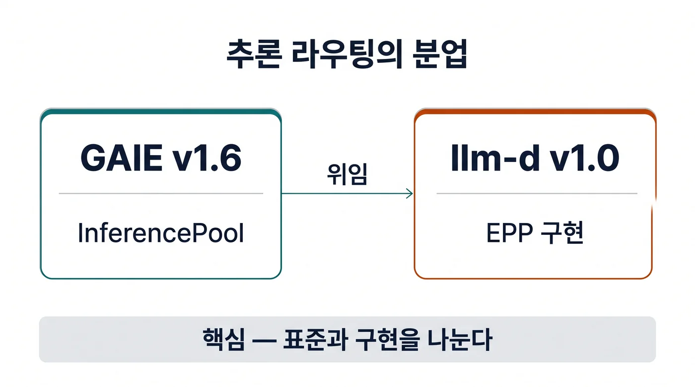

## 이 글을 30초에 파악하기

> **한 줄로** — 요청을 어느 GPU 파드로 보낼지 정하는 일에서 "무엇을 약속할지"와 "실제로 고르는 프로그램"을 서로 다른 프로젝트가 맡도록 나눈 결정과, 그 뒤에 남은 선택지를 정리한다.

**읽고 나면 알게 되는 것**

- 2026-08-17 GAIE v1.6.0이 무엇을 남기고 무엇을 llm-d로 넘겼는지
- 쿠버네티스 표준에 남은 `InferencePool` 하나가 어떤 필드로 라우팅 조건을 정하는지
- 설치 문서마다 버전이 다른 상황에서, 내 클러스터에 무엇을 먼저 확인해야 하는지

**용어 먼저 보기**

| 용어 | 한 줄 설명 | 이 글에서의 역할 |
|---|---|---|
| GAIE(게이트웨이 API 추론 확장) | 쿠버네티스 Gateway API 위에 추론 서버용 리소스와 선택 규약을 얹은 표준 프로젝트 | 2절에서 경계가 다시 그어진 대상 |
| Gateway API | 쿠버네티스의 차세대 인그레스 규격. HTTPRoute가 트래픽 규칙을 적는다 | GAIE가 얹히는 바닥 |
| InferencePool | "이 파드 묶음이 추론 서버다"라고 선언하는 리소스. Service 대신 백엔드 자리에 온다 | v1에 남은 유일한 사용자 리소스 |
| EPP(엔드포인트 선택기) | 요청마다 보낼 파드를 점수로 골라 주는 프로그램 | 분할의 중심에 있는 컴포넌트 |
| ext_proc | 게이트웨이가 요청을 넘기기 전에 외부 프로세스에 판단을 물어보는 훅 | 게이트웨이와 EPP를 잇는 통로 |
| llm-d | 분산 추론을 위한 오픈소스 스택. v1.6.0 이후 EPP 본체를 보유한다 | 라우팅 구현의 새 집 |
| llm-d-router | llm-d 안에서 라우터와 설정 API를 담당하는 컴포넌트 | 4절의 주제 |
| LWEPP | GAIE 저장소에 남은 참조용 경량 EPP | 적합성 테스트의 기준 구현 |

**이런 분께** — 클러스터에 추론 서비스를 올렸거나 올릴 예정이고, 게이트웨이와 라우터를 무엇으로 고를지 결정해야 하는 개발자. 처음 읽을 때는 2.1절 이동 표와 6.1절 버전 표만 먼저 봐도 전체 지도가 잡힌다.



2026년 상반기까지 추론 게이트웨이를 설명하는 문서는 대개 "게이트웨이가 EPP를 불러 파드를 고른다"는 한 문장으로 끝났습니다. 그런데 같은 문장을 8월 이후 문서에서 읽으면 주어가 달라집니다. EPP를 정의하는 저장소와 EPP를 구현하는 저장소가 서로 달라졌기 때문입니다. 이 글은 그 분할이 어디서 생겼는지, 표준에 무엇이 남았는지, 그리고 지금 클러스터를 운영하는 사람이 무엇을 먼저 확인해야 하는지를 순서대로 정리합니다. 수치와 버전은 2026-11-07 기준으로 공개된 릴리스 노트와 공식 문서에서 확인했고, 개인 학습과 설계 리뷰 목적의 기록입니다.

---

## 1. 요청을 어느 파드로 보낼지는 원래 순번이 정했다

사내 챗봇에 같은 규정 문서를 붙인 질문이 열 개 들어왔다고 하자. 앞단 로드밸런서는 요청을 순번대로 파드에 나눠 준다. 파드 열 개가 같은 문서를 열 번 다시 읽고, 첫 글자가 나오기까지의 시간은 그만큼 늘어난다.

LLM(대규모 언어 모델) 추론에서 파드마다 다른 값은 세 가지다. 대기 중인 요청 수, 이미 계산해 둔 **KVCache(키-값 캐시)** 의 양, GPU 사용률이다. 일반 로드밸런서는 이 셋을 보지 않는다. 연결 수와 응답 시간만 본다. 프롬프트 길이에 따라 요청 하나의 비용이 크게 달라지는 워크로드에서는 그 기준이 어긋난다.

### 1.1 상태가 파드에 붙는 순간 균등 분배는 손해가 된다

택시 배차를 떠올려 보자. 승객 위치를 모르는 상태에서 차 번호순으로 배차하면 공차 운행이 늘어난다. LLM 추론의 프리픽스(prefix) 캐시가 같은 성질이다. 같은 시스템 프롬프트나 같은 문서를 공유하는 요청은 그 앞부분을 이미 계산한 파드로 보낼 때 이득이 생긴다. 아무 파드로 보내면 그 계산을 처음부터 다시 한다.

여기에 큐가 겹친다. 긴 문서 요약 요청 하나가 파드에 들어가면, 그 파드에 배정된 짧은 질문들은 첫 토큰도 받지 못하고 뒤에 선다. 평균 지연은 그대로인데 꼬리 지연(P95, P99)만 치솟는 전형적인 모양이다.

### 1.2 표준이 만들어 둔 자리: Service를 대신하는 백엔드

Gateway API에서 `HTTPRoute`의 `backendRef`는 보통 Service를 가리킨다. GAIE는 그 자리에 `InferencePool`을 놓을 수 있게 했다[^1]. 게이트웨이가 `InferencePool`을 백엔드로 인식하면, 요청을 넘기기 전에 그 풀의 **엔드포인트 선택기(Endpoint Picker, EPP)** 에 판단을 물어본다. 통로는 Envoy 계열 게이트웨이가 제공하는 **ext_proc** 훅이고, 형식은 gRPC다. 게이트웨이는 돌려받은 `podIP:port`로 요청을 보낸다[^2].

여기서 표준이 정한 범위를 눈여겨볼 필요가 있다. 정해진 것은 "어떤 리소스가 백엔드가 되는가", "언제 누구에게 물어보는가", "그 답을 어떤 형식으로 받는가"까지다. 점수를 매기는 규칙, 어떤 신호를 볼지, 플러그인을 어떻게 조합할지는 이 표준의 몫이 아니었다. 2026년 8월의 분할은 이 문장을 제도화한 사건이다.

---

## 2. v1.6의 분할: 규격은 남기고 구현은 넘겼다

릴리스 노트를 열면 추가된 항목보다 삭제된 항목이 먼저 눈에 들어온다. 2026-08-17에 나온 GAIE v1.6.0은 알파 API 세 개를 지우고, EPP 본체를 다른 저장소로 옮겼다[^3].

삭제된 것은 `InferenceObjective`(`inference.networking.x-k8s.io/v1alpha2`), `InferenceModelRewrite`(같은 그룹), `EndpointPickerConfig`(`config.inference.networking.k8s.io/v1alpha1`)다. 함께 빠진 것은 EPP 본체, 본문 기반 라우팅(Body-Based Routing, BBR), 지연 예측기(Latency Predictor)다.

### 2.1 무엇이 어디로 갔나

| 구성요소 | v1.6.0 이전 | v1.6.0 이후 |
|---|---|---|
| EPP와 EPP 설정 | GAIE 저장소 | llm-d 라우터(`llm-d.ai/v1` EPPConfig) |
| InferenceObjective | GAIE 알파(`inference.networking.x-k8s.io/v1alpha2`) | `llm-d.ai/v1` |
| InferenceModelRewrite | GAIE 알파 | `llm-d.ai/v1alpha2` |
| 본문 기반 라우팅(BBR) | GAIE | llm-d 추론 페이로드 프로세서 |
| 경량 EPP(LWEPP) | 없음 | GAIE에 참조 구현으로 추가 |

표의 이동 경로는 Azure Application Gateway for Containers 문서의 컴포넌트 매핑 표와 같은 내용이다[^4]. 읽는 법은 이렇다. 쿠버네티스 진영에 남은 것은 리소스 하나(`InferencePool`), 호출 프로토콜, 적합성 테스트다. "어떤 요청을 어느 파드로 보낼지 계산하는 코드"는 이제 다른 프로젝트의 코드다.

이 분할이 가능했던 이유는 원래부터 층이 둘이었기 때문이다. 아래층은 Gateway API가 정의하는 라우팅 규칙이고, 위층은 추론에 특화된 선택 로직이다. 분할 전에는 두 층이 한 저장소에 있었고, 분할 후에는 위층만 옮겨 갔다.

### 2.2 endpointPickerRef가 선택 항목이 된 이유

`InferencePool`의 `spec.endpointPickerRef`는 오랫동안 필수였다. v1.5.0(2026-04-20)에서 선택 항목으로 바뀌었고, 이 필드가 비어 있으면 `status.parents`에 `EndpointPickerRefMissing` 사유가 남는다[^5]. 그런데 문서는 곧바로 단서를 붙인다. "대부분의 구현과 함께 동작하려면 여전히 필요하다"는 문장이다[^5].

이 조합은 운영에서 두 가지로 읽힌다. 첫째, EPP를 따로 띄우지 않고 게이트웨이의 기본 분배에 맡기는 구성이 문법적으로 가능해졌다는 뜻이다. 둘째, 그 구성이 모든 게이트웨이에서 동작한다는 보장은 없다는 뜻이다. 필드가 선택 항목이 된 것과 그 필드 없이 잘 도는 것은 다른 문제다.

실패 모드도 같은 맥락이다. `failureMode`의 기본값은 `FailOpen`이 아니라 `FailClose`다[^5]. EPP가 응답하지 않으면 요청을 그냥 실패시킨다는 뜻이다. 캐시를 모르는 채 엉뚱한 파드로 보내는 것보다 실패를 돌려주는 편이 낫다고 본 기본값이다. 운영에서는 이 기본값이 곧 "EPP는 가용성이 확보된 컴포넌트여야 한다"는 요구가 된다.

### 2.3 경량 EPP를 표준 저장소에 남긴 이유

구현을 전부 넘기고 나면 적합성 테스트를 돌릴 대상이 없어진다. 그래서 GAIE 저장소에는 **LWEPP(Lightweight EPP)** 라는 참조 구현이 남았다. 이미지 이름은 `registry.k8s.io/gateway-api-inference-extension/lwepp:v1.6.2`이고, 설치는 릴리스 매니페스트 한 줄로 끝난다[^5].

```
kubectl apply -f https://github.com/kubernetes-sigs/gateway-api-inference-extension/releases/download/v1.6.2/manifests.yaml
```

1.6 계열은 이후 두 번 패치됐다. v1.6.1(2026-09-11)은 적합성 테스트가 이전 버전 이미지를 가리키는 상태로 나왔고, v1.6.2(2026-09-17)에서 고쳐졌다[^3]. 새로 설치한다면 v1.6.2를 기준으로 삼는 편이 안전하다.

---

## 3. 남은 v1 API를 읽는 법

매니페스트를 열면 리소스가 하나뿐이라 오히려 당황한다. 정식 버전(`inference.networking.k8s.io/v1`)에서 사용자가 직접 쓰는 리소스는 `InferencePool` 하나다[^5]. 다중 클러스터용 `InferencePoolImport`는 실험 스펙에 있고, 컨트롤러가 만들지 사용자가 작성하지 않는다[^1].

필드 수가 적다는 것은 결정할 것이 적다는 뜻이 아니다. 각 필드가 운영에서 무엇을 잠그는지 보면 그렇다.

### 3.1 필드가 정하는 것: 셀렉터는 좁게, 포트는 여러 개

- **`spec.selector`** — `matchLabels`만 받고 최대 64개 항목이다. 같은 네임스페이스의 파드만 고를 수 있다[^5]. 라벨 하나를 잘못 붙이면 풀에 엉뚱한 파드가 섞인다는 뜻이므로, 풀 라벨은 다른 워크로드와 겹치지 않게 관리해야 한다.
- **`spec.targetPorts`** — 1~8개를 받는다. 각 포트가 별도의 `podIP:port` 엔드포인트가 되므로, 파드 10개에 포트 2개를 두면 엔드포인트는 20개다[^5]. 같은 파드에서 추론 서버와 다른 서비스를 함께 열 때 쓰는 구조다.
- **`spec.appProtocol`** — `http`(기본) 또는 `kubernetes.io/h2c`다[^5]. 추론 서버가 HTTP/2를 쓰는지 여부를 여기서 밝힌다.

### 3.2 프로토콜과 실패 모드가 경계를 만든다

표준이 보증하는 경계는 두 개의 선으로 그려진다. 게이트웨이와 EPP 사이의 호출 형식, 그리고 EPP가 죽었을 때의 동작(`FailOpen`/`FailClose`)이다[^5]. 그 두 선 안쪽에서 무엇을 계산하든 표준은 관여하지 않는다.

이 구조 덕분에 라우팅 알고리즘은 표준 개정 없이 바뀔 수 있다. 반대로 말하면, 알고리즘이 바뀌어도 표준 문서에는 아무 기록이 남지 않는다. 운영 중인 클러스터의 라우팅 품질을 확인하려면 표준 문서가 아니라 라우터 버전과 그 설정을 봐야 한다.

### 3.3 적합성 보고서가 말해 주는 것

v1.6.0 기준 적합성 보고서는 두 개뿐이다. agentgateway와 NGINX Gateway Fabric(v2.6.0)이다[^2]. Alibaba Cloud의 ACK Gateway with Inference Extension 보고서(`v1.6.1-apsara.3`)는 v1.5.0 프로필 기준으로 남아 있다[^2]. 저장소에는 v0.4.0부터 v1.6.0까지의 보고서 디렉터리가 있지만, 최신 분할을 반영한 보고서는 아직 많지 않다.

Cilium은 1.20(2026-07-29)부터 GIE를 베타로 지원한다. Gateway API v1.6.3 CRD가 필요하고, `GatewayWeightedAcrossTwoInferencePools` 시나리오를 건너뛰는 부분 적합성이며, `HTTPRoute` 하나에 `InferencePool` 하나만 붙일 수 있다[^6]. "베타"라는 단어와 "부분 적합성"이라는 문구를 같이 읽어야 하는 이유다.

---

## 4. 넘겨받은 쪽: llm-d-router v1.0이 고정한 것

라우터를 직접 고르는 입장이면 이제 질문이 둘로 갈린다. 어떤 게이트웨이가 EPP를 부를 수 있는가, 그리고 그 EPP는 무엇을 보고 점수를 매기는가. 전자는 GAIE가, 후자는 llm-d가 답한다.

llm-d는 CNCF 샌드박스 프로젝트이고, v1.0 발표 기준 500명 이상의 기여자와 25개 이상 조직이 참여한다[^7]. llm-d-router는 그 안에서 라우터 본체와 설정 API를 맡는다.

### 4.1 설정 API가 llm-d.ai/v1로 올라갔다

2026-10-16에 나온 llm-d-router v1.0.0은 `EPPConfig`와 `InferenceObjective`를 `llm-d.ai/v1`로 올렸다. `InferenceModelRewrite`는 `llm-d.ai/v1alpha2`에 남았다. 플러그인 표면은 고정됐고, `priority-holdback-policy`는 베타다[^8].

세 리소스의 역할은 이렇게 나뉜다. `EPPConfig`는 어떤 플러그인을 어떤 가중치로 쓸지 정한다. `InferenceObjective`는 라우팅이 달성해야 할 목표(지연 예산, 우선순위 등)를 선언한다. `InferenceModelRewrite`는 요청의 모델 이름을 다른 대상으로 바꾼다.

GAIE 알파 시절 `inference.networking.x-k8s.io/v1alpha2`에 있던 이름이 `llm-d.ai/v1`로 옮겨 온 셈이다. 클러스터에 남은 옛 매니페스트는 이 그룹 이름을 그대로 참조하므로, 업그레이드 점검에서 가장 먼저 검색할 문자열이 된다.

### 4.2 v1.0.0 본체가 더한 운영 기능

2026-10-20에 나온 llm-d v1.0.0은 새 알고리즘보다 운영 쪽에 무게가 있다[^7].

- **다중 테넌트 QoS** — 우선순위와 공정성 흐름 제어, 확률적 수용기(probabilistic admitter)를 함께 쓴다. 큐가 찼을 때 일괄로 거절하지 않고 확률로 받아들이는 방식이다.
- **라우터 HA** — 액티브-스탠바이 핫 스탠바이 구성이 들어갔다. 앞서 본 `FailClose` 기본값과 짝을 이루는 기능이다.
- **DisaggregatedSet 락스텝 업그레이드** — 프리필과 디코드를 나눈 구성에서 양쪽을 함께 올린다.
- **세션 인식 라우팅과 Responses API 상태** — 대화가 이어지는 동안 같은 파드로 보내 캐시를 재사용한다.

### 4.3 성능 변경은 플러그인 교체로 흡수된다

라우터가 GAIE 밖으로 나온 뒤에도 릴리스는 계속됐다. v0.9.0(2026-06-23)은 큰 플릿에서 `Scheduler.Schedule`의 할당을 약 90% 줄였다. v0.10.0(2026-08-17)은 RDMA 없이 KV 전송을 오프로드하는 커넥터, DisaggregatedSet 리비전 라우팅, DCGM 기반 GPU 사용률 라우팅을 넣었다. v0.11.0(2026-09-27)은 프리필·디코드 단계별 포화 게이팅과 대역별 큐 TTL을 추가했다[^8].

이 변경들이 표준 문서에 반영되지 않는 이유는 간단하다. 전부 라우터 내부 플러그인의 교체이기 때문이다. 표준은 호출 형식만 보증하고, 그 안의 알고리즘은 버전이 올라갈 때마다 바뀔 수 있다. llm-d v0.5 시점의 구조는 [엔터프라이즈 AI 플랫폼 설계 글](/llm/enterprise-ai-platform-disaggregated-serving-kvcache-gaie/)에서 정리했다. 그 글이 다룬 시점에는 EPP가 GAIE 저장소 안에 있었고, 설정 API도 알파 그룹에 있었다. 지금은 본체가 라우터 저장소로 옮겨졌고 설정 API가 `llm-d.ai/v1`이 됐다.

---

## 5. 숫자로 보는 효과와 그 조건

라우팅을 바꿨다는 발표에는 대개 배수 하나가 따라붙는다. 문제는 그 배수가 어떤 하드웨어와 어떤 요청 분포에서 나왔는지다. 아래 세 묶음은 조건이 서로 다르므로 하나로 합쳐 읽으면 안 된다.

### 5.1 같은 하드웨어에서 비교한 값

Principled Technologies가 2026년 5월에 수행한 비교다. Llama 3.1 8B Instruct, 공유 프리픽스 워크로드, A100 40GB 8장, 같은 하드웨어 조건에서 GKE Inference Gateway와 서드파티 관리형 쿠버네티스를 비교했다[^9].

- 출력 처리량 **7,169.21 vs 6,042.05 토큰/초** (+15.7%)
- TTFT(첫 토큰까지 걸린 시간) **188.36ms vs 2,624.73ms** (−92.8%)
- ITL(토큰 간 지연) **30.20ms vs 81.03ms** (−62.6%)

읽는 순서가 중요하다. 처리량 차이는 15.7%인데 첫 토큰 지연 차이는 92.8%다. 이 격차는 캐시 재사용이 전체 처리량보다 대기 시간에서 먼저 드러난다는 뜻이다. 다만 비교 대상인 서드파티 클러스터는 게시글에 이름이 밝혀지지 않았고, 라운드로빈 HTTP 로드밸런서를 쓰는 구성이었다[^9]. 이 조건을 떼고 "추론 게이트웨이는 92% 빠르다"로 인용하면 안 된다.

### 5.2 규모가 커질 때

17,000노드 규모의 다중 리전 GKE 구성에서 측정한 값도 있다. 3개 클러스터, 미국과 유럽, MoE 모델 구성이다. llm-d 라우터를 붙였을 때 처리량 2.9배, 성공률 99.9%, 라우팅 오버헤드 1% 미만을 기록했다[^10].

이 수치는 단일 클러스터 값이 아니다. 클러스터 경계를 넘는 라우팅과 장애 격리가 함께 들어간 결과이므로, 사내 단일 클러스터에 그대로 대입할 수 없다. 대신 "라우터를 앞단에 두는 비용이 처리량의 1% 미만"이라는 문장은 규모와 상관없이 참고할 만하다.

### 5.3 캐시 적중률이 사용자 지표로 바뀌는 지점

Gemini 플랫폼의 운영 트래픽(코딩 에이전트와 버스트 채팅)에서 프리픽스 캐시 적중률이 35%에서 70%로 올랐다. 같은 기간 TTFT가 35% 이상 줄고 P95 TTFT가 50% 이상 줄었다[^10]. 적중률이 두 배가 되면 대기 시간이 두 배 줄어드는 것은 아니다. 지표가 어느 정도 개선되는지 감을 잡는 데 쓰는 숫자다.

비용 쪽 사례도 있다. IBM Research의 자체 호스팅 코딩 에이전트 구성(H100 544장)은 동시 에이전트 3,000개를 처리하며 프리픽스 캐시 적중률 약 98%, 100만 토큰당 약 0.11달러를 기록했다. 같은 작업을 상용 스택으로 처리할 때보다 비용이 약 11.5배 낮다는 주장이다[^7].

---

## 6. 지금 운영 중이라면 무엇을 먼저 볼까

설치 문서 세 개를 나란히 열면 같은 컴포넌트를 서로 다른 버전으로 설치하라고 적혀 있다. 문서가 틀린 것이 아니라, 각 문서가 검증한 시점이 다르다.

기반이 되는 Gateway API 자체도 계속 움직였다. v1.6.0(2026-06-30)에서 TCPRoute와 UDPRoute가 정식으로 올라왔고[^11], v1.7.0(2026-10-29)에서는 HTTPRoute 재시도가 정식이 됐다[^12].

### 6.1 버전이 갈라진 지도

| 소비자 | 문서가 고정한 버전 | 비고 |
|---|---|---|
| GKE Inference Gateway 설치 문서 | GAIE v1.5.0, llm-d v0.7.0 | 삭제된 알파 `InferenceObjective` CRD를 여전히 설치한다[^13] |
| vLLM Production Stack | Gateway API v1.6.0, GAIE v1.5.0, agentgateway v1.4.1, llm-d router v0.9.0 | 참조 경로[^14] |
| NVIDIA Dynamo v1.3.0 문서 | GAIE v1.2.1, agentgateway v1.0.0, Istio 1.29.2, Gateway API v1.5.1 | 분할 이전에 고정[^15] |
| Azure AGFC(미리보기) | GAIE CRD v1.6.2, llm-d router v1.0.0 (ALB Controller 1.13.0 이상) | 분할 이후 기준[^4] |
| Cilium 1.20 | Gateway API v1.6.3 CRD 필요, GIE 베타 | 부분 적합성[^6] |
| Istio | GAIE CRD v1.0.1, Gateway API v1.6.0, v1.28.0 이상 권장 | 환경 변수 두 개로 활성화[^16] |

이 표에서 얻을 결론은 하나다. "현재 지원 버전"이라는 문구는 소비자를 밝혀야 의미가 생긴다. 같은 시기의 문서가 v1.2.1, v1.5.0, v1.6.2를 각각 가리키는 상태다.

### 6.2 업그레이드에서 먼저 확인할 세 가지

1. **삭제된 그룹 이름** — 매니페스트와 Git 저장소에서 `inference.networking.x-k8s.io`, `config.inference.networking.k8s.io`, `EndpointPickerConfig`를 검색한다. 이 셋이 남아 있으면 v1.6 이후 CRD에는 해당 종류가 없다[^3].
2. **`endpointPickerRef` 유무** — 필드가 비어 있으면 `status`에 `EndpointPickerRefMissing`이 남는다[^5]. 게이트웨이 구현이 이 필드를 요구하면 풀이 resolve되지 않고 요청이 전달되지 않는다.
3. **실패 모드 기본값** — `failureMode`를 따로 적지 않았다면 `FailClose`다[^5]. EPP를 단일 파드로 띄웠다면 그 파드의 재시작이 곧 요청 실패가 된다. llm-d v1.0의 라우터 HA 기능이 이 지점을 겨냥한다[^7].

### 6.3 게이트웨이 선택지에서 빠진 것과 남은 것

kgateway는 이 경로에서 빠졌다. 에이전트게이트웨이 없이 추론 확장을 운용하는 방식이 2.1에서 폐기 예고, 2.2에서 미지원이 됐다[^14]. Volcano 프로젝트의 Kthena는 다른 방향을 택했다. `kthena-router` GatewayClass가 별도 EPP 없이 `InferencePool`을 직접 서빙한다[^17].

관리형 서비스는 비용 구조가 다르다. GKE Inference Gateway는 2025-09-11에 정식 출시됐고[^18], 추가 비용 없이 GKE와 부하 분산기, 가속기 비용만 낸다. 대신 GKE 1.32.3 이상이 필요하고, `InferencePool` CRD는 1.34.0-gke.1626000부터 번들로 들어가며, 백엔드 서비스당 NEG 50개 제한이 targetPorts 설계에 영향을 준다[^19]. Azure AGFC의 추론 게이트웨이는 미리보기이고, AKS 애드온이 아니라 Helm으로 설치한 ALB Controller가 필요하며, `InferencePool` 기반 경로에서는 `AuthPolicy`의 JWT 검증이 지원되지 않는다[^20].

---

## 한계와 트레이드오프

- 이 분할은 규격과 구현의 릴리스 주기를 분리했지만, 대신 호환 행렬을 사용자가 관리하게 만들었다. GAIE v1.6.2를 쓰는 게이트웨이가 llm-d router v1.0.0과 맞는지는 각 프로젝트 문서를 대조해야 한다.
- v1.6.0 기준 적합성 보고서가 둘뿐이라, "표준을 지킨다"는 문장만으로 게이트웨이를 고르기 어렵다[^2]. Cilium처럼 부분 적합성을 명시한 구현도 있다.
- 관리형 문서가 삭제된 알파 API를 계속 설치하는 동안은, 문서만 따라 만든 클러스터가 최신 규격과 어긋난다[^13].
- 5절의 수치는 대부분 프리픽스가 겹치는 워크로드에서 나왔다. 짧은 단발 질의나 매번 다른 문서를 넣는 사용 패턴에서는 캐시 재사용 이득이 작다.

## 정리

- 2026-08-17 GAIE v1.6.0은 추론 라우팅에서 규격과 구현을 갈랐다. 쿠버네티스 표준에 남은 것은 `InferencePool` 리소스, EPP 호출 프로토콜, 적합성 테스트다.
- 라우팅 알고리즘과 설정 API는 llm-d로 옮겨 갔고, llm-d-router v1.0.0(2026-10-16)이 이를 `llm-d.ai/v1`로 고정했다. llm-d v1.0.0(2026-10-20)은 QoS와 라우터 HA를 더했다.
- 업그레이드에서 볼 것은 세 가지다. 삭제된 그룹 이름, `endpointPickerRef` 유무, `FailClose` 기본값.
- 효과는 조건과 함께 읽어야 한다. 같은 하드웨어 비교에서 TTFT 92.8% 감소는 공유 프리픽스 워크로드와 이름이 밝혀지지 않은 비교 대상 위에서 나온 값이다.

## References

[^1]: GAIE API 개요 — `InferencePool`이 Gateway API의 Service 대체 백엔드로 동작하며, 실험 스펙의 `InferencePoolImport`는 컨트롤러가 생성한다. https://gateway-api-inference-extension.sigs.k8s.io/concepts/api-overview/
[^2]: GAIE 게이트웨이 구현 목록 — ext_proc gRPC 기반 EPP 호출, v1.6.0 적합성 보고서는 agentgateway와 NGINX Gateway Fabric(v2.6.0) 두 건, ACK 보고서는 v1.5.0 프로필. https://gateway-api-inference-extension.sigs.k8s.io/implementations/gateways/
[^3]: GAIE v1.6.0 릴리스 노트(2026-08-17) — EPP·BBR·지연 예측기의 llm-d 이관, LWEPP 도입, `endpointPickerRef` 선택화, `InferenceObjective`·`InferenceModelRewrite`·`EndpointPickerConfig` 삭제. 1.6 계열은 v1.6.1(2026-09-11), v1.6.2(2026-09-17) 패치로 이어진다. https://github.com/kubernetes-sigs/gateway-api-inference-extension/releases/tag/v1.6.0
[^4]: Azure Application Gateway for Containers 추론 게이트웨이 설치 문서 — ALB Controller 1.13.0 이상이 GAIE CRD v1.6.2를 설치하고 llm-d router v1.0.0이 같은 CRD에 맞춰 빌드된다. 컴포넌트 이관 표(EPP→llm-d 라우터, InferenceObjective→llm-d.ai/v1, InferenceModelRewrite→llm-d.ai/v1alpha2, BBR→llm-d 페이로드 프로세서). https://learn.microsoft.com/en-us/azure/application-gateway/for-containers/how-to-inference-gateway
[^5]: GAIE v1 API 레퍼런스 — v1의 사용자 리소스는 `InferencePool` 하나, `selector.matchLabels` 최대 64개, `targetPorts` 1~8개, `appProtocol` http 또는 kubernetes.io/h2c, `failureMode` 기본 FailClose, `EndpointPickerRefMissing` 사유, 설치 매니페스트와 lwepp:v1.6.2 이미지. https://gateway-api-inference-extension.sigs.k8s.io/reference/spec/
[^6]: Cilium GIE 문서 — 1.20부터 베타, Gateway API v1.6.3 CRD 필요, `GatewayWeightedAcrossTwoInferencePools` 생략(부분 적합성), `HTTPRoute`당 `InferencePool` 하나. https://docs.cilium.io/en/latest/network/servicemesh/gateway-api/gie/
[^7]: llm-d v1.0 발표(2026-10-20) — 500명 이상 기여자·25개 이상 조직, 다중 테넌트 QoS와 확률적 수용기, 라우터 HA 핫 스탠바이, DisaggregatedSet 락스텝 업그레이드, 세션 인식 라우팅. IBM Research 사례: H100 544장, 동시 에이전트 3,000, 프리픽스 적중률 약 98%, 100만 토큰당 약 `$0.11`, 상용 대비 약 11.5배 낮은 비용. https://llm-d.ai/blog/llm-d-v1.0-state-of-the-art-inference-ready-for-day-2
[^8]: llm-d-router 릴리스 — v0.9.0(2026-06-23, `Scheduler.Schedule` 할당 약 90% 감소), v0.10.0(2026-08-17), v0.11.0(2026-09-27), v1.0.0(2026-10-16, EPPConfig·InferenceObjective를 llm-d.ai/v1로, priority-holdback-policy 베타). https://github.com/llm-d/llm-d-router/releases
[^9]: GKE Inference Gateway 성능 글(2026-06-10) — Principled Technologies 측정. Llama 3.1 8B Instruct, 공유 프리픽스, A100 40GB 8장에서 출력 7,169.21 vs 6,042.05 토큰/초(+15.7%), TTFT 188.36ms vs 2,624.73ms(−92.8%), ITL 30.20ms vs 81.03ms(−62.6%). https://cloud.google.com/blog/products/containers-kubernetes/gke-inference-gateway-prefix-caching-accelerates-ai-inference
[^10]: Google의 llm-d 1.0 글(2026-10-21) — 17,000노드·3클러스터·2리전 MoE에서 처리량 2.9배, 성공률 99.9%, 라우팅 오버헤드 1% 미만. Gemini 플랫폼 프리픽스 적중률 35%→70%, TTFT 35% 이상·P95 TTFT 50% 이상 감소. https://cloud.google.com/blog/topics/ai-infrastructure/llm-d-1-0-an-open-source-stack-for-distributed-inference
[^11]: Gateway API v1.6 릴리스 — v1.6.0(2026-06-30), TCPRoute·UDPRoute 정식 승격과 실험 그룹 분리. https://kubernetes.io/blog/2026/08/03/gateway-api-v1-6-release/
[^12]: Gateway API 릴리스 피드 — v1.6.3(2026-10-06), v1.7.0(2026-10-29, HTTPRoute 재시도 정식 승격). https://github.com/kubernetes-sigs/gateway-api/releases
[^13]: GKE Inference Gateway 설치 문서 — 예제가 GAIE v1.5.0과 llm-d v0.7.0을 고정하고, 삭제된 알파 `InferenceObjective` CRD를 함께 설치한다. https://docs.cloud.google.com/kubernetes-engine/docs/how-to/deploy-gke-inference-gateway
[^14]: vLLM Production Stack 게이트웨이 문서 — Gateway API v1.6.0, GAIE v1.5.0, agentgateway v1.4.1, llm-d router v0.9.0 고정. kgateway의 추론 확장 경로는 2.1 폐기 예고, 2.2 미지원. https://docs.vllm.ai/projects/production-stack/en/latest/deployment/gateway-inference-extension.html
[^15]: NVIDIA Dynamo GAIE 개요(v1.3.0 문서) — GAIE v1.2.1, agentgateway v1.0.0, Istio 1.29.2, Gateway API v1.5.1 고정. https://docs.nvidia.com/dynamo/v1.3.0/kubernetes-deployment/request-routing/gateway-api-inference-extension/overview
[^16]: Istio Gateway API Inference Extension 태스크 — `SUPPORT_`·`ENABLE_GATEWAY_API_INFERENCE_EXTENSION` 환경 변수, Gateway API v1.6.0과 GAIE CRD v1.0.1 고정, v1.28.0 이상 권장. https://istio.io/latest/docs/tasks/traffic-management/ingress/gateway-api-inference-extension/
[^17]: Kthena GIE 지원 문서 — `kthena-router` GatewayClass가 별도 EPP 없이 `InferencePool`을 서빙, `--enable-gateway-api`·`--enable-gateway-api-inference-extension` 플래그. https://kthena.volcano.sh/docs/v0.2.0/user-guide/gateway-inference-extension-support
[^18]: GKE Inference Gateway 정식 출시 글(2025-09-11) — GA 시점과 프리픽스 인식 부하 분산 소개. https://cloud.google.com/blog/products/ai-machine-learning/gke-inference-gateway-and-quickstart-are-ga
[^19]: GKE Inference Gateway 개념 문서 — 추가 비용 없음, GKE 1.32.3 이상, `InferencePool` CRD는 1.34.0-gke.1626000부터 번들, targetPorts 최대 8, 백엔드 서비스당 NEG 50개. https://docs.cloud.google.com/kubernetes-engine/docs/concepts/about-gke-inference-gateway
[^20]: AGFC 추론 게이트웨이 개념 문서(미리보기) — 관리형 BBR, `InferencePool` v1, `FailOpen`/`FailClose`, `InferencePool` 기반 경로에서 `AuthPolicy` JWT 검증 미지원. https://learn.microsoft.com/en-us/azure/application-gateway/for-containers/inference-gateway