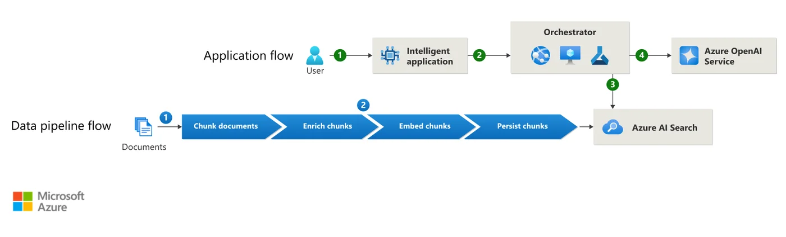

## 이 글을 30초에 파악하기

> **한 줄로** — 사내 문서에 쌓인 답을 언어 모델이 근거와 함께 말하게 만드는 RAG는 결국 검색과 생성을 어떻게 연결하는가의 문제다. 이 글은 그 연결 방식이 3세대에 걸쳐 무엇을 얻고 무엇을 잃었는지, 그리고 PDF 파싱과 2단계 검색이 왜 병목이 되는지를 따라간다.

**읽고 나면 알게 되는 것**

- RAG가 단순 벡터 검색에서 자가 교정 구조로 넘어가는 동안 무엇이 추가됐는지
- 표와 다단 레이아웃이 있는 PDF를 그대로 잘라 넣으면 검색 품질이 왜 무너지는지
- 키워드 검색(BM25)과 벡터 검색을 함께 쓰고 리랭커로 다시 정렬하는 2단계 구성이 필요한 이유

**용어 먼저 보기**

| 용어 | 한 줄 설명 | 이 글에서의 역할 |
|---|---|---|
| RAG | 언어 모델이 답하기 전에 외부 문서에서 근거를 찾아 함께 넣어 주는 방식 | 글 전체의 주제 |
| 환각(Hallucination) | 모델이 사실이 아닌 내용을 그럴듯하게 만들어 내는 현상 | RAG가 해결하려는 문제 |
| DPR | 질문과 문서를 각각 벡터로 바꿔 가까운 것을 찾는 검색기 | 원조 논문의 검색 구성 요소 |
| 심층 문서 파싱 | PDF의 표·도표·읽기 순서를 원래 구조대로 복원해 뽑는 처리 | 3장에서 다루는 병목 |
| BM25 | 단어가 겹치는 정도로 문서를 찾는 키워드 기반 검색 | 2단계 검색의 1단계 |
| Cross-Encoder | 질문과 문서를 한 번에 넣어 관련도를 정밀하게 다시 계산하는 모델 | 2단계 검색의 재순위화 |
| Ragas | 답변이 검색된 문맥에 근거하는지, 검색이 충분했는지를 지표로 재는 평가 도구 | 5장의 평가 프레임워크 |

**이런 분께** — 사내 문서를 대상으로 RAG를 직접 붙여 보려는 개발자와, 이미 돌아가는 검색 파이프라인이 어디서 새는지 점검하려는 엔지니어. 처음 읽을 때는 2장에서 세대별 차이를 잡고 3~4장으로 넘어가면 되고, 1장의 확률식은 나중에 다시 봐도 된다.

---

생성형 대규모 언어 모델(LLM)은 방대한 매개변수적 지식(Parametric Knowledge)을 내재화하고 있다. 그러나 학습 컷오프(Cutoff) 시점 이후의 최신 정보가 없고, 비공개 사내 지식에도 접근할 수 없다. 결정적으로는 사실과 다른 정보를 그럴듯하게 지어내는 **환각(Hallucination)** 문제에 직면한다.

이를 극복하기 위해 **검색 증강 생성(RAG, Retrieval-Augmented Generation)**이 등장했다. RAG는 언어 모델의 추론 엔진에 외부의 검증 가능한 비매개변수적 지식(Non-parametric Knowledge) 소스를 결합하는 아키텍처 패턴이다. RAG는 2020년 Patrick Lewis 등의 논문[^1]에서 출발했다. 이후 단순한 벡터 검색을 넘어 **심층 문서 파싱(Deep Document Parsing)**과 **동적 쿼리 변환**이 더해졌다. **다단계 하이브리드 검색 및 리랭킹(Reranking)**과 **자가 교정(Self-Correction)**까지 통합한 엔터프라이즈 모듈러 아키텍처로 진화했다. 이 글에서는 RAG의 이론적 기초부터 3세대 발전사, 비정형 복합 문서 처리의 핵심 기술, 그리고 프로덕션 파이프라인을 분석한다.

---

## 1. 이론적 기초: Lewis et al. (2020) 논문 정밀 분석

RAG라는 용어를 정립한 원조 논문[^1]은 사전 훈련된 Seq2Seq 모델(BART)과 조밀한 구절 검색기를 결합했다. 여기서 조밀한 구절 검색기란 DPR(Dense Passage Retriever)[^2]을 가리킨다. 논문은 두 구성 요소를 종단간(End-to-End)으로 묶어 언어 모델의 지식 접근 방식을 정식화했다.

```
RAG의 지식 결합 정식화:
  Parametric Memory (LLM 가중치)  ──┐
                                     ├──> 조건부 확률 분포 P(y | x)
  Non-Parametric Memory (벡터 인덱스) ──┘
```

논문은 검색된 문서 집합 $Z$를 활용하여 최종 답변 시퀀스 $y$를 생성할 때, 문서를 참조하는 단위에 따라 두 가지 모델을 제안했다.

### 1.1 RAG-Sequence vs. RAG-Token

두 방식의 차이는 검색된 문서를 답변 전체에 한 번 반영하느냐, 토큰을 하나 만들 때마다 반영하느냐에 있다.

```
생성 전략의 수학적 분기:
[RAG-Sequence Model]
  P_RAG-Seq(y | x) = ∑_{z ∈ Z} P_η(z | x) ∏_{i=1}^N P_θ(y_i | x, z, y_{1:i-1})
  * 메커니즘: 단일 상위 문서 z를 고정한 채 전체 시퀀스 y를 생성한 후, 각 문서별 생성 확률을 주변화(Marginalize) 합산.
  * 특성: 단일 문서의 논리적 일관성과 흐름이 우수함.

[RAG-Token Model]
  P_RAG-Token(y | x) = ∏_{i=1}^N ∑_{z ∈ Z} P_η(z | x) P_θ(y_i | x, z, y_{1:i-1})
  * 메커니즘: 매 토큰 y_i를 생성할 때마다 검색된 문서 집합 Z 전체의 가중 평균 분포를 계산.
  * 특성: 여러 문서에 흩어진 단편 정보를 토큰 단위로 결합하여 합성 답변을 생성하는 데 유리함.
```

현대의 대부분의 RAG 구현체는 실시간 추론 비용 절감을 위해 검색된 상위 $k$개 문서를 프롬프트 컨텍스트에 한 번에 이어 붙인다. 그러나 그 이론적 뿌리는 이러한 문서 확률 가중 결합 모델에 근거한다.

---

## 2. RAG 아키텍처의 3세대 진화 궤적



*출처: [Design and develop a RAG solution (Azure Architecture Center)](https://learn.microsoft.com/en-us/azure/architecture/ai-ml/guide/rag/rag-solution-design-and-evaluation-guide)*

```
RAG 시스템의 3세대 발전사:
┌─────────────────┬────────────────────────────────────────────────────────────────────────┐
│ 세대            │ 아키텍처 특성 및 파이프라인                                            │
├─────────────────┼────────────────────────────────────────────────────────────────────────┤
│ 1세대: Naive    │ Index ──> Retrieve (단일 벡터 Top-k) ──> Generate (단순 주입)          │
│                 │ 한계: 낮은 검색 정밀도, 문맥 붕괴, 환각 취약                           │
├─────────────────┼────────────────────────────────────────────────────────────────────────┤
│ 2세대: Advanced │ Pre-retrieval (쿼리 재작성, 서브쿼리 분해)                             │
│                 │ ──> Hybrid Retrieval (BM25 + Dense)                                    │
│                 │ ──> Post-retrieval (Rerank, Context Compression) ──> Generate          │
├─────────────────┼────────────────────────────────────────────────────────────────────────┤
│ 3세대: Modular  │ Dynamic Routing (지식 소스 선별)                                       │
│ / Agentic       │ ──> Iterative / Interleaved Retrieval                                  │
│                 │ ──> Self-RAG (자기 비판 및 검증 토큰), Corrective RAG (웹 폴백)        │
└─────────────────┴────────────────────────────────────────────────────────────────────────┘
```

1. **Naive RAG (1세대)**:
   - 문서를 단순히 고정 길이로 자르고 인덱싱한 뒤, 단일 코사인 유사도 쿼리로 상위 청크를 뽑아 LLM에 넘긴다.
   - 검색된 청크가 질문과 의미상 유사하지만 정답 사실을 포함하지 않는 경우(False Positive), 모델은 잘못된 문맥에 오도되어 심각한 환각을 일으킨다.
2. **Advanced RAG (2세대)**:
   - 검색 전(Pre-retrieval) 단계에서 사용자의 모호한 질문을 명확화(Query Expansion/Rewrite)하고, 복합 질의를 다중 서브쿼리로 분해한다.
   - 검색 후(Post-retrieval) 단계에서 Cross-Encoder 기반 **Reranker**를 도입하여 실제 관련도 순으로 정렬하고 노이즈 청크를 쳐낸다.
3. **Modular & Agentic RAG (3세대)**:
   - 검색 파이프라인이 고정된 파이프라인이 아니라, 조건부 라우팅과 반복(Iterative) 실행이 가능한 모듈형 워크플로우로 발전했다.
   - **Self-RAG**: 모델 스스로 검색이 필요한지(`[Retrieve]`), 검색된 문서가 유용한지(`[ISREL]`), 생성된 답변이 문맥에 의해 뒷받침되는지(`[ISSUP]`)를 판정한다.
   - **Corrective RAG (CRAG)**: 내부 벡터 검색 결과의 신뢰도가 낮다고 판정되면 동적으로 웹 검색 API(Tavily, Google)로 폴백하여 외부 지식을 보충한다.

---

## 3. 엔터프라이즈의 최대 병목: 심층 문서 파싱 (Deep Document Parsing)

엔터프라이즈 RAG 구축 시 가장 큰 실패 요인은 "Garbage In, Garbage Out" 원칙에 기인한다[^3]. 기업이 보유한 실제 지식의 대부분은 일반 텍스트 파일이 아니다. 복잡한 다단(Multi-column) 레이아웃, 병합된 셀을 가진 복잡한 표(Table), 캡션이 달린 도표/차트가 포함된 **PDF 및 오피스 문서** 형태로 존재한다.

```
문서 파싱 수준의 차이:
[단순 텍스트 추출 (PyPDF, pdfminer)]
  - 단락 순서 뒤섞임 (다단 레이아웃 인식 불가: 좌우 텍스트가 줄 단위로 교차 결합)
  - 표 구조 붕괴 (구분자 소실로 단순 텍스트 나열)
  - 이미지 및 도표 완전 소실

[심층 문서 파싱 (RAGFlow, LayoutLM, Vision-Parser)]
  1. Document Layout Analysis: 컴퓨터 비전 객체 검출(YOLO, LayoutLMv3)로 텍스트/표/그림 영역 바운딩 박스 식별
  2. Table Structure Recognition: 표 내부의 행·열 셀 경계 및 헤더 복원 ──> 정형화된 HTML / Markdown Table 변환
  3. Reading Order Recovery: 사람이 문서를 읽는 올바른 시각적 흐름(Top-to-Bottom, Left-to-Right)으로 블록 정렬
```

심층 파싱 기술(Deep Document Parsing)을 거친 문서는 텍스트 블록의 의미적 완전성을 보존한다. 표 데이터를 온전한 구조로 LLM에 제공할 수 있으므로, 수치·조건 질의에서 표 구조를 근거로 답변을 구성하는 데 유리하다. 다만 파서가 표 경계나 병합 셀을 잘못 복원하면 오히려 잘못된 구조가 문맥으로 주입되므로, 파싱 결과를 원본과 대조하는 검수 단계가 함께 필요하다.

---

## 4. 고성능 2단계 검색 파이프라인 (Two-Stage Retrieval)

프로덕션 RAG 검색 계층에서 널리 쓰이는 구성은 두 단계의 조합이다. **1단계 고속 후보 추출(Fast Candidate Generation)**과 **2단계 고정밀 재순위화(High-Precision Reranking)**가 그것이다.

```
2단계 검색 파이프라인 구조:
  User Query
      │
      ├───────────────────────┬───────────────────────┐
      ▼                       ▼                       ▼
  [BM25 검색]             [Dense 임베딩]          [Sparse (SPLADE)]
  (키워드/품번 매칭)      (문맥/의미 유사도)      (학습형 어휘 확장)
      │                       │                       │
      └───────────────────────┼───────────────────────┘
                              ▼
            [Reciprocal Rank Fusion (RRF)]
            - 1단계: 수천만 건 중 상위 50~100개 후보 추출 (지연시간: < 20ms)
                              │
                              ▼
            [Cross-Encoder Reranker] (예: bge-reranker-large, Cohere)
            - 쿼리와 각 후보 청크를 [CLS] q [SEP] doc [SEP] 형태로 결합
            - 전체 셀프 어텐션(Full Cross-Attention)을 통해 깊은 의미적 정합도 계산
            - 상위 3~5개 최종 청크 선별 (지연시간: 50~100ms)
                              │
                              ▼
                        [LLM Context]
```

위 다이어그램의 <20ms·50~100ms 지연시간과 후보 수(50~100개), 최종 청크 수(3~5개)는 인덱스 규모·하드웨어·모델을 특정하지 않은 개략적 참고치다. 실제 값은 ANN 인덱스 크기와 배치 크기, 리랭커 모델·입력 길이에 따라 크게 달라지므로, 상위 k와 리랭킹 후보 수는 자체 검증 데이터셋으로 보정해 결정하는 편이 안전하다.

### 4.1 왜 Bi-Encoder(단순 임베딩)만으로 부족한가?

- **Bi-Encoder**: 쿼리와 문서를 독립된 신경망으로 각각 단일 벡터로 인코딩한 뒤 내적(Dot Product)을 계산한다. 연산이 극도로 빠르고 ANN 인덱싱이 가능하지만, 쿼리 토큰과 문서 토큰 간의 교차 상호작용(Token-to-token cross-attention)을 포착할 수 없다.
- **Cross-Encoder**: 쿼리와 문서를 하나의 시퀀스로 묶어 모든 토큰 쌍의 어텐션을 직접 연산하므로, 동일 후보군에 대한 관련도 판정 정확도가 Bi-Encoder 단독보다 높다. 그러나 수백만 개 문서 전체에 대해 Cross-Encoder를 연산하는 것은 계산 비용상 불가능하므로, 반드시 Bi-Encoder로 걸러진 소수 후보군(Top-50)에만 파이프라인 후단에서 적용해야 한다.

---

## 5. RAG 파이프라인 정량 평가 프레임워크 (Ragas)

RAG 시스템을 개선할 때 감(Intuition)에 의존한 프롬프트 수정은 퇴행(Regression)을 유발한다. 표준 RAG 평가 프레임워크인 **Ragas**는 독립적인 4대 핵심 메트릭을 통해 병목을 진단한다.

```
Ragas 4대 평가 메트릭:
┌─────────────────────────┬──────────────────────────────────┬─────────────────────────────────┐
│ 평가 지표               │ 측정 대상                        │ 병목 지점 및 원인               │
├─────────────────────────┼──────────────────────────────────┼─────────────────────────────────┤
│ Context Precision       │ 질문과 검색된 문맥 간의 정합도   │ 리트리버 성능 부실, 청크 과대   │
│ Context Recall          │ 정답 생성에 필요한 정보 포함 여부│ 검색 Top-k 부족, 임베딩 모델 부실│
│ Faithfulness (충실도)   │ 답변이 검색된 문맥에 근거하는가  │ LLM의 환각, 프롬프트 지시 불이행│
│ Answer Relevance        │ 생성된 답변이 질문의 의도에 부합 │ LLM 추론 실패, 장황한 사족 답변 │
└─────────────────────────┴──────────────────────────────────┴─────────────────────────────────┘
```

```python
from ragas import evaluate
from ragas.metrics import faithfulness, answer_relevance, context_precision, context_recall
from datasets import Dataset

# Ragas 평가 데이터셋 스키마
eval_data = {
    "question": ["RAG-Token 모델의 토큰 생성 확률 계산 방식은?"],
    "contexts": [["P_RAG-Token은 매 토큰 생성 시 검색된 전체 문서 집합 Z의 가중치를 주변화한다..."]],
    "answer": ["매 토큰마다 검색된 모든 문서에 걸쳐 토큰 분포를 한계화(marginalize)하여 결합 생성합니다."],
    "ground_truth": ["각 토큰을 생성할 때마다 검색된 문서 집합 Z에 대해 주변화하여 확률을 계산합니다."]
}

dataset = Dataset.from_dict(eval_data)
results = evaluate(dataset, metrics=[faithfulness, answer_relevance, context_precision, context_recall])
print(results)
```

---

## 6. 결론: 엔지니어링 체크리스트

프로덕션 수준의 고성능 RAG 시스템을 구축하기 위한 아키텍처 체크리스트는 다음과 같다.

1. **문서 수집(Ingestion) 계층**: 일반 텍스트 파서 대신, 다단 레이아웃과 테이블 구조를 복원할 수 있는 **심층 문서 파서(Document Layout Analyzer)**를 도입하라.
2. **검색(Retrieval) 계층**: Dense 임베딩 단독 검색을 지양하고, **BM25 + Dense 하이브리드 검색**에 **RRF 순위 융합** 및 **Cross-Encoder Reranker**를 결합한 2단계 파이프라인을 구축하라.
3. **생성(Generation) 계층**: 프롬프트에 문맥을 주입할 때 신뢰도가 가장 높은 청크를 프롬프트의 맨 앞과 맨 끝에 배치하여 **Lost in the Middle** 편향을 상쇄하라.
4. **평가(Evaluation) 계층**: **Ragas 메트릭**을 CI/CD 파이프라인에 통합하여, 청킹 전략이나 프롬프트 변경 시 Faithfulness와 Context Precision의 회귀를 지속적으로 모니터링하라.

---

### References

[^1]: [Retrieval-Augmented Generation for Knowledge-Intensive NLP Tasks (Lewis et al., 2020)](https://arxiv.org/abs/2005.11401)
[^2]: [Dense Passage Retrieval for Open-Domain Question Answering](https://arxiv.org/abs/2004.04906)
[^3]: [Seven Failure Points in Concept-to-Production RAG](https://arxiv.org/abs/2401.05856)
