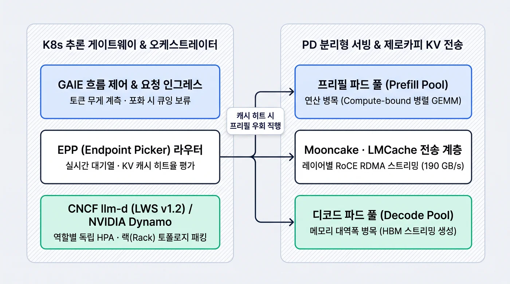
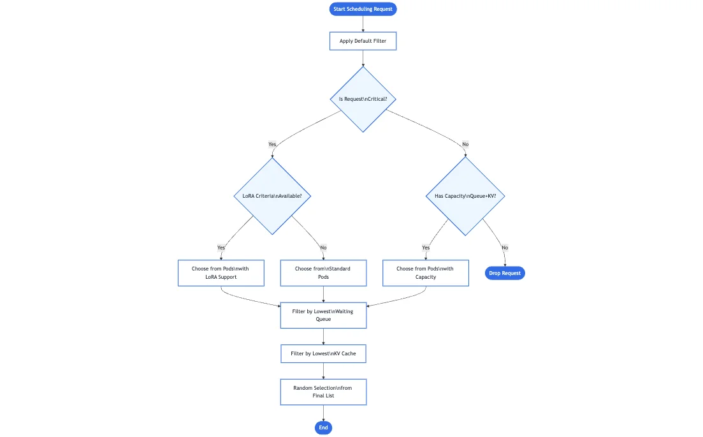
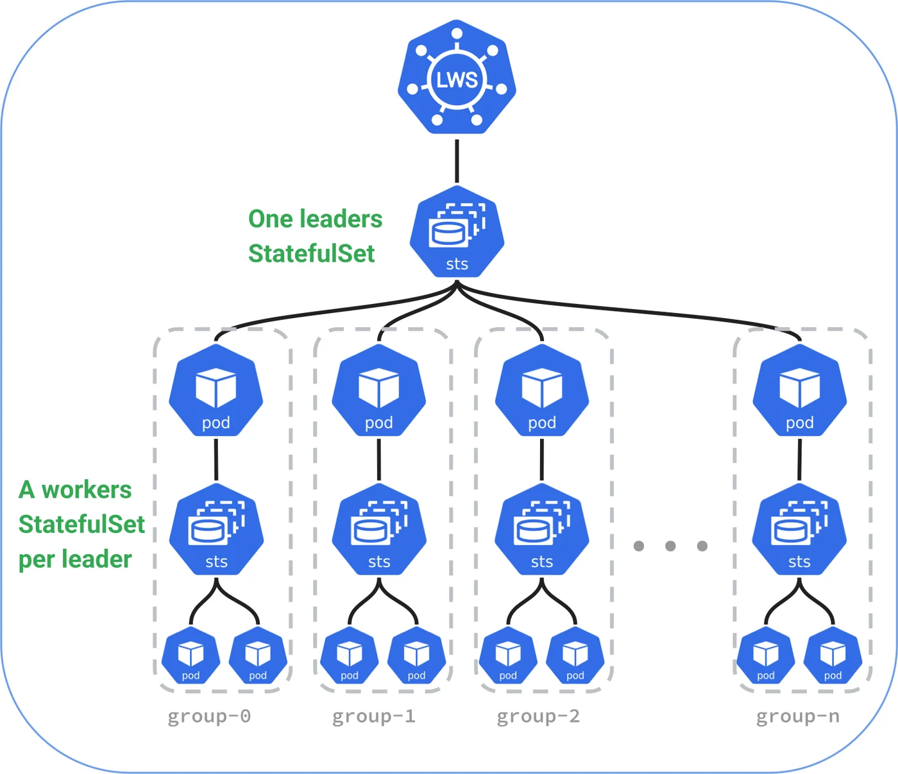

## 이 글을 30초에 파악하기

> **한 줄로** — 긴 문서를 읽히는 작업과 짧은 대화를 받는 작업을 같은 GPU에서 번갈아 처리하느라 생기는 대기 시간을, 일을 나눠 맡기고 이미 계산해 둔 결과를 다시 쓰는 방식으로 줄이는 설계를 정리한다.

**읽고 나면 알게 되는 것**

- 한 GPU에 두 작업을 묶어 두면 왜 20~40%가 노는지, 그리고 작업을 나눠 맡겼을 때 드는 전송 비용을 언제 넘어서는지
- 같은 프롬프트를 이미 계산한 파드로 보내려면 라우터가 무엇을 보고 판단해야 하는지
- Dynamo와 llm-d가 각각 무엇을 맡는지, 실제 매니페스트에서 무엇을 확인해야 하는지

**용어 먼저 보기**

|용어|한 줄 설명|이 글에서의 역할|
|---|---|---|
|KVCache(키-값 캐시)|모델이 앞서 읽은 내용을 다시 계산하지 않도록 GPU 메모리에 남겨 두는 중간 결과|파드 사이를 옮겨 다니는 대상이자 라우팅 판단 기준|
|PD 분리(Prefill-Decode Disaggregation)|입력을 한꺼번에 읽는 단계와 토큰을 하나씩 만드는 단계를 서로 다른 GPU·파드에 나눠 배치하는 구성|글 전체의 주제. 1~3절이 이득과 비용을 계산한다|
|TTFT(첫 토큰까지 걸린 시간)|요청을 보낸 뒤 첫 글자가 나올 때까지의 시간|전송 비용과 라우팅 선택이 사용자 체감으로 드러나는 지표|
|GAIE(게이트웨이 API 추론 확장)|쿠버네티스 표준 Gateway API 위에 추론 서버용 리소스와 확장 스케줄러를 얹은 규격|2절 라우팅 표준화의 기준|
|EPP(엔드포인트 선택기)|대기 큐 길이와 캐시 적합도로 점수를 매겨 요청을 보낼 파드를 고르는 구성요소|2.2절과 2.3절의 캐시 인식 라우팅|
|NIXL|GPU 메모리·호스트 메모리·SSD·원격 노드 사이의 데이터 이동을 하나의 API로 묶은 NVIDIA 전송 라이브러리|3.2절 Dynamo의 KV 전송 계층|
|Mooncake|KVCache를 중심에 두고 프리필과 디코드를 나눈 분산 서빙 아키텍처. 여러 RDMA NIC를 묶어 KV를 옮기는 Transfer Engine이 핵심이다|4.3절 실측 지표의 대상|
|LMCache|서빙 엔진의 KVCache를 파드 밖으로 내보내 다른 요청이 재사용하게 해 주는 오픈소스 계층|4.4절과 5절 매니페스트에 등장|

**이런 분께** — GPU 추론 서버를 직접 운영하거나, 특정 시간대에 응답이 유난히 느려지는 이유를 찾는 분께 맞다. 처음 읽을 때는 1.2절 손익분기점 계산과 5.2절 검증 포인트부터 보면 판단 기준이 먼저 잡힌다.

추론 클러스터에서 프리필과 디코드를 같은 GPU에 묶어 두면 GPU 시간의 20~40%가 그대로 논다. 프리필은 연산기가 병목이고 디코드는 메모리 대역폭이 병목이라, 한쪽이 돌 때 다른 쪽은 쉬기 때문이다. 앞선 [엔터프라이즈 AI 플랫폼 설계 1편](/llm/enterprise-ai-platform-distributed-serving-architecture/)[^1]에서는 사설망 제로 트러스트 경계와 텐서·파이프라인 병렬화의 통신 수식을 다루었다. [엔터프라이즈 AI 플랫폼 설계 2편](/agent/enterprise-ai-platform-fault-tolerance-operations/)[^2]에서는 슬라이딩 윈도우 서킷 브레이커와 투기적 헤지드 요청(Hedged Requests)으로 무중단 장애 격리를 만드는 방법을 살펴보았다. 인프라 격리와 고가용성 제어면이 준비되면 남는 것은 Day-2 운영 단계다. 이 단계의 핵심 과제는 **클러스터 단위의 GPU 자원 효율 극대화와 KVCache 중심의 데이터플레인 재설계**다.

주방 하나에서 대량 조리와 한 접시씩 플레이팅을 같은 화구로 번갈아 하는 셈이다. 대량 조리 중에는 재료를 나르는 손이 놀고, 한 접시씩 담는 동안에는 화구가 논다.

단일 서빙 파드 안에서 프롬프트 처리(Prefill)와 토큰 생성(Decode)을 함께 실행하는 기존 일체형(Colocated) 아키텍처를 먼저 보자. 이 구조는 워크로드 특성이 상반된 두 단계를 동일 가속기에 묶어 둔다. 그 결과 전체 GPU 시간의 20~40%를 구조적으로 낭비한다. 여기에 KVCache가 특정 파드의 로컬 HBM에만 고립되는 문제가 겹친다. 기존 L7 로드밸런서는 캐시 위치와 큐 깊이를 무시한 채 요청을 분배한다. 그래서 중복 프리필 연산과 꼬리 지연(Tail Latency)이 따라온다.

분산 추론 클러스터의 데이터플레인을 재설계할 시점이다. KVCache 전송 계층(Mooncake, LMCache)과 쿠버네티스 추론 라우팅 표준(GAIE, llm-d, NVIDIA Dynamo)을 한 번에 정리해 둘 필요가 있다. 프리필·디코드 분리의 수리적 손익분기점부터 시작한다. 이어서 레이어별 스트리밍 전송을 본다. 마지막으로 TypeSafe System One(Jev)을 결합한 결정론적 라우팅 제어를 차례대로 해부한다.

---

## 1. 단일 파드(Colocated) 서빙의 구조적 낭비와 분리 역설

긴 문서 요약 요청 하나가 파드에 들어오면, 같은 GPU에 배정된 짧은 질문들은 첫 토큰도 받지 못하고 그 뒤에 줄을 선다. 사용자 화면에서는 방금 보낸 질문의 답이 유난히 늦게 뜬다. 이 절은 단일 파드를 그대로 쓰면 왜 GPU가 노는지를 따져 본다. 대규모 언어 모델(LLM)의 자기회귀(Autoregressive) 추론은 연산 특성이 판이하게 다른 두 단계로 나뉜다[^3][^4].



### 1.1 Prefill(Compute-bound) vs Decode(Memory-bound) 비대칭성

두 단계는 같은 GPU를 쓰지만 병목 지점이 정반대다. 아래 두 항목이 그 차이를 정리한다.

- **프리필 단계(Prefill Phase — Compute-bound)**: 사용자의 입력 시퀀스 $S_{\text{in}}$ 전체를 한 번의 순전파(Forward Pass)로 병렬 처리한다. 이때 초기 **키-값 캐시(Key-Value Cache, KVCache)**가 만들어진다. 대규모 행렬 곱셈(GEMM)이 지배적이므로 병목은 GPU의 텐서 코어(Tensor Core) 연산량(FLOPs)이다. 산술 강도(Arithmetic Intensity, $\text{FLOPs/Byte}$)는 수백 이상으로 높다.
- **디코드 단계(Decode Phase — Memory-bound)**: 직전에 생성된 토큰 단 1개를 입력으로 받는다. 전체 모델 가중치와 누적된 KVCache를 HBM에서 읽어 들인 뒤 다음 토큰 1개를 만든다. 행렬-벡터 곱셈(GEMV) 위주로 동작하므로 산술 강도가 $1 \sim 4\text{ FLOPs/Byte}$ 수준으로 떨어진다. 텐서 코어는 대부분 유휴 상태로 남고 **고대역폭 메모리(High Bandwidth Memory, HBM)** 대역폭만 포화된다.

저울과 수레를 한 사람이 나눠 쓰는 상황을 떠올려 보자. 저울로 재는 동안 수레는 세워져 있고, 수레로 나르는 동안 저울은 비어 있는데, 두 도구를 동시에 쓸 방법은 없다.

동일한 파드와 GPU에서 두 단계를 연속 배칭(Continuous Batching)으로 혼합 실행하면 구조적 손실이 생긴다. 아래 세 가지가 대표적이다.

1. **자원 불일치로 인한 20~40% GPU 시간 낭비**: 프리필이 실행되는 동안에는 HBM 대역폭이 남는다. 반면 디코드가 실행되는 동안에는 텐서 코어 연산 유닛의 70% 이상이 유휴 상태로 대기한다. 결과적으로 클러스터 전체 기준 약 20~40%의 GPU 사이클이 두 단계 간 하드웨어 요구사항 불일치로 소실된다[^3].
2. **단계 간 간섭과 TPOT 스파이크**: 디코드 배치가 진행되는 도중에 수천 토큰 규모의 신규 프롬프트가 유입된다고 하자. 그러면 프리필 연산이 수백 밀리초 동안 GPU를 독점한다. 기존 사용자들의 **출력 토큰당 생성 시간(Time-Per-Output-Token, TPOT)**은 이 구간에서 순간적으로 5~10배 치솟는다.
3. **병렬화 전략의 강제 결합**: 프리필은 높은 처리량을 위해 작은 텐서 병렬화($TP$)와 데이터 병렬화($DP$) 조합이 유리하다. 반면 디코드는 HBM 대역폭 확보와 대규모 전문가 병렬화(Expert Parallelism, EP)를 위해 넓은 노드 분산이 유리하다. 일체형 파드에서는 두 단계에 서로 다른 병렬화 토폴로지를 적용할 수 없다.

### 1.2 PD 분리의 수리적 손익분기점(Break-Even Point) 모델링

**프리필-디코드 분리(Prefill-Decode Disaggregation, PD 분리)**는 프리필 전용 워커 풀과 디코드 전용 워커 풀을 물리적으로 격리한다. 그리고 프리필 풀에서 생성된 KVCache를 네트워크를 통해 디코드 풀로 넘긴다[^1][^3]. 그러나 모든 워크로드에서 PD 분리가 유리한 것은 아니다. 프리필 노드에서 디코드 노드로 KVCache 텐서를 복사하는 **전송 세금(Transfer Tax)**이 붙기 때문이다.

이 비용이 언제 이득을 넘어서는지 계산으로 확인해 보자. 모델의 레이어 수를 $L$, KV 헤드 수를 $H_{kv}$, 헤드 차원을 $d_h$라 하자. 정밀도 바이트 수 $b$는 FP16이면 $2$, FP8이면 $1$이다. 이때 입력 길이 $S_{\text{in}}$에 대한 KVCache 볼륨 $V_{\text{KV}}$는 다음과 같다.

$$V_{\text{KV}}(S_{\text{in}}) = 2 \cdot L \cdot H_{kv} \cdot d_h \cdot b \cdot S_{\text{in}}$$

유효 네트워크 전송 대역폭을 $B_{\text{net}}$라 하자. RDMA 핸드셰이크 및 메타데이터 동기화 지연은 $L_{\text{setup}}$이다. 이 두 값으로 KVCache 전송 시간 $T_{\text{transfer}}$를 정의한다.

$$T_{\text{transfer}}(S_{\text{in}}) = \frac{V_{\text{KV}}(S_{\text{in}})}{B_{\text{net}}} + L_{\text{setup}}$$

일체형 서빙에서 프리필과 디코드가 같은 배치를 공유할 때 간섭 지연 $\Delta T_{\text{interference}}(S_{\text{in}}, S_{\text{out}})$이 생긴다. 전용 하드웨어와 병렬화 최적화로 절감되는 연산 시간은 $\Delta T_{\text{compute}}(S_{\text{in}}, S_{\text{out}})$이다. PD 분리가 순이득(Net Gain)을 내는 수리적 조건은 다음과 같다.

$$\Delta T_{\text{interference}}(S_{\text{in}}, S_{\text{out}}) + \Delta T_{\text{compute}}(S_{\text{in}}, S_{\text{out}}) > \frac{2 \cdot L \cdot H_{kv} \cdot d_h \cdot b \cdot S_{\text{in}}}{B_{\text{net}}} + L_{\text{setup}}$$

이 부등식은 운영 경계를 그대로 알려 준다. 아래 표가 워크로드 프로파일별 권장 모드를 정리한 것이다.

| 워크로드 프로파일 | 입력/출력 토큰 규모 | 전송 오버헤드 대비 분리 이득 | 권장 서빙 모드 |
|---|---|---|---|
| **단문 질의응답 및 단순 분류** | $S_{\text{in}} < 512$, $S_{\text{out}} < 200$ | $T_{\text{transfer}} + L_{\text{setup}}$이 간섭 제거 이득을 초과하여 전체 지연 시간 8~15% 악화 | 일체형(Colocated) 파드 서빙 |
| **장문 RAG 및 문서 분석** | $S_{\text{in}} \ge 8,192$, $S_{\text{out}} \in [256, 1024]$ | 대형 프리필의 디코드 배치 블로킹 제거로 p99 TPOT 50% 이상 단축 | PD 분리 + 레이어별 KV 스트리밍 |
| **다중 턴 에이전트 루프** | $S_{\text{in}} \ge 16,384$ (누적 컨텍스트) | 글로벌 KV 스토어 히트 시 프리필 연산 자체를 생략하고 디코드 직행 | PD 분리 + 계층형 KV 캐시 풀링 |
| **대규모 MoE 모델 (DeepSeek-V3/Kimi K2)** | 가변 길이, 대규모 동시 배치 | 프리필(DP+TP)과 디코드(광역 EP)의 비대칭 병렬화로 Goodput 2~3배 향상 | 멀티노드 EP 결합 PD 분리 |

특히 [DeepSeek-V3/R1의 Multi-Head Latent Attention(MLA) 아키텍처](/llm/multi-head-latent-attention-mla-deepseek-sglang/)[^5]처럼 KV 텐서를 저차원 잠재 벡터($d_c = 512$)로 압축하는 모델을 보자. 이 구조에서는 $V_{\text{KV}}$ 자체가 표준 GQA 대비 70% 이상 줄어든다. 전송량이 줄어드는 만큼 $T_{\text{transfer}}$도 감소한다. 그래서 PD 분리의 손익분기점이 더 짧은 시퀀스 영역까지 내려간다. 반면 프롬프트 512 토큰 미만·출력 200 토큰 미만의 단문 트래픽에서는 사정이 다르다. RPC 설정 비용($L_{\text{setup}}$)과 NIC 복사 오버헤드가 분리 이득을 잠식하기 때문이다. 따라서 게이트웨이 계층에서 요청 특성에 따라 일체형 풀과 분리형 풀을 동적으로 분기해야 한다.

**핵심 요약 — 단일 파드 서빙은 프리필(연산 바운드)과 디코드(메모리 바운드)의 자원 불일치로 GPU 시간의 20~40%를 낭비한다. 그러나 512 토큰 미만의 단문 요청에서는 KV 전송 세금이 이득을 초과한다. 따라서 수리적 손익분기점에 기반한 선택적 PD 분리가 필수적이다**.

---

## 2. 쿠버네티스 추론 라우팅의 표준화: GAIE와 Endpoint Picker(EPP)

같은 시스템 프롬프트를 쓰는 사내 문서 질의가 매번 다른 파드로 흩어진다. 캐시가 어느 파드에 있는지는 아무도 확인하지 않으니, 각 파드는 같은 문서를 처음부터 다시 읽는다. 이 절은 분리한 파드 중 어디로 요청을 보낼지 정하는 기준을 다룬다. PD 분리 클러스터를 구축하더라도 앞단의 인그레스 프록시가 기존 웹 트래픽 방식으로 동작하면 이점이 사라진다. 앞서 [EKS Gateway API 마이그레이션과 Cilium 통합 실전](/k8s/gateway-api-migration-cilium/)[^6]에서 본 표준 쿠버네티스 `Gateway`와 `HTTPRoute`를 떠올려 보자. 이 둘은 L7 경로·헤더 분기와 라운드로빈 가중치 분배를 표준화했다. 그러나 LLM 추론 워크로드의 내부 상태는 인지하지 못한다.

### 2.1 전통적 L7 게이트웨이의 한계와 추론 트래픽의 비대칭성

기존 Envoy나 NGINX 인그레스는 라운드로빈(Round-Robin)이나 최소 연결(Least-Connections) 알고리즘을 쓴다. 두 방식 모두 **HTTP 요청 1건의 무게를 동일하게 취급**한다. 그러나 LLM 서빙에서 200 토큰짜리 단문 요청 1건과 20,000 토큰짜리 장문 요약 요청 1건은 연산량과 HBM 점유량에서 100배 이상 차이가 난다.

더 큰 문제는 **캐시 비인식(Cache-Oblivious) 라우팅**이다. [Kubernetes 환경에서 vLLM과 SGLang의 접두사 캐싱(Prefix Caching) 비교](/llm/k8s/k8s-low-latency-llm-serving-vllm-sglang/)[^8]에서 분석했듯, 다중 턴 대화나 동일한 시스템 프롬프트를 공유하는 RAG 요청이 있다. 이 요청이 이전에 처리된 워커 파드로 다시 라우팅되면 KVCache 히트를 통해 TTFT를 60~80% 줄일 수 있다. 반면 단순 라운드로빈 라우터는 요청을 매번 다른 파드로 흩뿌린다. 그러면 클러스터 전체에서 동일한 프리필 연산이 중복 수행된다. HBM 공간도 중복 KV 블록으로 채워진다.

### 2.2 Gateway API Inference Extension(GAIE)과 EPP 스케줄링 파이프라인

이 문제를 해결하기 위해 Kubernetes SIG Network가 나섰다. 표준 Gateway API 위에 추론 전용 리소스(`InferencePool`, `InferenceModel`)와 확장 스케줄러를 결합했다. 이 결합체가 **게이트웨이 API 추론 확장(Gateway API Inference Extension, GAIE)**이며, SIG Network가 이를 표준화했다[^7].


*출처: [Kubernetes Blog — Introducing Gateway API Inference Extension](https://kubernetes.io/blog/2025/06/05/introducing-gateway-api-inference-extension/), CC BY 4.0*

GAIE 아키텍처는 두 계층으로 구성된다. Envoy 프록시와 `ext_proc`(External Processing) gRPC 프로토콜로 통신하는 **엔드포인트 선택기(Endpoint Picker, EPP)**가 첫째다. **흐름 제어(Flow Control)** 계층이 둘째다. 두 계층이 함께 동작하는 순서는 아래와 같다.

1. **흐름 제어(Flow Control) 및 Criticality 큐잉**: 요청에 부여된 중요도(`criticality`: `Critical`, `Standard`, `Sheddable`)를 먼저 본다. 클러스터가 과부하 상태면 배치성(`Sheddable`) 요청을 대기열에 보류하거나 조기 거절(Load Shedding)한다. 이렇게 해서 실시간 대화형(`Critical`) SLO를 방어한다.
2. **단계적 필터링 및 스코어링 파이프라인**: EPP는 각 서빙 파드의 프로메테우스 메트릭을 주기적으로 수집한다. 수집 항목은 대기 큐 깊이 `waiting_queue_depth`, KV 캐시 블록 사용률 `kv_cache_usage_perc`, 로드된 LoRA 어댑터 목록, 프리픽스 해시 인덱스다. EPP는 이 값들을 바탕으로 최적의 엔드포인트를 고른다.

이미 재료를 손질해 둔 주방에 주문을 넘기는 것과 같다. 재료가 없는 주방은 같은 손질을 처음부터 다시 해야 하고, 그 시간이 그대로 첫 토큰 지연으로 돌아온다.

복합 스코어링 함수 $S_{\text{EPP}}(p, q)$는 후보 파드 $p$와 요청 $q$마다 값을 계산한다. 입력은 네 가지다. 프리픽스 캐시 히트율 $H_{\text{prefix}}(p, q) \in [0, 1]$과 LoRA 어댑터 상주 여부 $I_{\text{LoRA}}(p, q) \in \{0, 1\}$가 앞의 두 개다. 정규화된 대기 큐 길이 $\tilde{Q}(p) \in [0, 1]$와 KV 캐시 사용률 $U_{\text{KV}}(p) \in [0, 1]$가 나머지다. 네 값을 가중 합산하여 점수를 낸다. 가중치 $w_{\text{cache}}$, $w_{\text{lora}}$는 캐시와 어댑터 적합성에 가산점을 준다. 반대로 $w_{\text{queue}}$, $w_{\text{kv}}$는 큐 적체와 KV 포화에 감점을 준다.

$$S_{\text{EPP}}(p, q) = w_{\text{cache}} \cdot H_{\text{prefix}}(p, q) + w_{\text{lora}} \cdot I_{\text{LoRA}}(p, q) - w_{\text{queue}} \cdot \tilde{Q}(p) - w_{\text{kv}} \cdot U_{\text{KV}}(p)$$

### 2.3 캐시 인식 라우터와 PD 분리의 결합: Prefill Bypass

이 절은 프리필 단계를 아예 건너뛸 수 있는 조건을 정리한다. GAIE의 EPP를 PD 분리 아키텍처와 결합하면 최적화 경로가 하나 더 열린다. 일반적인 PD 분리 흐름에서는 모든 요청이 `라우터 -> 프리필 풀 -> KV 전송 -> 디코드 풀` 순서로 이동한다. 그러나 EPP가 클러스터의 분산 KV 캐시 인덱스를 조회하는 순간이 있다. 그때 **요청 프롬프트의 프리픽스 캐시 히트율이 임계치(예: 90% 이상)를 넘는다면** 상황이 달라진다. 해당 KV 블록이 이미 특정 디코드 파드(또는 디코드 노드의 로컬 DRAM 티어)에 상주하고 있다면 더욱 그렇다. 이 조건이 맞으면 프리필 풀을 거칠 이유가 없다.

이 경우 라우터는 프리필 워커 디스패치와 네트워크 KV 전송 단계를 통째로 우회(Bypass)한다. 그리고 해당 디코드 파드로 요청을 직행시킨다. 남은 미스 토큰(Suffix)만 로컬에서 짧게 계산하고, 곧바로 토큰 생성을 시작한다.

### 2.4 TypeSafe System One(Jev) 기반 초저지연 라우팅 분기 제어

프롬프트의 단순 토큰 길이($S_{\text{in}}$)만으로는 **출력 시퀀스 길이($S_{\text{out}}$)와 추론 복잡도**를 사전에 알 수 없다. 예를 들어 입력은 300 토큰에 불과한 요청이 있다. 그런데 작업 지시가 `"주어진 스키마를 바탕으로 5개 마이크로서비스의 전체 OpenAPI 명세와 마이그레이션 코드를 작성하라"`처럼 되어 있다면 수천 토큰의 긴 디코드 세션이 열린다.

라우터 앞단에서 무거운 생성형 LLM을 호출해 이를 분류하면 수백 밀리초의 지연이 더해진다. 그래서 TypeSafe AI의 비생성형 판정 엔진인 **System One(Jev)**[^9]을 인바운드 라우터에 결합한다. `POST /v1/systemone` 엔드포인트는 단일 순전파 패스로 70~120ms 내에 타입화된 판정 결과를 반환한다. 호스트 코드는 이 결과를 바탕으로 경로를 결정론적으로 나눈다. 경로는 **일체형 단문 풀(Colocated Short Pool)**, **PD 분리 파이프라인(Disaggregated PD Pool)**, **디코드 직행(Decode Direct Bypass)** 세 가지다.

**1) `/v1/systemone` HTTP 요청 페이로드 구조**: 런타임 메트릭과 프롬프트 원문은 `state`에만 격리한다. 그리고 `questions`에는 오직 판단 기준만 선언한다[^9].

```json
{
  "state": {
    "prompt_head": "아래 쿠버네티스 네트워크 장애 로그 14,200줄을 분석하여 패킷 드롭 원인과 Cilium eBPF 맵 수정 패치를 작성하시오...",
    "input_token_count": 11420,
    "prefix_cache_hit_ratio": 0.94,
    "cached_decode_pod_id": "decode-worker-rack2-03",
    "decode_pool_kv_utilization": 0.62
  },
  "questions": {
    "generation_horizon": {
      "type": "choice",
      "instructions": "요청의 작업 지시문을 바탕으로 예상되는 출력 토큰 생성 규모를 분류하시오.",
      "criteria": {
        "short_atomic": "단답형 확인, 단일 명령어 조회 등 200 토큰 미만의 출력으로 완결되는 요청.",
        "medium_structured": "함수 스니펫 작성, 단락 요약 등 200~1,000 토큰 사이의 출력이 예상되는 요청.",
        "long_exhaustive": "전체 모듈 코드 생성, 대규모 로그 전수 분석 등 1,000 토큰 이상의 장기 디코드 세션이 필요한 요청."
      }
    },
    "decode_memory_pressure_risk": {
      "type": "score",
      "instructions": "입력 길이, 캐시 히트율, 예상 출력 규모를 종합하여 디코드 워커 HBM 압박 위험도를 평가하시오.",
      "criteria": {
        "0": "입력 512 토큰 미만이고 단답형 출력이 예상되어 단일 워커 HBM 점유 증가분이 1% 미만인 상태.",
        "1": "입력 512~4,096 토큰 또는 중간 길이 출력이나 기존 프리픽스 캐시 재사용으로 추가 블록 할당이 제한적인 상태.",
        "2": "입력 4,096~16,384 토큰이며 신규 KV 블록 할당과 장기 디코드 점유가 동시에 발생하는 상태.",
        "3": "입력 16,384 토큰 이상이거나 장기 출력이 결합되어 일체형 파드 배치를 블로킹할 위험이 즉각적인 상태."
      }
    },
    "can_bypass_prefill_pool": {
      "type": "noul",
      "instructions": "프리픽스 캐시 히트율이 0.90 이상이고 디코드 풀의 KV 사용률이 0.80 미만이어서 프리필 풀을 우회하고 캐시 보유 디코드 워커로 직행할 수 있는가?"
    }
  }
}
```

**2) Python SDK 선언 및 호스트 코드 분기 제어**: 같은 기준을 Python SDK로 선언하고 호스트 코드에서 분기하는 예시다.

```python
from typesafe import SystemOne, Choice, Score, Noul
import httpx

jev = SystemOne()

DISAGG_ROUTING_RUBRIC = {
    "generation_horizon": Choice(
        instructions="요청의 작업 지시문을 바탕으로 예상되는 출력 토큰 생성 규모를 분류하시오.",
        criteria={
            "short_atomic": "단답형 확인, 단일 명령어 조회 등 200 토큰 미만의 출력으로 완결되는 요청.",
            "medium_structured": "함수 스니펫 작성, 단락 요약 등 200~1,000 토큰 사이의 출력이 예상되는 요청.",
            "long_exhaustive": "전체 모듈 코드 생성, 대규모 로그 전수 분석 등 1,000 토큰 이상의 장기 디코드 세션이 필요한 요청.",
        },
    ),
    "decode_memory_pressure_risk": Score(
        instructions="입력 길이, 캐시 히트율, 예상 출력 규모를 종합하여 디코드 워커 HBM 압박 위험도를 평가하시오.",
        criteria={
            0: "입력 512 토큰 미만이고 단답형 출력이 예상되어 단일 워커 HBM 점유 증가분이 1% 미만인 상태.",
            1: "입력 512~4,096 토큰 또는 중간 길이 출력이나 기존 프리픽스 캐시 재사용으로 추가 블록 할당이 제한적인 상태.",
            2: "입력 4,096~16,384 토큰이며 신규 KV 블록 할당과 장기 디코드 점유가 동시에 발생하는 상태.",
            3: "입력 16,384 토큰 이상이거나 장기 출력이 결합되어 일체형 파드 배치를 블로킹할 위험이 즉각적인 상태.",
        },
    ),
    "can_bypass_prefill_pool": Noul(
        instructions="프리픽스 캐시 히트율이 0.90 이상이고 디코드 풀의 KV 사용률이 0.80 미만이어서 프리필 풀을 우회하고 캐시 보유 디코드 워커로 직행할 수 있는가?"
    ),
}

async def dispatch_inference_request(
    prompt: str, input_tokens: int, prefix_hit_ratio: float,
    cached_decode_pod_url: str | None, decode_kv_util: float, payload: dict,
) -> dict:
    judgment = await jev.evaluate_async(
        state={
            "prompt_head": prompt[:1500],
            "input_token_count": input_tokens,
            "prefix_cache_hit_ratio": prefix_hit_ratio,
            "cached_decode_pod_id": cached_decode_pod_url or "none",
            "decode_pool_kv_utilization": decode_kv_util,
        },
        questions=DISAGG_ROUTING_RUBRIC,
    )

    # 홀드아웃 검증 데이터셋으로 보정된 임계값 기반 결정론적 호스트 분기
    if cached_decode_pod_url and prefix_hit_ratio >= 0.90 and judgment.can_bypass_prefill_pool.prob >= 0.88:
        target_endpoint = f"{cached_decode_pod_url}/v1/chat/completions"
        routing_mode = "DECODE_DIRECT_BYPASS"
    elif input_tokens < 512 and judgment.generation_horizon.choice == "short_atomic" and judgment.decode_memory_pressure_risk.score <= 1:
        target_endpoint = "http://colocated-short-pool.llm-serving.svc:8000/v1/chat/completions"
        routing_mode = "COLOCATED_FAST_PATH"
    else:
        target_endpoint = "http://gaie-epp-disagg-router.llm-serving.svc:8000/v1/chat/completions"
        routing_mode = "PD_DISAGGREGATED_PIPELINE"

    async with httpx.AsyncClient(timeout=120.0) as client:
        resp = await client.post(target_endpoint, json=payload, headers={"X-Routing-Mode": routing_mode})
        return resp.json()
```

**핵심 요약 — GAIE와 EPP는 큐 깊이와 KV 캐시 히트율을 결합해 추론 요청을 스케줄링한다. 여기에 TypeSafe System One(Jev)을 앞단에 결합하면 단문 일체형 경로·PD 분리 경로·프리필 우회 직행 경로를 100ms 내외의 단일 패스로 결정론적 분기할 수 있다**.

---

## 3. 분산 추론 오케스트레이터 해부: NVIDIA Dynamo 1.0 vs CNCF llm-d v0.5

노드 4대에 걸친 모델 복제본에서 파드 하나가 재시작되면, 나머지 파드들은 짝을 잃고 트래픽을 받지 못한다. 그룹이 깨지는 순간 GPU 16~32장이 함께 논다. 이 절은 분리형 파드를 실제로 묶어 띄우는 오케스트레이터를 비교한다. PD 분리와 캐시 인식 라우팅을 쿠버네티스에서 굴리려면 전용 컨트롤러가 필요하다. 오픈소스 생태계는 두 오케스트레이터로 모이고 있다. 하나는 NVIDIA가 주도하는 데이터센터 스케일 추론 프레임워크인 **NVIDIA Dynamo(v1.0 GA)**[^10]다. 다른 하나는 Red Hat·Google·IBM·CoreWeave 등이 공동 발족한 **llm-d(v0.5)**[^11]다. llm-d는 2026년 3월 CNCF 샌드박스 프로젝트로 채택되었다.

### 3.1 NVIDIA Dynamo 1.0 vs CNCF llm-d v0.5 아키텍처 비교

아래 표는 NVIDIA Dynamo와 CNCF llm-d를 아키텍처 포지셔닝, 배포 단위, KV 전송 계층 관점에서 나란히 비교한 결과다.

| 비교 항목 | NVIDIA Dynamo (v1.0 GA) | CNCF llm-d (v0.5) |
|---|---|---|
| **아키텍처 포지셔닝** | 추론 엔진(vLLM, SGLang, TensorRT-LLM) 상위에서 동작하는 범용 분산 런타임 계층 (Stack-above) | KServe 컨트롤 플레인과 vLLM 서빙 엔진 사이를 잇는 쿠버네티스 네이티브 데이터플레인 |
| **코어 구현체 및 컴포넌트** | Rust 기반 고성능 런타임 코어 + Python 확장성 레이어 (`DynamoGraphDeployment`) | 쿠버네티스 표준 GAIE + EPP + `LeaderWorkerSet`(LWS) + vLLM 네이티브 통합 |
| **스케줄링 및 배포 단위** | 단일 그래프 선언 내에서 Frontend, Router, Prefill Worker, Decode Worker 생명주기 통합 관리 | Prefill, Decode, Router를 각각 독립된 K8s `Service` 및 `LeaderWorkerSet`으로 분리 배포 |
| **오토스케일링 시그널** | **Planner Profiler + SLA Planner**: 목표 TTFT/ITL SLO에 맞춰 Prefill:Decode 비율 자동 재조정 | 역할별 분리 HPA: 프리필 풀은 **Queue Depth**, 디코드 풀은 **KV Cache Utilization** 기반 독립 스케일링 |
| **KV 캐시 전송 계층** | **NIXL(NVIDIA Inference Transfer Library)**: GPUDirect RDMA/InfiniBand 우선, UCX/TCP 자동 폴백 | vLLM NIXL 커넥터, **LMCache**, **UCCL**(컨테이너 레벨 집합 통신 및 전송) 플러그인 지원 |
| **핵심 특화 기능** | 글로벌 KV 캐시 관리자(GPU HBM ↔ CPU DRAM ↔ 로컬/네트워크 SSD 티어링), 이기종 엔진 통합 | 계층형 KV 오프로딩, 캐시 인식 LoRA 어댑터 라우팅, 토폴로지 랙 패킹(`packDomain: rack`), Scale-to-Zero |

### 3.2 NVIDIA Dynamo 1.0: SLA Planner와 NIXL 전송 추상화

NVIDIA Dynamo[^10]는 특정 서빙 엔진에 얽매이지 않는다. vLLM, SGLang, TensorRT-LLM 위에 공통 분산 제어면을 씌우는 **상위 계층(Stack-above)** 설계를 택한다. 지연 시간에 민감한 라우터와 이벤트 루프는 Rust로 작성되어 마이크로초 단위의 디스패치 성능을 보장한다. 반면 오케스트레이션 정책과 커스텀 파이프라인은 Python으로 유연하게 확장할 수 있다.

Dynamo의 핵심 차별점은 **SLA Planner**와 **NIXL(NVIDIA Inference Transfer Library)**이다.

1. **Planner Profiler & SLA Planner**: 배포 전 모델과 하드웨어 조합에 대해 입력/출력 길이별 보간 곡선(Interpolation Curve)을 프로파일링한다. 운영 중 트래픽의 평균 입력 길이($\bar{S}_{\text{in}}$)가 길어져 TTFT가 목표 SLO에 근접하면 프리필 워커 복제본 수를 늘린다. 반대로 동시 디코드 세션이 누적되어 토큰 간 지연(ITL)이 상승하면 디코드 워커 비율을 실시간으로 확장한다.
2. **NIXL(NVIDIA Inference Transfer Library)**: GPU HBM, 호스트 CPU DRAM, 로컬 NVMe SSD, 원격 노드 HBM에 걸친 데이터 이동을 단일 API로 추상화한다. 하드웨어가 GPUDirect RDMA(InfiniBand 또는 RoCE v2)를 지원하면 제로카피 RDMA 경로를 자동 선택한다. 일반 이더넷 환경에서는 TCP/소켓 백엔드로 투명하게 폴백한다.

### 3.3 CNCF llm-d v0.5: LeaderWorkerSet(LWS)과 쿠버네티스 네이티브 토폴로지 제어

반면 CNCF **llm-d**[^11]는 새로운 자체 런타임을 만들지 않는다. 대신 쿠버네티스 공식 표준 API들(GAIE, LeaderWorkerSet, HPA)을 조합한다. KServe와 vLLM 사이의 간극을 메우는 **K8s-native 데이터플레인** 전략이다.


*출처: [LeaderWorkerSet 공식 문서 — Concepts](https://lws.sigs.k8s.io/docs/concepts/leaderworkerset/), CC BY 4.0*

초거대 MoE 모델(예: DeepSeek-V3 671B, Kimi K2)을 서빙할 때는 단일 추론 복제본(Replica) 하나가 노드 2~4대(GPU 16~32장)에 걸쳐 실행되어야 한다. 기존 쿠버네티스 `Deployment`는 개별 파드를 독립 단위로 취급한다. `StatefulSet`은 전체 파드를 하나의 직렬 집합으로만 다룬다. 그래서 **"멀티노드로 묶인 파드 그룹(Super-pod)을 하나의 추론 복제본 단위로 오토스케일링"**하기 어렵다.

이를 해결하기 위해 llm-d는 Kubernetes SIG Apps의 **LeaderWorkerSet(LWS)**[^12]을 기본 워크로드 컨트롤러로 사용한다. 아래 네 가지 기능이 그 핵심이다.

- **그룹 단위 원자적 생명주기(All-or-Nothing Topology)**: 1개의 리더 파드(Rank 0)와 $N-1$개의 워커 파드를 단일 복제본 그룹으로 묶어 함께 생성·재시작·스케일링한다. 2026년 7월 릴리스된 **LWS v1.2**에서는 동적 토폴로지 조정과 우선순위 어노테이션이 추가되었다. 부분 노드 장애 시 그룹 재스케줄링 속도가 개선되었다.
- **물리적 랙 인식 배치(`packDomain: rack`)**: LWS 매니페스트의 `topologyConstraint`에 `packDomain: rack`을 선언할 수 있다. 그러면 스케줄러가 동일 복제본 그룹에 속한 파드들을 동일 Top-of-Rack(ToR) 스위치 아래 노드에 모아 배치한다. Spine 스위치를 거치는 홉(Hop) 지연을 차단하기 위함이다.
- **역할별 비대칭 오토스케일링**: llm-d는 프리필과 디코드를 별도의 쿠버네티스 `Service`로 노출한다. 프리필 풀의 HPA는 **대기 큐 길이(Queue Depth)**를 주 시그널로 삼는다. 디코드 풀의 HPA는 **KV 캐시 메모리 사용률(KV Utilization)**을 주 시그널로 삼아 HBM 고갈을 방어한다.
- **llm-d v0.5 확장 기능**: 계층형 KV 오프로딩(HBM $\to$ CPU RAM $\to$ 원격 스토리지)을 지원한다. 캐시 인식 LoRA 라우팅과 컨테이너 집합 통신 가속을 위한 **UCCL** 통합도 포함한다. 유휴 시간대 GPU 비용을 줄이는 **Scale-to-Zero**도 제공한다.

여객선 한 척을 띄우려면 선원 전원이 함께 타야 한다. 한 명이 늦으면 나머지를 태우고도 출항하지 못하듯, 리더와 워커는 한 그룹 단위로만 뜨고 내린다.

**핵심 요약 — NVIDIA Dynamo 1.0은 SLA Planner와 NIXL을 통해 다중 서빙 엔진 위에서 Prefill:Decode 비율과 전송 계층을 통합 제어한다. CNCF llm-d v0.5는 GAIE와 LeaderWorkerSet(LWS)을 결합해 쿠버네티스 네이티브 표준 위에서 멀티노드 복제본과 역할별 HPA를 구현한다**.

---

## 4. KVCache를 일급 시민으로: Mooncake와 LMCache 제로카피 전송

프리필이 끝났는데도 첫 토큰이 뜨지 않고, 그동안 GPU는 놀면서 네트워크 카드만 바쁘다. 이 구간의 길이가 체감 품질을 좌우한다. 이 절은 생성된 KVCache를 노드 사이에 어떻게 지연 없이 주고받을지 다룬다. PD 분리 아키텍처의 성패는 네트워크 전송 지연에 달려 있다. 핵심은 수 기가바이트에서 수십 기가바이트에 이르는 KVCache 텐서를 지연 없이 옮기는 일이다. 현대 추론 시스템은 KVCache를 일회성 연산 부산물로 보지 않는다. 클러스터 전역에서 주소를 지정하고 계층을 이동할 수 있는 **일급 시민(First-Class Citizen)**으로 다룬다.

### 4.1 운영체제 가상 메모리 및 GFS 아키텍처와의 설계 대조

KVCache 중심 서빙 아키텍처는 고전 원리를 GPU 클러스터로 옮겨온 결과물이다. 운영체제(OS)의 메모리 관리와 분산 파일 시스템의 지혜가 여기에 쓰인다. 아래 두 항목이 그 대응 관계를 보여준다.

- **OS 페이징·스왑 및 NUMA 지역성과의 대응**: 과거 정리했던 [운영체제 메인 메모리 관리와 페이징](/os/os9_10th/)[^13] 및 [가상 메모리와 요구 페이징(Demand Paging), 워킹셋 모델](/os/os10_10th/)[^14]을 떠올려 보자. OS 커널은 단편화를 막기 위해 고정 크기 페이지 테이블을 둔다. 워킹셋에서 밀려난 콜드 페이지는 디스크 스왑 영역으로 내린다(Page-out). vLLM의 PagedAttention은 단일 GPU 안의 페이지 테이블이다. Mooncake와 LMCache는 이를 클러스터 단위 가상 메모리로 넓힌다. 계층은 **GPU HBM(L1 캐시) $\leftrightarrow$ 호스트 CPU DRAM(메인 메모리) $\leftrightarrow$ 로컬 NVMe 및 원격 RDMA 메모리 풀(스왑 스토리지)**로 이어진다. 다중 소켓 서버에서 PCIe 루트를 가로지르면 대역폭이 반감된다. 따라서 OS의 **비균일 메모리 접근(NUMA)** 스케줄링처럼, GPU와 같은 NUMA 노드에 직결된 RDMA NIC(RNIC)와 핀 고정 메모리(Pinned Memory)만 묶어야 제로카피 대역폭이 온전히 나온다.
- **Google File System(GFS)과의 대응**: [Google File System(GFS) 논문 리뷰](/paper/gfs/)[^15]에서 살펴본 핵심 설계는 두 가지다. 첫째, 작은 블록 대신 **64MB의 대형 청크(Chunk)** 단위로 데이터를 묶는다. 이렇게 해서 메타데이터 오버헤드와 왕복 비용을 상각(Amortize)한다. 둘째, **제어 흐름과 데이터 흐름을 분리**한다. 마스터 노드는 청크 위치 메타데이터만 본다. 클라이언트와 청크서버는 직접 파이프라인으로 데이터를 스트리밍한다. Mooncake의 Conductor(메타데이터 스케줄러)와 Transfer Engine(직접 RDMA 전송)이 이 분리를 따른다. LMCache의 청크 병합 역시 같은 GFS 원칙을 KVCache 전송에 옮긴 구조다.

### 4.2 전송 계층 병목 해부: Post-prefill Pull vs Layer-by-layer 스트리밍

KVCache를 언제, 어떤 단위로 보내느냐에 따라 체감 지연이 크게 바뀐다. **첫 토큰 생성 시간(Time-To-First-Token, TTFT)**이 여기에 직접 걸린다. 최근 연구(arXiv:2610.18444)[^16]는 두 가지 전송 패턴의 차이를 실측으로 보여준다.

1. **기본 vLLM NIXL 커넥터의 Post-prefill Pull 방식**:
   프리필 워커가 $L$개 레이어의 순전파를 끝까지 완료한다. 그 뒤 디코드 워커로 완료 알림을 보낸다. 디코드 워커는 원격 읽기(RDMA Read / Pull)로 전체 KVCache를 가져온다. 이 방식에서는 연산 시간 $T_{\text{prefill}}$과 전송 시간 $T_{\text{transfer}}$가 직렬로 이어진다.
   $$\text{TTFT}_{\text{pull}} = T_{\text{prefill}} + T_{\text{transfer}} + T_{\text{decode\_step1}}$$
   입력 컨텍스트가 32K~128K 토큰으로 커지면 $T_{\text{transfer}}$가 수백 밀리초에 달한다. 그만큼 TTFT가 정직하게 늘어난다.

2. **Mooncake 및 LMCache의 Layer-by-layer 비동기 스트리밍(Push) 방식**:
   트랜스포머의 $l$번째 레이어($l = 1, \dots, L$) 연산이 끝나는 즉시 전송을 시작한다. 전용 CUDA 스트림과 비동기 RDMA 스레드가 해당 KV 텐서를 디코드 노드로 바로 푸시(Push)한다. 그동안 GPU 연산 스트림은 멈추지 않고 $l+1$번째 레이어 연산을 이어간다.

$$T_{\text{effective\_transfer}} = \max\left(0, \; \sum_{l=1}^{L} T_{\text{transfer}}^{(l)} - \sum_{l=2}^{L} T_{\text{compute}}^{(l)}\right) + T_{\text{transfer}}^{(L)}$$

연산 시간 동안 $1 \sim L-1$번째 레이어의 전송이 백그라운드에서 오버랩(Overlap)되어 가려진다. 그래서 겉으로 드러나는 순수 전송 지연은 **마지막 레이어($L$)의 전송 시간 $T_{\text{transfer}}^{(L)}$** 수준으로 줄어든다[^16].

이삿짐을 모두 싼 뒤에 트럭을 부르는 방식과, 짐을 싸는 즉시 트럭에 올리는 방식의 차이다. 뒤쪽은 포장이 끝나기를 기다리지 않으므로 트럭이 짐을 다 받는 시점이 앞당겨진다.

### 4.3 Mooncake 아키텍처와 USENIX FAST 2025 실측 지표

Moonshot AI와 칭화대 연구진이 설계한 **Mooncake**[^17]를 보자. KVCache 중심 분리형 아키텍처를 정립하여 **USENIX FAST 2025 최우수 논문상(Best Paper Award)**을 받았다. 2026년 2월 PyTorch 생태계에 공식 합류했다. 이어 2026년 8월 vLLM(v0.31.0) 및 LMDeploy(v0.18.0)에 기본 통합되었다.

Mooncake의 핵심 엔진은 **Transfer Engine**이다. 서버에 장착된 여러 RDMA NIC(예: 4×200Gbps 또는 8×400Gbps RoCE v2 / InfiniBand)를 하나의 논리 전송 파이프로 묶는다(Multi-NIC Aggregation). GPU-CPU-NIC 간 NUMA 토폴로지도 자동으로 탐색한다. 이를 통해 크로스 소켓 QPI/UPI 병목을 피해 간다.

| 벤치마크 시나리오 및 환경 | 비교 기준 (Baseline) | Mooncake 실측 성능 | 핵심 기술 요인 |
|---|---|---|---|
| **LLaMA3-70B 12.8만 토큰 (40GB KV) 전송 (4×200Gbps RoCE)** | TCP 소켓 전송 (약 36 GB/s) | **최대 87 GB/s** (TCP 대비 2.4배 가속) | NUMA 인식 다중 RNIC 대역폭 병합 및 제로카피 RDMA Write |
| **LLaMA3-70B 12.8만 토큰 (40GB KV) 전송 (8×400Gbps RoCE)** | TCP 소켓 전송 (약 41 GB/s) | **최대 190 GB/s** (TCP 대비 4.6배 가속) | 8개 400G NIC 스트라이핑 및 PCIe Gen5 Direct P2P 전송 |
| **장문 컨텍스트 시뮬레이션 및 실 프로덕션 부하** | 기존 일체형 vLLM 기준선 | 시뮬레이션 처리량 **최대 525% 증가**, 실 Kimi 워크로드 **75% 더 많은 요청 처리** | SLO 인식 조기 거절(Early Rejection) + 글로벌 DRAM KV 풀 재사용 |
| **128대 H200 클러스터 Kimi K2 (대규모 MoE) 배포** | 단일 역할 대칭 배포 | **프리필 22.4만 tok/s, 디코드 28.8만 tok/s** 달성 | PD 분리 + 대규모 전문가 병렬화(EP) 결합 및 무손실 KV 스트리밍 |

또한 Mooncake는 노드들의 유휴 CPU DRAM과 로컬 SSD를 묶어 분산 KV 저장소(**Mooncake Store**)를 만든다. 특정 파드의 HBM에서 쫓겨난(Evict) KV 블록도 원격 DRAM 풀에 남아 있을 수 있다. 그러면 다음 턴 요청이 들어왔을 때 재연산하지 않고 RDMA로 읽는다. 프리필 GPU 연산을 아끼는 방법이다.

### 4.4 LMCache: 소형 페이지 병목 극복을 위한 대형 청크 병합과 CUDA 스트림 파이프라이닝

vLLM 생태계에서 널리 쓰이는 **LMCache**[^18]는 PagedAttention의 구조적 I/O 단위 불일치를 해결하는 데 집중한다.

vLLM의 기본 페이지 크기(보통 16 토큰 블록)는 개당 **20KB~63KB** 수준이다. 이처럼 잘게 쪼개진 비연속 메모리 포인터를 그대로 I/O 큐에 던지면 오버헤드가 크다. 드라이버 인터럽트와 디스크립터 생성 비용 때문에 400Gbps NIC 대역폭의 15%도 채우지 못한다.

LMCache는 이를 두 단계로 해결한다.

1. **가변 대형 청크 병합(Configurable Chunk Coalescing)**: 파편화된 KV 페이지들을 전송 직전에 묶는다. **256 토큰 이상의 연속된 대형 청크(수 메가바이트 단위)**로 병합하여 단일 벌크 DMA/RDMA 트랜잭션으로 밀어 넣는다.
2. **별도 CUDA 스트림 기반 레이어별 파이프라이닝**: 추론 연산용 기본 스트림과 분리된 전용 I/O 스트림(`cudaStreamNonBlocking`)을 띄운다. 레이어 연산이 돌아가는 동안 백그라운드에서 CPU RAM, 로컬 디스크, NIXL, 또는 Mooncake Store로 KV 청크를 비동기 전송한다.

**핵심 요약 — Mooncake와 LMCache는 OS 가상 메모리 계층화와 GFS의 대형 청크 분리 원리를 빌려왔다. 소형 KV 페이지를 대형 청크로 병합하고, 레이어별 비동기 스트리밍과 다중 RDMA NIC 병합으로 40GB KV 캐시를 최대 190GB/s 속도로 은닉 전송한다**.

---

## 5. 실전 배포 토폴로지: DynamoGraphDeployment와 LMCacheEngine 매니페스트

매니페스트를 붙여 넣고 파드가 모두 Running이 되면 배포가 끝난 것처럼 보인다. 그런데 청크 크기와 RDMA 바인딩, 랙 고정 세 줄이 빠지면 설계한 대역폭은 나오지 않는다. 이 절은 앞서 살펴본 Dynamo와 LMCache를 쿠버네티스 매니페스트로 엮는 실전 배포를 다룬다. 실제 프로덕션 클러스터에서 멀티프로세스 PD 분리 파이프라인을 배포하는 YAML 예시다. `disagg_lmcache_mp.yaml` 스타일의 선언적 매니페스트 구조를 나타낸다.

### 5.1 쿠버네티스 `DynamoGraphDeployment` 및 `LMCacheEngine` 통합 매니페스트

아래 매니페스트는 Dynamo 선언 안에서 프리필과 디코드 워커를 나누고 LMCache로 KV 캐시를 연동하는 실제 배포 예시다.

```yaml
apiVersion: nvidia.com/v1alpha1
kind: DynamoGraphDeployment
metadata:
  name: llama3-70b-disagg-lmcache
  namespace: llm-serving
spec:
  slaPlanner:
    enabled: true
    targetTtftMs: 800
    targetItlMs: 25
    minPrefillWorkers: 2
    maxPrefillWorkers: 12
    minDecodeWorkers: 4
    maxDecodeWorkers: 24
  services:
    Frontend:
      dynamoNamespace: llama3-disagg
      componentType: main
      replicas: 2
    KvRouter:
      dynamoNamespace: llama3-disagg
      componentType: router
      replicas: 2
      env:
        - { name: DYNAMO_ROUTER_KV_OVERLAP_WEIGHT, value: "1.5" }
        - { name: DYNAMO_ROUTER_QUEUE_PENALTY_WEIGHT, value: "0.8" }
    PrefillWorker:
      dynamoNamespace: llama3-disagg
      componentType: worker
      replicas: 4
      topologyConstraint: { packDomain: rack }
      resources:
        limits: { nvidia.com/gpu: "8", rdma/roce_gdr: "4" }
      env:
        - { name: VLLM_USE_V1, value: "1" }
        - { name: LMCACHE_USE_EXPERIMENTAL, value: "True" }
        - { name: LMCACHE_CONFIG_FILE, value: "/etc/lmcache/lmcache-prefill.yaml" }
      args:
        - "vllm"
        - "serve"
        - "/models/Meta-Llama-3.1-70B-Instruct"

        - "--tensor-parallel-size=8"
        - "--enable-prefix-caching"
        - "--kv-transfer-config"
        - '{"kv_connector":"LMCacheConnectorV1","kv_role":"kv_producer","kv_parallel_size":8}'
    DecodeWorker:
      dynamoNamespace: llama3-disagg
      componentType: worker
      replicas: 8
      topologyConstraint: { packDomain: rack }
      resources:
        limits: { nvidia.com/gpu: "8", rdma/roce_gdr: "4" }
      env:
        - { name: VLLM_USE_V1, value: "1" }
        - { name: LMCACHE_USE_EXPERIMENTAL, value: "True" }
        - { name: LMCACHE_CONFIG_FILE, value: "/etc/lmcache/lmcache-decode.yaml" }
      args:
        - "vllm"
        - "serve"
        - "/models/Meta-Llama-3.1-70B-Instruct"

        - "--tensor-parallel-size=8"
        - "--max-num-seqs=512"
        - "--kv-transfer-config"
        - '{"kv_connector":"LMCacheConnectorV1","kv_role":"kv_consumer","kv_parallel_size":8}'
---
apiVersion: v1
kind: ConfigMap
metadata:
  name: lmcache-engine-config
  namespace: llm-serving
data:
  lmcache-prefill.yaml: |
    chunk_size: 256
    local_cpu: true
    max_local_cpu_size: 64.0
    enable_async_loading: true
    transfer_channel: "nixl"
    remote_url: "mooncakestore://mooncake-master.llm-serving.svc:50051"
    remote_serde: "naive"
    pipelined_backend: true
    numa_bind_policy: "auto_strict"
```

### 5.2 프로덕션 배포 시 핵심 검증 포인트

프로덕션 배포 시에는 아래 세 가지 검증 포인트를 순서대로 확인해야 한다.

1. **청크 크기(`chunk_size: 256`)와 레이어 파이프라이닝**: vLLM의 기본 16 토큰 블록을 묶는다. 256 토큰 단위로 묶어 NIXL 및 Mooncake Store로 보낸다. 이렇게 해서 소형 패킷 오버헤드를 걷어낸다.
2. **GPUDirect RDMA 리소스 바인딩(`rdma/roce_gdr: "4"`)**: 쿠버네티스 SR-IOV 또는 RDMA Plugin으로 파드에 RNIC를 직접 할당한다. `numa_bind_policy: "auto_strict"` 설정으로 GPU와 같은 PCIe 루트 아래의 NIC만 매핑한다.
3. **랙 단위 토폴로지 고정(`packDomain: rack`)**: 프리필과 디코드 워커 그룹이 물리적 랙 경계를 넘지 않게 묶는다. 스케줄링 제약을 걸어 RoCE v2 PFC 스톰과 크로스 랙 지연 변동을 억제한다.

낱개 택배 상자를 창구에 하나씩 올리는 대신 팔레트 단위로 묶어 넘기는 것과 같다. 상자마다 라벨을 다시 붙이는 시간이 사라지고, 창구는 화물을 옮기는 일에만 집중하면 된다.

**핵심 요약 — 프로덕션 배포 매니페스트에서는 vLLM의 `LMCacheConnectorV1`을 통해 생산자(Prefill)와 소비자(Decode) 역할을 분리한다. 256 토큰 청크 병합·NUMA 바인딩·랙 패킹(`packDomain: rack`)을 선언적으로 결합해야 설계된 RDMA 처리량이 달성된다**.

---

## 6. 엔지니어링 한계와 트레이드오프

출근 직후에는 짧은 질문만 쏟아지는데, 그 시간대에 오히려 꼬리 지연이 나빠지는 일이 생긴다. 원인은 파드를 나눈 구조 자체가 짧은 요청에서 손해를 보기 때문이다. 이 절은 PD 분리 아키텍처를 도입하기 전에 따져 보아야 할 제약과 비용을 다룬다. KVCache 중심 PD 분리와 GAIE 라우팅은 대규모 클러스터의 Goodput을 끌어올린다. 그러나 운영 현장에서 마주하는 4가지 한계와 트레이드오프가 있다.

1. **단문 워크로드에서의 역성능(Transfer Tax Dominance)**:
   1.2절의 손익분기점 모델을 보자. 입력 512 토큰 미만·출력 200 토큰 미만 트래픽에서는 전송 세금이 이득을 넘는다. KVCache 직렬화, RDMA 메타데이터 협상($L_{\text{setup}}$), 워커 간 홉 지연이 분리 이득보다 크다. 모든 트래픽에 획일적으로 PD 분리를 걸면 단문 TTFT가 오히려 8~15% 악화된다. 따라서 일체형 패스트패스(Fast-path) 풀을 함께 굴려야 한다.
2. **RDMA 패브릭 및 NUMA 하드웨어 의존성**:
   Mooncake의 87~190GB/s 전송 속도는 베어메탈 고성능 클러스터를 전제로 한다. 4×200Gbps 또는 8×400Gbps RoCE v2 / InfiniBand와 GPUDirect RDMA가 필수다. 일반 25~100GbE TCP 네트워크에서는 전송 계층이 바로 병목이 된다. PCIe P2P가 꺼진 가상화 환경에서도 프리필 워커의 버퍼가 막힌다(Backpressure stall).
3. **트래픽 급변 시 Prefill:Decode 비율 리밸런싱 지연**:
   문서 요약 배치가 몰리면 프리필 풀이 먼저 찬다. 반대로 긴 코드 생성이 몰리면 디코드 풀의 HBM이 바닥난다. Dynamo의 SLA Planner나 llm-d의 역할별 HPA가 워커 비율을 재조정할 수 있다. 그러나 새 파드 HBM에 수백 기가바이트의 모델 가중치를 올리는 데 수십 초에서 수 분의 지연(Scaling Lag)이 든다.
4. **TypeSafe System One(Jev) 라우팅 임계값 보정과 타입 안정성의 한계**:
   2.4절의 Jev 라우팅 코드에서 쓴 확률 임계값(`prob >= 0.88`)이나 점수(`score <= 1`)는 고정 상수가 아니다. **타입 안정성(Type Safety)은 스키마 유효성을 보장할 뿐 판정의 무오류성(Infallibility)을 뜻하지 않는다**[^9]. 따라서 운영 트래픽에서 추출한 홀드아웃(Held-out) 데이터셋으로 오분류 시 꼬리 지연을 측정해야 한다. 도메인별로 임계값을 주기적으로 재보정(Calibration)해야 안전하다.

환전할 때 붙는 고정 수수료와 같다. 바꾸는 금액이 작을수록 수수료의 비중이 커져서, 작은 금액을 나눠 바꾸는 쪽이 오히려 손해다.

**핵심 요약 — PD 분리 아키텍처는 단문 요청의 전송 세금, 400Gbps급 RDMA 하드웨어 강제성, 가중치 로딩으로 인한 오토스케일링 지연이라는 물리적 제약을 안고 있다. 따라서 홀드아웃 데이터셋으로 보정된 라우팅 정책과 일체형 풀 병행 전략이 함께 설계되어야 한다**.

---

## References

[^1]: ingu627.github.io: *엔터프라이즈 AI 플랫폼 설계 (1): 프라이빗 인프라 격리와 초거대 분산 서빙 토폴로지* (2026). [/llm/enterprise-ai-platform-distributed-serving-architecture/](/llm/enterprise-ai-platform-distributed-serving-architecture/)
[^2]: ingu627.github.io: *엔터프라이즈 AI 플랫폼 설계 (2): 무중단 장애 격리와 프로덕션 운영화(LLMOps)* (2026). [/agent/enterprise-ai-platform-fault-tolerance-operations/](/agent/enterprise-ai-platform-fault-tolerance-operations/)
[^3]: Zhong et al.: *DistServe: Disaggregating Prefill and Decoding for Goodput-optimized Large Language Model Serving*, USENIX OSDI (2024). [arXiv:2401.09670](https://arxiv.org/abs/2401.09670)
[^4]: Patel et al.: *Splitwise: Efficient Generative LLM Inference Using Phase Splitting*, ACM/IEEE ISCA (2024). [arXiv:2311.18677](https://arxiv.org/abs/2311.18677)
[^5]: ingu627.github.io: *Multi-Head Latent Attention(MLA)과 DeepSeek-V3/R1 추론 최적화: SGLang 서빙 아키텍처 해부* (2026). [/llm/multi-head-latent-attention-mla-deepseek-sglang/](/llm/multi-head-latent-attention-mla-deepseek-sglang/)
[^6]: ingu627.github.io: *EKS 인그레스에서 Gateway API로의 마이그레이션: Cilium CNI 통합 실전* (2026). [/k8s/gateway-api-migration-cilium/](/k8s/gateway-api-migration-cilium/)
[^7]: Kubernetes Blog: *Introducing Gateway API Inference Extension* (2025). [https://kubernetes.io/blog/2025/06/05/introducing-gateway-api-inference-extension/](https://kubernetes.io/blog/2025/06/05/introducing-gateway-api-inference-extension/)
[^8]: ingu627.github.io: *Kubernetes 환경에서 초저지연 LLM 서빙: vLLM vs SGLang 접두사 캐싱 아키텍처와 처리량 심층 비교* (2026). [/llm/k8s/k8s-low-latency-llm-serving-vllm-sglang/](/llm/k8s/k8s-low-latency-llm-serving-vllm-sglang/)
[^9]: TypeSafe AI Official Documentation: *System One API & Jev Question Design Guide* (2026). [https://docs.typesafe.ai](https://docs.typesafe.ai)
[^10]: NVIDIA Developer & GitHub: *NVIDIA Dynamo: A Datacenter Scale Distributed Inference Serving Framework (v1.0 GA)* (2026). [https://github.com/ai-dynamo/dynamo](https://github.com/ai-dynamo/dynamo)
[^11]: CNCF Sandbox Project: *llm-d: Kubernetes-native Distributed LLM Inference Serving (v0.5)* (2026). [https://github.com/llm-d/llm-d](https://github.com/llm-d/llm-d)
[^12]: Kubernetes SIGs: *LeaderWorkerSet (LWS) Concepts and v1.2 Release Documentation* (2026). [https://lws.sigs.k8s.io/docs/concepts/leaderworkerset/](https://lws.sigs.k8s.io/docs/concepts/leaderworkerset/)
[^13]: ingu627.github.io: *운영체제(OS) - Main Memory (9)* (2022). [/os/os9_10th/](/os/os9_10th/)
[^14]: ingu627.github.io: *운영체제(OS) - Virtual Memory (10)* (2022). [/os/os10_10th/](/os/os10_10th/)
[^15]: ingu627.github.io: *[논문 리뷰] The Google File System (GFS) 아키텍처 정리* (2022). [/paper/gfs/](/paper/gfs/)
[^16]: *Disaggregated LLM Serving Transfer-Layer Analysis: Post-prefill Pull vs Layer-by-layer Streaming* (2026). [arXiv:2610.18444](https://arxiv.org/abs/2610.18444)
[^17]: Qin et al.: *Mooncake: A KVCache-Centric Disaggregated Architecture for LLM Serving*, USENIX FAST Best Paper (2025). [https://www.usenix.org/conference/fast25/presentation/qin](https://www.usenix.org/conference/fast25/presentation/qin)
[^18]: LMCache Team: *LMCache: Efficient KV Cache Offloading and Disaggregated Transfer for vLLM* (2026). [https://github.com/LMCache/LMCache](https://github.com/LMCache/LMCache)
