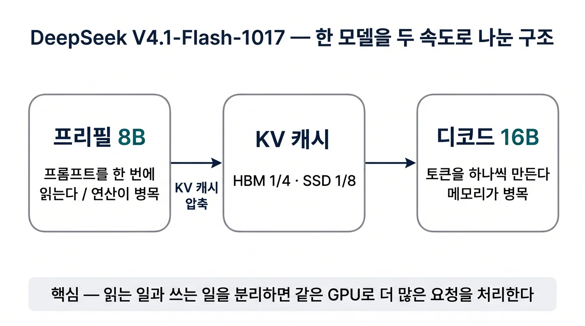

## 이 글을 30초에 파악하기

> **한 줄로** — 긴 입력 문서를 읽을 때는 작은 연산기만 쓰고 답변을 한 글자씩 지어낼 때는 두 배 큰 연산기를 쓰는 독특한 구조로 메모리 사용량과 토큰 비용을 낮춘 모델의 동작 원리를 다룬다.

**읽고 나면 알게 되는 것**

- 입력 처리(프리필)에 8B, 출력 생성(디코드)에 16B 활성 파라미터를 배정하는 비대칭 인코더-디코더가 서빙 자원 불균형을 해결하는 원리
- KV 캐시 용량을 HBM에서 토큰당 890바이트(약 4분의 1), 영구 저장소에서 8분의 1로 압축하는 CSA2와 슬라이딩 윈도우 바운디드 리플레이 기법
- 2026년 10월 17일 재학습(1017)으로 달라진 에이전트 성능 지표와 독립 벤치마크 실측치에서 드러난 지연시간 트레이드오프

**용어 먼저 보기**

| 용어 | 한 줄 설명 | 이 글에서의 역할 |
|---|---|---|
| 프리필(Prefill) | 프롬프트 입력 전체를 모델에 한 번에 읽혀 초기 상태를 계산하는 단계 | 8B 활성 파라미터가 배정되는 첫 번째 연산 단계 |
| 디코드(Decode) | 이전 단어들을 바탕으로 다음 글자를 하나씩 생성해 나가는 단계 | 16B 활성 파라미터가 배정되는 두 번째 연산 단계 |
| CED(인과적 인코더-디코더) | 입력 처리와 출력 생성을 각각 20개 레이어로 분할해 담당하는 구조 | 프리필과 디코드의 활성 가중치 크기를 비대칭으로 나누는 핵심 골격 |
| KV 캐시(키-값 캐시) | 이전에 계산한 어텐션 중간 결과를 GPU 메모리에 저장해 재사용하는 공간 | 1M 문맥에서 메모리 고갈을 막기 위해 HBM 890바이트로 압축하는 대상 |
| SWA 바운디드 리플레이 | 슬라이딩 윈도우 어텐션 구간을 캐시에 남기지 않고 짧게 다시 계산하는 방식 | SSD 영구 저장소에 보관하는 캐시 용량을 8분의 1로 줄이는 메커니즘 |
| MoE(전문가 혼합) | 수백 개의 세부 신경망 중 필요한 소수 전문가만 골라 활성화하는 구조 | 552B 총 파라미터 중 토큰당 8B 또는 16B만 선택해 연산하는 기반 |
| 캐시 적중(Cache Hit) | 이전에 입력했던 프롬프트 내용을 서버가 기억해 다시 계산하지 않고 넘어가는 상태 | 입력 요금을 `$0.15`~`$0.30`에서 `$0.003`~`$0.006`으로 낮추는 조건 |

**이런 분께** — 대규모 문맥 기반 에이전트를 운영하며 추론 비용과 지연시간 사이의 균형점을 찾는 엔지니어에게 적합하다. 2절의 비대칭 연산 원리와 3절의 캐시 압축 구조를 먼저 읽으면 모델 설계 의도를 빠르게 파악할 수 있다.

## 1. 2026년 가을의 모델 라인업: 왜 V4.1-Flash-1017인가

수십만 줄의 코드 저장소나 방대한 시스템 로그를 프롬프트에 넣고 자동화 에이전트를 가동할 때, 개발자가 가장 먼저 부딪히는 현실적인 벽은 토큰당 청구 비용과 메모리 한계다. 2026년 10월 17일 DeepSeek가 DeepSeek-V4.1-Flash-1017(이하 1017)을 공개했다. 이 모델은 API 서비스 모델명 `deepseek-flash`로 투명하게 전환된 최신 체크포인트다[^1][^2]. 상위 플래그십인 DeepSeek-V4-Pro-0813이 여전히 판매되고 있는 가운데, V4.1-Flash 라인업은 100만(1M) 토큰 문맥 창을 기본으로 제공한다. 최대 출력은 38만 4천(384K) 토큰이다. 이 라인업은 에이전트 중심의 실무 워크로드를 겨냥한다[^2].

### V4 프리뷰에서 V4.1-Flash-1017까지의 타임라인

2026년의 DeepSeek 모델 계보는 크게 두 세대로 구분된다[^1]. 2026년 4월 24일 공개된 DeepSeek-V4 프리뷰는 V4-Pro(총 1.6T 파라미터, 활성 49B)와 V4-Flash(총 284B, 활성 13B)를 선보였다. 이 프리뷰는 1M 문맥 지원을 선언했다. 이후 7월 31일 사후 학습만 갱신한 V4-Flash-0731 베타가 배포되었다. 8월 13일에는 추론 강도(reasoning effort) 조절과 Responses API를 탑재한 V4-Pro-0813이 정식 출시되었다.

하지만 기존 디코더 전용(Decoder-only) 구조는 긴 문맥에서 KV 캐시 크기와 연산 비효율을 완전히 해결하지 못했다. 이에 따라 2026년 9월 10일 V4.1-Flash가 출시되었다[^3]. 이 모델은 완전히 새로운 552B 인과적 인코더-디코더(Causal Encoder-Decoder, CED) 아키텍처를 적용했다. 그리고 약 한 달 뒤인 2026년 10월 17일, V4.1-Flash-1017 체크포인트가 오픈소스(MIT 라이선스) 가중치와 함께 정식 배포되었다[^2][^5]. 이 체크포인트는 가중치 골격은 유지한 채 에이전트 작업 성능을 집중적으로 보강했다.

### V4-Pro-0813과 V4.1-Flash의 현행 판매 구도

현재 공식 API 상에서 제공되는 모델은 두 축으로 나뉜다[^4].

| 항목 | deepseek-flash (V4.1-Flash-1017) | deepseek-v4-pro (V4-Pro-0813) |
|---|---|---|
| 모델 성격 | 최신 플래시 (기본값) | 기존 플래그십 (지속 판매) |
| 총 파라미터 | 552B 백본 + 196B Engram | 1.6T 백본 |
| 활성 파라미터 | 프리필 8B / 디코드 16B | 토큰당 49B |
| 멀티모달 | 텍스트 + 이미지 입력 (기본 내장) | 텍스트 전용 |
| 문맥 / 최대 출력 | 1M / 384K 토큰 | 1M / 384K 토큰 |
| 동시 요청 제한 | 2,500건 | 500건 |

공식 변경 이력에 따르면 당초 2026년 9월 중순 V4-Pro 요청을 V4.1-Flash로 라우팅하려던 계획은 철회되었다. V4-Pro 서비스는 기존 요금제를 유지한 채 지속 제공되고 있다[^1]. 아직 공식 출시되지 않은 V4.1-Pro나 발표되지 않은 V5와 달리, 현재 상용 환경에서 선택 가능한 실제 대안은 두 가지다. V4-Pro-0813과 V4.1-Flash-1017이다.

## 2. 비대칭 인코더-디코더: 프리필 8B와 디코드 16B의 분리 계산

수만 토큰의 문서를 한 번에 읽어 들이는 계산과 단어를 하나씩 이어 붙이며 답안을 써 내려가는 작업은 컴퓨터 자원을 쓰는 방식이 완전히 다르다. 기존 트랜스포머 모델은 입력 토큰을 읽을 때나 출력 토큰을 생성할 때나 동일한 활성 파라미터 수를 적용했다. 반면 V4.1-Flash-1017은 Causal Encoder-Decoder(CED) 설계를 도입해 비대칭 구조를 채택했다[^3]. 프롬프트 처리(프리필) 단계에서는 토큰당 8B 활성 파라미터만 쓰고, 답변 생성(디코드) 단계에서는 토큰당 16B 활성 파라미터를 사용한다.

### Causal Encoder-Decoder(CED) 20+20 레이어 분할

V4.1-Flash-1017은 전체 40개 레이어를 20개의 인코더 레이어와 20개의 디코더 레이어로 정확히 양분한다[^3][^6].

1. **인코더 20개 레이어 (프리필 집중)**: 입력 프롬프트를 처리하는 구간이다. 첫 2개 레이어는 윈도우 크기 128의 순수 슬라이딩 윈도우 어텐션(Sliding Window Attention, SWA)을 적용하고, 나머지 18개 레이어는 압축률 $m=2$를 갖는 CSA2(Compressed Sparse Attention 2) 방식을 적용한다. 인코더 레이어는 토큰당 상위 6개(top-6) 라우팅 전문가를 선택할 때 적은 연산량으로 빠르게 문맥 벡터를 추출하도록 최적화되어 활성 파라미터가 8B 수준에 머문다.
2. **디코더 20개 레이어 (디코드 집중)**: 답변 토큰을 하나씩 생성하는 구간이다. 디코더의 전역 키-값(Global KV)은 인코더의 최종 은닉 상태(Hidden States)로부터 직접 투영(Projection)된다. 디코더에서는 복잡한 추론과 다음 토큰 예측 품질을 확보하기 위해 토큰당 16B 활성 파라미터가 연산에 투입된다.

이러한 분할 설계 덕분에 프롬프트 길이가 수십만 토큰에 달하는 에이전트 워크로드에서 프리필 단계의 계산 부하(FLOPs)를 절반 가까이 줄일 수 있다.

### MoE 라우팅과 하드웨어 병목의 분리 매칭

앞서 [엔터프라이즈 AI 플랫폼 설계 (3): KVCache 중심 분리형 서빙](/llm/enterprise-ai-platform-disaggregated-serving-kvcache-gaie/)에서 살펴보았듯이, 대규모 언어 모델 서빙에서 프리필과 디코드는 물리적인 병목 지점이 상반된다. 프리필은 많은 연산기가 동시에 일하는 연산 바운드(Compute-bound) 특성을 띤다. 디코드는 토큰마다 가중치를 메모리에서 읽어와야 하는 메모리 대역폭 바운드(Memory Bandwidth-bound) 특성을 띈다.

V4.1-Flash-1017의 MoE 구조는 총 384개의 라우티드 전문가(Routed Experts)와 1개의 공유 전문가(Shared Expert)로 구성된다[^6]. 은닉 차원(hidden dimension)은 5120, 어텐션 헤드는 64개이며, KV 헤드는 1개로 설계되었다. 프리필 단계에서 8B 활성 파라미터만 가동함으로써 GPU 연산 유닛에 걸리는 과도한 발열과 전력 스파이크를 억제한다. 디코드 단계에서는 16B 활성 파라미터로 확장해 깊은 추론 능력을 유지한다.

즉, 하드웨어 특성에 맞춰 모델의 크기를 동적으로 전환하는 효과를 단일 모델 구조 안에서 달성한 셈이다.

## 3. KV 캐시 압축: HBM 890바이트와 SSD 8분의 1 바운디드 리플레이

대화 기록이 길어질수록 과거 문맥을 보관해 두는 캐시 크기가 모델 가중치 자체보다 커져 GPU 메모리를 먼저 잠식하는 현상이 벌어진다. 100만 토큰 환경에서 표준적인 어텐션 구조를 그대로 유지하면 수십 기가바이트의 HBM(고대역폭 메모리)이 캐시 데이터 하나에 소모된다. V4.1-Flash-1017은 희소 어텐션, 저정밀도 양자화, 그리고 캐시 재계산 기법을 조합해 HBM 상의 전역 캐시 크기를 토큰당 890바이트로 억제했다[^3].

이는 기존 V4-Flash 대비 약 4분의 1 수준이다.

### CSA2 희소 어텐션과 FP4 KV 양자화

메모리 압축의 첫 번째 축은 CSA2(Compressed Sparse Attention 2)와 FP4 정밀도 도입이다[^3].

- **HBM 전역 캐시 890바이트/토큰**: 일반적인 FP16 기반 모델이 토큰당 수 킬로바이트의 캐시 공간을 요구하는 반면, V4.1-Flash-1017은 1 토큰당 890바이트만 고속 HBM에 보관한다.
- **FP4 KV 양자화**: 키와 값 벡터를 FP4(E2M1 값 표현, 16개 채널당 E4M3 스케일 계수) 형태로 변환해 저장한다. 이를 통해 양자화 오차를 통제하면서도 메모리 점유 면적을 절반으로 줄인다.
- **계층형 희소 인덱서(Hierarchical Sparse Indexer)**: 인덱스 상위 512개(index_topk 512)의 중요한 토큰 키만을 추적해 어텐션 연산 시 탐색 범위를 제한한다.

여기에 가중치 자체도 FP8(32×32 블록 단위, ue8m0 스케일)과 전문가 가중치 전용 FP4 포맷을 결합해 메모리 적재 부담을 덜었다[^6].

### SWA Bounded Replay로 비휘발성 저장소 부담 완화

두 번째 축은 다단계 캐시 계층에서 발생하는 호스트 메모리 및 SSD 대역폭 병목을 해소하는 기법이다[^3]. 모델의 앞단 2개 레이어에서 동작하는 슬라이딩 윈도우 어텐션(SWA, 윈도우 크기 128) 상태는 SSD나 호스트 메모리에 영구 저장하지 않는다. 대신 요청이 다시 유입될 때 약 128 토큰 범위 내에서 즉시 다시 계산하는 바운디드 리플레이(Bounded Replay) 방식을 취한다.

이러한 설계의 핵심은 지속적 KV 캐시(Persistent KV)의 용량을 기존 대비 약 8분의 1 수준으로 줄인다는 점이다. 이 캐시는 로컬 HBM에 더해 외부 저장소(SSD)로 오프로딩되는 계층을 함께 포함한다. 긴 시스템 프롬프트를 디스크에 보관했다가 재호출하는 에이전트 환경에서 I/O 대역폭 병목이 크게 완화되며, 이는 캐시 적중 시 토큰 처리 속도를 높이는 직접적인 기반이 된다.

## 4. 1017 체크포인트 재학습: 에이전트 지표와 파레토 개선

동일한 가중치 골격을 가진 모델이라도 도구 호출과 터미널 제어에 초점을 맞춰 사후 학습을 어떻게 다시 수행하느냐에 따라 실제 작업 성공률은 판이하게 달라진다. 2026년 10월 17일에 배포된 V4.1-Flash-1017은 9월 10일의 초기 V4.1-Flash와 동일한 매개변수 구조를 유지한다. 대신 사후 학습(Post-training) 파이프라인을 전면 재구성했다[^2]. 그 결과 소프트웨어 개발과 자율 에이전트 관련 벤치마크 전반에서 눈에 띄는 점수 상승을 기록했다.

### 터미널·소프트웨어 엔지니어링 벤치마크 변화

공식 발표 자료에 기록된 V4.1-Flash 초기 버전(0910)과 1017 버전의 주요 평가 지표 비교는 다음과 같다[^1][^2].

| 벤치마크 | 1017 (2026-10-17) | V4.1-Flash (2026-09-10) | 평가 환경 및 성격 |
|---|---|---|---|
| HLE (도구 미사용) | **42.6** (텍스트 44.0) | 36.8 (텍스트 39.1) | Humanity's Last Exam 학술 추론 |
| Terminal-Bench 4.0 | **42.3** | 31.2 | Claude Code 하네스 기반 CLI 제어 |
| DeepSWE v1.1 | **77.0** | 74.2 | Mini-SWE-V2 하네스 기반 코드 수정 |
| ProgramBench | **29.1** | 20.3 | 프로그래밍 작업 평가 |
| NL2Repo-Bench | **68.2** | 65.4 | 자연어 요구사항 기반 저장소 구축 |
| Automation-Bench v1.0.6 | **60.5** | 54.8 | 자율 작업 자동화 |
| Agents' Last Exam | **35.4** | 31.8 | 고난도 에이전트 과제 종합 평가 |
| Apex Bench v1.1 | **72.1** | 64.6 | 수학 및 논리 추론 |
| Chartography (도구 사용) | **83.0** | 78.9 | 차트 분석 멀티모달 과제 |
| BabyVision (도구 사용) | **92.5** | 89.6 | 기본 시각 인식 과제 |
| ZeroBench-main (도구 사용) | **51.0** (Pass@5) | 49.0 | 복합 도구 활용 추론 |

가장 두드러진 변화는 터미널 명령어를 다루는 Terminal-Bench 4.0에서 31.2에서 42.3으로 상승한 부분이다. DeepSWE v1.1에서도 74.2에서 77.0으로 개선되었다. 공식 가중치와 함께 공개된 비교표에 따르면, DeepSWE v1.1 기준 1017은 77.0을 기록했다[^5]. 이는 GPT-5.6 Sol(73.0), Opus 5(74.0), GLM-5.3(66.9), K3(67.5)보다 높은 점수다. Automation-Bench v1.0.6에서도 60.5를 기록해 Opus 5(50.3)와 GPT-5.6 Sol(45.8)을 상회하는 수치를 보였다.

### 출력 길이 단축과 작업당 토큰 소모 최소화

공식 릴리스 노트에서 강조하는 핵심 주장은 파레토(Pareto) 효율성 개선이다[^2]. 단순히 정답률 점수만 올린 것이 아니라, 동일한 과제를 해결할 때 장황한 설명을 줄이고 간결한 핵심 명령 위주로 답안을 도출하도록 튜닝되었다. 

에이전트가 터미널 환경에서 불필요한 사설을 늘어놓으면 문맥 창이 금세 차오르고 왕복 비용이 누적된다. 1017 체크포인트는 태스크 완료에 필요한 출력 토큰 수를 압축함으로써 작업당 지출되는 총비용을 낮추는 방향으로 유도되었다.

## 5. 서빙 비용과 지연시간 분석: 독립 측정치가 보여주는 현실

클라우드 API 가격표의 저렴한 단가만 보고 프로덕션 환경에 모델을 연동했다가, 첫 글자가 반환될 때까지 걸리는 긴 대기 시간에 당황하는 경우가 적지 않다. DeepSeek V4.1-Flash-1017의 상용 가치를 객관적으로 판단하려면 공식 요금제 구조를 봐야 한다. 여기에 독립 평가 기관인 Artificial Analysis의 실측 지표를 나란히 대조해 보아야 한다.

### 피크·오프피크 요금제와 98% 캐시 적중 할인

공식 API 가격표에 따른 `deepseek-flash`의 100만 토큰당 요금 기준은 다음과 같다[^4].

| 구분 | 입력 캐시 적중 (Cache Hit) | 입력 캐시 미적중 (Cache Miss) | 출력 토큰 (Output) |
|---|---|---|---|
| 오프피크 (Off-peak) | **`$0.003`** | **`$0.15`** | **`$0.60`** |
| 피크 (Peak) | **`$0.006`** | **`$0.30`** | **`$1.20`** |

피크 시간대는 월요일부터 금요일까지 UTC 기준 01:00~04:00 및 06:00~10:00(중국 공휴일 제외)이다. 그 외의 모든 시간대와 주말은 피크 요금 대비 50% 할인된 오프피크 요금이 적용된다. 특히 주목할 부분은 캐시 적중 할인율이다. 오프피크 기준 캐시 미적중 입력이 `$0.15`인데 비해 캐시 적중 입력은 `$0.003`으로 책정되어 약 50배 저렴하다.

또한 1017 출시와 함께 웹 검색(Search API) 및 본문 추출(Fetch API) 기능이 일반 사용자에게 개방되었다. 이 기능은 성공적인 호출 1,000건당 $0.75가 별도 청구된다[^2][^4]. 플래그십인 V4-Pro-0813의 피크 요금은 미적중 $1.32 / 출력 `$3.96`이다. 이와 비교하면 V4.1-Flash-1017의 토큰 단가는 약 4분의 1에서 3분의 1 수준으로 책정되어 있다.

### Artificial Analysis 실측: 161 tok/s와 긴 사고 시간

Artificial Analysis가 V4.1-Flash-1017을 대상으로 독립 측정한 수치는 실무 배포 시 고려해야 할 중요한 현실을 보여준다[^7].

- **지능 지수(AA Intelligence Index v5.0.1)**: 최대 추론 강도(max effort)에서 33점을 기록해 비교 대상 26개 모델 중 2위에 올랐다.
- **출력 속도**: 초당 161 토큰(161 tok/s)으로 빠른 생성 대역폭을 보였다.
- **첫 토큰 생성 지연(TTFT)**: 최대 추론 모드에서 **53.56초**가 소요되었다. 비사고(non-reasoning) 모드에서는 **1.31초**로 단축되었다.
- **태스크당 소요 시간**: 인덱스 과제 1건당 최대 모드에서 14.4분, 비사고 모드에서 7.5분이 걸렸다.
- **태스크당 청구 비용**: 인덱스 과제당 최대 모드에서 `$0.60`, 비사고 모드에서 `$0.43` 수준이었다.
- **출력 토큰 총량과 성향**: 인덱스 전체에서 1억 7,400만(174M) 토큰을 출력했다. 비교 모델들의 중간값이 9,930만(99.3M) 토큰인 점을 감안하면 모델이 기본적으로 많은 양의 사고 과정을 서술하는 성향을 가진다.

Artificial Analysis는 이 결과를 이렇게 정리했다[^7]. "과제당 소요 시간은 평균보다 느리고 출력이 장황한 편이지만, 토큰당 가격이 낮아 태스크당 최종 비용 관점에서 우위를 점한다"는 평가다. 즉, 사용자가 실시간 대화창에서 즉각적인 반응을 기대하는 환경보다는, 백그라운드에서 복잡한 개발 과제를 비동기로 수행하는 에이전트 파이프라인에 최적화된 특성을 드러낸다.

## 한계와 트레이드오프

V4.1-Flash-1017의 비대칭 아키텍처와 사고 모드는 모든 환경에서 유리하지 않다. 최대 추론 강도 기준 첫 토큰 도달 시간(TTFT)이 53초를 넘어서기 때문에 실시간 챗봇이나 즉각적인 UI 상호작용 서비스에는 사용자 이탈을 초래할 수 있다. 또한 174M 토큰에 달하는 긴 사고 과정은 토큰 단가의 저렴함으로 상쇄되더라도 절대적인 처리 대기 시간을 늘린다.

프롬프트 캐시 적중률이 낮은 단발성 질의 환경이거나 초 단위 왕복 지연이 핵심인 서비스라면 비사고 모드로 전환하거나 경량 디코더 전용 모델을 검토해야 한다.

## 정리

DeepSeek V4.1-Flash-1017은 프리필 8B와 디코드 16B의 비대칭 연산 배분으로 프롬프트 처리 부담을 낮춘 모델이다. HBM KV 캐시를 890바이트 수준으로 압축한 실용적인 서빙 모델이기도 하다. 1017 사후 학습을 통해 터미널 제어와 소프트웨어 엔지니어링 벤치마크 지표를 끌어올렸으며, 피크 시에도 캐시 적중 시 `$0.006` 수준의 진입 비용을 제시한다. 빠른 사용자 체감 응답성보다 백그라운드에서 장시간 대규모 문맥을 탐색하고 연산 비용을 통제해야 하는 에이전트 시스템에 적합한 선택지다.

## References

[^1]: DeepSeek 공식 변경 이력 (Change Log) — 2026년 4월 V4 프리뷰부터 10월 V4.1-Flash-1017 출시까지의 타임라인 및 모델별 사양 변경 기록. https://api-docs.deepseek.com/updates
[^2]: DeepSeek 공식 릴리스 공지 (news261017) — DeepSeek-V4.1-Flash-1017 출시 발표, 벤치마크 지표 비교 및 검색·가져오기 API 개방 안내. https://api-docs.deepseek.com/news/news261017
[^3]: DeepSeek V4.1-Flash 기술 보고서 (arXiv 2609.19969) — 552B 백본 및 20+20 레이어 CED 아키텍처, 토큰당 890바이트 HBM KV 캐시 및 SWA 바운디드 리플레이 압축 기술. https://arxiv.org/abs/2609.19969
[^4]: DeepSeek 공식 요금 안내 (Pricing) — deepseek-flash 및 deepseek-v4-pro의 피크·오프피크 요금 및 캐시 적중 단가 기준. https://api-docs.deepseek.com/quick_start/pricing
[^5]: HuggingFace DeepSeek-V4.1-Flash-1017 모델 카드 — MIT 라이선스 가중치 공개, 권장 샘플링 매개변수 및 타사 모델 대비 벤치마크 성적표. https://huggingface.co/deepseek-ai/DeepSeek-V4.1-Flash-1017
[^6]: HuggingFace DeepSeek-V4.1-Flash-1017 config.json — 40개 레이어, 384개 라우티드 전문가 top-6 구조, FP8 가중치 및 FP4 전문가 양자화 하이퍼파라미터 명세. https://huggingface.co/deepseek-ai/DeepSeek-V4.1-Flash-1017/raw/main/config.json
[^7]: Artificial Analysis 독립 실측 벤치마크 — DeepSeek-V4.1-Flash-1017의 생성 속도(161 tok/s), 최대 추론 첫 토큰 지연(53.56초) 및 인덱스 과제당 비용(`$0.60`) 실측치. https://artificialanalysis.ai/models/deepseek-v4-1-flash-1017