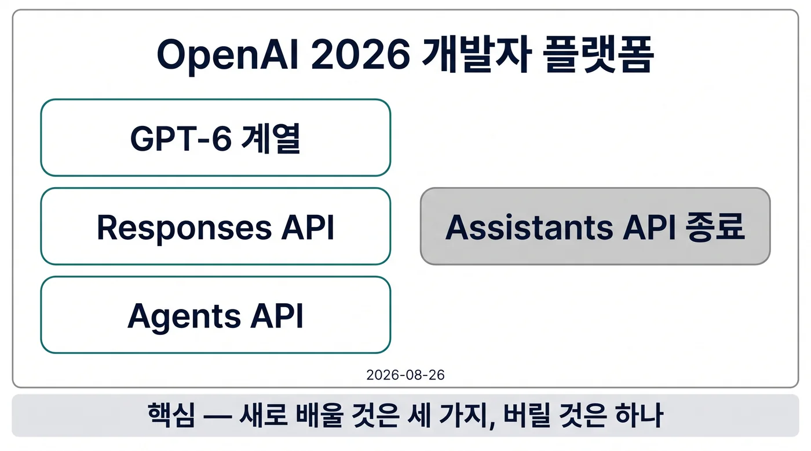

## 이 글을 30초에 파악하기

> **한 줄로** — 2026년 한 해 동안 OpenAI API는 "대화를 이어 붙이는 창구"에서 "작업을 맡기고 결과를 받는 창구"로 옮겨 갔고, 그 이동에 맞춰 호출 코드와 비용 계산식, 폐기 일정이 함께 바뀌었다.

**읽고 나면 알게 되는 것**

- 새 호출 표면(Responses API)이 기존 방식과 무엇이 다르고, 기존 코드를 언제까지 그대로 둘 수 있는지
- 같은 모델을 써도 청구서가 0.5배에서 6배까지 벌어지는 네 가지 축과, 그 축을 실제로 계산하는 방법
- 이미 꺼진 API와 앞으로 꺼질 API의 날짜, 지금 다시 배워 둘 가치가 있는 것과 그대로 두어도 되는 것

**용어 먼저 보기**

|용어|한 줄 설명|이 글에서의 역할|
|---|---|---|
|Responses API|메시지 배열 대신 아이템 목록과 응답 ID로 상태를 다루는 기본 호출 표면|2절 전체가 이 표면의 구조를 다룬다|
|Chat Completions|기존 대화 완성 엔드포인트. 2026년에도 지원이 유지된다|2.3절에서 "언제까지 그대로 둘 수 있는가"를 판단한다|
|아이템(Item)|모델 출력·도구 호출·도구 결과를 각각 독립된 항목으로 남기는 기록 단위|2.1절 요청 예시의 구성 요소다|
|에이전트 하네스(Agent Harness)|명령 실행·압축·서브에이전트·재개를 대신 처리하는 실행 계층|5.1절에서 서비스로 제공되는 부분을 설명한다|
|서비스 티어(Service Tier)|Batch·Flex·Standard·Fast·Ultrafast로 속도와 가격을 맞바꾸는 등급|4.1절 표의 배수 값이 여기서 나온다|
|프롬프트 캐싱(Prompt Caching)|반복되는 앞부분을 저장해 입력 요금을 0.05~0.1배로 낮추는 기능|4.3절에서 10회 반복 비용을 계산한다|
|장기 컨텍스트 할증|272K 토큰을 넘는 요청에 입력 2배·출력 1.5배를 붙이는 규칙|4.2절에서 요청 전체에 적용되는 조건을 다룬다|
|Decisions API|문항 목록에 확률과 선택지만 돌려주는 분류 전용 엔드포인트|5.2절에서 출력 요금이 없는 과금 구조를 설명한다|

**이런 분께** — 챗봇이나 사내 도구에 OpenAI API를 붙여 두고, 올해 안에 한 번 코드를 손봐야 하는 백엔드 개발자에게 맞다. 급하면 2.3절과 6.1절만 읽어도 "무엇이 언제 꺼지는지"는 확인할 수 있고, 이유와 비용 구조가 궁금하면 1절부터 순서대로 읽으면 된다.

---



*그림 1. 2026년 스택은 하나의 호출 표면(Responses) 위에 관리형 실행(Agents)과 좁은 분류(Decisions)가 얹히는 구조로 정리됐다.*

모델 이름만 바꾸면 끝날 줄 알았던 업그레이드가, 실제로는 호출 코드를 다시 쓰게 만드는 경우가 있다. 2026년의 OpenAI 개발자 플랫폼이 그런 해였다. 1월에는 호출 규격을 벤더 공통으로 맞추자는 제안이 나왔고, 3월과 9월에 모델 계열이 두 번 갈렸고, 8월에는 오래 쓰던 Assistants API가 실제로 종료됐다. 같은 해 10월에는 분류 전용 엔드포인트와 12시간짜리 캐시가 붙었다.

이 글은 그 변화를 기능 목록이 아니라 **결정 지점** 순서로 정리한다. 무엇이 새 기본값이 되었는지, 그 기본값이 비용을 어떻게 바꾸는지, 무엇을 버려야 하는지를 따라간다. 수치와 날짜는 모두 OpenAI 공식 문서와 발표 글을 기준으로 했고, 자료끼리 어긋나는 항목은 뒤에서 따로 표시한다.

## 1. 1년 사이 호출 창구가 세 번 바뀌었다

API를 쓰는 쪽에서 체감하는 변화는 대개 버전 번호가 아니라 "요청 한 번에 무엇을 넣고 무엇을 받는가"에서 온다. 2026년에는 그 형태가 세 차례 크게 흔들렸다. 먼저 날짜순으로 무엇이 언제 도착했는지 본다.

### 1.1 2026년 1월에서 11월까지

아래 표는 공식 변경 이력에서 개발자 코드에 영향을 주는 항목만 골라 시간순으로 놓은 것이다[^1]. 모델 출시만 나열하면 놓치기 쉬운 것이, 같은 해에 요청 형식과 과금 단위가 함께 바뀌었다는 점이다.

|날짜|바뀐 것|실무에서 달라진 점|
|---|---|---|
|2026-01-15|Open Responses 명세 제안 공개|호출 규격을 벤더 공통으로 맞추는 논의가 시작됨|
|2026-02-10|Skills·Hosted Shell·서버 측 압축|긴 작업을 클라이언트 루프 없이 서버에서 이어 돌림|
|2026-03-05|GPT-5.4, 100만 토큰 컨텍스트·내장 컴퓨터 사용|도구가 모델 기본 기능으로 들어옴|
|2026-07-09|GPT-5.6 Sol/Terra/Luna, 프로그래매틱 도구 호출|모델이 도구를 코드처럼 호출|
|2026-08-26|**Assistants API 종료**|스레드·런 기반 코드는 Responses와 Conversations로 이동|
|2026-09-03|GPT-6 Astra, 비동기 도구 호출·턴 중 개입|긴 작업 도중 설정을 바꿔도 캐시가 깨지지 않음|
|2026-09-10|Agents API 공개 베타|명령 실행·압축·재개를 서비스가 대신함|
|2026-09-22|GPT-6 Sol(`$2`/`$10`)·Luna(`$0.10`/`$0.50`)|같은 계열 안에서 토큰 단가가 100배 벌어짐|
|2026-09-29|DevDay 2026: GPT-6.1 Sol, Ultrafast, Decisions API, Agents API 컴퓨터 사용|에이전트 실행과 초고속 티어가 제품으로 나옴[^2]|
|2026-10-22|Decisions API 정식 출시|요청당 문항 수가 200에서 400으로 늘어남|
|2026-10-30|GPT-6 Rosalind|연구·법률 등 목적이 고정된 모델이 분화|
|2026-11-04|GPT Image 2.6|복잡도 지정, SVG·움직이는 GIF 출력, 마크업 기반 편집[^3]|
|2026-11-05|GPT-6 Cyber|보안 평가용 모델, 접근 등급 제한|

표를 세로로 훑으면 세 덩어리가 보인다. 1~2월은 **도구와 상태를 서버로 올리는** 변화, 9월은 **실행 자체를 맡기는** 변화, 9월 말에서 10월은 **같은 모델 안에서 가격을 쪼개는** 변화다. 코드를 고쳐야 하는 압력은 첫째와 둘째에서 오고, 청구서가 달라지는 압력은 셋째에서 온다.

### 1.2 계층이 셋으로 갈라졌다

새로 붙은 API를 하나씩 외우면 금방 헷갈린다. 실제로는 아래에 깔린 하나의 호출 표면 위에 목적이 다른 두 층이 얹힌 구조로 읽는 편이 낫다.

가장 아래는 **Responses API**다. `POST /v1/responses` 하나로 텍스트 생성, 도구 호출, 상태 이어가기가 모두 처리된다[^4]. 그 위의 **Agents API**는 이 표면을 감싸 명령 실행과 세션 재개를 대신하는 관리형 실행 계층이다[^5]. 옆으로 갈라지는 **Decisions API**는 생성이 아니라 판정만 하는 좁은 창구로, 문항 목록에 확률과 선택지만 돌려준다[^6]. 여기에 전이중 음성용 실시간 세션이 별도 축으로 붙는다.

이 구조는 직접 에이전트를 만들 때와 비교하면 역할 분담이 분명해진다. 관리형 실행 계층을 쓰지 않고 하네스를 직접 구현한다면, 도구 노출 방식과 세션 경계를 어디에 둘지가 여전히 설계 문제로 남는다. 그때의 패턴은 [MCP 에이전트 아키텍처 패턴](/agent/mcp-agent-architecture-patterns/)[^7]에서 정리한 내용이 그대로 참고가 된다.

### 1.3 같은 계열 안에서 단가가 100배 벌어졌다

가격표를 처음 보면 숫자가 난잡해 보이지만, GPT-6 계열만 놓고 보면 사다리가 단순하다. 입력 100만 토큰 기준으로 Astra는 `$10`, 6.1 Sol은 `$2`, 6.1 Terra는 `$1`, 6 Luna는 `$0.10`이다[^8]. 출력은 각각 `$50`, `$10`, `$5`, `$0.50`이다. 가장 비싼 모델과 가장 싼 모델의 차이가 정확히 100배다.

이 사다리가 생긴 배경에는 방향이 다른 두 움직임이 겹쳐 있다. 최전선 모델의 절대 단가는 올라갔고(Astra `$10`/`$50`), 효율 구간의 단가는 내려갔다. 2026년 8월 21일 GPT-5.6 Sol은 입력 20%·출력 33% 인하로 `$4`/`$20`이 됐고, 9월 22일 GPT-6 Sol이 같은 `$2`/`$10`으로 등장했다. 같은 작업을 어느 칸에 배치하느냐가 비용의 절반을 결정하게 된 셈이다.

## 2. Responses API: 메시지 목록에서 아이템 목록으로

기존 코드를 가장 많이 건드리는 지점은 모델명이 아니라 요청 본문이다. 예전에는 대화 전체를 `messages` 배열로 매번 다시 보냈고, 도구 호출 결과도 역할이 정해진 메시지로 끼워 넣었다. 새 표면에서는 이 기록의 단위가 바뀐다.

### 2.1 요청 한 번이 만드는 것: 아이템

Responses API는 대화를 **아이템(Item)** 목록으로 다룬다. 아이템의 종류는 크게 셋이다. 사람이 넣은 메시지, 모델이 낸 함수 호출, 그 호출의 결과값이다[^4]. 도구 결과가 메시지가 아니라 별도 타입으로 남기 때문에, 대화 기록을 다시 읽을 때 "무엇이 지시이고 무엇이 실행 결과인지"가 구조적으로 구분된다.

`POST /v1/responses`로 보내는 본문은 다음처럼 생겼다. 핵심은 매번 전체 대화를 다시 붙이지 않고 이전 응답의 ID만 넘긴다는 점이다.

```json
{
  "model": "gpt-6.1-sol",
  "previous_response_id": "resp_9f3c...",
  "input": [{"role": "user", "content": "이 로그에서 실패 원인만 뽑아줘"}],
  "store": true
}
```

`store`의 기본값은 true이고, 대화를 길게 이어 갈 때는 Conversations API로 대화 단위를 묶는다. 한 요청에 생성은 한 번만 일어난다. 기존 `n` 파라미터로 여러 개를 한꺼번에 뽑던 방식은 이 표면에 없다.

내장 도구도 함께 붙는다. 웹 검색, 파일 검색, 코드 인터프리터, 컴퓨터 사용, 호스팅 셸, 패치 적용, Skills, 이미지 생성, MCP, 도구 검색이 모두 같은 요청 안에서 이름으로 지정된다[^4]. 예전처럼 도구 정의를 프롬프트에 넣고 파싱하는 왕복이 줄어드는 이유다.

### 2.2 마이그레이션에서 실제로 달라지는 숫자

같은 프롬프트를 두 표면에 넣었을 때의 차이는 공식 마이그레이션 가이드에 수치로 적혀 있다. SWE-bench 기준으로 Responses 쪽이 3% 높고, 캐시 활용률은 40~80% 개선된다[^4]. 조건은 "동일 프롬프트, 동일 모델"이며, 차이는 대화 기록을 서버가 들고 있으면서 접두사가 그대로 유지되기 때문이다.

캐시 개선 폭(40~80%)이 코드 정확도 개선 폭(3%)보다 큰 것이 이 표면 교체의 성격을 말해 준다. 정답률을 끌어올리는 변화라기보다, 같은 대화를 반복해서 이어 갈 때 **다시 계산하지 않는 범위**를 넓히는 변화다. 4.3절의 캐시 요율과 합쳐 읽으면 왜 이전이 권장되는지가 숫자로 설명된다.

### 2.3 Chat Completions는 종료되지 않았다

여기서 흔한 오해를 하나 정리해야 한다. "Responses가 Chat Completions를 대체했다"는 서술은 공식 문서와 맞지 않는다. Chat Completions는 계속 지원되며 종료일도 공지되지 않았다. 새 프로젝트에 Responses를 권장하는 것이지, 기존 엔드포인트를 끊겠다는 발표가 아니다[^4].

다만 조건이 두 개 붙는다. 첫째, GPT-5.4 이후 Chat Completions에서 도구 호출을 쓰려면 `reasoning_effort`를 `none`으로 지정해야 한다. 둘째, Astra·6.1 Sol·6.1 Terra에서는 도구 호출 자체가 Responses API를 요구한다[^9][^10][^11]. 정리하면 **도구를 쓰는 코드만 먼저 옮기고, 단발 텍스트 생성은 그대로 두어도 된다**는 판단이 가능하다.

## 3. 모델 계열: 이름이 아니라 사다리로 읽기

모델 이름이 열 개를 넘으면 어느 것을 골라야 하는지가 먼저 막힌다. 실제로는 공통 골격이 하나 있고, 그 위에 용도와 가격이 붙는 구조다. 골격부터 확인한다.

### 3.1 GPT-6 계열의 공통 뼈대

GPT-6 계열은 컨텍스트 길이와 입출력 한도가 동일하다. 컨텍스트 1,050,000 토큰, 최대 입력 922,000 토큰, 최대 출력 128,000 토큰이고, 입력은 텍스트와 이미지를 받고 출력은 텍스트다[^9]. 컨텍스트보다 최대 입력이 작은 것은 출력과 추론 토큰 몫을 미리 떼어 두기 때문으로 읽힌다.

학습 지식 기준일은 모델마다 다르다. Astra와 6.1 Sol은 2026-04-30, 6.1 Terra는 2026-06-01, 6 Luna는 2026-05-18이며, GPT-6 Cyber는 공개되지 않았다[^9][^10][^11][^12][^13]. 최신 시사 정보를 다루는 서비스라면 이 날짜 차이가 검색 도구 필요 여부를 가른다.

추론 강도 선택지도 갈린다. Astra와 6.1 Sol은 low에서 max까지이고 `none`이 없다. 6.1 Terra, 6 Sol, 6 Luna는 `none`을 포함한다[^9][^10][^11][^12]. 지연 시간이 중요한 단순 분류 작업을 Terra나 Luna에 두는 이유가 여기 있다.

호출 한도는 사용 등급 세 단계(Build·Launch·Grow) 기준으로 공개돼 있다. Astra는 분당 5천·1만·1만 5천 요청, 분당 100만·400만·4천만 토큰이고, Luna는 분당 5천·1만·3만 요청, 분당 200만·1천만·1억 8천만 토큰이다[^9][^12]. 2026년 10월 6일 사용 등급이 다섯 단계에서 세 단계로 줄었으므로, 예전 문서의 등급 이름을 그대로 쓰는 스크립트는 한 번 점검이 필요하다[^1].

### 3.2 가격 사다리와 작업당 비용

단가표만 보면 판단이 어렵다. 실제 선택은 "한 작업에 얼마가 드는가"로 이뤄지기 때문이다. 아래 표는 표준 티어, 272K 이하 구간 기준 단가다[^8].

|모델|입력(1M)|출력(1M)|캐시 입력(1M)|성격|
|---|---|---|---|---|
|gpt-6-astra|`$10`|`$50`|`$1.00`|최전선, 컴퓨터 사용·장기 작업|
|gpt-6.1-sol|`$2`|`$10`|`$0.10`|비용 대비 성능의 기본값|
|gpt-6-sol|`$2`|`$10`|`$0.20`|9월 세대, 6.1보다 캐시 단가 높음|
|gpt-6.1-terra|`$1`|`$5`|`$0.05`|중간 작업, `none` 추론 지원|
|gpt-6-luna|`$0.10`|`$0.50`|`$0.01`|대량 분류·단순 처리|
|gpt-5.6-sol|`$4`|`$20`|`$0.40`|8월 인하 가격, 프로모션 기간 별도|
|gpt-6-cyber|`$20`|`$100`|`$2.00`|보안 평가, 접근 등급 제한|

작업당 비용을 직접 비교한 수치도 있다. 6.1 Sol은 DeepSWE v1.1에서 Astra와 같은 수준을 약 5분의 1 비용으로 낸다고 발표됐고, Terminal-Bench Science 0.1에서는 작업당 `$5.47`로 Astra의 `$23.80`, 경쟁 모델의 `$23.21`보다 낮았다[^15]. 같은 발표에서 Astra의 정확도는 68.1%로 가장 높게 기록됐다[^15]. 정확도 1위와 가성비 1위가 서로 다른 칸에 있다는 뜻이다.

Astra의 벤치마크도 조건과 함께 봐야 한다. OSWorld 2.0 오프라인 기준 72.6%로 GPT-5.6 Sol의 65.7%보다 높고, 작업당 소요 시간은 약 75분에서 약 40분으로 줄었다. Terminal-Bench 4.0은 57.9% 대 37.3%, 512K~1M 구간의 MRCR v2는 96.3% 대 73.8%다[^14]. 긴 문맥에서 성능이 유지되는 폭이 가장 크게 벌어진 항목이다.

### 3.3 목적이 고정된 모델들

2026년 하반기에는 범용 사다리에서 빠지는 모델이 생겼다. GPT-6 Rosalind는 입력 `$15`·출력 `$75`로 책정됐고, 연구·탐색 변형은 `$5`/`$25`다. 법률 특화 변형인 astra-law는 `$10`/`$50`이다[^8]. 용도가 좁은 대신 평가와 안전 정책이 그 용도에 맞춰져 있다.

GPT-6 Cyber는 가격이 아니라 접근 방식이 다르다. 입력 `$20`·출력 `$100`이고, Daybreak Red 등급에서만 열리며 기본적으로 IP 허용 목록을 요구한다. Batch 티어는 지원하지 않는다[^13]. 사이버보안 Preparedness 등급이 Critical로 분류된 모델이라 일반 API 키로 바로 호출되는 구조가 아니다.

성능은 ExploitGym 48.5%로 GPT-5.6 Cyber의 32.1%보다 16포인트 높다. 재현된 리눅스 커널 취약점 1,724건에서 동작하는 익스플로이트 948건을 만들어 냈는데, 같은 하네스를 쓴 GPT-5.6 Sol의 166건과 비교하면 약 5배다. 파이어폭스의 신규 고위험 취약점 81건도 함께 보고됐다[^16]. 방어 목적 평가에 쓰이는 모델이라는 전제가 숫자 해석의 전제다.

## 4. 같은 모델, 네 축으로 갈리는 청구서

비용을 모델 단가로만 계산하면 실제 청구서와 두 배 이상 어긋나는 일이 흔하다. 같은 모델, 같은 토큰이라도 네 축이 각각 곱해지기 때문이다. 축은 모델 등급, 서비스 티어, 컨텍스트 구간, 캐시 설정이다.

### 4.1 서비스 티어: 0.5배에서 6배까지

티어는 지연 시간과 가격을 맞바꾸는 등급이다. 표준 대비 배수는 아래와 같다[^8].

|티어|가격 배수|특징|
|---|---|---|
|Batch|0.5x|비동기 대량 처리|
|Flex|0.5x|여유 용량 활용|
|Standard|1x|기본값|
|Fast|2x|기존 Priority를 대체, 약 2.5배 속도|
|Ultrafast|6x|API 최대 6배, Codex 최대 8배(300 tok/s)|

Ultrafast는 GPT-6 Astra와 GPT-6.1 Sol에만 열려 있고, 별도 요청 한도를 쓰며 WebSocket 사용이 권장된다. 같은 모델의 단가가 Astra는 `$60`/`$300`, 6.1 Sol은 `$12`/`$60`으로 올라간다[^17]. 대화형 응답에서 체감 지연이 매출에 직결되는 경우가 아니면 기본값을 유지하는 편이 낫다.

티어는 프로젝트 단위로 제한할 수도 있다. 2026년 10월 21일부터 프로젝트별 서비스 티어 제한이 가능해졌으므로, 실험용 프로젝트에서 Ultrafast가 켜진 채로 대량 배치가 도는 사고를 구조적으로 막을 수 있다[^1].

### 4.2 컨텍스트 구간: 272K를 넘는 순간

컨텍스트 할증은 임계값 하나로 갈린다. 272K 토큰 이하이면 표에 적힌 단가가 그대로 적용되고, 넘으면 입력과 캐시가 2배, 출력이 1.5배가 된다. 중요한 것은 이 배수가 **요청 전체**에 적용된다는 점이다[^8]. 272K를 1토큰 넘긴 요청은 그 아래 부분까지 모두 할증 단가로 계산된다.

그래서 긴 문서를 넣는 작업에서는 "몇 토큰에서 잘라 두 번 호출하는 것이 싼가"를 계산해야 한다. 272K를 조금 넘기는 요청 두 개로 쪼개는 편이 한 번에 넣는 것보다 쌀 수 있고, 이 판단은 문서 길이 분포를 알면 스크립트로 자동화할 수 있다.

### 4.3 프롬프트 캐싱: 10회 반복이면 4.7배 차이

캐시는 같은 접두사를 반복해서 보낼 때 입력 요금을 낮추는 장치다. 최소 캐시 단위는 1,024 토큰이고, 요청당 최대 4회까지 쓰기가 가능하다. TTL은 30분이 기본이며 쓰기 요금이 입력의 1.25배, 12시간 TTL은 2.5배다. 읽기 요금은 캐시되지 않은 입력의 0.1배이고, 6.1 Sol과 6.1 Terra는 0.05배다[^19].

공식 문서에 적힌 비교가 계산 방식을 가장 잘 보여 준다. 쓰기 1회와 읽기 1회를 합치면 캐시 없이 2배를 내야 할 자리가 1.35배가 된다. 쓰기 1회에 읽기 9회를 붙이면 10배 자리가 2.15배가 된다[^19]. 같은 앞부분을 10번 보내는 작업이라면 $10/2.15 \approx 4.7$배 적게 낸다는 뜻이다.

주의할 조건이 셋 있다. 캐시는 머신 단위로 남아 조직이나 리전 사이에서 공유되지 않는다. 분당 15회를 넘는 요청량에서는 라우팅이 흔들려 캐시 적중이 깨질 수 있다. 그리고 30분 TTL은 대화가 끊긴 뒤 다시 이어 붙이는 간격이 길면 의미가 없다[^19]. 세 조건이 모두 맞는 워크로드에서만 4.7배가 실현된다.

## 5. 실행을 맡기는 두 가지 방법

여기서부터는 "모델을 부르는 코드"가 아니라 "작업을 끝내는 코드"의 이야기다. 직접 루프를 돌리던 일부를 서비스가 대신 맡게 되면서, 어디까지 맡길지가 설계 결정으로 떠올랐다.

### 5.1 Agents API: 하네스를 서비스로

Agents API는 2026년 9월 10일 공개 베타로 나왔다. 구성 요소는 네 개다. 에이전트, 환경, 세션, 이벤트[^5]. 에이전트는 모델과 도구 설정, 환경은 실행 장소, 세션은 대화와 상태의 단위, 이벤트는 그 안에서 오간 기록이다.

관리형 하네스가 대신 처리하는 일은 생각보다 많다. 명령 실행, Skills 호출, MCP 연결, 턴 중 개입(steering), 컨텍스트 압축, 서브에이전트 실행, 세션 재개가 모두 여기에 포함된다[^5]. 환경은 OpenAI 호스팅과 자체 호스팅 중에 고를 수 있고, 서브에이전트 동시 수는 `multi_agent.max_concurrent_subagents`로 제한한다.

과금은 모델·도구·샌드박스가 각각 표준 요율로 계산된다. 2026년 10월 9일부터는 샌드박스가 미리 준비(pre-warmed)되고, 실제로 턴이 돌아가는 시간에만 과금된다[^1]. 대기 시간에 돈이 나가지 않는다는 점이 셀프 호스팅 대비 계산을 바꾼다.

### 5.2 Decisions API: 출력 요금이 없는 분류

Decisions API는 10월 6일 베타, 10월 22일 정식 출시됐다. 문항 유형은 셋이다. 참·거짓 확률을 0~1로 받는 predicate, 후보 중 하나를 고르는 choice, 확률 가중 인덱스를 받는 score다[^6].

과금 구조가 다른 API와 다르다. gpt-6-luna 전용이고, 캐시되지 않은 입력 100만 토큰당 `$0.10`만 받는다. 출력 요금은 없다. Luna의 캐시 요율이 그대로 적용되고, 요청당 문항은 최대 400개다[^6]. 입력 끝에 암묵적 캐시 브레이크포인트가 생기고 최소 1,024 토큰이 캐시 단위다.

입력은 텍스트, 메시지, 도구 호출 기록, 이미지, 임의 JSON을 받는다. ZDR과 HIPAA 대상이며 미국·EU 리전 처리를 지원한다[^6]. 공식 문서는 기존 대비 10배 빠르다고 서술하지만, 이는 문서 표현이며 측정 조건이 함께 공개된 수치는 아니다. 실무적으로는 "분류를 채팅 모델 프롬프트로 시키던 자리"를 옮기는 용도로 판단하면 된다.

### 5.3 Ultrafast와 실시간 세션

지연 시간이 제품 요건인 경우에는 두 가지 선택지가 있다. 하나는 앞서 본 Ultrafast 티어이고, 다른 하나는 음성 전용 실시간 세션이다.

실시간 쪽은 gpt-live-1이 분당 `$0.05`, 초 단위 과금이고 백엔드 모델 비용은 별도로 붙는다[^8]. 2026년 10월 15일에는 Decisions가 실시간 세션 안으로 들어갔고, 10월 16일에는 한국어 보이스 Noeul을 포함한 9종의 새 보이스가 추가됐다. 11월 2일에는 아웃바운드 SIP가 붙었다[^1]. 전화 응대처럼 상대가 먼저 말을 거는 시나리오까지 같은 세션 모델로 처리된다는 뜻이다.

## 6. 무엇을 버리고 무엇을 새로 배워야 하나

새 기능을 다 쫓아가면 남는 것이 없다. 실제로 손대야 할 것은 폐기 일정과, 새 기본값 두세 개다. 나머지는 기존 코드로도 계속 돈다.

### 6.1 이미 끝난 것과 곧 끝나는 것

가장 급한 항목은 이미 지나간 날짜다. Assistants API는 2026년 8월 26일 종료됐고, 대체 경로는 Responses와 Conversations다[^20]. 아래 표는 아직 남은 주요 종료 일정이다.

|날짜|대상|대체 경로|
|---|---|---|
|2026-11-30|`/v1/prompts`, Evals 대시보드·API, Agent Builder|Evals는 Promptfoo, ChatKit은 유지|
|2026-12-01|gpt-image-1.5, gpt-image-1-mini, chatgpt-image-latest|GPT Image 2 계열|
|2026-12-11|gpt-5·gpt-5-mini·gpt-5-nano·gpt-5-pro, o3·o3-pro|공식 대체 지정 없음, 모델 페이지 확인|
|2027-01-06|tts-1·tts-1-hd·gpt-4o-mini-tts|gpt-realtime-2.1-mini|
|2027-01-14|gpt-4o·gpt-4o-mini·gpt-4.1·gpt-4.1-mini|gpt-6-luna|
|2027-04-01|gpt-5.3-codex, gpt-5.1, gpt-5.4-nano|공식 대체 지정 없음|

파인튜닝도 정리 수순에 들어갔다. 2026년 5월 7일 신규 조직에 닫혔고, 2027년 1월 6일부터는 모든 조직에서 새 작업이 시작되지 않는다[^20]. 공지 기간 정책은 정식 출시 모델 6개월, 특수 변형 3개월, 프리뷰는 최소 2주다. `GET /v1/models` 응답에 `shutdown_date`가 들어 있으므로 배포 스크립트에 이 필드를 검사하는 단계를 넣으면 예고 없이 깨지는 일은 줄어든다[^20].

### 6.2 새로 배울 것 세 가지

첫째, 아이템과 응답 ID다. 대화를 배열로 재조립하던 습관을 버리고 `previous_response_id`로 이어 가는 방식에 익숙해져야 한다. 이 하나가 2.2절의 캐시 개선과 4.3절의 요금 절감을 동시에 만든다.

둘째, 비용을 네 축으로 계산하는 습관이다. 모델 단가, 서비스 티어, 컨텍스트 구간, 캐시 TTL을 곱해서 보지 않으면 견적이 어긋난다. 특히 272K 임계값과 캐시 TTL은 코드 한 줄로 바뀌는 값이므로 배포 전에 자동 점검 대상으로 두는 편이 낫다.

셋째, 위임 경계다. 무엇을 Agents API에 맡기고 무엇을 직접 남길지 정해야 한다. 샌드박스 실행과 세션 재개는 맡기는 쪽이 유리하고, 사내 시스템 접근 권한과 감사 로그는 직접 통제하는 편이 낫다. 이 경계는 [MCP 에이전트 아키텍처 패턴](/agent/mcp-agent-architecture-patterns/)[^7]에서 다룬 도구 노출 범위와 같은 문제다.

### 6.3 그대로 두어도 되는 것

Chat Completions는 종료일이 없으므로, 단발 텍스트 생성 코드는 급히 고칠 이유가 없다. Amazon Bedrock의 `openai.*` 모델 ID도 그대로 쓸 수 있다. 2026년 6월 1일부터 Bedrock에서 Responses 호환 엔드포인트로 같은 모델을 호출할 수 있게 됐고, Bedrock Managed Agents는 Agents API의 핵심을 AWS 안에서 제공한다[^1].

비용 측면의 완화책도 있다. 2026년 10월 28일부터 ChatGPT Pro와 Business 구독에 API 크레딧이 붙는다. Pro는 `$100`·`$200`·`$500` 구간, Business는 시트당 `$20`·`$100`이고 워크스페이스 상한은 `$500`이다[^18]. 개발 계정의 실험 비용을 이 크레딧으로 흡수할 수 있는지 먼저 확인하는 편이 좋다.

클라이언트 쪽은 여전히 빠르게 바뀐다. Codex CLI는 2026년 9월 22일 0.156.0에서 11월 6일 0.167.0까지 약 6주에 12번 올라갔다[^21]. 서버 API를 고정해 두고 클라이언트만 자주 올리는 전략이 유지 가능한 이유다.

## 한계와 트레이드오프

이 글의 정리는 2026년 11월 7일 공개 자료 기준이며, 발표 글끼리 어긋나는 항목이 남아 있다. Astra 발표 글은 Terminal-Bench Science 0.1을 64.6%로 적었는데 6.1 Sol 발표 글은 같은 항목을 68.1%로 인용하고, FrontierMath Tier 4도 표에는 97.6%, 본문에는 98%로 나온다. 평가 설정 차이로 보이지만 어느 쪽이 기준인지는 공개되지 않았다[^14][^15].

ARC-AGI-3의 99.9%는 두 설정을 조합한 Responses 하네스에서 나온 값이라, 순수 모델 성능으로 단독 인용하면 과대 해석이 된다[^14]. 마찬가지로 4장의 배수는 표준 티어·짧은 컨텍스트 기준이므로, 장기 컨텍스트와 Ultrafast를 함께 쓰면 같은 작업의 단가가 열 배 이상 벌어질 수 있다.

공개되지 않은 항목도 결정에 영향을 준다. Chat Completions의 종료일, GPT-6 Cyber의 학습 기준일, Ultrafast의 API 절대 처리량, ChatGPT 유료 요금제의 2026년 변경 여부는 확인되지 않았다. 또 Cyber와 Rosalind 같은 특수 모델은 접근 등급과 리전 제약이 있어, 가격표만 보고 도입을 결정할 수 없다.

## 정리

2026년의 변화는 새 모델 목록이 아니라 세 개의 기본값으로 요약된다. 호출 표면은 Responses로, 상태는 응답 ID로, 실행은 하네스로 옮겨 갔다는 것이다. 반대로 Chat Completions와 기존 단발 호출은 종료일 없이 남아 있으므로 전면 재작성은 필요하지 않다.

지금 손댈 일은 세 가지다. 2026년 11월 30일과 12월 11일에 꺼지는 항목을 배포 목록에서 확인하고, 도구 호출을 쓰는 경로만 Responses로 옮기고, 청구서 계산식을 네 축으로 다시 세우는 것이다.

비용 판단의 기준점은 하나로 모인다. 같은 작업을 6.1 Sol에 두면 Astra 대비 약 5분의 1 비용으로 유사한 결과가 나온다는 발표 수치가 있고, 캐시를 걸면 입력 요금이 다시 0.05~0.1배로 내려간다. 최전선 모델이 꼭 필요한 작업을 먼저 가려내는 것이 올해의 실질적인 최적화다.

## References

[^1]: OpenAI API Changelog: *2026년 1월~11월 API 변경 이력* — 날짜별 릴리스, Assistants 종료(2026-08-26), 샌드박스 과금 변경, 아웃바운드 SIP(2026-11-02). https://developers.openai.com/api/docs/changelog
[^2]: OpenAI: *DevDay 2026 Recap* — 2026-09-29 발표, GPT-6.1 Sol·Ultrafast·Decisions API·Agents API 컴퓨터 사용, 주간 사용자 12억. https://openai.com/index/devday-2026-recap/
[^3]: OpenAI API Guide: *Image generation* — GPT Image 2.6의 복잡도 low/medium/high, SVG·움직이는 GIF 출력, 마크업 기반 편집. https://developers.openai.com/api/docs/guides/image-generation
[^4]: OpenAI API Guide: *Migrate to Responses* — 아이템 타입, `previous_response_id`, 내장 도구 목록, SWE-bench +3%, 캐시 활용 40~80% 개선, Chat Completions 유지 및 종료일 없음. https://developers.openai.com/api/docs/guides/migrate-to-responses
[^5]: OpenAI API Guide: *Agents API overview* — agent·environment·session·events, 관리형 하네스의 명령 실행·압축·서브에이전트·재개, 호스팅/자체 호스팅 환경. https://developers.openai.com/api/docs/guides/agents-api/overview
[^6]: OpenAI API Guide: *Decisions* — predicate·choice·score, 요청당 문항 400개, gpt-6-luna 전용, 출력 요금 없음, ZDR·HIPAA 대상. https://developers.openai.com/api/docs/guides/decisions
[^7]: ingu627.github.io: *MCP 에이전트 아키텍처 패턴* (2026). https://ingu627.github.io/agent/mcp-agent-architecture-patterns/
[^8]: OpenAI API Pricing: *모델별 1M 토큰 단가* — Astra `$10`/`$50`, 6.1 Sol `$2`/`$10`, 6.1 Terra `$1`/`$5`, 6 Luna `$0.10`/`$0.50`, Cyber `$20`/`$100`, Rosalind `$15`/`$75`, 티어 배수(Batch·Flex 0.5x, Fast 2x, Ultrafast 6x), 272K 초과 할증. https://developers.openai.com/api/docs/pricing
[^9]: OpenAI Model Page: *gpt-6-astra* — 컨텍스트 1,050,000, 최대 입력 922,000, 최대 출력 128,000, 지식 기준일 2026-04-30, 도구 호출에 Responses 필요, 분당 요청·토큰 한도. https://developers.openai.com/api/docs/models/gpt-6-astra
[^10]: OpenAI Model Page: *gpt-6.1-sol* — 지식 기준일 2026-04-30, 캐시 읽기 5% 요율, Ultrafast 지원, `none` 추론 없음. https://developers.openai.com/api/docs/models/gpt-6.1-sol
[^11]: OpenAI Model Page: *gpt-6.1-terra* — 지식 기준일 2026-06-01, `$1`/`$5`, 추론 강도에 `none` 포함. https://developers.openai.com/api/docs/models/gpt-6.1-terra
[^12]: OpenAI Model Page: *gpt-6-luna* — 지식 기준일 2026-05-18, `$0.10`/`$0.50`, 분당 5천·1만·3만 요청과 200만·1천만·1억 8천만 토큰, EU 데이터 레지던시. https://developers.openai.com/api/docs/models/gpt-6-luna
[^13]: OpenAI Model Page: *gpt-6-cyber* — `$20`/`$100`, 1.05M 컨텍스트, Daybreak Red 전용, IP 허용 목록, Batch 미지원, 지식 기준일 미공개. https://developers.openai.com/api/docs/models/gpt-6-cyber
[^14]: OpenAI: *Introducing GPT-6 Astra* — OSWorld 2.0 72.6% vs 65.7%, 작업당 약 40분 vs 약 75분, Terminal-Bench 4.0 57.9% vs 37.3%, MRCR v2 512K~1M 96.3% vs 73.8%, ARC-AGI-3 99.9%(2설정 하네스). https://openai.com/index/gpt-6-astra/
[^15]: OpenAI: *Introducing GPT-6.1 Sol* — DeepSWE v1.1 Astra 수준을 약 1/5 비용으로, Terminal-Bench Science 0.1 작업당 `$5.47` vs `$23.80`(Astra), Astra 68.1% 기록, 사실 오류 응답 11.4%→7.7%. https://openai.com/index/introducing-gpt-6-1-sol/
[^16]: OpenAI: *Introducing GPT-6 Cyber* — ExploitGym 48.5% vs 32.1%, 리눅스 커널 취약점 1,724건에서 동작 익스플로이트 948건(GPT-5.6 Sol 166건), 파이어폭스 신규 고위험 81건. https://openai.com/index/introducing-gpt-6-cyber/
[^17]: OpenAI API Guide: *Ultrafast mode* — `service_tier=ultrafast`, API 최대 6배·Codex 최대 8배(300 tok/s), Astra `$60`/`$300`·6.1 Sol `$12`/`$60`, 별도 요청 한도, WebSocket 권장. https://developers.openai.com/api/docs/guides/ultrafast-mode
[^18]: OpenAI API Guide: *ChatGPT API credits* — 2026-10-28 무료 크레딧, Pro `$100`/`$200`/`$500` 구간, Business 시트당 `$20`/`$100`, 워크스페이스 상한 `$500`. https://developers.openai.com/api/docs/guides/chatgpt-api-credits
[^19]: OpenAI API Guide: *Prompt caching* — 최소 1,024 토큰, 요청당 최대 4회 쓰기, 30분 TTL 1.25x·12시간 2.5x, 읽기 0.1x(Sol·Terra 0.05x), 쓰기 1+읽기 1 = 1.35x vs 2x, 쓰기 1+읽기 9 = 2.15x vs 10x, 머신 단위 캐시. https://developers.openai.com/api/docs/guides/prompt-caching
[^20]: OpenAI API Deprecations: *종료 일정과 대체 매트릭스* — 2026-11-30 prompts·Evals·Agent Builder, 2026-12-11 gpt-5 계열·o3, 2027-01-14 gpt-4o·4.1, 파인튜닝 2027-01-06 종료, 공지 기간 정책(GA 6개월·특수 3개월·프리뷰 2주), `shutdown_date` 노출. https://developers.openai.com/api/docs/deprecations
[^21]: ChatGPT Learn Changelog: *Codex CLI 버전 이력* — 0.156.0(2026-09-22)에서 0.167.0(2026-11-06)까지 릴리스 기록. https://learn.chatgpt.com/docs/changelog